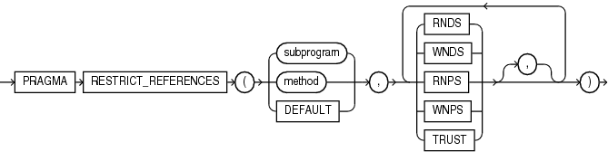

Note:

The `RESTRICT_REFERENCES` pragma is deprecated. Oracle recommends using `DETERMINISTIC` and `PARALLEL_ENABLE` (explained in ["Function Declaration and Definition"](function.md)) instead of `RESTRICT_REFERENCES`.

The `RESTRICT_REFERENCES` pragma asserts that a user-defined subprogram does not read or write database tables or package variables. Subprograms that read or write database tables or package variables are difficult to optimize, because any invocation of the subprogram might produce different results or encounter errors.

Restriction on RESTRICT\_REFERENCES Pragma

This pragma can appear only in a package specification or ADT specification. Typically, this pragma is specified for functions. If a function invokes procedures, specify this pragma for those procedures also.

Topics

- Syntax
- Semantics

Syntax

restrict\_references\_pragma::=



> ```
> PRAGMA RESTRICT_REFERENCES
>  ( { subprogram | method | DEFAULT } ,
>      { RNDS | WNDS | RNPS | WNPS | TRUST }
>        [, { RNDS | WNDS | RNPS | WNPS | TRUST } ]... ) ;
> ```
>
> [Copyright © 1996, 2014, Oracle and/or its affiliates. All rights reserved.](https://docs.oracle.com/cd/E11882_01/dcommon/html/cpyr.htm)
  

Semantics

subprogram

Name of a user-defined subprogram, typically a function. If `subprogram` is overloaded, the pragma applies only to the most recent subprogram declaration.

method

Name of a `MEMBER` subprogram (see ["CREATE TYPE Statement"](create_type.md), specifically ["element\_spec::="](create_type.md)).

DEFAULT

Applies the pragma to all subprograms in the package specification or ADT specification (including the system-defined constructor for ADTs).

If you also declare the pragma for an individual subprogram, it overrides the `DEFAULT` pragma for that subprogram.

RNDS

Asserts that the subprogram reads no database state (does not query database tables).

WNDS

Asserts that the subprogram writes no database state (does not modify tables).

RNPS

Asserts that the subprogram reads no package state (does not reference the values of package variables)

Restriction on RNPS You cannot specify `RNPS` if the subprogram invokes the `SQLCODE` or `SQLERRM` function.

WNPS

Asserts that the subprogram writes no package state (does not change the values of package variables).

Restriction on WNPS You cannot specify `WNPS` if the subprogram invokes the `SQLCODE` or `SQLERRM` function.

TRUST

Asserts that the subprogram can be trusted not to violate one or more rules.

When you specify `TRUST`, PL/SQL does not check the subprogram body for violations of the constraints listed in the pragma. Skipping these checks can improve performance. `TRUST` is needed for functions written in C or Java that are invoked from PL/SQL, since PL/SQL cannot verify them at run time.

Note:

To invoke a subprogram from parallel queries, you must specify all four constraints— `RNDS`, `WNDS`, `RNPS`, and `WNPS`. No constraint implies another.