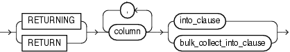
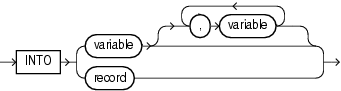

The `RETURNING` `INTO` clause specifies the variables in which to store the values returned by the statement to which the clause belongs. The variables can be either individual variables or collections. If the statement affects no rows, then the values of the variables are undefined.

The static `RETURNING` `INTO` clause belongs to a `DELETE`, `INSERT`, or `UPDATE` statement. The dynamic `RETURNING` `INTO` clause belongs to the `EXECUTE` `IMMEDIATE` statement.

Note:

You cannot use the `RETURNING` `INTO` clause for remote or parallel deletes.

Topics

Syntax

static\_returning\_clause::=



> ```
> { RETURNING | RETURN } column [, column ]...
>   { into_clause | bulk_collect_into_clause }
> ```
>
> [Copyright © 1996, 2014, Oracle and/or its affiliates. All rights reserved.](https://docs.oracle.com/cd/E11882_01/dcommon/html/cpyr.htm)
  
  

dynamic\_returning\_clause::=


> ```
> { RETURNING | RETURN } { into_clause | bulk_collect_into_clause }
> ```
>
> [Copyright © 1996, 2014, Oracle and/or its affiliates. All rights reserved.](https://docs.oracle.com/cd/E11882_01/dcommon/html/cpyr.htm)
  
  

into\_clause::=



> ```
> INTO { variable [, variable ]... | record )
> ```
>
> [Copyright © 1996, 2014, Oracle and/or its affiliates. All rights reserved.](https://docs.oracle.com/cd/E11882_01/dcommon/html/cpyr.htm)
  
  

bulk\_collect\_into\_clause::=


> ```
> BULK COLLECT INTO { collection | :host_array }
>   [, { collection | :host_array } ]...
> ```
>
> [Copyright © 1996, 2014, Oracle and/or its affiliates. All rights reserved.](https://docs.oracle.com/cd/E11882_01/dcommon/html/cpyr.htm)
  

Semantics

static\_returning\_clause

column

Expression whose value is the name of a column of a database table.

into\_clause

Specifies the variables or record in which to store the column values that the statement returns.

Restriction on into\_clause Use `into_clause` in `dynamic_returning_clause` if and only if `dynamic_sql_stmt` (which appears in ["EXECUTE IMMEDIATE Statement"](executeimmediate_statement.md)) returns a single row.

record

The name of a record variable in which to store the row that the statement returns. For each `select_item` in the statement, the record must have a corresponding, type-compatible field.

variable

Either the name of a scalar variable in which to store a column that the statement returns or the name of a host cursor variable that is declared in a PL/SQL host environment and passed to PL/SQL as a bind variable. Each `select_item` in the statement must have a corresponding, type-compatible variable. The data type of a host cursor variable is compatible with the return type of any PL/SQL cursor variable.

Restriction on variable `variable` cannot have the data type `BOOLEAN`.

bulk\_collect\_into\_clause

Specifies one or more existing collections or host arrays in which to store the rows that the statement returns. For each `select_item` in the statement, `bulk_collect_into_clause` must have a corresponding, type-compatible `collection` or `host_array`.

For the reason to use this clause, see ["Bulk SQL and Bulk Binding"](tuning.md).

Restrictions on bulk\_collect\_into\_clause

- Use the `bulk_collect_into_clause` clause in `dynamic_returning_clause` if and only if `dynamic_sql_stmt` (which appears in ["EXECUTE IMMEDIATE Statement"](executeimmediate_statement.md)) can return multiple rows.
- You cannot use `bulk_collect_into_clause` in client programs.
- When the statement that includes `bulk_collect_into_clause` requires implicit data type conversions, `bulk_collect_into_clause` can have only one `collection` or `host_array`.

collection

Name of a collection variable in which to store the rows that the statement returns.

Restrictions on collection

- `collection` cannot be the name of an associative array that is indexed by a string.
- When the statement requires implicit data type conversions, `collection` cannot be the name of a collection of a composite type.

:host\_array

Name of an array declared in a PL/SQL host environment and passed to PL/SQL as a bind variable. Do not put space between the colon (:) and `host_array`.

Examples

- [Example 5-49, "UPDATE Statement Assigns Values to Record Variable"](composites.md)
- [Example 6-1, "Static SQL Statements"](static.md)
- [Example 12-25, "Returning Deleted Rows in Two Nested Tables"](tuning.md)
- [Example 12-26, "DELETE with RETURN BULK COLLECT INTO in FORALL Statement"](tuning.md)

Related Topics

In this chapter:

- ["DELETE Statement Extension"](delete_statement.md)
- ["EXECUTE IMMEDIATE Statement"](executeimmediate_statement.md)
- ["FETCH Statement"](fetch_statement.md)
- ["SELECT INTO Statement"](selectinto_statement.md)
- ["UPDATE Statement Extensions"](update_statement.md)

In other chapters:

- ["SQL Statements that Return Rows in PL/SQL Record Variables"](composites.md)
- ["EXECUTE IMMEDIATE Statement"](dynamic.md)
- ["RETURNING INTO Clause with BULK COLLECT Clause"](tuning.md)