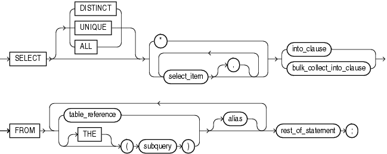
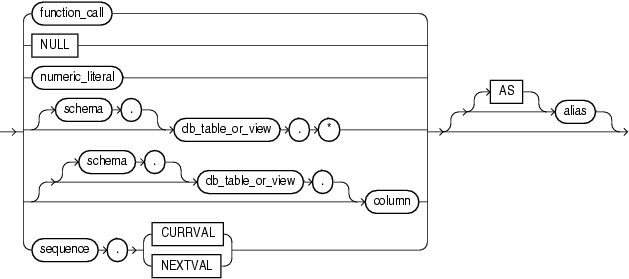
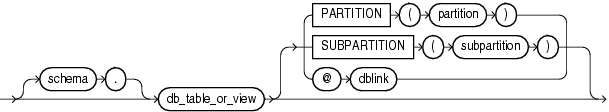

The `SELECT` `INTO` statement retrieves values from one or more database tables (as the SQL `SELECT` statement does) and stores them in variables (which the SQL `SELECT` statement does not do).

Caution:

The `SELECT` `INTO` statement with the `BULK` `COLLECT` clause is vulnerable to aliasing, which can cause unexpected results. For details, see ["SELECT BULK COLLECT INTO Statements and Aliasing"](tuning.md).

See Also:

[Oracle Database SQL Language Reference](https://docs.oracle.com/cd/E11882_01/server.112/e41084/statements_10002.htm#SQLRF01702) for the syntax of the SQL `SELECT` statement

Topics

Syntax

select\_into\_statement::=



> ```
> SELECT [ { DISTINCT | UNIQUE } | ALL ] 
>   { * | select_item [[,] select_item ]... }
>     { into_clause | bulk_collect_into_clause }
>         FROM { table_reference | [ THE ] ( subquery ) } [ alias ]
>           [ { table_reference | [ THE ] ( subquery ) } [ alias ] ]...
>             rest-of-statement ;
> ```
  
  

See:

- ["bulk\_collect\_into\_clause::="](returninginto_clause.md)
- ["into\_clause::="](returninginto_clause.md)
- "table\_reference::="

select\_item::=



> ```
> { function [ ( parameter [ [,] parameter ]... ) ]
> | NULL
> | numeric_literal
> | [ schema . ] db_table_view.*
> | [ [ schema . ] db_table_view. ] column
> | sequence . { CURRVAL | NEXTVAL }
> | subquery
> | 'text'
> } 
> [ [ AS ] alias]
> ```
>
> [Copyright © 1996, 2014, Oracle and/or its affiliates. All rights reserved.](https://docs.oracle.com/cd/E11882_01/dcommon/html/cpyr.htm)
  
  

See ["function\_call::="](expression.md).

table\_reference::=



> ```
> [ schema.] db_table_view
>   { PARTITION ( partition ) | SUBPARTITION ( subpartition ) | @dblink }
> ```
>
> [Copyright © 1996, 2014, Oracle and/or its affiliates. All rights reserved.](https://docs.oracle.com/cd/E11882_01/dcommon/html/cpyr.htm)
  

Semantics

select\_into\_statement

DISTINCT or UNIQUE

Causes the database to return only one copy of each set of duplicate rows selected. Duplicate rows are those with matching values for each `select_item`. These two keywords are synonymous.

Restrictions on DISTINCT and UNIQUE

- The total number of bytes in all `select_item` expressions is limited to the size of a data block minus some overhead. This size is specified by the initialization parameter `DB_BLOCK_SIZE`.
- No `select_item` expression can contain a LOB column.

ALL

(Default) Causes the database to return all rows selected, including all copies of duplicates.

\*

Selects all columns.

into\_clause

With this clause, the `SELECT` `INTO` statement retrieves one or more columns from a single row and stores them in either one or more scalar variables or one record variable. For more information, see ["into\_clause"](returninginto_clause.md).

bulk\_collect\_into\_clause

With this clause, the `SELECT` `INTO` statement retrieves an entire result set and stores it in one or more collection variables. For more information, see ["bulk\_collect\_into\_clause"](returninginto_clause.md).

subquery

SQL `SELECT` statement (not a PL/SQL `SELECT` `INTO` statement).

alias

Another (usually short) name for the referenced column, table, or view.

rest\_of\_statement

Anything that can follow the `FROM` clause in a SQL `SELECT` statement, described in [Oracle Database SQL Language Reference](https://docs.oracle.com/cd/E11882_01/server.112/e41084/statements_10002.htm#SQLRF01702).

select\_item

If the `SELECT` `INTO` statement returns no rows, PL/SQL raises the predefined exception `NO_DATA_FOUND`. To guard against this exception, select the result of the aggregate function `COUNT(*)`, which returns a single value even if no rows match the condition.

numeric\_literal

Literal of a numeric data type.

schema

Name of the schema that contains the table or view. Default: your schema.

db\_table\_or\_view

Name of a database table or view.

column

Name of a column of `db_table_or_view`.

\*

Selects all columns of `db_table_or_view`.

sequence

Name of a sequence.

CURRVAL

Current value in `sequence`.

NEXTVAL

Next value in `sequence`.

alias

Another (usually short) name for the referenced column, table, or view.

table\_reference

Reference to a table or view for which you have the `SELECT` privilege, which is accessible when you run the `SELECT` `INTO` statement.

schema

Name of the schema that contains the table or view. Default: your schema.

table

Name of a database table.

view

Name of a database view.

PARTITION partition or SUBPARTITION subpartition

See [Oracle Database SQL Language Reference](https://docs.oracle.com/cd/E11882_01/server.112/e41084/statements_10002.htm#SQLRF55289).

@dblink

Database link, described in [Oracle Database SQL Language Reference](https://docs.oracle.com/cd/E11882_01/server.112/e41084/statements_10002.htm#SQLRF55290). Do not put space between @ and `dblink`.

Examples

- [Example 2-25, "Assigning Value to Variable with SELECT INTO Statement"](fundamentals.md)
- [Example 5-47, "SELECT INTO Assigns Values to Record Variable"](composites.md)
- [Example 6-36, "ROLLBACK Statement"](static.md)
- [Example 6-37, "SAVEPOINT and ROLLBACK Statements"](static.md)
- [Example 6-44, "Declaring Autonomous Function in Package"](static.md)
- [Example 7-13, "Validation Checks Guarding Against SQL Injection"](dynamic.md)
- [Example 12-16, "Bulk-Selecting Two Database Columns into Two Nested Tables"](tuning.md)
- [Example 12-17, "Bulk-Selecting into Nested Table of Records"](tuning.md)
- [Example 12-21, "Limiting Bulk Selection with ROWNUM and SAMPLE"](tuning.md)

Related Topics

In this chapter:

- ["Assignment Statement"](assignment_statement.md)
- ["FETCH Statement"](fetch_statement.md)
- ["%ROWTYPE Attribute"](rowtype_attribute.md)

In other chapters:

- ["Assigning Values to Variables with the SELECT INTO Statement"](fundamentals.md)
- ["SELECT INTO Statement for Assigning Row to Record Variable"](composites.md)
- ["Query Result Set Processing With SELECT INTO Statements"](static.md)
- ["SELECT INTO Statement with BULK COLLECT Clause"](tuning.md)

See Also:

[Oracle Database SQL Language Reference](https://docs.oracle.com/cd/E11882_01/server.112/e41084/statements_10002.htm#SQLRF01702) for information about the SQL `SELECT` statement