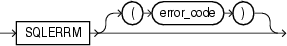

The `SQLERRM` function returns the error message associated with an error code.

Note:

The language of the error message depends on the `NLS_LANGUAGE` parameter. For information about this parameter, see [Oracle Database Globalization Support Guide](https://docs.oracle.com/cd/E11882_01/server.112/e10729/ch3globenv.htm#NLSPG199).

A SQL statement cannot invoke `SQLERRM`.

If a function invokes `SQLERRM`, and you use the `RESTRICT_REFERENCES` pragma to assert the purity of the function, then you cannot specify the constraints `WNPS` and `RNPS`.

Note:

`DBMS_UTILITY`.`FORMAT_ERROR_STACK` is recommended over `SQLERRM`, unless you use the `FORALL` statement with its `SAVE` `EXCEPTIONS` clause. For more information, see ["Error Code and Error Message Retrieval"](errors.md).

Topics

Syntax

sqlerrm\_function::=



> ```
> SQLERRM [ ( error_code ) ]
> ```
>
> [Copyright © 1996, 2014, Oracle and/or its affiliates. All rights reserved.](https://docs.oracle.com/cd/E11882_01/dcommon/html/cpyr.htm)
  

Semantics

error\_code

Expression whose value is an Oracle Database error code. For a list of Oracle Database error codes, see [Oracle Database Error Messages](https://docs.oracle.com/cd/E11882_01/server.112/e17766/toc.htm). Default: error code associated with the current value of `SQLCODE`.

Like `SQLCODE`, `SQLERRM` without `error_code` is useful only in an exception handler. Outside an exception handler, or if the value of `error_code` is zero, `SQLERRM` returns ORA-0000.

If the value of `error_code` is +100, `SQLERRM` returns ORA-01403.

If the value of `error_code` is a positive number other than +100, `SQLERRM` returns this message:

```
-error_code: non-ORACLE exception
```

If the value of `error_code` is a negative number whose absolute value is an Oracle Database error code, `SQLERRM` returns the error message associated with that error code. For example:

```
BEGIN
  DBMS_OUTPUT.PUT_LINE('SQLERRM(-6511): ' || TO_CHAR(SQLERRM(-6511)));
END;
/
```

Result:

```
SQLERRM(-6511): ORA-06511: PL/SQL: cursor already open
```

If the value of `error_code` is a negative number whose absolute value is not an Oracle Database error code, `SQLERRM` returns this message:

```
ORA-error_code: Message error_code not found;  product=RDBMS;
facility=ORA
```

For example:

```
BEGIN
  DBMS_OUTPUT.PUT_LINE('SQLERRM(-50000): ' || TO_CHAR(SQLERRM(-50000)));
END;
/
```

Result:

```
SQLERRM(-50000): ORA-50000: Message 50000 not found;  product=RDBMS;
facility=ORA
```

Related Topics

In this chapter:

- ["Block"](block.md)
- ["EXCEPTION\_INIT Pragma"](exceptioninit_pragma.md)
- ["RESTRICT\_REFERENCES Pragma"](restrictreferences_pragma.md)
- ["SQLCODE Function"](sqlcode_function.md)

In other chapters:

- ["Error Code and Error Message Retrieval"](errors.md)

See Also:

[Oracle Database Error Messages](https://docs.oracle.com/cd/E11882_01/server.112/e17766/toc.htm) for a list of Oracle Database error messages and information about them