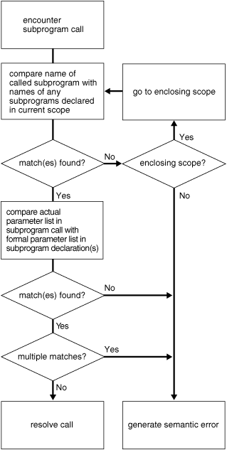

## 8 PL/SQL Subprograms

A PL/SQL subprogram is a named PL/SQL block that can be invoked repeatedly. If the subprogram has parameters, their values can differ for each invocation.

A subprogram is either a procedure or a function. Typically, you use a procedure to perform an action and a function to compute and return a value.

Topics

## Reasons to Use Subprograms

Subprograms support the development and maintenance of reliable, reusable code with the following features:

- Modularity
	Subprograms let you break a program into manageable, well-defined modules.
- Easier Application Design
	When designing an application, you can defer the implementation details of the subprograms until you have tested the main program, and then refine them one step at a time. (To define a subprogram without implementation details, use the `NULL` statement, as in [Example 4-35](controlstatements.md).)
- Maintainability
	You can change the implementation details of a subprogram without changing its invokers.
- Packageability
	Subprograms can be grouped into packages, whose advantages are explained in ["Reasons to Use Packages"](packages.md).
- Reusability
	Any number of applications, in many different environments, can use the same package subprogram or standalone subprogram.
- Better Performance
	Each subprogram is compiled and stored in executable form, which can be invoked repeatedly. Because stored subprograms run in the database server, a single invocation over the network can start a large job. This division of work reduces network traffic and improves response times. Stored subprograms are cached and shared among users, which lowers memory requirements and invocation overhead.

Subprograms are an important component of other maintainability features, such as packages (explained in [Chapter 10, "PL/SQL Packages"](packages.md)) and Abstract Data Types (explained in ["Abstract Data Types"](overview.md)).

## Nested, Package, and Standalone Subprograms

You can create a subprogram either inside a PL/SQL block (which can be another subprogram), inside a package, or at schema level.

A subprogram created inside a PL/SQL block is a nested subprogram. You can either declare and define it at the same time, or you can declare it first and then define it later in the same block (see "Forward Declaration"). A nested subprogram is stored in the database only if it is nested in a standalone or package subprogram.

A subprogram created inside a package is a package subprogram. You declare it in the package specification and define it in the package body. It is stored in the database until you drop the package. (Packages are described in [Chapter 10, "PL/SQL Packages."](packages.md))

A subprogram created at schema level is a standalone subprogram. You create it with the `CREATE` `PROCEDURE` or `CREATE` `FUNCTION` statement. It is stored in the database until you drop it with the `DROP` `PROCEDURE` or `DROP` `FUNCTION` statement. (These statements are described in [Chapter 14, "SQL Statements for Stored PL/SQL Units."](sqlstatements.md))

A stored subprogram is either a package subprogram or a standalone subprogram.

When you create a standalone subprogram or package, you can specify the `AUTHID` property, which affects the name resolution and privilege checking of SQL statements that the subprogram issues at run time. For more information, see "Invoker's Rights and Definer's Rights (AUTHID Property)".

## Subprogram Invocations

A subprogram invocation has this form:

```
subprogram_name [ ( [ parameter [, parameter]... ] ) ]
```

If the subprogram has no parameters, or specifies a default value for every parameter, you can either omit the parameter list or specify an empty parameter list.

A procedure invocation is a PL/SQL statement. For example:

```
raise_salary(employee_id, amount);
```

A function invocation is an expression. For example:

```
new_salary := get_salary(employee_id);
IF salary_ok(new_salary, new_title) THEN ...
```

See Also:

"Subprogram Parameters" for more information about specifying parameters in subprogram invocations

## Subprogram Parts

A subprogram begins with a subprogram heading, which specifies its name and (optionally) its parameter list.

Like an anonymous block, a subprogram has these parts:

- Declarative part (optional)
	This part declares and defines local types, cursors, constants, variables, exceptions, and nested subprograms. These items cease to exist when the subprogram completes execution.
	This part can also specify pragmas (described in ["Pragmas"](fundamentals.md)).
	Note:
	The declarative part of a subprogram does not begin with the keyword `DECLARE`, as the declarative part of an anonymous block does.
- Executable part (required)
	This part contains one or more statements that assign values, control execution, and manipulate data. (Early in the application design process, this part might contain only a `NULL` statement, as in [Example 4-35](controlstatements.md).)
- Exception-handling part (optional)
	This part contains code that handles runtime errors.

In Example 8-1, an anonymous block simultaneously declares and defines a procedure and invokes it three times. The third invocation raises the exception that the exception-handling part of the procedure handles.

Example 8-1 Declaring, Defining, and Invoking a Simple PL/SQL Procedure

```
DECLARE
  first_name employees.first_name%TYPE;
  last_name  employees.last_name%TYPE;
  email      employees.email%TYPE;
  employer   VARCHAR2(8) := 'AcmeCorp';
 
  -- Declare and define procedure
 
  PROCEDURE create_email (  -- Subprogram heading begins
    name1   VARCHAR2,
    name2   VARCHAR2,
    company VARCHAR2
  )                         -- Subprogram heading ends
  IS
                            -- Declarative part begins
    error_message VARCHAR2(30) := 'Email address is too long.';
  BEGIN                     -- Executable part begins
    email := name1 || '.' || name2 || '@' || company;
  EXCEPTION                      -- Exception-handling part begins
    WHEN VALUE_ERROR THEN
      DBMS_OUTPUT.PUT_LINE(error_message);
  END create_email;
 
BEGIN
  first_name := 'John';
  last_name  := 'Doe';
 
  create_email(first_name, last_name, employer);  -- invocation
  DBMS_OUTPUT.PUT_LINE ('With first name first, email is: ' || email);
 
  create_email(last_name, first_name, employer);  -- invocation
  DBMS_OUTPUT.PUT_LINE ('With last name first, email is: ' || email);
 
  first_name := 'Elizabeth';
  last_name  := 'MacDonald';
  create_email(first_name, last_name, employer);  -- invocation
END;
/
```

Result:

```
With first name first, email is: John.Doe@AcmeCorp
With last name first, email is: Doe.John@AcmeCorp
Email address is too long.
```

Topics

- Additional Parts for Functions
- RETURN Statement

See Also:

- ["Procedure Declaration and Definition"](procedure.md) for the syntax of procedure declarations and definitions
- "Subprogram Parameters" for more information about subprogram parameters

### Additional Parts for Functions

A function has the same structure as a procedure, except that:

- A function heading must include a `RETURN` clause, which specifies the data type of the value that the function returns. (A procedure heading cannot have a `RETURN` clause.)
- In the executable part of a function, every execution path must lead to a `RETURN` statement. Otherwise, the PL/SQL compiler issues a compile-time warning. (In a procedure, the `RETURN` statement is optional and not recommended. For details, see "RETURN Statement".)
- Only a function heading can include these options:

| Option | Description |
| --- | --- |
| `DETERMINISTIC` option | Helps the optimizer avoid redundant function invocations. |
| `PARALLEL_ENABLE` option | Enables the function for parallel execution, making it safe for use in slave sessions of parallel DML evaluations. |
| `PIPELINED` option | Makes a table function pipelined, for use as a row source. |
| `RESULT_CACHE` option | Stores function results in the PL/SQL function result cache (appears only in declaration). |
| `RESULT_CACHE` clause | Stores function results in the PL/SQL function result cache (appears only in definition). |

See Also:

- ["Function Declaration and Definition"](function.md) for the syntax of function declarations and definitions, including descriptions of the items in the preceding table
- "PL/SQL Function Result Cache" for more information about the `RESULT_CACHE` option and clause

In Example 8-2, an anonymous block simultaneously declares and defines a function and invokes it.

Example 8-2 Declaring, Defining, and Invoking a Simple PL/SQL Function

```
DECLARE
  -- Declare and define function

  FUNCTION square (original NUMBER)   -- parameter list
    RETURN NUMBER                     -- RETURN clause
  AS
                                      -- Declarative part begins
    original_squared NUMBER;
  BEGIN                               -- Executable part begins
    original_squared := original * original;
    RETURN original_squared;          -- RETURN statement
  END;
BEGIN
  DBMS_OUTPUT.PUT_LINE(square(100));  -- invocation
END;
/
```

Result:

```
10000
```

### RETURN Statement

The `RETURN` statement immediately ends the execution of the subprogram or anonymous block that contains it. A subprogram or anonymous block can contain multiple `RETURN` statements.

Topics

- RETURN Statement in Function
- RETURN Statement in Procedure
- RETURN Statement in Anonymous Block

See Also:

["RETURN Statement"](return_statement.md) for the syntax of the `RETURN` statement

#### RETURN Statement in Function

In a function, every execution path must lead to a `RETURN` statement and every `RETURN` statement must specify an expression. The `RETURN` statement assigns the value of the expression to the function identifier and returns control to the invoker, where execution resumes immediately after the invocation.

Note:

In a pipelined table function, a `RETURN` statement need not specify an expression. For information about the parts of a pipelined table function, see ["Creating Pipelined Table Functions"](tuning.md).

In Example 8-3, the anonymous block invokes the same function twice. The first time, the `RETURN` statement returns control to the inside of the invoking statement. The second time, the `RETURN` statement returns control to the statement immediately after the invoking statement.

Example 8-3 Execution Resumes After RETURN Statement in Function

```
DECLARE
  x INTEGER;
 
  FUNCTION f (n INTEGER)
  RETURN INTEGER
  IS
  BEGIN
    RETURN (n*n);
  END;
 
BEGIN
  DBMS_OUTPUT.PUT_LINE (
    'f returns ' || f(2) || '. Execution returns here (1).'
  );
  
  x := f(2);
  DBMS_OUTPUT.PUT_LINE('Execution returns here (2).');
END;
/
```

Result:

```
f returns 4. Execution returns here (1).Execution returns here (2).
```

In Example 8-4, the function has multiple `RETURN` statements, but if the parameter is not 0 or 1, then no execution path leads to a `RETURN` statement. The function compiles with warning PLW-05005: subprogram F returns without value at line 10.

Example 8-4 Function Where Not Every Execution Path Leads to RETURN Statement

```
CREATE OR REPLACE FUNCTION f (n INTEGER)
  RETURN INTEGER
IS
BEGIN
  IF n = 0 THEN
    RETURN 1;
  ELSIF n = 1 THEN
    RETURN n;
  END IF;
END;
/
```

Example 8-5 is like Example 8-4, except for the addition of the `ELSE` clause. Every execution path leads to a `RETURN` statement, and the function compiles without warning PLW-05005.

Example 8-5 Function Where Every Execution Path Leads to RETURN Statement

```
CREATE OR REPLACE FUNCTION f (n INTEGER)
  RETURN INTEGER
IS
BEGIN
  IF n = 0 THEN
    RETURN 1;
  ELSIF n = 1 THEN
    RETURN n;
  ELSE
    RETURN n*n;
  END IF;
END;
/
BEGIN
  FOR i IN 0 .. 3 LOOP
    DBMS_OUTPUT.PUT_LINE('f(' || i || ') = ' || f(i));
  END LOOP;
END;
/
```

Result:

```
f(0) = 1
f(1) = 1
f(2) = 4
f(3) = 9
```

#### RETURN Statement in Procedure

In a procedure, the `RETURN` statement returns control to the invoker, where execution resumes immediately after the invocation. The `RETURN` statement cannot specify an expression.

In Example 8-6, the `RETURN` statement returns control to the statement immediately after the invoking statement.

Example 8-6 Execution Resumes After RETURN Statement in Procedure

```
DECLARE
  PROCEDURE p IS
  BEGIN
    DBMS_OUTPUT.PUT_LINE('Inside p');
    RETURN;
    DBMS_OUTPUT.PUT_LINE('Unreachable statement.');
  END;
BEGIN
  p;
  DBMS_OUTPUT.PUT_LINE('Control returns here.');
END;
/
```

Result:

```
Inside p
Control returns here.
```

#### RETURN Statement in Anonymous Block

In an anonymous block, the `RETURN` statement exits its own block and all enclosing blocks. The `RETURN` statement cannot specify an expression.

In Example 8-7, the `RETURN` statement exits both the inner and outer block.

Example 8-7 Execution Resumes After RETURN Statement in Anonymous Block

```
BEGIN
  BEGIN
    DBMS_OUTPUT.PUT_LINE('Inside inner block.');
    RETURN;
    DBMS_OUTPUT.PUT_LINE('Unreachable statement.');
  END;
  DBMS_OUTPUT.PUT_LINE('Inside outer block. Unreachable statement.');
END;
/
```

Result:

```
Inside inner block.
```

## Forward Declaration

If nested subprograms in the same PL/SQL block invoke each other, then one requires a forward declaration, because a subprogram must be declared before it can be invoked.

A forward declaration declares a nested subprogram but does not define it. You must define it later in the same block. The forward declaration and the definition must have the same subprogram heading.

In Example 8-8, an anonymous block creates two procedures that invoke each other.

Example 8-8 Nested Subprograms Invoke Each Other

```
DECLARE
  -- Declare proc1 (forward declaration):
  PROCEDURE proc1(number1 NUMBER);

  -- Declare and define proc2:
  PROCEDURE proc2(number2 NUMBER) IS
  BEGIN
    proc1(number2);
  END;

  -- Define proc 1:
  PROCEDURE proc1(number1 NUMBER) IS
  BEGIN
    proc2 (number1);
  END;

BEGIN
  NULL;
END;
/
```

## Subprogram Parameters

If a subprogram has parameters, their values can differ for each invocation.

Topics

- Formal and Actual Subprogram Parameters
- Subprogram Parameter Passing Methods
- Subprogram Parameter Modes
- Subprogram Parameter Aliasing
- Default Values for IN Subprogram Parameters
- Positional, Named, and Mixed Notation for Actual Parameters

### Formal and Actual Subprogram Parameters

If you want a subprogram to have parameters, declare formal parameters in the subprogram heading. In each formal parameter declaration, specify the name and data type of the parameter, and (optionally) its mode and default value. In the execution part of the subprogram, reference the formal parameters by their names.

When invoking the subprogram, specify the actual parameters whose values are to be assigned to the formal parameters. Corresponding actual and formal parameters must have compatible data types.

Note:

You can declare a formal parameter of a constrained subtype, like this:
```
DECLARE
  SUBTYPE n1 IS NUMBER(1);
  SUBTYPE v1 IS VARCHAR2(1);
 
  PROCEDURE p (n n1, v v1) IS ...
```

But you cannot include a constraint in a formal parameter declaration, like this:

```
DECLARE
  PROCEDURE p (n NUMBER(1), v VARCHAR2(1)) IS ...
```

Tip:

To avoid confusion, use different names for formal and actual parameters.

Note:

Formal parameters can be evaluated in any order. If a program determines order of evaluation, then at the point where the program does so, its behavior is undefined.

In Example 8-9, the procedure has formal parameters `emp_id` and `amount`. In the first procedure invocation, the corresponding actual parameters are `emp_num` and `bonus`, whose value are 120 and 100, respectively. In the second procedure invocation, the actual parameters are `emp_num` and `merit` + `bonus`, whose value are 120 and 150, respectively.

Example 8-9 Formal Parameters and Actual Parameters

```
DECLARE
  emp_num NUMBER(6) := 120;
  bonus   NUMBER(6) := 100;
  merit   NUMBER(4) := 50;

  PROCEDURE raise_salary (
    emp_id NUMBER,  -- formal parameter
    amount NUMBER   -- formal parameter
  ) IS
  BEGIN
    UPDATE employees
    SET salary = salary + amount  -- reference to formal parameter
    WHERE employee_id = emp_id;   -- reference to formal parameter
  END raise_salary;

BEGIN
  raise_salary(emp_num, bonus);          -- actual parameters

  /* raise_salary runs this statement:
       UPDATE employees
       SET salary = salary + 100
       WHERE employee_id = 120;       */

  raise_salary(emp_num, merit + bonus);  -- actual parameters

  /* raise_salary runs this statement:
       UPDATE employees
       SET salary = salary + 150
       WHERE employee_id = 120;       */
END;
/
```

Formal Parameters of Constrained Subtypes

If the data type of a formal parameter is a constrained subtype, then:

- If the subtype has the `NOT` `NULL` constraint, then the actual parameter inherits it.
- If the subtype has the base type `VARCHAR2`, then the actual parameter does not inherit the size of the subtype.
- If the subtype has a numeric base type, then the actual parameter inherits the range of the subtype, but not the precision or scale.

Note:

In a function, the clause `RETURN` `datatype` declares a hidden formal parameter and the statement `RETURN` `value` specifies the corresponding actual parameter. Therefore, if `datatype` is a constrained data type, then the preceding rules apply to `value` (see Example 8-11).

Example 8-10 shows that an actual subprogram parameter inherits the `NOT` `NULL` constraint but not the size of a `VARCHAR2` subtype.

Example 8-10 Actual Parameter Inherits Only NOT NULL from Subtype

```
DECLARE
  SUBTYPE License IS VARCHAR2(7) NOT NULL;
  n  License := 'DLLLDDD';
 
  PROCEDURE p (x License) IS
  BEGIN
    DBMS_OUTPUT.PUT_LINE(x);
  END;
 
BEGIN
  p('1ABC123456789');  -- Succeeds; size is not inherited
  p(NULL);             -- Raises error; NOT NULL is inherited
END;
/
```

Result:

```
p(NULL);             -- Raises error; NOT NULL is inherited
    *
ERROR at line 12:
ORA-06550: line 12, column 5:
PLS-00567: cannot pass NULL to a NOT NULL constrained formal parameter
ORA-06550: line 12, column 3:
PL/SQL: Statement ignored
```

As [Appendix E, "PL/SQL Predefined Data Types"](predefined.md) shows, PL/SQL has many predefined data types that are constrained subtypes of other data types. For example, `INTEGER` is a constrained subtype of `NUMBER`:

```
SUBTYPE INTEGER IS NUMBER(38,0);
```

In Example 8-11, the function has both an `INTEGER` formal parameter and an `INTEGER` return type. The anonymous block invokes the function with an actual parameter that is not an integer. Because the actual parameter inherits the range but not the precision and scale of `INTEGER`, and the actual parameter is in the `INTEGER` range, the invocation succeeds. For the same reason, the `RETURN` statement succeeds in returning the noninteger value.

Example 8-11 Actual Parameter and Return Value Inherit Only Range From Subtype

```
DECLARE
  FUNCTION test (p INTEGER) RETURN INTEGER IS
  BEGIN
    DBMS_OUTPUT.PUT_LINE('p = ' || p);
    RETURN p;
  END test;
 
BEGIN
  DBMS_OUTPUT.PUT_LINE('test(p) = ' || test(0.66));
END;
/
```

Result:

```
p = .66
test(p) = .66
 
PL/SQL procedure successfully completed.
```

In Example 8-12, the function implicitly converts its formal parameter to the constrained subtype `INTEGER` before returning it.

Example 8-12 Function Implicitly Converts Formal Parameter to Constrained Subtype

```
DECLARE
  FUNCTION test (p NUMBER) RETURN NUMBER IS
    q INTEGER := p;  -- Implicitly converts p to INTEGER
  BEGIN
    DBMS_OUTPUT.PUT_LINE('p = ' || q);  -- Display q, not p
    RETURN q;                           -- Return q, not p
  END test;
 
BEGIN
  DBMS_OUTPUT.PUT_LINE('test(p) = ' || test(0.66));
END;
/
```

Result:

```
p = 1
test(p) = 1
 
PL/SQL procedure successfully completed.
```

See Also:

- ["Formal Parameter Declaration"](parameter_declaration.md) for the syntax and semantics of a formal parameter declaration
- ["function\_call::="](expression.md) and ["function\_call"](expression.md) for the syntax and semantics of a function invocation
- ["procedure\_call::="](block.md) and ["procedure\_call"](block.md) for the syntax and semantics of a procedure invocation
- ["Constrained Subtypes"](datatypes.md) for general information about constrained subtypes

### Subprogram Parameter Passing Methods

The PL/SQL compiler has two ways of passing an actual parameter to a subprogram:

- By reference
	The compiler passes the subprogram a pointer to the actual parameter. The actual and formal parameters refer to the same memory location.
- By value
	The compiler assigns the value of the actual parameter to the corresponding formal parameter. The actual and formal parameters refer to different memory locations.
	If necessary, the compiler implicitly converts the data type of the actual parameter to the data type of the formal parameter. For information about implicit data conversion, see [Oracle Database SQL Language Reference](https://docs.oracle.com/cd/E11882_01/server.112/e41084/sql_elements002.htm#SQLRF51047).
	Tip:
	Avoid implicit data conversion (for the reasons in [Oracle Database SQL Language Reference](https://docs.oracle.com/cd/E11882_01/server.112/e41084/sql_elements002.htm#SQLRF51046)), in either of these ways:
	- Declare the variables that you intend to use as actual parameters with the same data types as their corresponding formal parameters (as in the declaration of variable `x` in Example 8-13).
	- Explicitly convert actual parameters to the data types of their corresponding formal parameters, using the SQL conversion functions described in [Oracle Database SQL Language Reference](https://docs.oracle.com/cd/E11882_01/server.112/e41084/sql_elements002.htm#SQLRF51054) (as in the third invocation of the procedure in Example 8-13).

In Example 8-13, the procedure `p` has one parameter, `n`, which is passed by value. The anonymous block invokes `p` three times, avoiding implicit conversion twice.

Example 8-13 Avoiding Implicit Conversion of Actual Parameters

```
CREATE OR REPLACE PROCEDURE p (
  n NUMBER
) IS
BEGIN
  NULL;
END;
/
DECLARE
  x NUMBER      :=  1;
  y VARCHAR2(1) := '1';
BEGIN
  p(x);             -- No conversion needed
  p(y);             -- z implicitly converted from VARCHAR2 to NUMBER
  p(TO_NUMBER(y));  -- z explicitly converted from VARCHAR2 to NUMBER
END;
/
```

The method by which the compiler passes a specific actual parameter depends on its mode, as explained in "Subprogram Parameter Modes".

### Subprogram Parameter Modes

The mode of a formal parameter determines its behavior.

Table 8-1 summarizes and compares the characteristics of the subprogram parameter modes.

Table 8-1 PL/SQL Subprogram Parameter Modes

| IN | OUT | IN OUT |
| --- | --- | --- |
| Default mode | Must be specified. | Must be specified. |
| Passes a value to the subprogram. | Returns a value to the invoker. | Passes an initial value to the subprogram and returns an updated value to the invoker. |
| Formal parameter acts like a constant: When the subprogram begins, its value is that of either its actual parameter or default value, and the subprogram cannot change this value. | Formal parameter is initialized to the default value of its type. The default value of the type is `NULL` except for a record type with a non- `NULL` default value (see Example 8-16).  When the subprogram begins, the formal parameter has its initial value regardless of the value of its actual parameter. Oracle recommends that the subprogram assign a value to the formal parameter. | Formal parameter acts like an initialized variable: When the subprogram begins, its value is that of its actual parameter. Oracle recommends that the subprogram update its value. |
| Actual parameter can be a constant, initialized variable, literal, or expression. | If the default value of the formal parameter type is `NULL`, then the actual parameter must be a variable whose data type is not defined as `NOT` `NULL`. | Actual parameter must be a variable (typically, it is a string buffer or numeric accumulator). |
| Actual parameter is passed by reference. | By default, actual parameter is passed by value; if you specify `NOCOPY`, it might be passed by reference. | By default, actual parameter is passed by value (in both directions); if you specify `NOCOPY`, it might be passed by reference. |

Tip:

Do not use `OUT` and `IN` `OUT` for function parameters. Ideally, a function takes zero or more parameters and returns a single value. A function with `IN` `OUT` parameters returns multiple values and has side effects.

Note:

The specifications of many packages and types that Oracle Database supplies declare formal parameters with this notation:
```
i1 IN VARCHAR2 CHARACTER SET ANY_CS
i2 IN VARCHAR2 CHARACTER SET i1%CHARSET
```

Do not use this notation when declaring your own formal or actual parameters. It is reserved for Oracle implementation of the supplied packages types.

Regardless of how an `OUT` or `IN` `OUT` parameter is passed:

- If the subprogram exits successfully, then the value of the actual parameter is the final value assigned to the formal parameter. (The formal parameter is assigned at least one value—the initial value.)
- If the subprogram ends with an exception, then the value of the actual parameter is undefined.
- Formal `OUT` and `IN` `OUT` parameters can be returned in any order. In this example, the final values of `x` and `y` are undefined:
	```
	CREATE OR REPLACE PROCEDURE p (x OUT INTEGER, y OUT INTEGER) AS
	BEGIN
	  x := 17; y := 93;
	END;
	/
	```

When an `OUT` or `IN` `OUT` parameter is passed by reference, the actual and formal parameters refer to the same memory location. Therefore, if the subprogram changes the value of the formal parameter, the change shows immediately in the actual parameter (see "Subprogram Parameter Aliasing with Parameters Passed by Reference").

In Example 8-14, the procedure `p` has two `IN` parameters, one `OUT` parameter, and one `IN` `OUT` parameter. The `OUT` and `IN` `OUT` parameters are passed by value (the default). The anonymous block invokes `p` twice, with different actual parameters. Before each invocation, the anonymous block prints the values of the actual parameters. The procedure `p` prints the initial values of its formal parameters. After each invocation, the anonymous block prints the values of the actual parameters again. (Both the anonymous block and `p` invoke the procedure `print`, which is created first.)

Example 8-14 Parameter Values Before, During, and After Procedure Invocation

```
CREATE OR REPLACE PROCEDURE print (x PLS_INTEGER) IS
BEGIN
  IF x IS NOT NULL THEN
    DBMS_OUTPUT.PUT_LINE(x);
  ELSE
    DBMS_OUTPUT.PUT_LINE('NULL');
  END IF;
END print;
/
CREATE OR REPLACE PROCEDURE p (
  a        PLS_INTEGER,  -- IN by default
  b     IN PLS_INTEGER,
  c    OUT PLS_INTEGER,
  d IN OUT BINARY_FLOAT
) IS
BEGIN
  -- Print values of parameters:
 
  DBMS_OUTPUT.PUT_LINE('Inside procedure p:');
  DBMS_OUTPUT.PUT('IN a = '); print(a);
  DBMS_OUTPUT.PUT('IN b = '); print(b);
  DBMS_OUTPUT.PUT('OUT c = '); print(c);
  DBMS_OUTPUT.PUT_LINE('IN OUT d = ' || TO_CHAR(d));
 
  -- Can reference IN parameters a and b,
  -- but cannot assign values to them.
 
  c := a+10;  -- Assign value to OUT parameter
  d := 10/b;  -- Assign value to IN OUT parameter
END;
/
DECLARE
  aa  CONSTANT PLS_INTEGER := 1;
  bb  PLS_INTEGER  := 2;
  cc  PLS_INTEGER  := 3;
  dd  BINARY_FLOAT := 4;
  ee  PLS_INTEGER;
  ff  BINARY_FLOAT := 5;
BEGIN
  DBMS_OUTPUT.PUT_LINE('Before invoking procedure p:');
  DBMS_OUTPUT.PUT('aa = '); print(aa);
  DBMS_OUTPUT.PUT('bb = '); print(bb);
  DBMS_OUTPUT.PUT('cc = '); print(cc);
  DBMS_OUTPUT.PUT_LINE('dd = ' || TO_CHAR(dd));
 
  p (aa, -- constant
     bb, -- initialized variable
     cc, -- initialized variable 
     dd  -- initialized variable
  );
 
  DBMS_OUTPUT.PUT_LINE('After invoking procedure p:');
  DBMS_OUTPUT.PUT('aa = '); print(aa);
  DBMS_OUTPUT.PUT('bb = '); print(bb);
  DBMS_OUTPUT.PUT('cc = '); print(cc);
  DBMS_OUTPUT.PUT_LINE('dd = ' || TO_CHAR(dd));
 
  DBMS_OUTPUT.PUT_LINE('Before invoking procedure p:');
  DBMS_OUTPUT.PUT('ee = '); print(ee);
  DBMS_OUTPUT.PUT_LINE('ff = ' || TO_CHAR(ff));
 
  p (1,        -- literal 
     (bb+3)*4, -- expression 
     ee,       -- uninitialized variable 
     ff        -- initialized variable
   );
 
  DBMS_OUTPUT.PUT_LINE('After invoking procedure p:');
  DBMS_OUTPUT.PUT('ee = '); print(ee);
  DBMS_OUTPUT.PUT_LINE('ff = ' || TO_CHAR(ff));
END;
/
```

Result:

```
Before invoking procedure p:
aa = 1
bb = 2
cc = 3
dd = 4.0E+000
Inside procedure p:
IN a = 1
IN b = 2
OUT c = NULL
IN OUT d = 4.0E+000
After invoking procedure p:
aa = 1
bb = 2
cc = 11
dd = 5.0E+000
Before invoking procedure p:
ee = NULL
ff = 5.0E+000
Inside procedure p:
IN a = 1
IN b = 20
OUT c = NULL
IN OUT d = 5.0E+000
After invoking procedure p:
ee = 11
ff = 5.0E-001
 
PL/SQL procedure successfully completed.
```

In Example 8-15, the anonymous block invokes procedure `p` (from Example 8-14) with an actual parameter that causes `p` to raise the predefined exception `ZERO_DIVIDE`, which `p` does not handle. The exception propagates to the anonymous block, which handles `ZERO_DIVIDE` and shows that the actual parameters for the `IN` and `IN` `OUT` parameters of `p` have retained the values that they had before the invocation. (Exception propagation is explained in ["Exception Propagation"](errors.md).)

Example 8-15 OUT and IN OUT Parameter Values After Unhandled Exception

```
DECLARE
  j  PLS_INTEGER  := 10;
  k  BINARY_FLOAT := 15;
BEGIN
  DBMS_OUTPUT.PUT_LINE('Before invoking procedure p:');
  DBMS_OUTPUT.PUT('j = '); print(j);
  DBMS_OUTPUT.PUT_LINE('k = ' || TO_CHAR(k));
 
  p(4, 0, j, k);  -- causes p to exit with exception ZERO_DIVIDE
 
EXCEPTION
  WHEN ZERO_DIVIDE THEN
    DBMS_OUTPUT.PUT_LINE('After invoking procedure p:');
    DBMS_OUTPUT.PUT('j = '); print(j);
    DBMS_OUTPUT.PUT_LINE('k = ' || TO_CHAR(k));
END;
/
```

Result:

```
Before invoking procedure p:
j = 10
k = 1.5E+001
Inside procedure p:
IN a = 4
IN b = 0
OUT c = NULL
d = 1.5E+001
After invoking procedure p:
j = 10
k = 1.5E+001
 
PL/SQL procedure successfully completed.
```

In Example 8-16, the procedure `p` has three `OUT` formal parameters: `x`, of a record type with a non- `NULL` default value; `y`, of a record type with no non- `NULL` default value; and `z`, which is not a record.

The corresponding actual parameters for `x`, `y`, and `z` are `r1`, `r2`, and `s`, respectively. `s` is declared with an initial value. However, when `p` is invoked, the value of `s` is initialized to `NULL`. The values of `r1` and `r2` are initialized to the default values of their record types, `'abcde'` and `NULL`, respectively.

Example 8-16 OUT Formal Parameter of Record Type with Non-NULL Default Value

```
CREATE OR REPLACE PACKAGE r_types AUTHID DEFINER IS
  TYPE r_type_1 IS RECORD (f VARCHAR2(5) := 'abcde');
  TYPE r_type_2 IS RECORD (f VARCHAR2(5));
END;
/
 
CREATE OR REPLACE PROCEDURE p (
  x OUT r_types.r_type_1,
  y OUT r_types.r_type_2,
  z OUT VARCHAR2) 
AUTHID DEFINER IS
BEGIN
  DBMS_OUTPUT.PUT_LINE('x.f is ' || NVL(x.f,'NULL'));
  DBMS_OUTPUT.PUT_LINE('y.f is ' || NVL(y.f,'NULL'));
  DBMS_OUTPUT.PUT_LINE('z is ' || NVL(z,'NULL'));
END;
/
DECLARE
  r1 r_types.r_type_1;
  r2 r_types.r_type_2;
  s  VARCHAR2(5) := 'fghij';
BEGIN
  p (r1, r2, s);
END;
/
```

Result:

```
x.f is abcde
y.f is NULL
z is NULL
 
PL/SQL procedure successfully completed.
```

### Subprogram Parameter Aliasing

Aliasing is having two different names for the same memory location. If a stored item is visible by more than one path, and you can change the item by one path, then you can see the change by all paths.

Subprogram parameter aliasing always occurs when the compiler passes an actual parameter by reference, and can also occur when a subprogram has cursor variable parameters.

Topics

- Subprogram Parameter Aliasing with Parameters Passed by Reference
- Subprogram Parameter Aliasing with Cursor Variable Parameters

#### Subprogram Parameter Aliasing with Parameters Passed by Reference

When the compiler passes an actual parameter by reference, the actual and formal parameters refer to the same memory location. Therefore, if the subprogram changes the value of the formal parameter, the change shows immediately in the actual parameter.

The compiler always passes `IN` parameters by reference, but the resulting aliasing cannot cause problems, because subprograms cannot assign values to `IN` parameters.

The compiler might pass an `OUT` or `IN` `OUT` parameter by reference, if you specify `NOCOPY` for that parameter. `NOCOPY` is only a hint—each time the subprogram is invoked, the compiler decides, silently, whether to obey or ignore `NOCOPY`. Therefore, aliasing can occur for one invocation but not another, making subprogram results indeterminate. For example:

- If the actual parameter is a global variable, then an assignment to the formal parameter might show in the global parameter (see Example 8-17).
- If the same variable is the actual parameter for two formal parameters, then an assignment to either formal parameter might show immediately in both formal parameters (see Example 8-18).
- If the actual parameter is a package variable, then an assignment to either the formal parameter or the package variable might show immediately in both the formal parameter and the package variable.
- If the subprogram is exited with an unhandled exception, then an assignment to the formal parameter might show in the actual parameter.

See Also:

["NOCOPY"](parameter_declaration.md) for the cases in which the compiler always ignores `NOCOPY`

In Example 8-17, the procedure has an `IN` `OUT` `NOCOPY` formal parameter, to which it assigns the value `'aardvark'`. The anonymous block assigns the value `'aardwolf'` to a global variable and then passes the global variable to the procedure. If the compiler obeys the `NOCOPY` hint, then the final value of the global variable is `'aardvark'`. If the compiler ignores the `NOCOPY` hint, then the final value of the global variable is `'aardwolf'`.

Example 8-17 Aliasing from Global Variable as Actual Parameter

```
DECLARE
  TYPE Definition IS RECORD (
    word     VARCHAR2(20),
    meaning  VARCHAR2(200)
  );

  TYPE Dictionary IS VARRAY(2000) OF Definition;

  lexicon  Dictionary := Dictionary();  -- global variable

  PROCEDURE add_entry (
    word_list IN OUT NOCOPY Dictionary  -- formal NOCOPY parameter
  ) IS
  BEGIN
    word_list(1).word := 'aardvark';
  END;

BEGIN
  lexicon.EXTEND;
  lexicon(1).word := 'aardwolf';
  add_entry(lexicon);  -- global variable is actual parameter
  DBMS_OUTPUT.PUT_LINE(lexicon(1).word);
END;
/
```

Result:

```
aardvark
```

In Example 8-18, the procedure has an `IN` parameter, an `IN` `OUT` parameter, and an `IN` `OUT` `NOCOPY` parameter. The anonymous block invokes the procedure, using the same actual parameter, a global variable, for all three formal parameters. The procedure changes the value of the `IN` `OUT` parameter before it changes the value of the `IN` `OUT` `NOCOPY` parameter. However, if the compiler obeys the `NOCOPY` hint, then the latter change shows in the actual parameter immediately. The former change shows in the actual parameter after the procedure is exited successfully and control returns to the anonymous block.

Example 8-18 Aliasing from Same Actual Parameter for Multiple Formal Parameters

```
DECLARE
  n NUMBER := 10;

  PROCEDURE p (
    n1 IN NUMBER,
    n2 IN OUT NUMBER,
    n3 IN OUT NOCOPY NUMBER
  ) IS
  BEGIN
    n2 := 20;  -- actual parameter is 20 only after procedure succeeds
    DBMS_OUTPUT.put_line(n1);  -- actual parameter value is still 10
    n3 := 30;  -- might change actual parameter immediately
    DBMS_OUTPUT.put_line(n1);  -- actual parameter value is either 10 or 30
  END;

BEGIN
  p(n, n, n);
  DBMS_OUTPUT.put_line(n);
END;
/
```

Result if the compiler obeys the `NOCOPY` hint:

```
10
30
20
```

Result if the compiler ignores the `NOCOPY` hint:

```
10
10
30
```

#### Subprogram Parameter Aliasing with Cursor Variable Parameters

Cursor variable parameters are pointers. Therefore, if a subprogram assigns one cursor variable parameter to another, they refer to the same memory location. This aliasing can have unintended results.

In Example 8-19, the procedure has two cursor variable parameters, `emp_cv1` and `emp_cv2`. The procedure opens `emp_cv1` and assigns its value (which is a pointer) to `emp_cv2`. Now `emp_cv1` and `emp_cv2` refer to the same memory location. When the procedure closes `emp_cv1`, it also closes `emp_cv2`. Therefore, when the procedure tries to fetch from `emp_cv2`, PL/SQL raises an exception.

Example 8-19 Aliasing from Cursor Variable Subprogram Parameters

```
DECLARE
  TYPE EmpCurTyp IS REF CURSOR;
  c1 EmpCurTyp;
  c2 EmpCurTyp;

  PROCEDURE get_emp_data (
    emp_cv1 IN OUT EmpCurTyp,
    emp_cv2 IN OUT EmpCurTyp
  )
  IS
    emp_rec employees%ROWTYPE;
  BEGIN
    OPEN emp_cv1 FOR SELECT * FROM employees;
    emp_cv2 := emp_cv1;  -- now both variables refer to same location
    FETCH emp_cv1 INTO emp_rec;  -- fetches first row of employees
    FETCH emp_cv1 INTO emp_rec;  -- fetches second row of employees
    FETCH emp_cv2 INTO emp_rec;  -- fetches third row of employees
    CLOSE emp_cv1;  -- closes both variables
    FETCH emp_cv2 INTO emp_rec; -- causes error when get_emp_data is invoked
  END;
BEGIN
  get_emp_data(c1, c2);
END;
/
```

Result:

```
DECLARE
*
ERROR at line 1:
ORA-01001: invalid cursor
ORA-06512: at line 19
ORA-06512: at line 22
```

### Default Values for IN Subprogram Parameters

When you declare a formal `IN` parameter, you can specify a default value for it. A formal parameter with a default value is called an optional parameter, because its corresponding actual parameter is optional in a subprogram invocation. If the actual parameter is omitted, then the invocation assigns the default value to the formal parameter. A formal parameter with no default value is called a required parameter, because its corresponding actual parameter is required in a subprogram invocation.

Omitting an actual parameter does not make the value of the corresponding formal parameter `NULL`. To make the value of a formal parameter `NULL`, specify `NULL` as either the default value or the actual parameter.

In Example 8-20, the procedure has one required parameter and two optional parameters.

Example 8-20 Procedure with Default Parameter Values

```
DECLARE
  PROCEDURE raise_salary (
    emp_id IN employees.employee_id%TYPE,
    amount IN employees.salary%TYPE := 100,
    extra  IN employees.salary%TYPE := 50
  ) IS
  BEGIN
    UPDATE employees
    SET salary = salary + amount + extra
    WHERE employee_id = emp_id;
  END raise_salary;
 
BEGIN
  raise_salary(120);       -- same as raise_salary(120, 100, 50)
  raise_salary(121, 200);  -- same as raise_salary(121, 200, 50)
END;
/
```

In Example 8-20, the procedure invocations specify the actual parameters in the same order as their corresponding formal parameters are declared—that is, the invocations use positional notation. Positional notation does not let you omit the second parameter of `raise_salary` but specify the third; to do that, you must use either named or mixed notation. For more information, see "Positional, Named, and Mixed Notation for Actual Parameters".

The default value of a formal parameter can be any expression whose value can be assigned to the parameter; that is, the value and parameter must have compatible data types. If a subprogram invocation specifies an actual parameter for the formal parameter, then that invocation does not evaluate the default value.

In Example 8-21, the procedure `p` has a parameter whose default value is an invocation of the function `f`. The function `f` increments the value of a global variable. When `p` is invoked without an actual parameter, `p` invokes `f`, and `f` increments the global variable. When `p` is invoked with an actual parameter, `p` does not invoke `f`, and value of the global variable does not change.

Example 8-21 Function Provides Default Parameter Value

```
DECLARE
  global PLS_INTEGER := 0;
 
  FUNCTION f RETURN PLS_INTEGER IS
  BEGIN
    DBMS_OUTPUT.PUT_LINE('Inside f.');
    global := global + 1;
    RETURN global * 2;
  END f;
 
  PROCEDURE p (
    x IN PLS_INTEGER := f()
  ) IS
  BEGIN  
    DBMS_OUTPUT.PUT_LINE (
      'Inside p. ' || 
      '  global = ' || global ||
      ', x = ' || x || '.'
    );
    DBMS_OUTPUT.PUT_LINE('--------------------------------');
  END p;
 
  PROCEDURE pre_p IS
  BEGIN
    DBMS_OUTPUT.PUT_LINE (
     'Before invoking p,  global = ' || global || '.'
    );
    DBMS_OUTPUT.PUT_LINE('Invoking p.');
  END pre_p;
 
BEGIN
  pre_p;
  p();     -- default expression is evaluated
 
  pre_p;
  p(100);  -- default expression is not evaluated
 
  pre_p;
  p();     -- default expression is evaluated
END;
/
```

Result:

```
Before invoking p,  global = 0.
Invoking p.
Inside f.
Inside p.   global = 1, x = 2.
--------------------------------
Before invoking p,  global = 1.
Invoking p.
Inside p.   global = 1, x = 100.
--------------------------------
Before invoking p,  global = 1.
Invoking p.
Inside f.
Inside p.   global = 2, x = 4.
--------------------------------
```

Example 8-22 creates a procedure with two required parameters, invokes it, and then adds a third, optional parameter. Because the third parameter is optional, the original invocation remains valid.

Example 8-22 Adding Subprogram Parameter Without Changing Existing Invocations

Create procedure:

```
CREATE OR REPLACE PROCEDURE print_name (
  first VARCHAR2,
  last VARCHAR2
) IS
BEGIN
  DBMS_OUTPUT.PUT_LINE(first || ' ' || last);
END print_name;
/
```

Invoke procedure:

```
BEGIN
  print_name('John', 'Doe');
END;
/
```

Result:

```
John Doe
```

Add third parameter with default value:

```
CREATE OR REPLACE PROCEDURE print_name (
  first VARCHAR2,
  last VARCHAR2,
  mi   VARCHAR2 := NULL
) IS
BEGIN
  IF mi IS NULL THEN
    DBMS_OUTPUT.PUT_LINE(first || ' ' || last);
  ELSE
    DBMS_OUTPUT.PUT_LINE(first || ' ' || mi || '. ' || last);
  END IF;
END print_name;
/
```

Invoke procedure:

```
BEGIN
  print_name('John', 'Doe');          -- original invocation
  print_name('John', 'Public', 'Q');  -- new invocation
END;
/
```

Result:

```
John Doe
John Q. Public
```

### Positional, Named, and Mixed Notation for Actual Parameters

When invoking a subprogram, you can specify the actual parameters using either positional, named, or mixed notation. Table 8-2 summarizes and compares these notations.

Table 8-2 PL/SQL Actual Parameter Notations

| Positional | Named | Mixed |
| --- | --- | --- |
| Specify the actual parameters in the same order as the formal parameters are declared. | Specify the actual parameters in any order, using this syntax:  ``` formal => actual ```  `formal` is the name of the formal parameter and `actual` is the actual parameter. | Start with positional notation, then use named notation for the remaining parameters. |
| You can omit trailing optional parameters. | You can omit any optional parameters. | In the positional notation, you can omit trailing optional parameters; in the named notation, you can omit any optional parameters. |
| Specifying actual parameters in the wrong order can cause problems that are hard to detect, especially if the actual parameters are literals. | There is no wrong order for specifying actual parameters. | In the positional notation, the wrong order can cause problems that are hard to detect, especially if the actual parameters are literals. |
| Subprogram invocations must change if the formal parameter list changes, unless the list only acquires new trailing optional parameters (as in Example 8-22). | Subprogram invocations must change only if the formal parameter list acquires new required parameters. | Changes to the formal parameter list might require changes in the positional notation. |
|  | Recommended when you invoke a subprogram defined or maintained by someone else. | Convenient when you invoke a subprogram that has required parameters followed by optional parameters, and you must specify only a few of the optional parameters. |

In Example 8-23, the procedure invocations use different notations, but are equivalent.

Example 8-23 Equivalent Invocations with Different Notations in Anonymous Block

```
DECLARE
  emp_num NUMBER(6) := 120;
  bonus   NUMBER(6) := 50;

  PROCEDURE raise_salary (
    emp_id NUMBER,
    amount NUMBER
  ) IS
  BEGIN
    UPDATE employees
    SET salary = salary + amount
    WHERE employee_id = emp_id;
  END raise_salary;

BEGIN
  -- Equivalent invocations:

  raise_salary(emp_num, bonus);                      -- positional notation
  raise_salary(amount => bonus, emp_id => emp_num);  -- named notation
  raise_salary(emp_id => emp_num, amount => bonus);  -- named notation
  raise_salary(emp_num, amount => bonus);            -- mixed notation
END;
/
```

In Example 8-24, the SQL `SELECT` statements invoke the PL/SQL function `compute_bonus`, using equivalent invocations with different notations.

Example 8-24 Equivalent Invocations with Different Notations in SELECT Statements

```
CREATE OR REPLACE FUNCTION compute_bonus (
  emp_id NUMBER,
  bonus NUMBER
)  RETURN NUMBER
IS
  emp_sal NUMBER;
BEGIN
  SELECT salary INTO emp_sal
  FROM employees
  WHERE employee_id = emp_id;

  RETURN emp_sal + bonus;
END compute_bonus;
/
SELECT compute_bonus(120, 50) FROM DUAL;                   -- positional
SELECT compute_bonus(bonus => 50, emp_id => 120) FROM DUAL; -- named
SELECT compute_bonus(120, bonus => 50) FROM DUAL;           -- mixed
```

## Subprogram Invocation Resolution

When the PL/SQL compiler encounters a subprogram invocation, it searches for a matching subprogram declaration—first in the current scope and then, if necessary, in successive enclosing scopes.

A declaration and invocation match if their subprogram names and parameter lists match. The parameter lists match if each required formal parameter in the declaration has a corresponding actual parameter in the invocation.

If the compiler finds no matching declaration for an invocation, then it generates a semantic error.

Figure 8-1 shows how the PL/SQL compiler resolves a subprogram invocation.

Figure 8-1 How PL/SQL Compiler Resolves Invocations



> This illustration is described in the text. It shows a flowchart of the logic used to decide which version of an overloaded subprogram to invoke, or whether to raise an error, based on the types of the parameters in the subprogram call.
>
> [Copyright © 1996, 2014, Oracle and/or its affiliates. All rights reserved.](https://docs.oracle.com/cd/E11882_01/dcommon/html/cpyr.htm)
  

In Example 8-25, the function `balance` tries to invoke the enclosing procedure `swap`, using appropriate actual parameters. However, `balance` contains two nested procedures named `swap`, and neither has parameters of the same type as the enclosing procedure `swap`. Therefore, the invocation causes compilation error PLS-00306.

Example 8-25 Resolving PL/SQL Procedure Names

```
DECLARE
  PROCEDURE swap (
    n1 NUMBER,
    n2 NUMBER
  )
  IS
    num1 NUMBER;
    num2 NUMBER;

    FUNCTION balance
      (bal NUMBER)
      RETURN NUMBER
    IS
      x NUMBER := 10;

      PROCEDURE swap (
        d1 DATE,
        d2 DATE
      ) IS
      BEGIN
        NULL;
      END;

      PROCEDURE swap (
        b1 BOOLEAN,
        b2 BOOLEAN
      ) IS
      BEGIN
        NULL;
      END;

    BEGIN  -- balance
      swap(num1, num2);
      RETURN x;
    END balance;

  BEGIN  -- enclosing procedure swap
    NULL;
  END swap;

BEGIN  -- anonymous block
  NULL;
END;   -- anonymous block
/
```

Result:

```
swap(num1, num2);
      *
ERROR at line 33:
ORA-06550: line 33, column 7:
PLS-00306: wrong number or types of arguments in call to 'SWAP'
ORA-06550: line 33, column 7:
PL/SQL: Statement ignored
```

## Overloaded Subprograms

PL/SQL lets you overload nested subprograms, package subprograms, and type methods. You can use the same name for several different subprograms if their formal parameters differ in name, number, order, or data type family. (A data type family is a data type and its subtypes. For the data type families of predefined PL/SQL data types, see [Appendix E, "PL/SQL Predefined Data Types"](predefined.md). For information about user-defined PL/SQL subtypes, see ["User-Defined PL/SQL Subtypes"](datatypes.md).) If formal parameters differ only in name, then you must use named notation to specify the corresponding actual parameters. (For information about named notation, see "Positional, Named, and Mixed Notation for Actual Parameters".)

Example 8-26 defines two subprograms with the same name, `initialize`. The procedures initialize different types of collections. Because the processing in the procedures is the same, it is logical to give them the same name.

You can put the two `initialize` procedures in the same block, subprogram, package, or type body. PL/SQL determines which procedure to invoke by checking their formal parameters. The version of `initialize` that PL/SQL uses depends on whether you invoke the procedure with a `date_tab_typ` or `num_tab_typ` parameter.

Example 8-26 Overloaded Subprogram

```
DECLARE
  TYPE date_tab_typ IS TABLE OF DATE   INDEX BY PLS_INTEGER;
  TYPE num_tab_typ  IS TABLE OF NUMBER INDEX BY PLS_INTEGER;

  hiredate_tab  date_tab_typ;
  sal_tab       num_tab_typ;

  PROCEDURE initialize (tab OUT date_tab_typ, n INTEGER) IS
  BEGIN
    DBMS_OUTPUT.PUT_LINE('Invoked first version');
    FOR i IN 1..n LOOP
      tab(i) := SYSDATE;
    END LOOP;
  END initialize;

  PROCEDURE initialize (tab OUT num_tab_typ, n INTEGER) IS
  BEGIN
    DBMS_OUTPUT.PUT_LINE('Invoked second version');
    FOR i IN 1..n LOOP
      tab(i) := 0.0;
    END LOOP;
  END initialize;

BEGIN
  initialize(hiredate_tab, 50);
  initialize(sal_tab, 100);
END;
/
```

Result:

```
Invoked first version
Invoked second version
```

For an example of an overloaded procedure in a package, see [Example 10-8](packages.md).

Topics

- Formal Parameters that Differ Only in Numeric Data Type
- Subprograms that You Cannot Overload
- Subprogram Overload Errors

### Formal Parameters that Differ Only in Numeric Data Type

You can overload subprograms if their formal parameters differ only in numeric data type. This technique is useful in writing mathematical application programming interfaces (APIs), because several versions of a function can use the same name, and each can accept a different numeric type. For example, a function that accepts `BINARY_FLOAT` might be faster, while a function that accepts `BINARY_DOUBLE` might be more precise.

To avoid problems or unexpected results when passing parameters to such overloaded subprograms:

- Ensure that the expected version of a subprogram is invoked for each set of expected parameters.
	For example, if you have overloaded functions that accept `BINARY_FLOAT` and `BINARY_DOUBLE`, which is invoked if you pass a `VARCHAR2` literal like `'5.0'`?
- Qualify numeric literals and use conversion functions to make clear what the intended parameter types are.
	For example, use literals such as `5.0f` (for `BINARY_FLOAT`), `5.0d` (for `BINARY_DOUBLE`), or conversion functions such as `TO_BINARY_FLOAT`, `TO_BINARY_DOUBLE`, and `TO_NUMBER`.

PL/SQL looks for matching numeric parameters in this order:

1. `PLS_INTEGER` (or `BINARY_INTEGER`, an identical data type)
2. `NUMBER`
3. `BINARY_FLOAT`
4. `BINARY_DOUBLE`

A `VARCHAR2` value can match a `NUMBER`, `BINARY_FLOAT`, or `BINARY_DOUBLE` parameter.

PL/SQL uses the first overloaded subprogram that matches the supplied parameters. For example, the `SQRT` function takes a single parameter. There are overloaded versions that accept a `NUMBER`, a `BINARY_FLOAT`, or a `BINARY_DOUBLE` parameter. If you pass a `PLS_INTEGER` parameter, the first matching overload is the one with a `NUMBER` parameter.

The `SQRT` function that takes a `NUMBER` parameter is likely to be slowest. To use a faster version, use the `TO_BINARY_FLOAT` or `TO_BINARY_DOUBLE` function to convert the parameter to another data type before passing it to the `SQRT` function.

If PL/SQL must convert a parameter to another data type, it first tries to convert it to a higher data type. For example:

- The `ATAN2` function takes two parameters of the same type. If you pass parameters of different types—for example, one `PLS_INTEGER` and one `BINARY_FLOAT` —PL/SQL tries to find a match where both parameters use the higher type. In this case, that is the version of `ATAN2` that takes two `BINARY_FLOAT` parameters; the `PLS_INTEGER` parameter is converted upwards.
- A function takes two parameters of different types. One overloaded version takes a `PLS_INTEGER` and a `BINARY_FLOAT` parameter. Another overloaded version takes a `NUMBER` and a `BINARY_DOUBLE` parameter. If you invoke this function and pass two `NUMBER` parameters, PL/SQL first finds the overloaded version where the second parameter is `BINARY_FLOAT`. Because this parameter is a closer match than the `BINARY_DOUBLE` parameter in the other overload, PL/SQL then looks downward and converts the first `NUMBER` parameter to `PLS_INTEGER`.

### Subprograms that You Cannot Overload

You cannot overload these subprograms:

- Standalone subprograms
- Subprograms whose formal parameters differ only in mode; for example:
	```
	PROCEDURE s (p IN  VARCHAR2) IS ...
	PROCEDURE s (p OUT VARCHAR2) IS ...
	```
- Subprograms whose formal parameters differ only in subtype; for example:
	```
	PROCEDURE s (p INTEGER) IS ...
	PROCEDURE s (p REAL) IS ...
	```
	`INTEGER` and `REAL` are subtypes of `NUMBER`, so they belong to the same data type family.
- Functions that differ only in return value data type, even if the data types are in different families; for example:
	```
	FUNCTION f (p INTEGER) RETURN BOOLEAN IS ...
	FUNCTION f (p INTEGER) RETURN INTEGER IS ...
	```

### Subprogram Overload Errors

The PL/SQL compiler catches overload errors as soon as it determines that it cannot tell which subprogram was invoked. When subprograms have identical headings, the compiler catches the overload error when you try to compile the subprograms themselves (if they are nested) or when you try to compile the package specification that declares them. Otherwise, the compiler catches the error when you try to compile an ambiguous invocation of a subprogram.

When you try to compile the package specification in Example 8-27, which declares subprograms with identical headings, you get compile-time error PLS-00305.

Example 8-27 Overload Error Causes Compile-Time Error

```
CREATE OR REPLACE PACKAGE pkg1 IS
  PROCEDURE s (p VARCHAR2);
  PROCEDURE s (p VARCHAR2);
END pkg1;
/
```

Although the package specification in Example 8-28 violates the rule that you cannot overload subprograms whose formal parameters differ only in subtype, you can compile it without error.

Example 8-28 Overload Error Compiles Successfully

```
CREATE OR REPLACE PACKAGE pkg2 IS
  SUBTYPE t1 IS VARCHAR2(10);
  SUBTYPE t2 IS VARCHAR2(10);
  PROCEDURE s (p t1);
  PROCEDURE s (p t2);
END pkg2;
/
```

However, when you try to compile an invocation of `pkg2`.`s`, as in Example 8-29, you get compile-time error PLS-00307.

Example 8-29 Invoking Subprogram in Example 8-28 Causes Compile-Time Error

```
CREATE OR REPLACE PROCEDURE p IS
  a pkg2.t1 := 'a';
BEGIN
  pkg2.s(a);  -- Causes compile-time error PLS-00307
END p;
/
```

Suppose that you correct the overload error in Example 8-28 by giving the formal parameters of the overloaded subprograms different names, as in Example 8-30.

Example 8-30 Correcting Overload Error in Example 8-28

```
CREATE OR REPLACE PACKAGE pkg2 IS
  SUBTYPE t1 IS VARCHAR2(10);
  SUBTYPE t2 IS VARCHAR2(10);
  PROCEDURE s (p1 t1);
  PROCEDURE s (p2 t2);
END pkg2;
/
```

Now you can compile an invocation of `pkg2`.`s` without error if you specify the actual parameter with named notation, as in Example 8-31. (If you specify the actual parameter with positional notation, as in Example 8-29, you still get compile-time error PLS-00307.)

Example 8-31 Invoking Subprogram in Example 8-30

```
CREATE OR REPLACE PROCEDURE p IS
  a pkg2.t1 := 'a';
BEGIN
  pkg2.s(p1=>a);  -- Compiles without error
END p;
/
```

The package specification in Example 8-32 violates no overload rules and compiles without error. However, you can still get compile-time error PLS-00307 when invoking its overloaded procedure, as in the second invocation in Example 8-33.

Example 8-32 Package Specification Without Overload Errors

```
CREATE OR REPLACE PACKAGE pkg3 IS
  PROCEDURE s (p1 VARCHAR2);
  PROCEDURE s (p1 VARCHAR2, p2 VARCHAR2 := 'p2');
END pkg3;
/
```

Example 8-33 Improper Invocation of Properly Overloaded Subprogram

```
CREATE OR REPLACE PROCEDURE p IS
  a1 VARCHAR2(10) := 'a1';
  a2 VARCHAR2(10) := 'a2';
BEGIN
  pkg3.s(p1=>a1, p2=>a2);  -- Compiles without error
  pkg3.s(p1=>a1);          -- Causes compile-time error PLS-00307
END p;
/
```

When trying to determine which subprogram was invoked, if the PL/SQL compiler implicitly converts one parameter to a matching type, then the compiler looks for other parameters that it can implicitly convert to matching types. If there is more than one match, then compile-time error PLS-00307 occurs, as in Example 8-34.

Example 8-34 Implicit Conversion of Parameters Causes Overload Error

```
CREATE OR REPLACE PACKAGE pack1 AUTHID DEFINER AS
  PROCEDURE proc1 (a NUMBER, b VARCHAR2);
  PROCEDURE proc1 (a NUMBER, b NUMBER);
END;
/
CREATE OR REPLACE PACKAGE BODY pack1 AS
  PROCEDURE proc1 (a NUMBER, b VARCHAR2) IS BEGIN NULL; END;
  PROCEDURE proc1 (a NUMBER, b NUMBER) IS BEGIN NULL; END;
END;
/
BEGIN
  pack1.proc1(1,'2');    -- Compiles without error
  pack1.proc1(1,2);      -- Compiles without error
  pack1.proc1('1','2');  -- Causes compile-time error PLS-00307
  pack1.proc1('1',2);    -- Causes compile-time error PLS-00307
END;
/
```

## Recursive Subprograms

A recursive subprogram invokes itself. Recursion is a powerful technique for simplifying an algorithm.

A recursive subprogram must have at least two execution paths—one leading to the recursive invocation and one leading to a terminating condition. Without the latter, recursion continues until PL/SQL runs out of memory and raises the predefined exception `STORAGE_ERROR`.

In Example 8-35, the function implements the following recursive definition of n factorial (n!), the product of all integers from 1 to n:

```
n! = n * (n - 1)!
```

Example 8-35 Recursive Function Returns n Factorial (n!)

```
CREATE OR REPLACE FUNCTION factorial (
  n POSITIVE
) RETURN POSITIVE
IS
BEGIN
  IF n = 1 THEN                 -- terminating condition
    RETURN n;
  ELSE
    RETURN n * factorial(n-1);  -- recursive invocation
  END IF;
END;
/
BEGIN
  FOR i IN 1..5 LOOP
    DBMS_OUTPUT.PUT_LINE(i || '! = ' || factorial(i));
  END LOOP;
END;
/
```

Result:

```
1! = 1
2! = 2
3! = 6
4! = 24
5! = 120
```

In Example 8-36, the function returns the nth Fibonacci number, which is the sum of the n-1st and n-2nd Fibonacci numbers. The first and second Fibonacci numbers are zero and one, respectively.

Example 8-36 Recursive Function Returns nth Fibonacci Number

```
CREATE OR REPLACE FUNCTION fibonacci (
  n PLS_INTEGER
) RETURN PLS_INTEGER
IS
  fib_1 PLS_INTEGER := 0;
  fib_2 PLS_INTEGER := 1;
BEGIN
  IF n = 1 THEN                              -- terminating condition
    RETURN fib_1;
  ELSIF n = 2 THEN
    RETURN fib_2;                           -- terminating condition
  ELSE
    RETURN fibonacci(n-2) + fibonacci(n-1);  -- recursive invocations
  END IF;
END;
/
BEGIN
  FOR i IN 1..10 LOOP
    DBMS_OUTPUT.PUT(fibonacci(i));
    IF i < 10 THEN
      DBMS_OUTPUT.PUT(', ');
    END IF;
  END LOOP;
 
  DBMS_OUTPUT.PUT_LINE(' ...');
END;
/
```

Result:

```
0, 1, 1, 2, 3, 5, 8, 13, 21, 34 ...
```

Note:

The function in Example 8-36 is a good candidate for result caching. For more information, see "Result-Cached Recursive Function".

Each recursive invocation of a subprogram creates an instance of each item that the subprogram declares and each SQL statement that it executes.

A recursive invocation inside a cursor `FOR` `LOOP` statement, or between an `OPEN` or `OPEN` `FOR` statement and a `CLOSE` statement, opens another cursor at each invocation, which might cause the number of open cursors to exceed the limit set by the database initialization parameter `OPEN_CURSORS`.

## Subprogram Side Effects

A subprogram has side effects if it changes anything except the values of its own local variables. For example, a subprogram that changes any of the following has side effects:

- Its own `OUT` or `IN` `OUT` parameter
- A global variable
- A public variable in a package
- A database table
- The database
- The external state (by invoking `DBMS_OUTPUT` or sending e-mail, for example)

Minimizing side effects is especially important when defining a result-cached function or a stored function for SQL statements to invoke.

## PL/SQL Function Result Cache

The PL/SQL function result caching mechanism provides a language-supported and system-managed way to cache the results of PL/SQL functions in a shared global area (SGA), which is available to every session that runs your application. The caching mechanism is both efficient and easy to use, and relieves you of the burden of designing and developing your own caches and cache-management policies.

When a result-cached function is invoked, the system checks the cache. If the cache contains the result from a previous invocation of the function with the same parameter values, the system returns the cached result to the invoker and does not reexecute the function body. If the cache does not contain the result, the system runs the function body and adds the result (for these parameter values) to the cache before returning control to the invoker.

Note:

If function execution results in an unhandled exception, the exception result is not stored in the cache.

The cache can accumulate very many results—one result for every unique combination of parameter values with which each result-cached function was invoked. If the system needs more memory, it ages out (deletes) one or more cached results.

Oracle Database automatically detects all data sources (tables and views) that are queried while a result-cached function is running. If changes to any of these data sources are committed, the cached result becomes invalid and must be recomputed. The best candidates for result-caching are functions that are invoked frequently but depend on information that changes infrequently or never.

Topics

- Enabling Result-Caching for a Function
- Developing Applications with Result-Cached Functions
- Restrictions on Result-Cached Functions
- Examples of Result-Cached Functions
- Advanced Result-Cached Function Topics

### Enabling Result-Caching for a Function

To make a function result-cached, include the `RESULT_CACHE` clause in the function definition. (If you declare the function before defining it, you must also include the `RESULT_CACHE` option in the function declaration.) For syntax details, see ["Function Declaration and Definition"](function.md).

Note:

The database initialization parameter `RESULT_CACHE_MODE` does not make a PL/SQL function result-cached. However, when `RESULT_CACHE_MODE=FORCE`, the database stores the results of all queries in the SQL query result cache, including queries issued by PL/SQL code and queries that call nondeterministic PL/SQL functions.

For information about `RESULT_CACHE_MODE`, see [Oracle Database Reference](https://docs.oracle.com/cd/E11882_01/server.112/e40402/initparams221.htm#REFRN10270) and [Oracle Database Performance Tuning Guide](https://docs.oracle.com/cd/E11882_01/server.112/e41573/memory.htm#PFGRF979).

In Example 8-37, the package `department_pkg` declares and then defines a result-cached function, `get_dept_info`, which returns a record of information about a given department. The function depends on the database tables `DEPARTMENTS` and `EMPLOYEES`.

Example 8-37 Declaring and Defining Result-Cached Function

```
CREATE OR REPLACE PACKAGE department_pkg IS
 
  TYPE dept_info_record IS RECORD (
    dept_name  departments.department_name%TYPE,
    mgr_name   employees.last_name%TYPE,
    dept_size  PLS_INTEGER
  );
 
  -- Function declaration
 
  FUNCTION get_dept_info (dept_id PLS_INTEGER)
    RETURN dept_info_record
    RESULT_CACHE;
 
END department_pkg;
/
CREATE OR REPLACE PACKAGE BODY department_pkg IS
  -- Function definition
  FUNCTION get_dept_info (dept_id PLS_INTEGER)
    RETURN dept_info_record
    RESULT_CACHE RELIES_ON (DEPARTMENTS, EMPLOYEES)
  IS
    rec  dept_info_record;
  BEGIN
    SELECT department_name INTO rec.dept_name
    FROM departments
    WHERE department_id = dept_id;
 
    SELECT e.last_name INTO rec.mgr_name
    FROM departments d, employees e
    WHERE d.department_id = dept_id
    AND d.manager_id = e.employee_id;
 
    SELECT COUNT(*) INTO rec.dept_size
    FROM EMPLOYEES
    WHERE department_id = dept_id;
 
    RETURN rec;
  END get_dept_info;
END department_pkg;
/
```

You invoke the function `get_dept_info` as you invoke any function. For example, this invocation returns a record of information about department number 10:

```
department_pkg.get_dept_info(10);
```

This invocation returns only the name of department number 10:

```
department_pkg.get_dept_info(10).department_name;
```

If the result for `get_dept_info(10)` is in the result cache, the result is returned from the cache; otherwise, the result is computed and added to the cache. Because `get_dept_info` depends on the `DEPARTMENTS` and `EMPLOYEES` tables, any committed change to `DEPARTMENTS` or `EMPLOYEES` invalidates all cached results for `get_dept_info`, relieving you of programming cache invalidation logic everywhere that `DEPARTMENTS` or `EMPLOYEES` might change.

### Developing Applications with Result-Cached Functions

When developing an application that uses a result-cached function, make no assumptions about the number of times the body of the function will run for a given set of parameter values.

Some situations in which the body of a result-cached function runs are:

- The first time a session on this database instance invokes the function with these parameter values
- When the cached result for these parameter values is invalid
	When a change to any data source on which the function depends is committed, the cached result becomes invalid.
- When the cached results for these parameter values have aged out
	If the system needs memory, it might discard the oldest cached values.
- When the function bypasses the cache (see "Result Cache Bypass")

### Restrictions on Result-Cached Functions

To be result-cached, a function must meet all of these criteria:

- It is not defined in a module that has invoker's rights or in an anonymous block.
- It is not a pipelined table function.
- It does not reference dictionary tables, temporary tables, sequences, or nondeterministic SQL functions.
	For more information, see [Oracle Database Performance Tuning Guide](https://docs.oracle.com/cd/E11882_01/server.112/e41573/memory.htm#PFGRF975).
- It has no `OUT` or `IN` `OUT` parameters.
- No `IN` parameter has one of these types:
	- `BLOB`
		- `CLOB`
		- `NCLOB`
		- `REF` `CURSOR`
		- Collection
		- Object
		- Record
- The return type is none of these:
	- `BLOB`
		- `CLOB`
		- `NCLOB`
		- `REF` `CURSOR`
		- Object
		- Record or PL/SQL collection that contains an unsupported return type

It is recommended that a result-cached function also meet these criteria:

- It has no side effects.
	For information about side effects, see "Subprogram Side Effects".
- It does not depend on session-specific settings.
	For more information, see "Making Result-Cached Functions Handle Session-Specific Settings".
- It does not depend on session-specific application contexts.
	For more information, see "Making Result-Cached Functions Handle Session-Specific Application Contexts".

### Examples of Result-Cached Functions

The best candidates for result-caching are functions that are invoked frequently but depend on information that changes infrequently (as might be the case in the first example). Result-caching avoids redundant computations in recursive functions.

Examples:

- Result-Cached Application Configuration Parameters
- Result-Cached Recursive Function

#### Result-Cached Application Configuration Parameters

Consider an application that has configuration parameters that can be set at either the global level, the application level, or the role level. The application stores the configuration information in these tables:

```
-- Global Configuration Settings
DROP TABLE global_config_params;
CREATE TABLE global_config_params
  (name  VARCHAR2(20), -- parameter NAME
   val   VARCHAR2(20), -- parameter VALUE
   PRIMARY KEY (name)
  );

-- Application-Level Configuration Settings
CREATE TABLE app_level_config_params
  (app_id  VARCHAR2(20), -- application ID
   name    VARCHAR2(20), -- parameter NAME
   val     VARCHAR2(20), -- parameter VALUE
   PRIMARY KEY (app_id, name)
  );

-- Role-Level Configuration Settings
CREATE TABLE role_level_config_params
  (role_id  VARCHAR2(20), -- application (role) ID
   name     VARCHAR2(20),  -- parameter NAME
   val      VARCHAR2(20),  -- parameter VALUE
   PRIMARY KEY (role_id, name)
  );
```

For each configuration parameter, the role-level setting overrides the application-level setting, which overrides the global setting. To determine which setting applies to a parameter, the application defines the PL/SQL function `get_value`. Given a parameter name, application ID, and role ID, `get_value` returns the setting that applies to the parameter.

The function `get_value` is a good candidate for result-caching if it is invoked frequently and if the configuration information changes infrequently.

Example 8-38 shows a possible definition for `get_value`. Suppose that for one set of parameter values, the global setting determines the result of `get_value`. While `get_value` is running, the database detects that three tables are queried— `role_level_config_params`, `app_level_config_params`, and `global_config_params`. If a change to any of these three tables is committed, the cached result for this set of parameter values is invalidated and must be recomputed.

Now suppose that, for a second set of parameter values, the role-level setting determines the result of `get_value`. While `get_value` is running, the database detects that only the `role_level_config_params` table is queried. If a change to `role_level_config_params` is committed, the cached result for the second set of parameter values is invalidated; however, committed changes to `app_level_config_params` or `global_config_params` do not affect the cached result.

Example 8-38 Result-Cached Function Returns Configuration Parameter Setting

```
CREATE OR REPLACE FUNCTION get_value
  (p_param VARCHAR2,
   p_app_id  NUMBER,
   p_role_id NUMBER
  )
  RETURN VARCHAR2
  RESULT_CACHE
IS
  answer VARCHAR2(20);
BEGIN
  -- Is parameter set at role level?
  BEGIN
    SELECT val INTO answer
      FROM role_level_config_params
        WHERE role_id = p_role_id
          AND name = p_param;
    RETURN answer;  -- Found
    EXCEPTION
      WHEN no_data_found THEN
        NULL;  -- Fall through to following code
  END;
  -- Is parameter set at application level?
  BEGIN
    SELECT val INTO answer
      FROM app_level_config_params
        WHERE app_id = p_app_id
          AND name = p_param;
    RETURN answer;  -- Found
    EXCEPTION
      WHEN no_data_found THEN
        NULL;  -- Fall through to following code
  END;
  -- Is parameter set at global level?
    SELECT val INTO answer
     FROM global_config_params
      WHERE name = p_param;
    RETURN answer;
END;
```

#### Result-Cached Recursive Function

A recursive function for finding the nth term of a Fibonacci series that mirrors the mathematical definition of the series might do many redundant computations. For example, to evaluate `fibonacci(7)`, the function must compute `fibonacci(6)` and `fibonacci(5)`. To compute `fibonacci(6)`, the function must compute `fibonacci(5)` and `fibonacci(4)`. Therefore, `fibonacci(5)` and several other terms are computed redundantly. Result-caching avoids these redundant computations.

Note:

The maximum number of recursive invocations cached is 128.
```
CREATE OR REPLACE FUNCTION fibonacci (n NUMBER)
   RETURN NUMBER RESULT_CACHE IS
BEGIN
  IF (n =0) OR (n =1) THEN
    RETURN 1;
  ELSE
    RETURN fibonacci(n - 1) + fibonacci(n - 2);
  END IF;
END;
/
```

### Advanced Result-Cached Function Topics

Topics

- Rules for a Cache Hit
- Result Cache Bypass
- Making Result-Cached Functions Handle Session-Specific Settings
- Making Result-Cached Functions Handle Session-Specific Application Contexts
- Choosing Result-Caching Granularity
- Result Caches in Oracle RAC Environment
- Result Cache Management
- Hot-Patching PL/SQL Units on Which Result-Cached Functions Depend

#### Rules for a Cache Hit

Each time a result-cached function is invoked with different parameter values, those parameters and their result are stored in the cache. Subsequently, when the same function is invoked with the same parameter values (that is, when there is a cache hit), the result is retrieved from the cache, instead of being recomputed.

The rules for parameter comparison for a cache hit differ from the rules for the PL/SQL "equal to" (=) operator, as follows:

| Cache Hit Rules | "Equal To" Operator Rules |
| --- | --- |
| `NULL` equals `NULL` | `NULL = NULL` evaluates to `NULL`. |
| Non-null scalars are the same if and only if their values are identical; that is, if and only if their values have identical bit patterns on the given platform. For example, `CHAR` values `'AA'` and `'AA '` are different. (This rule is stricter than the rule for the "equal to" operator.) | Non-null scalars can be equal even if their values do not have identical bit patterns on the given platform; for example, `CHAR` values `'AA'` and `'AA '` are equal. |

#### Result Cache Bypass

In some situations, the cache is bypassed. When the cache is bypassed:

- The function computes the result instead of retrieving it from the cache.
- The result that the function computes is not added to the cache.

Some examples of situations in which the cache is bypassed are:

- The cache is unavailable to all sessions.
	For example, the database administrator has disabled the use of the result cache during application patching (as in "Hot-Patching PL/SQL Units on Which Result-Cached Functions Depend").
- A session is performing a DML statement on a table or view on which a result-cached function depends.
	The session bypasses the result cache for that function until the DML statement is completed—either committed or rolled back. If the statement is rolled back, the session resumes using the cache for that function.
	Cache bypass ensures that:
	- The user of each session sees his or her own uncommitted changes.
		- The PL/SQL function result cache has only committed changes that are visible to all sessions, so that uncommitted changes in one session are not visible to other sessions.

#### Making Result-Cached Functions Handle Session-Specific Settings

If a function depends on settings that might vary from session to session (such as `NLS_DATE_FORMAT` and `TIME ZONE`), make the function result-cached only if you can modify it to handle the various settings.

Consider this function:

Example 8-39 Result-Cached Function Handles Session-Specific Settings

```
CREATE OR REPLACE FUNCTION get_hire_date (emp_id NUMBER) RETURN VARCHAR
 RESULT_CACHE
IS
  date_hired DATE;
BEGIN
  SELECT hire_date INTO date_hired
    FROM HR.EMPLOYEES
      WHERE EMPLOYEE_ID = emp_id;
  RETURN TO_CHAR(date_hired);
END;
/
```

The preceding function, `get_hire_date`, uses the `TO_CHAR` function to convert a `DATE` item to a `VARCHAR` item. The function `get_hire_date` does not specify a format mask, so the format mask defaults to the one that `NLS_DATE_FORMAT` specifies. If sessions that invoke `get_hire_date` have different `NLS_DATE_FORMAT` settings, cached results can have different formats. If a cached result computed by one session ages out, and another session recomputes it, the format might vary even for the same parameter value. If a session gets a cached result whose format differs from its own format, that result is probably incorrect.

Some possible solutions to this problem are:

- Change the return type of `get_hire_date` to `DATE` and have each session invoke the `TO_CHAR` function.
- If a common format is acceptable to all sessions, specify a format mask, removing the dependency on `NLS_DATE_FORMAT`. For example:
	```
	TO_CHAR(date_hired, 'mm/dd/yy');
	```
- Add a format mask parameter to `get_hire_date`. For example:
	```
	CREATE OR REPLACE FUNCTION get_hire_date
	  (emp_id NUMBER, fmt VARCHAR) RETURN VARCHAR
	  RESULT_CACHE
	IS
	  date_hired DATE;
	BEGIN
	  SELECT hire_date INTO date_hired
	    FROM HR.EMPLOYEES
	      WHERE EMPLOYEE_ID = emp_id;
	  RETURN TO_CHAR(date_hired, fmt);
	END;
	/
	```

#### Making Result-Cached Functions Handle Session-Specific Application Contexts

An application context, which can be either global or session-specific, is a set of attributes and their values. A PL/SQL function depends on session-specific application contexts if it does one or more of the following:

- Directly invokes the SQL function `SYS_CONTEXT`, which returns the value of a specified attribute in a specified context
- Indirectly invokes `SYS_CONTEXT` by using Virtual Private Database (VPD) mechanisms for fine-grained security
	(For information about VPD, see [Oracle Database Security Guide](https://docs.oracle.com/cd/E11882_01/network.112/e36292/vpd.htm#DBSEG007).)

The PL/SQL function result-caching feature does not automatically handle dependence on session-specific application contexts. If you must cache the results of a function that depends on session-specific application contexts, you must pass the application context to the function as a parameter. You can give the parameter a default value, so that not every user must specify it.

In Example 8-40, assume that a table, `config_tab`, has a VPD policy that translates this query:

```
SELECT value FROM config_tab WHERE name = param_name;
```

To this query:

```
SELECT value FROM config_tab
WHERE name = param_name
AND app_id = SYS_CONTEXT('Config', 'App_ID');
```

Example 8-40 Result-Cached Function Handles Session-Specific Application Context

```
CREATE OR REPLACE FUNCTION get_param_value (
  param_name VARCHAR,
  appctx     VARCHAR  DEFAULT SYS_CONTEXT('Config', 'App_ID')
) RETURN VARCHAR
  RESULT_CACHE
IS
  rec VARCHAR(2000);
BEGIN
  SELECT val INTO rec
  FROM config_tab
  WHERE name = param_name;
 
  RETURN rec;
END;
/
```

#### Choosing Result-Caching Granularity

PL/SQL provides the function result cache, but you choose the caching granularity. To understand the concept of granularity, consider the `Product_Descriptions` table in the Order Entry (`OE`) sample schema:

```
NAME                     NULL?      TYPE
----------------------   --------   ---------------
PRODUCT_ID               NOT NULL   NUMBER(6)
LANGUAGE_ID              NOT NULL   VARCHAR2(3)
TRANSLATED_NAME          NOT NULL   NVARCHAR2(50)
TRANSLATED_DESCRIPTION   NOT NULL   NVARCHAR2(2000)
```

The table has the name and description of each product in several languages. The unique key for each row is `PRODUCT_ID,LANGUAGE_ID`.

Suppose that you must define a function that takes a `PRODUCT_ID` and a `LANGUAGE_ID` and returns the associated `TRANSLATED_NAME`. You also want to cache the translated names. Some of the granularity choices for caching the names are:

- One name at a time (finer granularity)
- One language at a time (coarser granularity)

Table 8-3 Finer and Coarser Caching Granularity

| Finer Granularity | Coarser Granularity |
| --- | --- |
| Each function result corresponds to one logical result. | Each function result contains many logical subresults. |
| Stores only data that is needed at least once. | Might store data that is never used. |
| Each data item ages out individually. | One aged-out data item ages out the whole set. |
| Does not allow bulk loading optimizations. | Allows bulk loading optimizations. |

In Example 8-41 and Example 8-42, the function `productName` takes a `PRODUCT_ID` and a `LANGUAGE_ID` and returns the associated `TRANSLATED_NAME`. Each version of `productName` caches translated names, but at a different granularity.

In Example 8-41, `get_product_name_1` is a result-cached function. Whenever `get_product_name_1` is invoked with a different `PRODUCT_ID` and `LANGUAGE_ID`, it caches the associated `TRANSLATED_NAME`. Each invocation of `get_product_name_1` adds at most one `TRANSLATED_NAME` to the cache.

Example 8-41 Caching One Name at a Time (Finer Granularity)

```
CREATE OR REPLACE FUNCTION get_product_name_1 (prod_id NUMBER, lang_id VARCHAR2)
  RETURN NVARCHAR2
  RESULT_CACHE
IS
  result VARCHAR2(50);
BEGIN
  SELECT translated_name INTO result
    FROM Product_Descriptions
      WHERE PRODUCT_ID = prod_id
        AND LANGUAGE_ID = lang_id;
  RETURN result;
END;
```

In Example 8-42, `get_product_name_2` defines a result-cached function, `all_product_names`. Whenever `get_product_name_2` invokes `all_product_names` with a different `LANGUAGE_ID`, `all_product_names` caches every `TRANSLATED_NAME` associated with that `LANGUAGE_ID`. Each invocation of `all_product_names` adds every `TRANSLATED_NAME` of at most one `LANGUAGE_ID` to the cache.

Example 8-42 Caching Translated Names One Language at a Time (Coarser Granularity)

```
CREATE OR REPLACE FUNCTION get_product_name_2 (prod_id NUMBER, lang_id VARCHAR2)
  RETURN NVARCHAR2
IS
  TYPE product_names IS TABLE OF NVARCHAR2(50) INDEX BY PLS_INTEGER;

  FUNCTION all_product_names (lang_id NUMBER) RETURN product_names
    RESULT_CACHE
  IS
    all_names product_names;
  BEGIN
    FOR c IN (SELECT * FROM Product_Descriptions
      WHERE LANGUAGE_ID = lang_id) LOOP
        all_names(c.PRODUCT_ID) := c.TRANSLATED_NAME;
    END LOOP;
    RETURN all_names;
  END;
BEGIN
  RETURN all_product_names(lang_id)(prod_id);
END;
```

#### Result Caches in Oracle RAC Environment

Cached results are stored in the system global area (SGA). In an Oracle RAC environment, each database instance manages its own local function result cache. However, the contents of the local result cache are accessible to sessions attached to other Oracle RAC instances. If a required result is missing from the result cache of the local instance, the result might be retrieved from the local cache of another instance, instead of being locally computed.

The access pattern and work load of an instance determine the set of results in its local cache; therefore, the local caches of different instances can have different sets of results.

Although each database instance might have its own set of cached results, the mechanisms for handling invalid results are Oracle RAC environment-wide. If results were invalidated only in the local instance's result cache, other instances might use invalid results. For example, consider a result cache of item prices that are computed from data in database tables. If any of these database tables is updated in a way that affects the price of an item, the cached price of that item must be invalidated in every database instance in the Oracle RAC environment.

#### Result Cache Management

The PL/SQL function result cache shares its administrative and manageability infrastructure with the Result Cache. For information about the Result Cache, see [Oracle Database Performance Tuning Guide](https://docs.oracle.com/cd/E11882_01/server.112/e41573/memory.htm#PFGRF986).

The database administrator can use the following to manage the Result Cache:

- `RESULT_CACHE_MAX_SIZE` and `RESULT_CACHE_MAX_RESULT` initialization parameters
	`RESULT_CACHE_MAX_SIZE` specifies the maximum amount of SGA memory (in bytes) that the Result Cache can use, and `RESULT_CACHE_MAX_RESULT` specifies the maximum percentage of the Result Cache that any single result can use. For more information about these parameters, see [Oracle Database Reference](https://docs.oracle.com/cd/E11882_01/server.112/e40402/initparams220.htm#REFRN10272) and [Oracle Database Performance Tuning Guide](https://docs.oracle.com/cd/E11882_01/server.112/e41573/memory.htm#PFGRF986).
	See Also:
	- [Oracle Database Reference](https://docs.oracle.com/cd/E11882_01/server.112/e40402/initparams220.htm#REFRN10272) for more information about `RESULT_CACHE_MAX_SIZE`
	- [Oracle Database Reference](https://docs.oracle.com/cd/E11882_01/server.112/e40402/initparams219.htm#REFRN10298) for more information about `RESULT_CACHE_MAX_RESULT`
	- [Oracle Database Performance Tuning Guide](https://docs.oracle.com/cd/E11882_01/server.112/e41573/memory.htm#PFGRF986) for more information about Result Cache concepts
- `DBMS_RESULT_CACHE` package
	The `DBMS_RESULT_CACHE` package provides an interface to allow the DBA to administer that part of the shared pool that is used by the SQL result cache and the PL/SQL function result cache. For more information about this package, see [Oracle Database PL/SQL Packages and Types Reference](https://docs.oracle.com/cd/E11882_01/appdev.112/e40758/d_result_cache.htm#ARPLS202).
- Dynamic performance views:
	- `[G]V$RESULT_CACHE_STATISTICS`
		- `[G]V$RESULT_CACHE_MEMORY`
		- `[G]V$RESULT_CACHE_OBJECTS`
		- `[G]V$RESULT_CACHE_DEPENDENCY`
	See Oracle Database Reference for more information about [`[G]V$RESULT_CACHE_STATISTICS`](https://docs.oracle.com/cd/E11882_01/server.112/e40402/dynviews_2141.htm#REFRN30439), [`[G]V$RESULT_CACHE_MEMORY`](https://docs.oracle.com/cd/E11882_01/server.112/e40402/dynviews_2139.htm#REFRN30437), [`[G]V$RESULT_CACHE_OBJECTS`](https://docs.oracle.com/cd/E11882_01/server.112/e40402/dynviews_2140.htm#REFRN30438), and [`[G]V$RESULT_CACHE_DEPENDENCY`](https://docs.oracle.com/cd/E11882_01/server.112/e40402/dynviews_2138.htm#REFRN30436).

#### Hot-Patching PL/SQL Units on Which Result-Cached Functions Depend

When you hot-patch a PL/SQL unit on which a result-cached function depends (directly or indirectly), the cached results associated with the result-cached function might not be automatically flushed in all cases.

For example, suppose that the result-cached function `P1`.`foo()` depends on the package subprogram `P2`.`bar()`. If a new version of the body of package `P2` is loaded, the cached results associated with `P1`.`foo()` are not automatically flushed.

Therefore, this is the recommended procedure for hot-patching a PL/SQL unit:

Note:

To follow these steps, you must have the `EXECUTE` privilege on the package `DBMS_RESULT_CACHE`.

1. Put the result cache in bypass mode and flush existing results:
	```
	BEGIN
	  DBMS_RESULT_CACHE.Bypass(TRUE);
	  DBMS_RESULT_CACHE.Flush;
	END;
	/
	```
	In an Oracle RAC environment, perform this step for each database instance.
2. Patch the PL/SQL code.
3. Resume using the result cache:
	```
	BEGIN
	  DBMS_RESULT_CACHE.Bypass(FALSE);
	END;
	/
	```
	In an Oracle RAC environment, perform this step for each database instance.

## PL/SQL Functions that SQL Statements Can Invoke

To be invocable from SQL statements, a stored function (and any subprograms that it invokes) must obey these purity rules, which are meant to control side effects:

- When invoked from a `SELECT` statement or a parallelized `INSERT`, `UPDATE`, `DELETE`, or `MERGE` statement, the subprogram cannot modify any database tables.
- When invoked from an `INSERT`, `UPDATE`, `DELETE`, or `MERGE` statement, the subprogram cannot query or modify any database tables modified by that statement.
	If a function either queries or modifies a table, and a DML statement on that table invokes the function, then ORA-04091 (mutating-table error) occurs. There is one exception: ORA-04091 does not occur if a single-row `INSERT` statement that is not in a `FORALL` statement invokes the function in a `VALUES` clause.
- When invoked from a `SELECT`, `INSERT`, `UPDATE`, `DELETE`, or `MERGE` statement, the subprogram cannot execute any of the following SQL statements (unless `PRAGMA` `AUTONOMOUS_TRANSACTION` was specified):
	- Transaction control statements (such as `COMMIT`)
		- Session control statements (such as `SET` `ROLE`)
		- System control statements (such as `ALTER` `SYSTEM`)
		- Database definition language (DDL) statements (such as `CREATE`), which are committed automatically
	(For the description of `PRAGMA` `AUTONOMOUS_TRANSACTION`, see ["AUTONOMOUS\_TRANSACTION Pragma"](autotransaction_pragma.md).)

If any SQL statement in the execution part of the function violates a rule, then a runtime error occurs when that statement is parsed.

The fewer side effects a function has, the better it can be optimized in a `SELECT` statement, especially if the function is declared with the option `DETERMINISTIC` or `PARALLEL_ENABLE` (for descriptions of these options, see ["DETERMINISTIC"](function.md) and ["PARALLEL\_ENABLE"](function.md)).

See Also:

- [Oracle Database Advanced Application Developer's Guide](https://docs.oracle.com/cd/E11882_01/appdev.112/e41502/adfns_packages.htm#ADFNS00908) for information about restrictions on PL/SQL functions that SQL statements can invoke
- ["Tune Function Invocations in Queries"](tuning.md)

## Invoker's Rights and Definer's Rights (AUTHID Property)

The `AUTHID` property of a stored PL/SQL unit affects the name resolution and privilege checking of SQL statements that the unit issues at run time. The `AUTHID` property does not affect compilation, and has no meaning for units that have no code, such as collection types.

`AUTHID` property values are exposed in the static data dictionary view `*_PROCEDURES`. For units for which `AUTHID` has meaning, the view shows the value `CURRENT_USER` or `DEFINER`; for other units, the view shows `NULL`.

For stored PL/SQL units that you create or alter with the following statements, you can use the optional `AUTHID` clause to specify either `DEFINER` (the default) or `CURRENT_USER`:

- ["CREATE FUNCTION Statement"](create_function.md)
- ["CREATE PACKAGE Statement"](create_package.md)
- ["CREATE PROCEDURE Statement"](create_procedure.md)
- ["CREATE TYPE Statement"](create_type.md)
- ["ALTER TYPE Statement"](alter_type.md)

A unit whose `AUTHID` value is `CURRENT_USER` is called an invoker's rights unit, or IR unit. A unit whose `AUTHID` value is `DEFINER` is called a definer's rights unit, or DR unit. An anonymous block always behaves like an IR unit. A trigger or view always behaves like a DR unit.

The `AUTHID` property of a unit determines whether the unit is IR or DR, and it affects both name resolution and privilege checking at run time:

- The context for name resolution is `CURRENT_SCHEMA`.
- The privileges checked are those of the `CURRENT_USER` and the enabled roles.

When a session starts, `CURRENT_SCHEMA` has the value of the schema owned by `SESSION_USER`, and `CURRENT_USER` has the same value as `SESSION_USER`. (To get the current value of `CURRENT_SCHEMA`, `CURRENT_USER`, or `SESSION_USER`, use the `SYS_CONTEXT` function, documented in [Oracle Database SQL Language Reference](https://docs.oracle.com/cd/E11882_01/server.112/e41084/functions184.htm#SQLRF06117).)

`CURRENT_SCHEMA` can be changed during the session with the SQL statement `ALTER` `SESSION` `SET` `CURRENT_SCHEMA`. `CURRENT_USER` cannot be changed programmatically, but it might change when a PL/SQL unit or a view is pushed onto, or popped from, the call stack.

Note:

Oracle recommends against issuing `ALTER` `SESSION` `SET` `CURRENT_SCHEMA` from in a stored PL/SQL unit.

During a server call, when a DR unit is pushed onto the call stack, the database stores the currently enabled roles and the current values of `CURRENT_USER` and `CURRENT_SCHEMA`. It then changes both `CURRENT_USER` and `CURRENT_SCHEMA` to the owner of the DR unit, and enables only the role `PUBLIC`. (The stored and new roles and values are not necessarily different.) When the DR unit is popped from the call stack, the database restores the stored roles and values. In contrast, when an IR unit is pushed onto, or popped from, the call stack, the values of `CURRENT_USER` and `CURRENT_SCHEMA`, and the currently enabled roles do not change.

For dynamic SQL statements issued by a PL/SQL unit, name resolution and privilege checking are done once, at run time. For static SQL statements, name resolution and privilege checking are done twice: first, when the PL/SQL unit is compiled, and then again at run time. At compilation time, the `AUTHID` property has no effect—both DR and IR units are treated like DR units. At run time, however, the `AUTHID` property determines whether a unit is IR or DR, and the unit is treated accordingly.

Topics

- Choosing AUTHID CURRENT\_USER or AUTHID DEFINER
- AUTHID and SQL Command SET ROLE
- Need for Template Objects in IR Units
- Overriding Default Name Resolution in IR Units
- IR Subprograms, Views, and Database Triggers
- IR Database Links
- IR ADTs
- IR Instance Methods

### Choosing AUTHID CURRENT\_USER or AUTHID DEFINER

Scenario: Suppose that you must create an API whose procedures have unrestricted access to its tables, but you want to prevent ordinary users from selecting table data directly, and from changing it with `INSERT`, `UPDATE`, and `DELETE` statements.

Solution: In a special schema, create the tables and the procedures that comprise the API. By default, each procedure is a DR unit, so you need not specify `AUTHID` `DEFINER` when you create it. To other users, grant the `EXECUTE` privilege, but do not grant any privileges that allow data access.

Scenario: Suppose that you must write a PL/SQL procedure that presents compilation errors to a developer. The procedure is to join the static data dictionary views `ALL_SOURCE` and `ALL_ERRORS` and use the procedure `DBMS_OUTPUT`.`PUT_LINE` to show a window of numbered source lines around each error, following the list of errors for that window. You want the developers to be able to run the procedure, and you want the procedure to treat each developer as the `CURRENT_USER` for `ALL_SOURCE` and `ALL_ERRORS`.

Solution: When you create the procedure, specify `AUTHID` `CURRENT_USER`. Grant the `EXECUTE` privilege to the developers who must use the procedure. Because the procedure is an IR unit, `ALL_SOURCE` and `ALL_ERRORS` operate from the perspective of the user who invokes the procedure.

Note:

Another solution is to make the procedure a DR unit and grant its owner the `SELECT` privilege on both `DBA_SOURCE` and `DBA_ERRORS`. However, this solution is harder to program, and far harder to check for the criterion that a user must never see source text for units for which he or she does not have the `EXECUTE` privilege.

### AUTHID and SQL Command SET ROLE

The SQL command `SET` `ROLE` succeeds only if there are no DR units on the call stack. If at least one DR unit is on the call stack, issuing the `SET` `ROLE` command causes ORA-06565.

Note:

To run the `SET` `ROLE` command from PL/SQL, you must use dynamic SQL, preferably the `EXECUTE` `IMMEDIATE` statement. For information about this statement, see ["EXECUTE IMMEDIATE Statement"](dynamic.md).

### Need for Template Objects in IR Units

The PL/SQL compiler must resolve all references to tables and other objects at compile time. The owner of an IR unit must have objects in the same schema with the right names and columns, even if they do not contain any data. At run time, the corresponding objects in the invoker's schema must have matching definitions. Otherwise, you get an error or unexpected results, such as ignoring table columns that exist in the invoker's schema but not in the schema that contains the unit.

### Overriding Default Name Resolution in IR Units

Sometimes, the runtime name resolution rules for an IR unit (that cause different invocations to resolve the same unqualified name to different objects) are not desired. Rather, it is required that a specific object be used on every invocation. Nevertheless, an IR unit is needed for other reasons. For example, it might be critical that privileges are evaluated for the `CURRENT_USER`. Under these circumstances, qualify the name with the schema that owns the object.

An unqualified name for a public synonym is exposed to the risk of capture if the schema of the `CURRENT_USER` has a colliding name. A public synonym can be qualified with "PUBLIC". You must enclose PUBLIC in double quotation marks. For example:

```
DECLARE
  today  DATE;
BEGIN
  SELECT sysdate INTO today FROM "PUBLIC".DUAL;
END;
/
```

Note:

Oracle recommends against issuing the SQL statement `ALTER` `SESSION` `SET` `CURRENT_SCHEMA` from in a stored PL/SQL unit.

### IR Subprograms, Views, and Database Triggers

If a view expression invokes an IR subprogram, then the user who created the view, not the user who is querying the view, is the current user.

If a trigger invokes an IR subprogram, then the user who created the trigger, not the user who is running the triggering statement, is the current user.

Note:

If `SYS_CONTEXT` is used directly in the defining SQL statement of a view, then the value it returns for `CURRENT_USER` is the querying user and not the owner of the view.

### IR Database Links

You can create a database link to use invoker's rights:

```
CREATE DATABASE LINK link_name CONNECT TO CURRENT_USER
  USING connect_string;
```

A current-user link lets you connect to a remote database as another user, with that user's privileges. To connect, the database uses the user name of the current user (who must be a global user). Suppose an IR subprogram owned by user `OE` references this database link:

```
CREATE DATABASE LINK dallas CONNECT TO CURRENT_USER USING ...
```

If global user `HR` invokes the subprogram, it connects to the Dallas database as user `HR`, who is the current user. If it were a definer's rights subprogram, the current user would be `OE`, and the subprogram would connect to the Dallas database as global user `OE`.

### IR ADTs

To define ADTs for use in any schema, specify the `AUTHID` `CURRENT_USER` clause. For information about ADTs, see [Oracle Database Object-Relational Developer's Guide](https://docs.oracle.com/cd/E11882_01/appdev.112/e11822/adobjint.htm#ADOBJ001).

Suppose that user `HR` creates the ADT in Example 8-43.

Example 8-43 ADT for Use in Any Schema

```
CREATE TYPE person_typ AUTHID CURRENT_USER AS OBJECT (
  person_id    NUMBER,
  person_name  VARCHAR2(30),
  person_job   VARCHAR2(10),

  STATIC PROCEDURE new_person_typ (
    person_id NUMBER,
    person_name VARCHAR2,
    person_job VARCHAR2,
    schema_name VARCHAR2,
    table_name VARCHAR2
  ),

  MEMBER PROCEDURE change_job (
   SELF IN OUT NOCOPY person_typ,
   new_job VARCHAR2
  )
);
/
CREATE TYPE BODY person_typ AS
  STATIC PROCEDURE new_person_typ (
    person_id NUMBER,
    person_name VARCHAR2,
    person_job VARCHAR2,
    schema_name VARCHAR2,
    table_name VARCHAR2
  )
  IS
    sql_stmt VARCHAR2(200);
  BEGIN
    sql_stmt := 'INSERT INTO ' || schema_name || '.'
       || table_name || ' VALUES (HR.person_typ(:1, :2, :3))';

    EXECUTE IMMEDIATE sql_stmt
      USING person_id, person_name, person_job;
  END;

  MEMBER PROCEDURE change_job (
    SELF IN OUT NOCOPY person_typ,
    new_job VARCHAR2
  )
  IS
  BEGIN
    person_job := new_job;
  END;
END;
/
```

Then user `HR` grants the `EXECUTE` privilege on `person_typ` to user `OE`:

```
GRANT EXECUTE ON person_typ TO OE;
```

User `OE` creates an object table to store objects of type `person_typ` and then invokes procedure `new_person_typ` to populate the table:

```
DROP TABLE person_tab;
CREATE TABLE person_tab OF hr.person_typ;

BEGIN
  hr.person_typ.new_person_typ(1001,
                               'Jane Smith',
                               'CLERK',
                               'oe',
                               'person_tab');
  hr.person_typ.new_person_typ(1002,
                               'Joe Perkins',
                               'SALES',
                               'oe',
                               'person_tab');
  hr.person_typ.new_person_typ(1003,
                               'Robert Lange',
                               'DEV',
                               'oe',
                               'person_tab');
END;
/
```

The invocations succeed because the procedure runs with the privileges of its current user (`OE`), not its owner (`HR`).

For subtypes in an ADT hierarchy, these rules apply:

- If a subtype does not explicitly specify an `AUTHID` clause, it inherits the `AUTHID` of its supertype.
- If a subtype does specify an `AUTHID` clause, its `AUTHID` must match the `AUTHID` of its supertype. Also, if the `AUTHID` is `DEFINER`, both the supertype and subtype must have been created in the same schema.

### IR Instance Methods

An IR instance method runs with the privileges of the invoker, not the creator of the instance. Suppose that `person_typ` is the IR ADT created in Example 8-43 and user `HR` creates `p1`, an object of type `person_typ`. If user `OE` invokes instance method `change_job` to operate on object `p1`, the current user of the method is `OE`, not `HR`, as Example 8-44 shows.

Example 8-44 Invoking IR Instance Method

```
-- OE creates procedure that invokes change_job:

CREATE OR REPLACE PROCEDURE reassign (
  p IN OUT NOCOPY hr.person_typ,
  new_job VARCHAR2
) AS
BEGIN
  p.change_job(new_job);  -- runs with privileges of OE
END;
/
-- OE grants EXECUTE privilege on procedure reassign to HR:

GRANT EXECUTE ON reassign to HR;

-- HR passes person_typ object to procedure reassign:

DECLARE
  p1  person_typ;
BEGIN
  p1 := person_typ(1004, 'June Washburn', 'SALES');
  oe.reassign(p1, 'CLERK');  -- current user is OE, not HR
END;
/
```

## External Subprograms

If a C procedure or Java method is stored in the database, you can publish it as an external subprogram and then invoke it from PL/SQL.

To publish an external subprogram, define a stored PL/SQL subprogram with a call specification. The call specification maps the name, parameter types, and return type of the external subprogram to PL/SQL equivalents. Invoke the published external subprogram by its PL/SQL name.

For example, suppose that this Java class, `Adjuster`, is stored in the database:

```
import java.sql.*;
import oracle.jdbc.driver.*;
public class Adjuster {
  public static void raiseSalary (int empNo, float percent)
  throws SQLException {
    Connection conn = new OracleDriver().defaultConnection();
    String sql = "UPDATE employees SET salary = salary * ?
                    WHERE employee_id = ?";
    try {
      PreparedStatement pstmt = conn.prepareStatement(sql);
      pstmt.setFloat(1, (1 + percent / 100));
      pstmt.setInt(2, empNo);
      pstmt.executeUpdate();
      pstmt.close();
    } catch (SQLException e)
          {System.err.println(e.getMessage());}
    }
}
```

The Java class `Adjuster` has one method, `raiseSalary`, which raises the salary of a specified employee by a specified percentage. Because `raiseSalary` is a `void` method, you publish it as a PL/SQL procedure (rather than a function).

Example 8-45 publishes the stored Java method `Adjuster.raiseSalary` as a PL/SQL standalone procedure, mapping the Java method name `Adjuster.raiseSalary` to the PL/SQL procedure name `raise_salary` and the Java data types `int` and `float` to the PL/SQL data type `NUMBER`. Then the anonymous block invokes `raise_salary`.

Example 8-45 PL/SQL Anonymous Block Invokes External Procedure

```
-- Publish Adjuster.raiseSalary as standalone PL/SQL procedure:

CREATE OR REPLACE PROCEDURE raise_salary (
  empid NUMBER,
  pct   NUMBER
) AS
  LANGUAGE JAVA NAME 'Adjuster.raiseSalary (int, float)';  -- call specification
/

BEGIN
  raise_salary(120, 10);  -- invoke Adjuster.raiseSalary by PL/SQL name
END;
/
```

Example 8-46 publishes the stored Java method `java.lang.Thread.sleep` as a PL/SQL standalone procedure, mapping the Java method name to the PL/SQL procedure name `java_sleep` and the Java data type `long` to the PL/SQL data type `NUMBER`. The PL/SQL standalone procedure `sleep` invokes `java_sleep`.

Example 8-46 PL/SQL Standalone Procedure Invokes External Procedure

```
-- Java call specification:

CREATE PROCEDURE java_sleep (
  milli_seconds IN NUMBER
) AS LANGUAGE JAVA NAME 'java.lang.Thread.sleep(long)';
/

CREATE OR REPLACE PROCEDURE sleep (
  milli_seconds IN NUMBER
) IS
BEGIN
  DBMS_OUTPUT.PUT_LINE(DBMS_UTILITY.get_time());
  java_sleep (milli_seconds);
  DBMS_OUTPUT.PUT_LINE(DBMS_UTILITY.get_time());
END;
/
```

Call specifications can appear in PL/SQL standalone subprograms, package specifications and bodies, and type specifications and bodies. They cannot appear inside PL/SQL blocks.

See Also:

[Oracle Database Advanced Application Developer's Guide](https://docs.oracle.com/cd/E11882_01/appdev.112/e41502/adfns_externproc.htm#ADFNS010) for more information about calling external programs