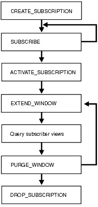

## 34 DBMS\_CDC\_SUBSCRIBE

Note:

Oracle Change Data Capture will be de-supported in a future release of Oracle Database and will be replaced with Oracle GoldenGate. Therefore, Oracle strongly recommends that you use Oracle GoldenGate for new applications.

For Oracle Database 11g Release 2 (11.2), Change Data Capture continues to function as in earlier releases. If you are currently using Change Data Capture, then you will be able to continue to do so for the foreseeable future. However, Change Data Capture will not be further enhanced, and will only be supported based on the current, documented functionality.

The `DBMS_CDC_SUBSCRIBE` package, one of a set of Change Data Capture packages, lets subscribers view and query change data that was captured and published with the `DBMS_CDC_PUBLISH` package.

A Change Data Capture system usually has one publisher and many subscribers. The subscribers (applications or individuals), use the Oracle supplied package, `DBMS_CDC_SUBSCRIBE`, to access published data.

See Also:

[Oracle Database Data Warehousing Guide](https://docs.oracle.com/cd/E11882_01/server.112/e25554/cdc.htm#DWHSG016) for information regarding Oracle Change Data Capture.

This chapter contains the following topics:

- Using DBMS\_CDC\_SUBSCRIBE
	- Overview
		- Deprecated Subprograms
		- Security Model
		- Views
- Summary of DBMS\_CDC\_SUBSCRIBE Subprograms

---

## Using DBMS\_CDC\_SUBSCRIBE

This section contains the following topics, which relate to using the `DBMS_CDC_SUBSCRIBE` package:

---

### Overview

The primary role of the subscriber is to use the change data. Through the `DBMS_CDC_SUBSCRIBE` package, each subscriber registers interest in source tables by subscribing to them.

Once the publisher sets up the system to capture data into change tables (which are viewed as publications by subscribers) and grants subscribers access to the change tables, subscribers can access and query the published change data for any of the source tables of interest. Using the subprograms in the `DBMS_CDC_SUBSCRIBE` package, the subscriber accomplishes the following main objectives:

1. Indicates the change data of interest by creating a subscription and associated subscriber views on published source tables and source columns
2. Activates the subscription to indicate that the subscriber is ready to receive change data
3. Extends the subscription window to receive a new set of change data
4. Uses SQL `SELECT` statements to retrieve change data from the subscriber views
5. Purges the subscription window when finished processing a block of changes
6. Drops the subscription when finished with the subscription

Figure 34-1 provides a graphical flowchart of the order in which subscribers most typically use the subprograms in the `DBMS_CDC_SUBSCRIBE` package (which are listed in Table 34-1). A subscriber would typically create a subscription, subscribe to one or more source tables and columns, activate the subscription, extend the subscription window, query the subscriber views, purge the subscription window, and then either extend the subscription window again or drop the subscription.

Note:

If a subscriber uses the `PURGE_WINDOW` procedure immediately after using an `EXTEND_WINDOW` procedure, then change data may be lost without ever being processed.

See Also:

Chapter 34, "DBMS\_CDC\_SUBSCRIBE" for information on the package for publishing change data.

Figure 34-1 Subscription Flow



> This is a text description of arpls011.gif. This figure provides a graphical flowchart. The flowchart shows the following sequence:
>
> 1. CREATE\_SUBSCRIPTION
> 2. SUBSCRIBE
> 3. Either repeat step 2 or continue to step 4
> 4. ACTIVATE\_SUBSCRIPTION
> 5. EXTEND\_WINDOW
> 6. Query subscriber views
> 7. PURGE\_WINDOW
> 8. Either return to step 5 or continue to step 9
> 9. DROP\_SUBSCRIPTION
>
> Copyright © 1996, 2013, Oracle and/or its affiliates. All rights reserved.  
> [Legal Notices](https://docs.oracle.com/cd/E11882_01/dcommon/html/cpyr.htm)
  

---

### Deprecated Subprograms

The following subprograms are deprecated with Oracle Database 11g:

- `DROP_SUBSCRIBER_VIEW`
	Subscribers no longer need to drop subscriber views. This work is now done automatically by Change Data Capture.
- `GET_SUBSCRIPTION_HANDLE`
	Subscribers no longer explicitly specify subscription handles. Subscribers should use the `CREATE_SUBSCRIPTION` procedure instead to specify a subscription name.
- `PREPARE_SUBSCRIBER_VIEW`
	Subscribers no longer need to prepare subscriber views. This work is now done automatically by Change Data Capture.

---

### Security Model

Change Data Capture grants `EXECUTE` privileges to `PUBLIC` on the `DBMS_CDC_SUBSCRIBE` package.

---

### Views

The `DBMS_CDC_SUBSCRIBE` package uses the views listed in the section on Getting Information About the Change Data Capture Environment in [Oracle Database Data Warehousing Guide.](https://docs.oracle.com/cd/E11882_01/server.112/e25554/cdc.htm#DWHSG016)

---

## Summary of DBMS\_CDC\_SUBSCRIBE Subprograms

Table 34-1 DBMS\_CDC\_SUBSCRIBE Package Subprograms

| Subprogram | Description |
| --- | --- |
| ACTIVATE\_SUBSCRIPTION Procedure | Indicates that a subscription is ready to start accessing change data |
| CREATE\_SUBSCRIPTION Procedure | Creates a subscription and associates it with one change set |
| DROP\_SUBSCRIPTION Procedure | Drops a subscription that was created with a prior call to the `CREATE_SUBSCRIPTION` procedure |
| EXTEND\_WINDOW Procedure | Sets a subscription window high boundary so that new change data can be seen |
| PURGE\_WINDOW Procedure | Sets the low boundary for a subscription window to notify Change Data Capture that the subscriber is finished processing a set of change data |
| SUBSCRIBE Procedure | Specifies a source table and the source columns for which the subscriber wants to access change data and specifies the subscriber view through which the subscriber sees change data for the source table |

---

### ACTIVATE\_SUBSCRIPTION Procedure

This procedure indicates that a subscription is ready to start accessing change data.

Syntax

```
DBMS_CDC_SUBSCRIBE.ACTIVATE_SUBSCRIPTION (
     subscription_name  IN VARCHAR2);
```

Parameters

Table 34-2 ACTIVATE\_SUBSCRIPTION Procedure Parameters

| Parameter | Description |
| --- | --- |
| `subscription_name` | The name of the subscription that was specified for a previous call to the `CREATE_SUBSCRIPTION` procedure. Subscription names follow the Oracle schema object naming rules. |

Exceptions

Table 34-3 ACTIVATE\_SUBSCRIPTION Procedure Exceptions

| Exception | Description |
| --- | --- |
| `ORA-31409` | One or more values for input parameters are incorrect |
| `ORA-31425` | Subscription does not exist |
| `ORA-31426` | Cannot modify active subscriptions |
| `ORA-31469` | Cannot enable Change Data Capture for change set |
| `ORA-31514` | Change set disabled due to capture error |

Usage Notes

- The `ACTIVATE_SUBSCRIPTION` procedure indicates that the subscriber is finished subscribing to tables, and the subscription is ready to start accessing change data.
- Once the subscriber activates the subscription:
	- No additional source tables can be added to the subscription.
		- Change Data Capture holds the available data for the source tables and sets the subscription window to empty.
		- The subscriber must use the `EXTEND_WINDOW` procedure to see the initial set of change data.
		- The subscription cannot be activated again.
- A subscription cannot be activated if the underlying change set has reached its `end_date` parameter value.

---

### CREATE\_SUBSCRIPTION Procedure

This procedure creates a subscription that is associated with one change set. This procedure replaces the deprecated `GET_SUBSCRIPTION_HANDLE` procedure.

Syntax

```
DBMS_CDC_SUBSCRIBE.CREATE_SUBSCRIPTION (
     change_set_name      IN  VARCHAR2,
     description          IN  VARCHAR2,
     subscription_name    IN  VARCHAR2);
```

Parameters

Table 34-4 CREATE\_SUBSCRIPTION Procedure Parameters

| Parameter | Description |
| --- | --- |
| `change_set_name` | The name of an existing change set to which the subscriber subscribes |
| `description` | A description of the subscription (which might include, for example, the purpose for which it is used). The description must be specified using 255 or fewer characters. |
| `subscription_name` | A unique name for a subscription that must consist of 30 characters or fewer and cannot have a prefix of `CDC$`. Subscription names follow the Oracle schema object naming rules. |

Exceptions

Table 34-5 CREATE\_SUBSCRIPTION Procedure Exceptions

| Exception | Description |
| --- | --- |
| `ORA-31409` | One or more values for input parameters are incorrect |
| `ORA-31415` | Specified change set does not exist |
| `ORA-31449` | Invalid value for `change_set_name` |
| `ORA-31457` | Maximum length of description field exceeded |
| `ORA-31469` | Cannot enable Change Data Capture for change set |
| `ORA-31506` | Duplicate subscription name specified |
| `ORA-31510` | Name uses reserved prefix `CDC$` |
| `ORA-31511` | Name exceeds maximum length of 30 characters |

Usage Notes

- `The` `CREATE_SUBSCRIPTION` procedure allows a subscriber to register interest in a change set associated with source tables of interest.
- A subscriber can query the `ALL_PUBLISHED_COLUMNS` view to see all the published source tables for which the subscriber has privileges and the change sets in which the source table columns are published.
- Subscriptions are not shared among subscribers; rather, each subscription name is validated against a given subscriber's login ID.
- Subscriptions cannot be created if the underlying change set has reached its `end_date` parameter value.

---

### DROP\_SUBSCRIPTION Procedure

This procedure drops a subscription.

Syntax

```
DBMS_CDC_SUBSCRIBE.DROP_SUBSCRIPTION (
     subscription_name  IN VARCHAR2);
```

Parameters

Table 34-6 DROP\_SUBSCRIPTION Procedure Parameters

| Parameter | Description |
| --- | --- |
| `subscription_name` | The name of the subscription that was specified for a previous call to the `CREATE_SUBSCRIPTION` procedure. Subscription names follow the Oracle schema object naming rules. |

Exceptions

Table 34-7 DROP\_SUBSCRIPTION Procedure Exceptions

| Exception | Description |
| --- | --- |
| `ORA-31409` | One or more values for input parameters are incorrect |
| `ORA-31425` | Subscription does not exist |

Usage Notes

Subscribers should be diligent about dropping subscriptions that are no longer needed so that change data will not be held in the change tables unnecessarily.

---

### EXTEND\_WINDOW Procedure

This procedure sets the subscription window high boundary so that new change data can be seen.

Syntax

```
DBMS_CDC_SUBSCRIBE.EXTEND_WINDOW (
     subscription_name  IN VARCHAR2,
     upper_bound        IN DATE DEFAULT NULL);
```

Parameters

Table 34-8 EXTEND\_WINDOW Procedure Parameters

| Parameter | Description |
| --- | --- |
| `subscription_name` | The unique name of the subscription that was specified by a previous call to the `CREATE_SUBSCRIPTION` procedure. Subscription names follow the Oracle schema object naming rules. |
| `upper_bound` | A date/timestamp to move the upper bound of the subscription window to. |

Exceptions

Table 34-9 EXTEND\_WINDOW Procedure Exceptions

| Exception | Description |
| --- | --- |
| `ORA-31409` | One or more values for input parameters are incorrect |
| `ORA-31425` | Subscription does not exist |
| `ORA-31429` | Subscription has not been activated |
| `ORA-31432` | Invalid source table |
| `ORA-31469` | Cannot enable Change Data Capture for change set |
| ORA-31508 | Invalid parameter value for synchronous change set |
| `ORA-31509` | Publication does not exist |
| `ORA-31514` | Change set disabled due to capture error |

Usage Notes

- Until the subscriber calls the `EXTEND_WINDOW` procedure to begin receiving change data, the subscription window remains empty.
	- The first time that the subscriber calls the `EXTEND_WINDOW` procedure, it establishes the initial boundaries for the subscription window.
		- Subsequent calls to the `EXTEND_WINDOW` procedure extend the high boundary of the subscription window so that new change data can be seen.
- Oracle recommends that subscribers not view change tables directly. Instead, subscribers should use the `DBMS_CDC_SUBSCRIBE` package and access data through subscriber views only. Control column values are guaranteed to be consistent only when viewed through subscriber views that have been updated with a call to the `EXTEND_WINDOW` procedure.
- When the underlying change set for a subscription has reached its `end_date` parameter value, subsequent calls to the `EXTEND_WINDOW` procedure will not raise the high boundary.
- Subscriptions employing synchronous Change Data Capture are not allowed to extend the window to a specified date. Hence, the `upper_bound` parameter should not be specified.

---

### PURGE\_WINDOW Procedure

This procedure sets the low boundary of the subscription window so that the subscription no longer sees any change data, effectively making the subscription window empty. The subscriber calls this procedure to notify Change Data Capture that the subscriber is finished processing a block of change data.

Syntax

```
DBMS_CDC_SUBSCRIBE.PURGE_WINDOW (
     subscription_name   IN VARCHAR2,
     lower_bound         IN DATE DEFAULT NULL);
```

Parameters

Table 34-10 PURGE\_WINDOW Procedure Parameters

| Parameter | Description |
| --- | --- |
| `subscription_name` | The name of the subscription that was specified for a previous call to the `CREATE_SUBSCRIPTION` procedure. Subscription names follow the Oracle schema object naming rules. |
| `lower_bound` | A date/timestamp to move the lower bound of the subscription window to. |

Exceptions

Table 34-11 PURGE\_WINDOW Procedure Exceptions

| Exception | Description |
| --- | --- |
| `ORA-31409` | One or more values for input parameters are incorrect |
| `ORA-31425` | Subscription does not exist |
| `ORA-31429` | Subscription has not been activated |
| `ORA-31432` | Invalid source table |
| `ORA-31469` | Cannot enable Change Data Capture for change set |
| `ORA-31514` | Change set disabled due to capture error |

Usage Notes

- When finished with a set of changes, the subscriber purges the subscription window with the `PURGE_WINDOW` procedure. By this action, the subscriber performs the following functions:
	- Informs Change Data Capture that the subscriber is finished with the current set of change data.
		- Enables Change Data Capture to remove change data that is no longer needed by any subscribers.
	Change Data Capture manages the change data to ensure that it is available as long as there are subscribers who need it.
- When the underlying change set for a subscription has reached its `end_date` parameter value, subsequent calls to the `PURGE_WINDOW` procedure will not move the low boundary.

---

### SUBSCRIBE Procedure

This procedure specifies a source table and the source columns for which the subscriber wants to access change data. In addition, it specifies the subscriber view through which the subscriber sees change data for the source table.

Syntax

There are two versions of syntax for the `SUBSCRIBE` procedure, as follow:

- Using source schema and source table
	When this syntax is used, Change Data Capture will attempt to find a single publication ID that contains the specified `source_table` and `column_list`. If such a publication cannot be found, then Change Data Capture returns an error.
	```
	DBMS_CDC_SUBSCRIBE.SUBSCRIBE (
	     subscription_name    IN VARCHAR2,
	     source_schema        IN VARCHAR2,
	     source_table         IN VARCHAR2,
	     column_list          IN VARCHAR2,
	     subscriber_view      IN VARCHAR2);
	```
- Using publication IDs
	When this syntax is used, Change Data Capture will use the publication ID to identify the change table. If the columns specified in the `column_list` parameter are not in the identified change table, then Change Data Capture returns an error.
	```
	DBMS_CDC_SUBSCRIBE.SUBSCRIBE (
	   subscription_name    IN VARCHAR2,
	   publication_id       IN NUMBER,
	   column_list          IN VARCHAR2,
	   subscriber_view      IN VARCHAR2);
	```

Parameters

Table 34-12 SUBSCRIBE Procedure Parameters

| Parameter | Description |
| --- | --- |
| `subscription_name` | The name of a subscription that was specified for, or returned by, a previous call to the `CREATE_SUBSCRIPTION` procedure. Subscription names follow the Oracle schema object naming rules. |
| `source_schema` | The name of the schema where the source table resides |
| `source_table` | The name of a published source table |
| `column_list` | A comma-delimited list of columns from the published source table or publication |
| `subscriber_view` | Unique name for the subscriber view for this source table or publication that must consist of 30 or fewer characters and must not have a prefix of `CDC$`. Subscriber view names follow the Oracle schema object naming rules. |
| `publication_id` | A valid `publication_id`, which the subscriber can obtain from the `ALL_PUBLISHED_COLUMNS` view. |

Exceptions

Table 34-13 SUBSCRIBE Procedure Exceptions

| Exception | Description |
| --- | --- |
| `ORA-31409` | One or more values for input parameters are incorrect |
| `ORA-31425` | Subscription does not exist |
| `ORA-31426` | Cannot modify active subscriptions |
| `ORA-31427` | Publication string already subscribed |
| `ORA-31428` | No publication contains all the specified columns |
| `ORA-31432` | Invalid source table |
| `ORA-31466` | No publications found |
| `ORA-31469` | Cannot enable Change Data Capture for change set |
| `ORA-31510` | Name uses reserved prefix `CDC$` |
| `ORA-31511` | Name exceeds maximum length of 30 characters |

Usage Notes

- The `SUBSCRIBE` procedure allows a subscriber to subscribe to one or more published source tables and to specific columns in each source table. Each call to the `SUBSCRIBE` procedure can specify only a single source table or publication ID. The subscriber can make multiple calls to the `SUBSCRIBE` procedure to include multiple source tables or publications IDs in a subscription.
- If the columns of interest are all in a single publication, the subscriber can call the `SUBSCRIBE` procedure using the `source_schema` and `source_table` parameters or using the `publication_id` parameter. However, if there are multiple publications on a single source table and these publications share some columns, and if any of the shared columns will be used by a single subscription, then the subscriber should call the `SUBSCRIBE` procedure using the `publication_id` parameter.
- The subscriber can subscribe to any valid publication ID on which the subscriber has privileges to access. The subscriber can find valid publication IDs on which the subscriber has access by querying the `ALL_PUBLISHED_COLUMNS` view.
- A subscriber can query the `ALL_PUBLISHED_COLUMNS` view to see all the published source table columns accessible to the subscriber.
- Subscriptions must be created before a subscriber calls the `SUBSCRIBE` procedure. Change Data Capture does not guarantee that there will be any change data available at the moment the subscription is created.
- Subscribers can subscribe only to published columns from the source table. All of the columns specified in a single call to the `SUBSCRIBE` procedure must come from the same publication. Any control columns associated with the underlying change table are added to the subscription automatically.
- All specified source tables or publications must be in the change set that is associated with the named subscription.
- A single source table can have more than one publication defined on it. A subscriber can subscribe to one or more of these publications. However a subscriber can subscribe to a particular publication only once.
- Each publication in a subscription has its own subscriber view. Subscriber views are used to query the change data encompassed by the subscription's current window. Subscriber views are created in the schema of the subscriber.
- A subscriber cannot subscribe to a publication within a change set that has reached its `end_date` parameter value.