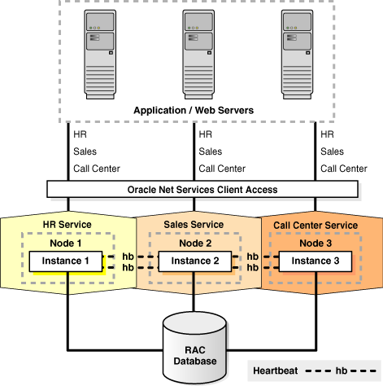

## 1 Introduction to Oracle RAC

This chapter introduces Oracle Real Application Clusters (Oracle RAC) and describes how to install, administer, and deploy Oracle RAC.

This chapter includes the following topics:

## Overview of Oracle RAC

A [cluster](rac_glossary.md) comprises multiple interconnected computers or servers that appear as if they are one server to end users and applications. Oracle RAC enables you to cluster an Oracle database. Oracle RAC uses Oracle Clusterware for the infrastructure to bind multiple servers so they operate as a single system.

Oracle Clusterware is a portable cluster management solution that is integrated with Oracle Database. Oracle Clusterware is also a required component for using Oracle RAC. In addition, Oracle Clusterware enables both noncluster Oracle databases and Oracle RAC databases to use the Oracle high-availability infrastructure. Oracle Clusterware enables you to create a clustered pool of storage to be used by any combination of noncluster and Oracle RAC databases.

Oracle Clusterware is the only clusterware that you need for most platforms on which Oracle RAC operates. You can also use clusterware from other vendors if the clusterware is certified for Oracle RAC.

See Also:

[Oracle Clusterware Administration and Deployment Guide](https://docs.oracle.com/cd/E11882_01/rac.112/e41959/toc.htm) and [Oracle Grid Infrastructure Installation Guide](http://www.oracle.com/pls/topic/lookup?ctx=db112&id=GINST) for more details

Noncluster Oracle databases have a one-to-one relationship between the Oracle database and the instance. Oracle RAC environments, however, have a one-to-many relationship between the database and instances. An Oracle RAC database can have up to 100 instances,Foot 1 all of which access one database. All database instances must use the same interconnect, which can also be used by Oracle Clusterware.

Oracle RAC databases differ architecturally from noncluster Oracle databases in that each Oracle RAC database instance also has:

- At least one additional thread of redo for each instance
- An instance-specific undo tablespace

The combined processing power of the multiple servers can provide greater throughput and Oracle RAC scalability than is available from a single server.

Figure 1-1 shows how Oracle RAC is the Oracle Database option that provides a single system image for multiple servers to access one Oracle database. In Oracle RAC, each Oracle instance must run on a separate server.

Figure 1-1 Oracle Database with Oracle RAC Architecture

> This illustration shows the Oracle database with Oracle RAC architecture for a partitioned three-node database.
>
> An Oracle RAC database is connected to three instances on different nodes. Each instance is associated with a service: HR, Sales, and Call Center. The instances monitor each other by checking heartbeats. Oracle Net Services provide client access to the Application/Web server tier at the top of the figure.
>
> End of description.
  

Traditionally, an Oracle RAC environment is located in one data center. However, you can configure Oracle RAC on an [extended distance cluster](rac_glossary.md), which is an architecture that provides extremely fast recovery from a site failure and allows for all nodes, at all sites, to actively process transactions as part of a single database cluster. In an extended cluster, the nodes in the cluster are located in two buildings that are separated by greater distances (anywhere from across the street, to across a campus, or across a city). For availability reasons, the data must be located at both sites, thus requiring the implementation of disk mirroring technology for storage.

If you choose to implement this architecture, you must assess whether this architecture is a good solution for your business, especially considering distance, latency, and the degree of protection it provides. Oracle RAC on extended clusters provides higher availability than is possible with local Oracle RAC configurations, but an extended cluster may not fulfill all of the disaster-recovery requirements of your organization. A feasible separation provides great protection for some disasters (for example, local power outage or server room flooding) but it cannot provide protection against all types of outages. For comprehensive protection against disasters—including protection against corruptions and regional disasters—Oracle recommends the use of Oracle Data Guard with Oracle RAC, as described in the [Oracle Database High Availability Overview](https://docs.oracle.com/cd/E11882_01/server.112/e17157/toc.htm) and on the Maximum Availability Architecture (MAA) Web site at

`http://www.oracle.com/technology/deploy/availability/htdocs/maa.htm`

Oracle RAC is a unique technology that provides high availability and scalability for all application types. The Oracle RAC infrastructure is also a key component for implementing the Oracle enterprise grid computing architecture. Having multiple instances access a single database prevents the server from being a single point of failure. Oracle RAC enables you to combine smaller commodity servers into a cluster to create scalable environments that support mission critical business applications. Applications that you deploy on Oracle RAC databases can operate without code changes.

## Overview of Oracle Clusterware for Oracle RAC

Oracle Clusterware provides a complete, integrated clusterware management solution on all Oracle Database platforms. This clusterware functionality provides all of the features required to manage your cluster database including node membership, group services, global resource management, and high availability functions.

You can install Oracle Clusterware independently or as a prerequisite to the Oracle RAC installation process. Oracle Database features, such as services, use the underlying Oracle Clusterware mechanisms to provide advanced capabilities. Oracle Database also continues to support select third-party clusterware products on specified platforms.

Oracle Clusterware is designed for, and tightly integrated with, Oracle RAC. You can use Oracle Clusterware to manage high-availability operations in a cluster. When you create an Oracle RAC database using any of the management tools, the database is registered with and managed by Oracle Clusterware, along with the other required components such as the Virtual Internet Protocol (VIP) address, the Single Client Access Name (SCAN), the SCAN listener, Oracle Notification Service, and the Oracle Net listeners. These resources are automatically started when Oracle Clusterware starts the node and automatically restarted if they fail. The Oracle Clusterware daemons run on each node.

Anything that Oracle Clusterware manages is known as a CRS resource. A CRS resource can be a database, an instance, a service, a listener, a VIP address, or an application process. Oracle Clusterware manages CRS resources based on the resource's configuration information that is stored in the Oracle Cluster Registry (OCR). You can use SRVCTL commands to administer any Oracle-defined CRS resources. Oracle Clusterware provides the framework that enables you to create CRS resources to manage any process running on servers in the cluster which are not predefined by Oracle. Oracle Clusterware stores the information that describes the configuration of these components in OCR that you can administer as described in the [Oracle Clusterware Administration and Deployment Guide](https://docs.oracle.com/cd/E11882_01/rac.112/e41959/toc.htm).

## Overview of Oracle RAC Architecture and Processing

At a minimum, Oracle RAC requires Oracle Clusterware software infrastructure to provide concurrent access to the same storage and the same set of data files from all nodes in the cluster, a communications protocol for enabling interprocess communication (IPC) across the nodes in the cluster, enable multiple database instances to process data as if the data resided on a logically combined, single cache, and a mechanism for monitoring and communicating the status of the nodes in the cluster.

The following sections describe these concepts in more detail:

- Understanding Cluster-Aware Storage Solutions
- Overview of Connecting to Oracle Database Using Services and VIP Addresses
- About Oracle RAC Software Components
- About Oracle RAC Background Processes

### Understanding Cluster-Aware Storage Solutions

An Oracle RAC database is a [shared everything](rac_glossary.md) database. All data files, control files, SPFILEs,Foot 2 and redo log files in Oracle RAC environments must reside on cluster-aware shared disks, so that all of the cluster database instances can access these storage components. Because Oracle RAC databases use a shared everything architecture, Oracle RAC requires cluster-aware storage for all database files.

In Oracle RAC, the Oracle Database software manages disk access and is certified for use on a variety of storage architectures. It is your choice how to configure your storage, but you must use a supported cluster-aware storage solution. Oracle Database provides the following file storage options for Oracle RAC:

- Oracle Automatic Storage Management (Oracle ASM)
	Oracle recommends this solution to manage your storage.
- A certified cluster file system, including OCFS2 and Oracle Cluster File System (OCFS for Windows)
	OCFS2 is available for Linux, and OCFS for Windows is available for Windows platforms. However you may optionally use a third-party cluster file system or cluster-aware volume manager that is certified for Oracle RAC.
- Certified network file system (NFS) file servers

### Overview of Connecting to Oracle Database Using Services and VIP Addresses

All [node](rac_glossary.md) s in an Oracle RAC environment must connect to a Local Area Network (LAN) to enable users and applications to access the database. Applications should use the Oracle Database services feature to connect to an Oracle database. Services enable you to define rules and characteristics to control how users and applications connect to database instances. These characteristics include a unique name, workload balancing and failover options, and high availability characteristics. Oracle Net Services enable the load balancing of application connections across all of the instances in an Oracle RAC database.

Users can access an Oracle RAC database using a client/server configuration or through one or more middle tiers, with or without connection pooling. Users can be database administrators, developers, application users, power users, such as data miners who create their own searches, and so on.

Most public networks typically use TCP/IP, but you can use any supported hardware and software combination. Oracle RAC database instances should be accessed through the Single Client Access Name (SCAN) for the cluster.

See Also:

"Overview of Automatic Workload Management" for more information about SCANs

The interconnect network is a private network that connects all of the servers in the cluster. The interconnect network uses a switch (or multiple switches) that only the nodes in the cluster can access. Configure User Datagram Protocol (UDP) on a Gigabit Ethernet for your cluster interconnect. On Linux and UNIX systems, you can configure Oracle Clusterware to use either the UDP or Reliable Data Socket (RDS) protocols. Windows clusters use the TCP protocol. Crossover cables are not supported for use with Oracle Clusterware interconnects.

Note:

Do not use the interconnect (the private network) for user communication, because [Cache Fusion](rac_glossary.md) uses the interconnect for interinstance communication.

If a node fails, then the node's VIP address fails over to another node on which the VIP address can accept TCP connections, but it does not accept connections to the Oracle database. Generally, VIP addresses fail over when:

- The node on which a VIP address runs fails
- All interfaces for the VIP address fail
- All interfaces for the VIP address are disconnected from the network

Clients that attempt to connect to the VIP address receive a rapid `connection refused` error instead of waiting for TCP connect timeout messages. When the network on which the VIP is configured comes back online, Oracle Clusterware fails back the VIP to its home node where connections are accepted.

If you use Network Attached Storage (NAS), then you are required to configure a second private network. Access to this network is typically controlled by the vendor's software. The private network uses static IP addresses.

Oracle RAC 11g release 2 (11.2) supports multiple public networks. Each network has its own subnet and each database service uses a particular network to access the Oracle RAC database. Each network is a resource managed by Oracle Clusterware.

You must also create a SCAN for each cluster, which is a single network name defined either in your organization's Domain Name Server (DNS) or in the Grid Naming Service (GNS) that round robins to three IP addresses. Oracle recommends that all connections to the Oracle RAC database use the SCAN in their client connection string. Incoming connections are load balanced across the active instances providing the requested service through the three SCAN listeners. With SCAN, you do not have to change the client connection even if the configuration of the cluster changes (nodes added or removed).

### About Oracle RAC Software Components

Oracle RAC databases generally have two or more database instances that each contain memory structures and background processes. An Oracle RAC database has the same processes and memory structures as a noncluster Oracle database and additional processes and memory structures that are specific to Oracle RAC. Any one instance's database view is nearly identical to any other instance's view in the same Oracle RAC database; the view is a single system image of the environment.

Each instance has a buffer cache in its System Global Area (SGA). Using Cache Fusion, Oracle RAC environments logically combine each instance's buffer cache to enable the instances to process data as if the data resided on a logically combined, single cache.

Note:

The SGA size requirements for Oracle RAC are greater than the SGA requirements for noncluster Oracle databases due to Cache Fusion.

To ensure that each Oracle RAC database instance obtains the block that it requires to satisfy a query or transaction, Oracle RAC instances use two processes, the Global Cache Service (GCS) and the Global Enqueue Service (GES). The GCS and GES maintain records of the statuses of each data file and each cached block using a Global Resource Directory (GRD). The GRD contents are distributed across all of the active instances, which effectively increases the size of the SGA for an Oracle RAC instance.

After one instance caches data, any other instance within the same cluster database can acquire a block image from another instance in the same database faster than by reading the block from disk. Therefore, Cache Fusion moves current blocks between instances rather than re-reading the blocks from disk. When a consistent block is needed or a changed block is required on another instance, Cache Fusion transfers the block image directly between the affected instances. Oracle RAC uses the private interconnect for interinstance communication and block transfers. The GES Monitor and the Instance Enqueue Process manage access to Cache Fusion resources and enqueue recovery processing.

### About Oracle RAC Background Processes

The GCS and GES processes, and the GRD collaborate to enable Cache Fusion. The Oracle RAC processes and their identifiers are as follows:

- `ACMS`: Atomic Controlfile to Memory Service (`ACMS`)
	In an Oracle RAC environment, the `ACMS` per-instance process is an agent that contributes to ensuring a distributed SGA memory update is either globally committed on success or globally aborted if a failure occurs.
- `GTX0-j`: Global Transaction Process
	The `GTX0-j` process provides transparent support for XA global transactions in an Oracle RAC environment. The database autotunes the number of these processes based on the workload of XA global transactions.
- `LMON`: Global Enqueue Service Monitor
	The `LMON` process monitors global enqueues and resources across the cluster and performs global enqueue recovery operations.
- `LMD`: Global Enqueue Service Daemon
	The `LMD` process manages incoming remote resource requests within each instance.
- `LMS`: Global Cache Service Process
	The `LMS` process maintains records of the data file statuses and each cached block by recording information in a Global Resource Directory (GRD). The `LMS` process also controls the flow of messages to remote instances and manages global data block access and transmits block images between the buffer caches of different instances. This processing is part of the Cache Fusion feature.
- `LCK0`: Instance Enqueue Process
	The `LCK0` process manages non-Cache Fusion resource requests such as library and row cache requests.
- `RMS` `n`: Oracle RAC Management Processes (`RMS` `n`)
	The `RMS` `n` processes perform manageability tasks for Oracle RAC. Tasks accomplished by an `RMS` `n` process include creation of resources related to Oracle RAC when new instances are added to the clusters.
- `RSMN`: Remote Slave Monitor manages background slave process creation and communication on remote instances. These background slave processes perform tasks on behalf of a coordinating process running in another instance.

Note:

Many of the Oracle Database components that this section describes are in addition to the components that are described for noncluster Oracle databases in [Oracle Database Concepts.](https://docs.oracle.com/cd/E11882_01/server.112/e40540/toc.htm)

## Overview of Automatic Workload Management

Automatic workload management enables you to manage the distribution of workloads to provide optimal performance for users and applications. This includes providing the highest availability for database connections, rapid failure recovery, and balancing workloads optimally across the active configuration. Oracle Database with Oracle RAC includes many features that can enhance automatic workload management, such as connection load balancing, fast connection failover, the load balancing advisory, and runtime connection load balancing. Automatic workload management provides the greatest benefits to Oracle RAC environments. You can, however, take advantage of automatic workload management by using Oracle Database services in noncluster Oracle databases, especially those that use Oracle Data Guard or Oracle Streams.

Automatic workload management includes the following components:

- High Availability Framework: The Oracle RAC high availability framework enables Oracle Database to always maintain components in a running state. Oracle high availability implies that Oracle Clusterware monitors and restarts critical components if they stop, unless you override the restart processing. Oracle Clusterware and Oracle RAC also provide alerts to clients when configurations change, enabling clients to immediately react to the changes, enabling application developers to hide outages and reconfigurations from end users. The scope of Oracle high availability spans from the restarting of stopped Oracle Database processes in an Oracle database instance to failing over the processing of an entire instance to other available instances.
- Single Client Access Name (SCAN): A single network name and IP addresses defined either in your DNS or GNS that all clients should use to access the Oracle RAC database. With SCAN, you are no longer required to modify your clients when changes occur to the cluster configuration. SCAN also allows clients to use an Easy Connect string to provide load balancing and failover connections to the Oracle RAC database.
	Note:
	SCAN is required regardless of whether you use GNS. If you use GNS, then Oracle automatically creates the SCAN. If you do not use GNS, then you must define the SCAN in DNS.
- Load Balancing Advisory: This is the ability of the database to provide information to applications about the current service levels being provided by the database and its instances. Applications can take advantage of this information to direct connection requests to the instance that provides the application request with the best service quality to complete the application's processing. Oracle Database has integrated its Java Database Connectivity (JDBC) and Oracle Data Provider for.NET (ODP.NET) connection pools to work with the load balancing information. Applications can use the integrated connection pools without programmatic changes.
- Services: Oracle Database provides a powerful automatic workload management facility, called services, to enable the enterprise grid vision. Services are entities that you can define in Oracle RAC databases. Services enable you to group database workloads and route the work to the optimal instances that are assigned to process the service. Furthermore, you can use services to define the resources that Oracle Database assigns to process workloads and to monitor workload resources. Applications that you assign to services transparently acquire the defined automatic workload management characteristics, including high availability and load balancing rules. Many Oracle Database features are integrated with services, such as Resource Manager, which enables you to restrict the resources that a service can use within an instance. Some database features are also integrated with Oracle Streams, Advanced Queuing (to achieve queue location transparency), and Oracle Scheduler (to map services to specific job classes).
	In Oracle RAC databases, the service performance rules that you configure control the amount of work that Oracle Database allocates to each available instance for that service. As you extend your database by adding nodes, applications, components of applications, and so on, you can add more services.
- Server Pools: Server pools enable the CRS Administrator to create a policy which defines how Oracle Clusterware allocates resources. An Oracle RAC policy-managed database runs in a server pool. Oracle Clusterware attempts to keep the required number of servers in the server pool and, therefore, the required number of instances of the Oracle RAC database. A server can be in only one server pool at any time. However, a database can run in multiple server pools. Cluster-managed services run in a server pool where they are defined as either UNIFORM (active on all instances in the server pool) or SINGLETON (active on only one instance in the server pool).
- Connection Load Balancing: Oracle Net Services provides connection load balancing for database connections. Connection load balancing occurs when the connection is created. Connections for a given service are balanced across all of the running instances that offer the service. You should define how you want connections to be balanced in the service definition. However, you must still configure Oracle Net Services. When you enable the load balancing advisory, the listener uses the load balancing advisory for connection load balancing.

See Also:

[Chapter 5, "Introduction to Automatic Workload Management"](hafeats.md)

## Overview of Installing Oracle RAC

Install Oracle Clusterware and Oracle Database software using Oracle Universal Installer, and create your database with Database Configuration Assistant (DBCA). This ensures that your Oracle RAC environment has the optimal network configuration, database structure, and parameter settings for the environment that you selected. As a database administrator, after installation your tasks are to administer your Oracle RAC environment at three levels:

- Instance Administration
- Database Administration
- Cluster Administration

This section introduces the installation processes for Oracle RAC under the following topics:

- Understanding Compatibility in Oracle RAC Environments
- Overview of Oracle RAC Installation and Database Creation
- Overview of Extending the Oracle Grid Infrastructure and Oracle RAC Software
	Note:
	You must first install Oracle Clusterware before installing Oracle RAC. See [Oracle Clusterware Administration and Deployment Guide](https://docs.oracle.com/cd/E11882_01/rac.112/e41959/intro.htm#CWADD1111) for more information.

### Understanding Compatibility in Oracle RAC Environments

To run Oracle RAC in configurations with different versions of the database in the same cluster, you must also install clusterware. For example, to run Oracle9i and Oracle Database 10g in the same cluster:

- For Oracle RAC nodes running the Oracle9i database, you must install an Oracle9i cluster:
	- For UNIX, the clusterware can be HACMP, Serviceguard, Sun Clusterware, or Veritas SF
		- For Windows and Linux, the cluster is Oracle Cluster Manager
- If you want to install Oracle RAC running Oracle Database 10g or later releases, you must also install Oracle Clusterware. For Oracle Database 11g release 2 (11.2), this means you must first install the Oracle Grid Infrastructure for a cluster. See your platform-specific [Oracle Grid Infrastructure Installation Guide](http://www.oracle.com/pls/topic/lookup?ctx=db112&id=GINST) and the [Oracle Clusterware Administration and Deployment Guide](https://docs.oracle.com/cd/E11882_01/rac.112/e41959/intro.htm#CWADD1118) for more information.
- If you run Oracle RAC 10g and Oracle RAC 11g in the same cluster, you must run Oracle Clusterware 11g (only)

Oracle requires that you install the Oracle9i RAC software first if you are going to run it in a cluster with Oracle RAC 10g or Oracle RAC 11g.

Note:

If you are adding Oracle RAC to servers that are part of a cluster, either migrate to Oracle Clusterware or ensure the clusterware you run is supported to run with Oracle RAC 10g or later releases and ensure you have installed the correct options for the two to work together. Oracle strongly recommends that you do not run different cluster software on the same servers unless they are certified to work together.

### Overview of Oracle RAC Installation and Database Creation

Once you have installed Oracle Clusterware and it is operational, run Oracle Universal Installer to install the Oracle database software with Oracle RAC components.

During the installation, you can select to create a database during the database home installation. Oracle Universal Installer runs DBCA to create your Oracle RAC database according to the options that you select.

Note:

A prerequisite of creating a database is that a default listener must be running in the Oracle Grid Infrastructure home. If a default listener is not present in the Oracle Grid Infrastructure home, then DBCA returns an error instructing you to run NETCA from the Oracle Grid Infrastructure home to create a default listener.

See Also:

[Oracle Database Net Services Administrator's Guide](https://docs.oracle.com/cd/E11882_01/network.112/e41945/toc.htm) for more information about NETCA

Oracle RAC software is distributed as part of the Oracle Database installation media. By default, the Oracle Database software installation process installs the Oracle RAC option when it recognizes that you are performing the installation on a cluster. Oracle Universal Installer installs Oracle RAC into a directory structure referred to as the Oracle home, which is separate from the Oracle home directory for other Oracle software running on the system. Because Oracle Universal Installer is cluster aware, it installs Oracle RAC software on all of the nodes that you defined to be part of the cluster.

Oracle recommends that you select Oracle ASM during the installation to simplify storage management; Oracle ASM automatically manages the storage of all database files within disk groups. If you plan to use Oracle Database Standard Edition to create an Oracle RAC database, then you must use Oracle ASM to store all of the database files.

Note:

You must configure Oracle ASM separately prior to creating an Oracle RAC database.

By default, Oracle Database creates one service for your Oracle RAC installation. This service is for the database. The default database service is typically identified using the combination of the `DB_NAME` and `DB_DOMAIN` initialization parameters: `db_name`.`db_domain`. The default service is available on all instances in an Oracle RAC environment, unless the database is in restricted mode.

Note:

Avoid changing host names after you complete the Oracle Clusterware installation, including adding or deleting domain qualifications. Nodes with changed host names must be deleted from the cluster and added back with the new name.

### Overview of Extending the Oracle Grid Infrastructure and Oracle RAC Software

You can extend Oracle RAC in grid environments to additional nodes by copying cloned images of the Oracle RAC database home to other nodes in the cluster. Oracle cloning copies images of the software to other nodes that have similar hardware and software. Cloning is best suited to a scenario where you must quickly extend your Oracle RAC environment to several nodes of the same configuration.

Oracle provides the following methods of extending Oracle RAC environments:

- Oracle cloning procedure using cloning scripts
	See Also:
	[Chapter 8, "Cloning Oracle RAC to Nodes in a New Cluster"](clonerac.md)
- Oracle Enterprise Manager cloning
- The `addNode.sh` (`addNode.bat` on Windows) script and Oracle Universal Installer cloning

Note:

Oracle cloning is not a replacement for Oracle Enterprise Manager cloning that is part of the Provisioning Pack. During Oracle Enterprise Manager cloning, the provisioning process includes a series of steps where details about the home you want to capture, the location you want to deploy to, and various other parameters are collected.

For new installations or if you install only one Oracle RAC database, you should use the traditional automated and interactive installation methods, such as Oracle Universal Installer, or the Provisioning Pack feature of Oracle Enterprise Manager. If your goal is to add or delete Oracle RAC from nodes in the cluster, you can use the procedures detailed in [Chapter 10, "Adding and Deleting Oracle RAC from Nodes on Linux and UNIX Systems"](adddelunix.md).

The cloning process assumes that you successfully installed an Oracle Clusterware home and an Oracle home with Oracle RAC on at least one node. In addition, all root scripts must have run successfully on the node from which you are extending your cluster database.

At a high level, Oracle cloning involves the following main tasks:

1. Clone the Oracle Clusterware home following the instructions in [Oracle Clusterware Administration and Deployment Guide](https://docs.oracle.com/cd/E11882_01/rac.112/e41959/intro.htm#CWADD1113).
2. Clone the Oracle home with the Oracle RAC software.
	The process for cloning the Oracle home onto new nodes is similar to the process for cloning the Oracle Clusterware home.
3. If you have not yet created a database, then run DBCA to create one.
4. Follow the post-cloning procedures to complete the extension of your Oracle RAC environment onto the new nodes.

See Also:

- [Chapter 8, "Cloning Oracle RAC to Nodes in a New Cluster"](clonerac.md)
- [Chapter 10, "Adding and Deleting Oracle RAC from Nodes on Linux and UNIX Systems"](adddelunix.md) for information about adding and deleting nodes and instances
- [Chapter 11, "Adding and Deleting Oracle RAC from Nodes on Windows Systems"](adddelwin.md) for information about adding and deleting nodes and instances
- Oracle Enterprise Manager online Help system for more information about the Provisioning Pack

## Overview of Managing Oracle RAC Environments

This section describes the following Oracle RAC environment management topics:

- About Designing and Deploying Oracle RAC Environments
- About Administrative Tools for Oracle RAC Environments
- About Monitoring Oracle RAC Environments
- About Evaluating Performance in Oracle RAC Environments

### About Designing and Deploying Oracle RAC Environments

Any enterprise that is designing and implementing a high availability strategy with Oracle RAC must begin by performing a thorough analysis of the business drivers that require high availability. An analysis of business requirements for high availability combined with an understanding of the level of investment required to implement different high availability solutions enables the development of a high availability architecture that achieves both business and technical objectives.

See Also:

For help choosing and implementing the architecture that best fits your availability requirements:
- [Chapter 12, "Design and Deployment Techniques"](design.md) provides a high-level overview you can use to evaluate the high availability requirements of your business.
- [Oracle Database High Availability Overview](https://docs.oracle.com/cd/E11882_01/server.112/e17157/toc.htm) describes how to select the most suitable architecture for your organization, describes several high availability architectures, and provides guidelines for choosing the one that best meets your requirements.
- Information about the Oracle Maximum Availability Architecture at
	`http://www.oracle.com/technetwork/database/features/availability/maa-090890.html`

Oracle RAC provides a new method to manage your clustered database. Traditionally, databases were administrator managed, where a DBA managed each instance of the database by defining specific instances to run on specific nodes in the cluster. To help implement dynamic grid configurations, Oracle RAC 11g release 2 (11.2) introduces policy-managed databases, where the DBA is required only to define the cardinality (number of database instances required). Oracle Clusterware manages the allocation of nodes to run the instances and Oracle RAC allocates the required redo threads and undo tablespaces, as needed.

Note:

Automatic allocation of the required redo threads and undo tablespaces only happens when the database uses Oracle Managed Files.

### About Administrative Tools for Oracle RAC Environments

Oracle enables you to administer a cluster database as a single system image through Oracle Enterprise Manager, SQL\*Plus, or through Oracle RAC command-line interfaces such as Server Control Utility (SRVCTL):

- Oracle Enterprise Manager: Oracle Enterprise Manager has both the Database Control and Grid Control GUI interfaces for managing both noncluster database and Oracle RAC database environments. Oracle recommends that you use Oracle Enterprise Manager to perform administrative tasks whenever feasible.
	You can use Oracle Enterprise Manager Database Control to also manage Oracle RAC One Node databases.
- Server Control Utility (SRVCTL): SRVCTL is a command-line interface that you can use to manage an Oracle RAC database from a single point. You can use SRVCTL to start and stop the database and instances and to delete or move instances and services. You can also use SRVCTL to manage configuration information, Oracle Real Application Clusters One Node (Oracle RAC One Node), Oracle Clusterware, and Oracle ASM.
- SQL\*Plus: SQL\*Plus commands operate on the current instance. The current instance can be either the local default instance on which you initiated your SQL\*Plus session, or it can be a remote instance to which you connect with Oracle Net Services.
- Cluster Verification Utility (CVU): CVU is a command-line tool that you can use to verify a range of cluster and Oracle RAC components, such as shared storage devices, networking configurations, system requirements, and Oracle Clusterware, in addition to operating system groups and users. You can use CVU for preinstallation checks and for postinstallation checks of your cluster environment. CVU is especially useful during preinstallation and during installation of Oracle Clusterware and Oracle RAC components. Oracle Universal Installer runs CVU after installing Oracle Clusterware and Oracle Database to verify your environment.
	Install and use CVU before you install Oracle RAC to ensure that your configuration meets the minimum Oracle RAC installation requirements. Also, use CVU for verifying the completion of ongoing administrative tasks, such as node addition and node deletion.
- DBCA: DBCA is the recommended method for creating and initially configuring Oracle RAC, Oracle RAC One Node, and Oracle noncluster databases.
- NETCA: Configures the network for your Oracle RAC environment.

See Also:

- [Chapter 3, "Administering Database Instances and Cluster Databases"](admin.md) for an introduction to Oracle RAC administration using Oracle Enterprise Manager, SQL\*Plus, and the SRVCTL utility
- ["Monitoring Oracle RAC and Oracle Clusterware"](monitor.md)
- [Appendix A, "Server Control Utility Reference"](srvctladmin.md) for SRVCTL reference information
- [Oracle Clusterware Administration and Deployment Guide](https://docs.oracle.com/cd/E11882_01/rac.112/e41959/cvu.htm#CWADD1100) for information about the Cluster Verification Utility (CVU), in addition to other Oracle Clusterware tools, such as the OIFCFG tool for allocating and deallocating network interfaces and the `OCRCONFIG` command-line tool for managing OCR
- [Oracle Database Net Services Administrator's Guide](https://docs.oracle.com/cd/E11882_01/network.112/e41945/toc.htm) for more information about NETCA

### About Monitoring Oracle RAC Environments

Web-based Oracle Enterprise Manager Database Control and Grid Control enable you to monitor an Oracle RAC database. The Oracle Enterprise Manager Console is a central point of control for the Oracle environment that you access by way of a graphical user interface (GUI). See ["Monitoring Oracle RAC and Oracle Clusterware"](monitor.md) and the [Oracle Database 2 Day + Real Application Clusters Guide](https://docs.oracle.com/cd/E11882_01/rac.112/e17264/racmon2.htm#TDPRC323) for detailed information about using Oracle Enterprise Manager to monitor Oracle RAC environments.

Also, note the following recommendations about monitoring Oracle RAC environments:

- Use the Oracle Enterprise Manager Console to initiate cluster database management tasks.
- Use Oracle Enterprise Manager Grid Control to administer multiple Oracle RAC databases. You can use Oracle Enterprise Manager Database Control to manage individual Oracle RAC databases.
- Use the global views (`GV$` views), which are based on `V$` views. The `catclustdb.sql` script creates the `GV$` views. Run this script if you do not create your database with DBCA. Otherwise, DBCA runs this script for you.
	For almost every `V$` view, there is a corresponding global `GV$` view. In addition to the `V$` information, each `GV$` view contains an extra column named `INST_ID`, which displays the instance number from which the associated `V$` view information was obtained.
- Use the sophisticated management and monitoring features of the Oracle Database Diagnostic and Tuning packs within Oracle Enterprise Manager that include the Automatic Database Diagnostic Monitor (ADDM) and AWR.

See Also:

- The [Oracle Database Performance Tuning Guide](https://docs.oracle.com/cd/E11882_01/server.112/e41573/diag.htm#PFGRF026) describes the Oracle Database automatic features for performance diagnosing and tuning, including ADDM.
- [Oracle Database 2 Day + Real Application Clusters Guide](https://docs.oracle.com/cd/E11882_01/rac.112/e17264/racmon2.htm#TDPRC322) for more information about monitoring performance and troubleshooting

### About Evaluating Performance in Oracle RAC Environments

You do not need to perform special tuning for Oracle RAC; Oracle RAC scales without special configuration changes. If your application performs well on a noncluster Oracle database, then it will perform well in an Oracle RAC environment. Many of the tuning tasks that you would perform on a noncluster Oracle database can also improve Oracle RAC database performance. This is especially true if your environment requires scalability across a greater number of CPUs.

Some of the performance features specific to Oracle RAC include:

- Dynamic resource allocation
	- Oracle Database dynamically allocates Cache Fusion resources as needed
		- The dynamic mastering of resources improves performance by keeping resources local to data blocks
- Cache Fusion enables a simplified tuning methodology
	- You do not have to tune any parameters for Cache Fusion
		- No application-level tuning is necessary
		- You can use a bottom-up tuning approach with virtually no effect on your existing applications
- More detailed performance statistics
	- More views for Oracle RAC performance monitoring
		- Oracle Enterprise Manager Database Control and Grid Control are integrated with Oracle RAC

---

Footnote Legend

Footnote 1: For configurations running Oracle Database 10g release 2 (10.2) and later releases, Oracle Clusterware supports 100 nodes in a cluster, and Oracle RAC supports 100 instances in an Oracle RAC database.  
Footnote 2: Note that PFILE files do not need to be shared.