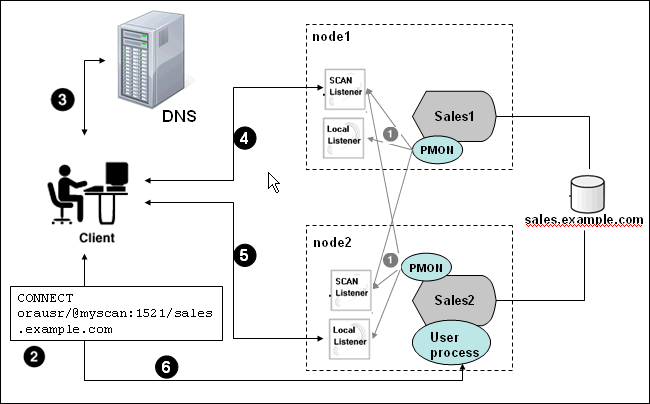

## 7 Understanding the Oracle Real Application Clusters Installed Configuration

This chapter describes the configuration of an Oracle Real Application Clusters (Oracle RAC) installation.

This chapter contains the following topics:

## 7.1 Understanding the Oracle RAC Configuration

Oracle Net Configuration Assistant (NETCA) and Oracle Database Configuration Assistant (DBCA) configure your environment to meet the requirements for database creation and to enable discovery of Oracle RAC databases by Oracle Enterprise Manager.

Note:

Configuration files are created on each node of your cluster database.

Avoid changing host names after you complete the Oracle RAC installation, including adding or deleting domain qualifications. Node names are created from the host names during an Oracle Clusterware installation and are used extensively with database processes. Nodes with changed host names must be deleted from the cluster and added back with the new host names.

## 7.2 Understanding Time Zone Settings on Cluster Nodes

Oracle RAC requires that all cluster nodes have the same time zone setting. During an Oracle Clusterware installation, the installation process determines the time zone setting of the owner of the Oracle Grid Infrastructure installation on the node where Oracle Universal Installer (OUI) runs, and uses that time zone value on all of the nodes as the default time zone setting for all processes that Oracle Clusterware manages. This default setting is used for databases, Oracle Automatic Storage Management (Oracle ASM), and any other managed processes.

If you use SQL\*Plus to start an instance, then you must ensure that the time zone value used by Oracle RAC is the same as the time zone value configured in Oracle Clusterware for the database. You can change the time zone that Oracle Clusterware uses for a database by running the following command, where `time zone` is the time zone to which you want to change:

```
srvctl setenv database -T "TZ=time zone"
```

## 7.3 Working with Multiple Oracle Home Directories on Windows

Each Oracle product should be installed in its own Oracle home. In other words, each product should be installed into a different directory structure from other Oracle products. The value for `%ORACLE_BASE%` is stored in the registry (for example, in `HKEY_LOCAL_MACHINE\SOFTWARE\ORACLE\HOME0`). The values for `ORACLE_HOME` and `ORACLE_SID` are also stored in the registry. Symbolic links for these directories, like those used on UNIX platforms, are not supported on Windows platforms.

See Also:

[Oracle Database Platform Guide for Microsoft Windows](https://docs.oracle.com/cd/E11882_01/win.112/e10845/toc.htm) for more information about the registry keys

Oracle Universal Installer (OUI) records the values for environment variables such as `ORACLE_BASE`, `ORACLE_HOME`, and `ORACLE_SID` in the registry and also updates the value for the `PATH` environment variable for the user performing the installation. In Linux and UNIX systems, you must manually set these environment variables in the user session or user profile.

To change the current setting for `%ORACLE_HOME%` (the default Oracle home), perform the following steps:

1. Run OUI, release 10.n or later.
2. Click the Installed Products button.
3. Click the Environment tab at the top of the window.
4. Move the Oracle home directory that you want as your default to the top of the list.
5. Apply the changes, and exit the installer.

This procedure changes the value of the default `ORACLE_HOME` variable in the registry to the value you selected. It also ensures that the `%ORACLE_HOME%\bin` directories for each product are listed in the correct order in your `PATH` environment variable.

## 7.4 Understanding the Database Components Created by DBCA

The database components that DBCA creates include:

- Tablespaces and Data Files
- Control Files
- Online Redo Log Files

### 7.4.1 Tablespaces and Data Files

In both single-instance and cluster database environments, an Oracle database is divided into smaller logical areas of space known as tablespaces. Each tablespace corresponds to one or more data files on the shared storage. Table 7-1 shows the tablespace names used by an Oracle RAC database and the types of data they contain.

Table 7-1 Tablespace Names Used with Oracle Real Application Clusters Databases

| Tablespace Name | Contents |
| --- | --- |
| `SYSTEM` | A mandatory tablespace that consists of the data dictionary, including definitions of tables, views, and stored procedures needed by the database. Oracle Database automatically maintains information in this tablespace. |
| `SYSAUX` | A mandatory, auxiliary system tablespace that is used by many Oracle Database features and products. This tablespace contains content that was previously stored in the `DRSYS`, `CWMLITE`, `XDB`, `ODM`, `OEM_REPOSITORY`, and `SYSTEM` tablespaces. |
| `USERS` | An user-created tablespace that consists of application data. As you create and enter data into tables, Oracle Database fills this space with your data. |
| `TEMP` | A mandatory tablespace that contains temporary tables and indexes created during SQL statement processing. You may have to expand this tablespace if you run SQL statements that involve significant sorting, such as `ANALYZE COMPUTE STATISTICS` on a very large table, or the constructs `GROUP BY`, `ORDER` `BY`, or `DISTINCT`. |
| `UNDOTBS` n | System-managed tablespaces that contain undo data for each instance. Each Oracle RAC instance uses a different value for n in the tablespace name. These tablespaces are used for automatic undo management. |
| `RBS` | A system tablespace that contains rollback segments. If you do not use automatic undo management, then you must configure the `RBS` tablespace. The `RBS` tablespace should only be used when needed for compatibility with earlier versions of Oracle Database. |

See Also:

[Oracle Database Administrator's Guide](https://docs.oracle.com/cd/E11882_01/server.112/e25494/create.htm#ADMIN11085) for more information about the `SYSTEM`, `SYSAUX`, and other tablespaces

You cannot alter these tablespace names if you select a preconfigured database templates, or database configuration type when installing Oracle RAC. However, you can change the names of the tablespaces if you select the Advanced database configuration type during the Oracle RAC installation. See ["Selecting an Oracle Database Configuration Type"](racinstl.md) for more information about database configuration types.

As mentioned, each tablespace has one or more data files. The data file names created by the preconfigured database configuration types vary by storage type such as Oracle Automatic Storage Management (Oracle ASM), or a file system.

Windows platforms use symbolic link names for the data files and other database files as shown in Table 7-2. You can specify different symbolic link names when you select the Advanced database configuration type during installation.

Table 7-2 Symbolic Link Names for Database Files on Windows Platforms

| Windows Symbolic Link Name | Tablespace or Other Database File Name |
| --- | --- |
| `db_name` `_system` | `SYSTEM` |
| `db_name_SYSAUX` | `SYSAUX` |
| `db_name` `_users` | `USERS` |
| `db_name` `_temp` | `TEMP` |
| `db_name` \_ `undotbs1` | `UNDOTBS1` |
| `db_name` `_undotbs2` | `UNDOTBS2` |
| `db_name` `_rbs` | `RBS` |
| `db_name` `_example` | `EXAMPLE` |
| `db_name` `_indx` | `INDX` |
| `db_name` `_spfile` | `SPFILE` |
| `db_name` `_control1` | First control file |
| `db_name` `_control2` | Second control file |
| `db_name` `_redo` `instance_number_log_number`  Where `instance_number` is the number of the instance and `log_number` is the redo log number (1 or 2). | Online redo log files  Each database instance must have at least two online redo log files. If the database name is `db`, then the symbolic link names for online redo log files for the first database instance are:  `db_redo1_1`  `db_redo1_2`  The link names for the online redo log files for the second instance are:  `db_redo2_1`  `db_redo2_2` |

### 7.4.2 Control Files

The database is configured with two control files that must be stored on shared storage. Every database must has one unique control file; any additional control files configured for the database are identical copies of the original control file.

If a control file becomes unusable, then the database instance fails when it attempts to access the damaged control file. By multiplexing (creating multiple copies of) a control file on different disks, the database can achieve redundancy and thereby avoid a single point of failure.

See Also:

[Oracle Database Concepts](https://docs.oracle.com/cd/E11882_01/server.112/e40540/physical.htm#CNCPT404) for more information about the control file

### 7.4.3 Online Redo Log Files

Each database instance must have at least two online redo log files. The online redo log files for a database instance are called the redo thread. Each Oracle RAC database instance has its own redo thread to avoid contention for a single set of online redo log files. In case of instance failure, the online redo log files must be accessible by the surviving instances. Therefore, the online redo log files for an Oracle RAC database must be placed on shared storage or Oracle ASM. If you use a file system for storage, then the file system must be a shared or cluster file system.

The generated file names created by the preconfigured database configuration types for the online redo log files can vary depending on the type of storage used. Unless you are using a cluster file system or Oracle ASM, during installation or database creation, you must specify a raw device name for the storage location of each online redo log file.

See Also:

- [Oracle Database Concepts](https://docs.oracle.com/cd/E11882_01/server.112/e40540/physical.htm#CNCPT11302) for more information about the online redo log files
- [Oracle Real Application Clusters Administration and Deployment Guide](https://docs.oracle.com/cd/E11882_01/rac.112/e41960/storage.htm#RACAD704) for more information about storage for online redo log files

## 7.5 Managing Undo Tablespaces in Oracle RAC

Oracle Database stores rollback or undo information in undo tablespaces. To manage undo tablespaces, Oracle recommends that you use automatic undo management, which is an automated management mode for the undo tablespace that makes the undo tablespace easier to administer.

When Oracle ASM and Oracle Managed Files (OMF) are used along with automatic undo management, an instance that is started for the first time, and thus does not have an undo tablespace, has its undo tablespace created for it by another instance automatically. The same is also true for online redo logs.

See Also:

- [Oracle Database Administrator's Guide](https://docs.oracle.com/cd/E11882_01/server.112/e25494/undo.htm#ADMIN11461) for more information about automatic undo management
- [Oracle Real Application Clusters Administration and Deployment Guide](https://docs.oracle.com/cd/E11882_01/rac.112/e41960/storage.htm#RACAD705) for more information about managing undo tablespaces

## 7.6 Using Initialization Parameter Files

Oracle recommends that you use a server parameter file (SPFILE) for storing Oracle Database initialization parameters. Oracle recommends that you store all SPFILEs on Oracle ASM, including the Oracle ASM SPFILE. SPFILEs must be located on shared storage so that all instances in a cluster database can access this parameter file.

See Also:

[Chapter 5, " Configuring the Server Parameter File in Oracle Real Application Clusters Environments"](params.md) for more information about the creation and use of parameter files

## 7.7 Oracle Database Vault Default Audit Policy and Initialization Parameters

Oracle Database Vault installs a baseline database auditing policy. This policy covers the access control configuration information stored in Oracle Database Vault tables, information stored in the Oracle data dictionary (rollback segments, tablespaces, and so on), the use of system privileges, and Oracle Label Security configuration. When you install Oracle Database Vault, the security specific database initialization parameters are initialized with default values.

See Also:

[Oracle Database Vault Administrator's Guide](https://docs.oracle.com/cd/E11882_01/server.112/e23090/dv_impact.htm#DVADM018) for more information about how installing Oracle Database Vault affects the Oracle RAC database configuration

## 7.8 Understanding Oracle Net Services Configuration Files

Networking elements for the Oracle Database server and clients are preconfigured for most environments. The Easy Connect naming method is enabled by default and does not require a repository. If you use a naming method other than Easy Connect, then additional configuration of Oracle Net Services may be required.

The following sections the Oracle Net Services configuration for an Oracle RAC database:

- Configuring the Listener Configuration File (listener.ora)
- Net Service Names (tnsnames.ora File)
- Net Services Profile (sqlnet.ora File)

### 7.8.1 Database Services for an Oracle RAC Database

Each database is represented by one or more services. A service is identified by a service name, for example, `sales.example.com`. A client uses a service name to identify the database it must access. The information about the database service and its location in the network is transparent to the client.

The information needed to use a service name to create a database connection is stored in a repository, which is represented by one or more naming methods. A naming method is a resolution method used by a client application to resolve a connect identifier (such as the service name) to a connect descriptor when attempting to connect to a database service. Oracle Net Services offers several types of naming methods that support localized configuration on each client, or centralized configuration that can be accessed by all clients in the network.

An Oracle Database 11g release 2 (11.2) database service automatically registers with the listeners specified in the `LOCAL_LISTENER` and `REMOTE_LISTENER` parameters. During registration, PMON sends information such as the service name, instance names, and workload information to the listeners. This feature is called service registration

Services coordinate their sessions by registering their workload, or the amount of work they are currently handling, with the local listener and the SCAN listeners. Clients are redirected by the SCAN listener to a local listener on the least-loaded node that is running the instance for a particular service. This feature is called load balancing. The local listener either directs the client to a dispatcher process (if the database was configured for shared server), or directs the client to a dedicated server process.

When a listener starts after the Oracle instance starts, and the listener is available for service registration, registration does not occur until the next time the Oracle Database process monitor (PMON) starts its discovery routine. By default, the PMON discovery routine is started every 60 seconds. To override the 60-second delay, use the SQL statement `ALTER SYSTEM REGISTER`. This statement forces PMON to register the service immediately.

Note:

Oracle recommends that you create a script to run this statement immediately after starting the listener. If you run this statement when the instance is registered are services are currently registered, or while the listener is down, then the statement has no effect.

See Also:

[Oracle Database Net Services Administrator's Guide](https://docs.oracle.com/cd/E11882_01/network.112/e41945/net_arch.htm#NETAG1080) for more information about service registration

### 7.8.2 Configuring the Listener Configuration File (listener.ora)

You can configure Oracle Net Services and listeners as described in the following sections:

- Grid Naming Service and Listeners
- Local Listeners
- Configuring Multiple Listeners for Your Database Using DBCA
- How Oracle Database Uses the Listener File (listener.ora)

#### 7.8.2.1 Grid Naming Service and Listeners

If you enable GNS, then you do not have to manually configure the listener.

In GNS configurations, there is one GNS daemon for the cluster. Service requests to the cluster domain that GNS manages are routed to the GNS VIP address, which routes these requests to the GNS daemon.

The GNS daemon listens for registrations. When a SCAN VIP starts on a node, it registers its addresses with GNS. When GNS receives a request from a DNS for the SCAN, it returns the registered addresses to the DNS.

#### 7.8.2.2 Local Listeners

Starting with Oracle Database 11g release 2 (11.2), the local listener, or default listener, is located in the Grid home when you have Oracle Grid Infrastructure installed. The `listener.ora` file is located in the `Grid_home` `\network\admin` directory. You can use a non-default location for the `listener.ora` file by setting the `TNS_ADMIN` environment variable or registry value to point to the directory that contains the Oracle Net Services configuration files.

During Oracle Database creation, the `LOCAL_LISTENER` parameter is automatically configured to point to the local listener for the database. The Database Agent process (`oraagent.exe`, previously known as `racgimon`) sets the `LOCAL_LISTENER` parameter to a connect descriptor that does not require an Oracle Net service name.

You can set a value manually for `LOCAL_LISTENER`. If you set `LOCAL_LISTENER`, then the Database Agent process does not automatically update this value. Oracle recommends that you leave the parameter unset so that the Database Agent process can maintain it automatically. If you do not set `LOCAL_LISTENER`, then the Database Agent process automatically updates the database associated with the local listener in the Grid home, even when the ports or IP address of that listener are changed.

See Also:

- "Net Service Names (tnsnames.ora File)" for more information about listener associations defined in the `tnsnames.ora` file
- [Oracle Database Net Services Reference](https://docs.oracle.com/cd/E11882_01/network.112/e10835/listener.htm#NETRF292) for more information about the `listener.ora` file
- [Oracle Database Net Services Administrator's Guide](https://docs.oracle.com/cd/E11882_01/network.112/e41945/toc.htm) for information about understanding and configuring listeners

#### 7.8.2.3 How Oracle Database Uses the Listener File (listener.ora)

Local listeners are configured to respond to database connection requests, and to nondatabase connection requests, such as external procedures or Oracle XML Database (XDB) requests. The `listener.ora` file is the configuration file for a listener. It can include the protocol addresses it is accepting connection requests on, a list of the database and nondatabase services it is listening for, and control parameters used by the listener. You can modify the configuration of the listeners used by Oracle Clusterware and Oracle RAC with Server Control Utility (SRVCTL) commands, or by using NETCA. Manual editing of the `listener.ora` file is not required.

Before you install Oracle RAC, during the Oracle Grid Infrastructure installation, NETCA creates and starts a default listener in the Grid home called `LISTENER`. The listener is configured with default protocol listening addresses. The listener is configured to respond to connection requests that are directed to one protocol address specified during installation.

During the Oracle RAC installation, the Oracle RAC database uses the listener in the Grid home, and configures service information about the Oracle RAC database. The database services are registered automatically and do not require configuration in the `listener.ora` file. Dynamic service registration eliminates the need for static configuration of database services. However, static service configuration is required if you plan to use Oracle Enterprise Manager.

Each listener is configured with one or more protocol addresses that specify its listening endpoints. The protocol address defines the protocol the listener listens on, and any other protocol specific information, such as the address, host, and port. Starting with Oracle Database 11g release 2, the `listener.ora` file now contains only an IPC key and the following information:

```
(ADDRESS = (PROTOCOL=TCP)(HOST=)(PORT=1521))
```

In the previous example, the protocol `ADDRESS` refers implicitly to the `HOST` endpoint of the local node. The `listener.ora` file is the same on every node for an Oracle RAC database. Listening endpoints, such as the port numbers, are dynamically registered with the listener.

Example 7-1 Example `listener.ora` File for an Oracle RAC Node

The following is an example `listener.ora` file as it would appear after installation, with an entry for a node named `node1` and a SCAN listener.

```
LISTENER_SCAN1=(DESCRIPTION=(ADDRESS_LIST=(ADDRESS=(PROTOCOL=IPC)(KEY=LISTENER_
SCAN1))))               # line added by Agent
LISTENER_NODE1=(DESCRIPTION=(ADDRESS_LIST=(ADDRESS=(PROTOCOL=IPC) (KEY=LISTENER))))
          # line added by Agent
# listener.ora.mycluster Network Configuration File:
C:\app\oracle\product\11.2.0\dbhome_1\network\admin\listener.ora.mycluster
# Generated by Oracle configuration tools.
 
LISTENER_NODE1 =
  (DESCRIPTION_LIST =
    (DESCRIPTION =
      (ADDRESS = (PROTOCOL = IPC)(KEY = EXTPROC1521))
    )
  )
 
ENABLE_GLOBAL_DYNAMIC_ENDPOINT_LISTENER_NODE1=ON              # line added by Agent
ENABLE_GLOBAL_DYNAMIC_ENDPOINT_LISTENER_SCAN2=ON              # line added by Agent
ENABLE_GLOBAL_DYNAMIC_ENDPOINT_LISTENER_SCAN1=ON              # line added by Agent
```

#### 7.8.2.4 Configuring Multiple Listeners for Your Database Using DBCA

It is possible to configure multiple listeners, each with unique name, in one listener.ora file. Multiple listener configurations are possible because each of the top-level configuration parameters has a suffix of the listener name or is the listener name itself.

Note:

Oracle recommends running only one listener for each node in most customer environments.

You can use DBCA to configure which listeners your Oracle RAC database registers with. If DBCA detects more than one listener on a node, then it displays a list of the listeners. You can select one or all of these listeners with which to register your database.

Note:

To administer Oracle Database 11g release 2 (11.2) local and SCAN listeners using the `lsnrctl` command, set your `ORACLE_HOME` environment variable to the path for the Grid home. Do not attempt to use the `lsnrctl` commands from Oracle home locations for earlier releases, because they cannot be used with Oracle Database 11g release 2 (11.2).

### 7.8.3 Net Service Names (tnsnames.ora File)

A `tnsnames.ora` file is created on each node and acts as a repository of net service names. Each net service name is associated with a connect identifier. A connect identifier is an identifier that maps a user-defined name to a connect descriptor. A connect descriptor contains the following information:

- The network route to the service, including the location of the listener through a protocol address
- The `SERVICE_NAME` parameter, with the value set to the name of a database service
	Note:
	The `SERVICE_NAME` parameter you use in the `tnsnames.ora` file is singular, because you can specify only one service name. There is also the `service_names` parameter in the database initialization file. The `service_names` database parameter defaults to the global database name, a name comprising the `db_name` and `db_domain` parameters in the initialization parameter file.

Example 7-2 Example `tnsnames.ora` File

The following is an example of a `tnsnames.ora` file. It contains a single net service name entry. The connect identifier for the net service name is `sales`. The database service associated with the `sales` connect identifier is `myApp`. The connect descriptor is the information in the line that starts with `ADDRESS`.

```
#  tnsnames.ora Network Configuration File:
C:\app\grid\11.2.0\network\admin\tnsnames.ora
#  Generated by Oracle configuration tools.

sales =
 (DESCRIPTION =
   (ADDRESS = (PROTOCOL = TCP)(HOST = myscan.mycluster.example.com)(PORT = 1522))
      (CONNECT_DATA =
        (SERVER = DEDICATED)
        (SERVICE_NAME = myApp)
    )
  )
```

The `tnsnames.ora` file is located in both the `Grid_home` `\network\admin` and `Oracle_home` `\network\admin` directories. By default, the `tnsnames.ora` file is read from the Grid home when Oracle Grid Infrastructure is installed.

Example 7-3 Example `tnsnames.ora` Entry for an Oracle RAC Database

The following is an example of a net service name stored in the tnsnames.ora file for an Oracle RAC 11g release 2 (11.2) database after installation, where the database name is `RACDB`, the cluster name is `mycluster`, and GNS is configured for the cluster:

```
RACDB =
   (DESCRIPTION = 
     (ADDRESS = (PROTOCOL = TCP)(HOST=myscan.mycluster.example.com)(PORT=1521))
     (CONNECT_DATA =
       (SERVER = DEDICATED)
       (SERVICE_NAME = RACDB)
      )
    )
```

With Oracle Clusterware 11g release 2 and later, the listener association no longer requires `tnsnames.ora` file entries. The listener associations are configured as follows:

- DBCA no longer sets the `LOCAL_LISTENER` parameter. The Oracle Clusterware agent that starts the database sets the `LOCAL_LISTENER` parameter dynamically, and it sets it to the actual value, not an alias. So `listener_` `alias` entries are no longer needed in the `tnsnames.ora` file.
- The `REMOTE_LISTENER` parameters is configured by DBCA to reference the SCAN and SCAN port, without any need for a `tnsnames.ora` entry. Oracle Clusterware uses the Easy Connect naming method with `scanname`:`scanport`, so no listener associations for the `REMOTE_LISTENER` parameter are needed in the `tnsnames.ora` file.

See Also:

[Oracle Database Net Services Administrator's Guide](https://docs.oracle.com/cd/E11882_01/network.112/e41945/listenercfg.htm#NETAG302) for more information about the `tnsnames.ora` file

DBCA creates net service names for connections as described in the following sections:

- Net Service Names for Database Connections
- Net Service Name for Instance Connections

#### 7.8.3.1 Net Service Names for Database Connections

Clients that connect to any instance of the database should use SCAN in the connect descriptor. You could also use a net service name to connect to the database. The net service name created by DBCA enables Oracle Enterprise Manager to discover an Oracle RAC database.

Three SCAN addresses are configured for the cluster, and allocated to servers. When a client issues a connection request using SCAN, the three SCAN addresses are returned to the client. If the first address fails, then the connection request to the SCAN name fails over to the next address. Using multiple addresses allows a client to connect to an instance of the database even if the initial instance has failed.

Example 7-4 Sample Net Service Name Entry for a Database Connection

This example shows a connect descriptor that is used in a `tnsnames.ora` file. The connect identifier in this case is the same as the database name, `mycluster.example.com`. Instead of specifying an individual server, virtual Internet Protocol (VIP) address, or cluster node name, the connect descriptor uses SCAN, which is `myscan.mycluster.example.com`.

Connections that use the net service name `mycluster.example.com` are connected to any of the database instances of the `mycluster` database that runs the `myApp` database service.

```
mycluster.example.com =
  (DESCRIPTION =
    (ADDRESS = (PROTOCOL = TCP)(HOST = host=myscan.mycluster.example.com)
      (PORT = 1522))
    (CONNECT_DATA =
      (SERVER = DEDICATED)
      (SERVICE_NAME = myApp)
    )
  )
```

The net service name does not need to know the physical address of the server on which the database, database instance, or listener runs. SCAN is resolved by DNS, which returns three IP addresses to the client. The client then tries each address in succession until a connection is made.

Example 7-5 Connecting to Oracle RAC Using the Easy Connect Naming Method

Clients can use SCAN and the Easy Connect naming method to connect to an Oracle RAC database without configuring the `tnsnames.ora` file. If the Oracle RAC database runs on a cluster for which SCAN is `myscan.mycluster.example.com`, then you could use a connection request for the database service `RACDB.example.com` using a connect descriptor similar to the following:

```
username
/@myscan.mycluster.example.com:1521/RACDB.example.com
```

#### 7.8.3.2 Net Service Name for Instance Connections

Clients that connect to a particular instance of the database use the net service name for the instance. The `tnsnames.ora` entry in Example 7-6 enables Oracle Enterprise Manager to discover the database instances in the cluster. These entries are also used to start and stop instances.

Example 7-6 Sample Net Service Name Entry for an Instance Connection

This example shows a net service name that is used to connect to a specific database instance. The connect identifier is the same as the instance name, `mycluster1.example.com`. The connect descriptor uses SCAN to locate the instance. Connections that use the net service name `mycluster1.example.com` are connected to the `mycluster1` database instance of the `mycluster` database, without needing to know on which node the instance is running.

```
mycluster1.example.com=
  (DESCRIPTION=
    (ADDRESS=(PROTOCOL=TCP)(HOST=myscan.mycluster.example.com)(PORT=1521))
    (CONNECT_DATA=
      (SERVICE_NAME=mycluster.example.com)
      (INSTANCE_NAME=mycluster1)
    )
  )
```

### 7.8.4 Net Services Profile (sqlnet.ora File)

OUI starts NETCA after the database is created. NETCA creates the Oracle Net Services profile, or the `sqlnet.ora` file. In an Oracle Grid Infrastructure installation, the `sqlnet.ora` file is located in the following directory by default:

```
Grid_home\network\admin
```

In the `%ORACLE_HOME%\network\admin` directory, in addition to a default `sqlnet.ora` file, you also can find a sample `sqlnet.ora` file in the subdirectory `sample`.

During installation, NETCA creates the following entries in the `sqlnet.ora` file, where `%ORACLE_BASE%` is the path to the Oracle base directory for the Oracle RAC installation:

```
SQLNET.AUTHENTICATION_SERVICES= (NTS)
NAMES.DIRECTORY_PATH=(TNSNAMES, EZCONNECT)
ADR_BASE =%ORACLE_BASE%
```

The `AUTHENTICATION_SERVICES` parameter specifies the method by which users are authenticated for database access. The value `NTS` indicates that Microsoft Windows native operating system authentication should be used to authorize access to the database. The parameter `NAMES.DIRECTORY_PATH` specifies the priority order of the naming methods to use to resolve connect identifiers to connect descriptors. The `ADR_BASE` parameter specifies the base directory into which tracing and logging incidents are stored when Automatic Diagnostic Repository (ADR) is enabled for the database.

The Easy Connect naming method eliminates the need to lookup service names in the `tnsnames.ora` files for TCP/IP environments. With Easy Connect, clients use a connect string for a simple TCP/IP address, consisting of a host name and optional port and service name. If you use this method, then no naming or directory system is required. See Example 7-5, "Connecting to Oracle RAC Using the Easy Connect Naming Method" for an example.

See Also:

- [Oracle Database Net Services Administrator's Guide](https://docs.oracle.com/cd/E11882_01/network.112/e41945/toc.htm) for more information about the `sqlnet.ora` file
- [Oracle Database Concepts](https://docs.oracle.com/cd/E11882_01/server.112/e40540/cmntopc.htm#CNCPT1556) for more information about authentication
- [Oracle Database Client Installation Guide for Microsoft Windows](http://www.oracle.com/pls/topic/lookup?ctx=db112&id=NTCLI004) for more information about configuring clients for database connectivity
- [Oracle Database Administrator's Guide](https://docs.oracle.com/cd/E11882_01/server.112/e25494/diag.htm#ADMIN11261) for more information about ADR

## 7.9 Using SCAN with Oracle RAC Databases

Oracle RAC databases provide the important benefits of connection load balancing and failover. Standalone Oracle databases perform load balancing by distributing connections among the shared server dispatcher processes.

Oracle RAC databases increase load balancing by using the single client access name (SCAN) for the cluster to balance connections among all instances in a cluster database. SCAN also adds location independence for the databases, so that client configuration does not have to depend on which nodes are running a particular database or database instance.

Review the following sections to understand Oracle RAC load-balancing features:

- Understanding SCAN
- Understanding SCAN Listeners and Listener Registration
- Understanding Failover, Load Balancing, and SCAN
- Understanding Shared Server Use in an Oracle RAC Database

### 7.9.1 Understanding SCAN

SCAN is a fully qualified name (host name.domain name) that is configured to resolve to all the addresses allocated for the SCAN listeners. The default value for SCAN is `cluster_name`.`GNS_sub_domain`, or, `cluster_name` `-scan.``domain_name` if GNS is not used. For example, in a cluster that does not use GNS, if your cluster name is `salesRAC`, and your domain is `example.com`, then the default SCAN address is `salesRAC-scan.example.com:1521`.

SCAN is configured in DNS to resolve to three IP addresses, and DNS should return the addresses using a round-robin algorithm. This means that when SCAN is resolved by DNS, the IP addresses are returned to the client in a different order each time.

Note:

Configuring SCAN in DNS using a round-robin algorithm does not ensure failover of connections. Instead, failover of connections is handled by the Oracle Client. Oracle recommends that you use Oracle Client 11g release 2 for connections that use SCAN.

SCAN provides location independence for the databases, so that the client configuration does not have to include the address of each node that hosts a particular database or database instance. For example, if you configure policy-managed server pools for a cluster, then SCAN enables connections to databases in these server pools regardless of which nodes are allocated to the server pool.

During the installation of Oracle Grid Infrastructure, several Oracle Clusterware resources are created for SCAN:

- A SCAN VIP is created for each IP address that SCAN resolves to
- A SCAN listener is created for each SCAN VIP
- A dependency on the SCAN VIP is configured for the SCAN listener

SCAN VIPs function like node VIPs, except that SCAN VIPs can run on any node in the cluster. Also, if you have three SCAN VIPs but only two nodes in your cluster, you can have two SCAN VIPs running on the same server. Clients (users or applications) that connect using SCAN instead of the node VIPs do not have to update the list of VIP addresses in their local `tnsnames.ora` file when nodes are added to or removed from the cluster.

### 7.9.2 Understanding SCAN Listeners and Listener Registration

During Oracle Grid Infrastructure installation, SCAN listeners are created for as many IP addresses as there are addresses assigned to resolve to the SCAN. Oracle recommends that the SCAN resolves to three addresses, to provide high availability and scalability. If the SCAN resolves to three addresses, then there are three SCAN listeners created.

The addresses for the SCAN listeners resolve with either the domain name service (DNS), or within the cluster for the Grid Naming Service (GNS), using a round-robin method. SCAN listeners can run on any node in the cluster.

The database parameter `LOCAL_LISTENER` specifies the listening endpoint of the local database listener, and the database parameter `REMOTE_LISTENER` parameter identifies the SCAN listeners. The database registers with the local and SCAN listeners by using the connect description information contained in these parameters. Oracle Database 11g release 2 and later instances only register with SCAN listeners as remote listeners. Upgraded databases register with SCAN listeners as remote listeners, and also continue to register with all node listeners.

Starting with Oracle Database 11g release 2, the `REMOTE_LISTENER` parameter is always set to the SCAN address. Do not set it to an Oracle Net alias that has a single address that uses SCAN for the host name (`HOST=` `scan`). For example, if SCAN for the cluster is `myscan`, and the GNS subdomain for the cluster is `mycluster.example.com`, then the `REMOTE_LISTENER` parameter has the following value:

```
myscan.mycluster.example.com:1521
```

The Database Agent process (previously known as `racgimon`) configures the `LOCAL_LISTENER` initialization parameter automatically for Oracle RAC databases by specifying a connect descriptor for the node VIP address of the local node. You do not have to alter this setting. The `REMOTE_LISTENER` parameter should be set to the SCAN and SCAN port. If you change the SCAN port, then you must change the value for the `REMOTE_LISTENER` parameter using the SQL statement `ALTER SYSTEM SET REMOTE_LISTENER`.

### 7.9.3 Understanding Failover, Load Balancing, and SCAN

Oracle RAC provides failover with the node VIP addresses by configuring multiple listeners on multiple nodes to manage client connection requests for the same database service. If a node fails, then the service connecting to the VIP is relocated transparently to a surviving node, enabling fast notification of the failure to the clients connecting through the VIP. If the application and client are configured with transparent application failover options, then the client is reconnected to the surviving node.

Clients configured to use VIP addresses for Oracle RAC releases prior to Oracle Database 11g release 2 can continue to use their existing connection addresses; using SCAN is not required. When an earlier release of Oracle Database is upgraded, it registers with the SCAN listeners, and clients can start using SCAN to connect to that database.

There are two types of load balancing that you can implement for an Oracle RAC database: client-side and server-side load balancing. Client-side load balancing balances the connection requests across the listeners. With server-side load balancing, the SCAN listener directs a connection request to the best instance currently providing the service by using the load balancing advisory.

Based on the environment, the following actions occur when you use SCAN to connect to an Oracle RAC database using a service name. The numbered actions correspond to the arrows shown in Figure 7-1.

1. The PMON process of each instance registers the database services with the default listener on the local node and with each SCAN listener, which is specified by the `REMOTE_LISTENER` database parameter. The listeners are dynamically updated on the amount of work being handled by the instances and dispatchers.
2. The client issues a database connection request using a connect descriptor of the form:
	```
	orausr/@scan_name:1521/sales.example.com
	```
	Note:
	If you use the Easy Connect naming method, then ensure the `sqlnet.ora` file on the client contains `EZCONNECT` in the list of naming methods specified by the `NAMES.DIRECTORY_PATH` parameter.
3. The client uses DNS to resolve `scan_name`. After DNS returns the three addresses assigned to SCAN, the client sends a connect request to the first IP address. If the connect request fails, then the client attempts to connect using the next IP address.
4. When the connect request is successful, the client connects to a SCAN listener for the cluster which hosts the `sales` database. The SCAN listener compares the workload of the instances `sales1` and `sales2` and the workload of the nodes on which they are running. Because `node2` is less loaded than `node1`, the SCAN listener selects `node2` and sends the address for the listener on that node back to the client.
5. The client connects to the local listener on `node2`. The local listener starts a dedicated server process for the connection to the database.
6. The client connects directly to the dedicated server process on node2 and accesses the `sales2` database instance.

Figure 7-1 Load Balancing Actions for Oracle RAC Connections That Use SCAN



> Figure 7-1 is an illustration of how load balancing works on an Oracle RAC system when SCAN is used. The contents of the illustration were described in the preceding numbered list.
>
> [Copyright © 2007, 2015, Oracle and/or its affiliates. All rights reserved.](https://docs.oracle.com/cd/E11882_01/dcommon/html/cpyr.htm)
  

See Also:

- The [Oracle Grid Infrastructure Installation Guide for Microsoft Windows x64 (64-Bit)](https://docs.oracle.com/cd/E11882_01/install.112/e48194/toc.htm) for more information about SCAN and its configuration
- [Oracle Real Application Clusters Administration and Deployment Guide](https://docs.oracle.com/cd/E11882_01/rac.112/e41960/hafeats.htm#RACAD076) for more information about failover, load balancing, and the load balancing advisory