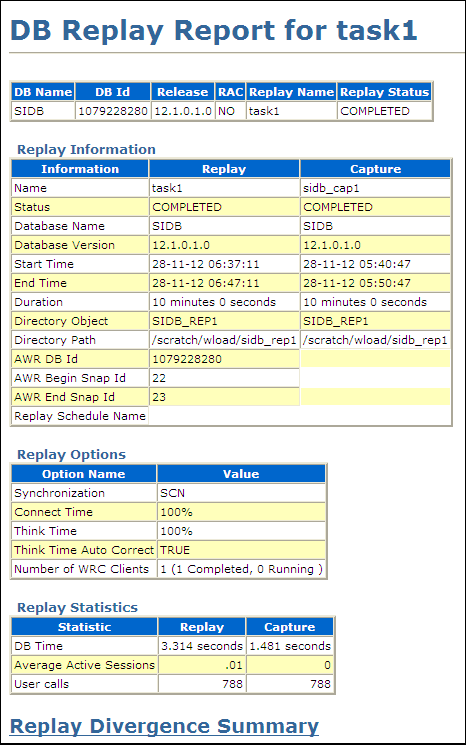
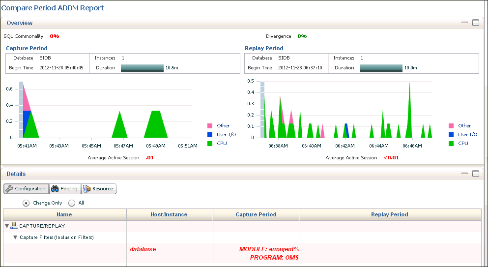
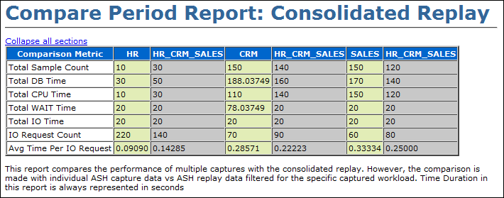
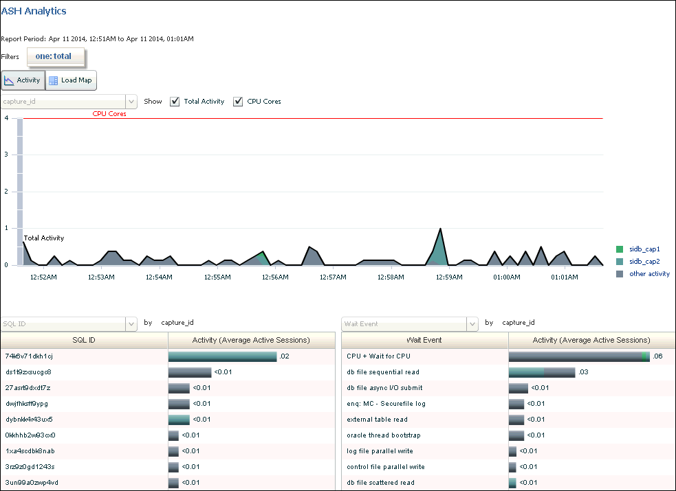
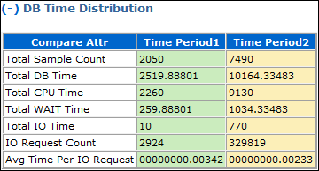
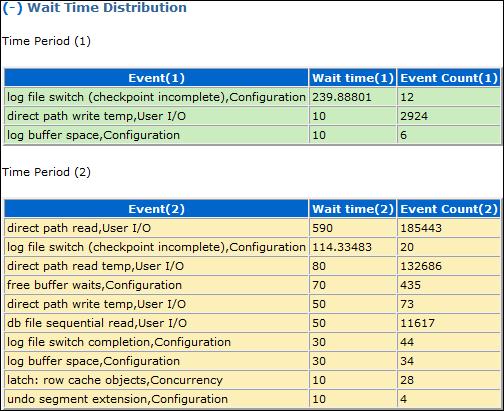
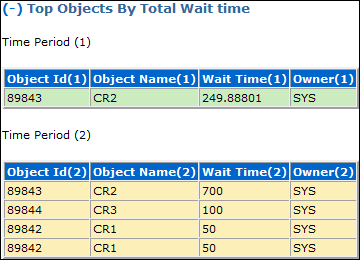

## 12 Analyzing Captured and Replayed Workloads

There are three types of reports for Database Replay: workload capture, workload replay, and compare period.

This chapter describes how to generate and analyze these reports and contains the following sections:

Note:

After the replay analysis is complete, you can restore the database to its original state at the time of workload capture and repeat workload replay to test other changes to the system once the workload directory object is backed up to another physical location.

## 12.1 Using Workload Capture Reports

Workload capture reports contain captured workload statistics, information about the top session activities that were captured, and any workload filters used during the capture process.

The following sections describe how to generate and utilize workload capture reports:

- Accessing Workload Capture Reports Using Enterprise Manager
- Generating Workload Capture Reports Using APIs
- Reviewing Workload Capture Reports

### 12.1.1 Accessing Workload Capture Reports Using Enterprise Manager

This section describes how to generate a workload capture report using Oracle Enterprise Manager.

The primary tool for generating workload capture reports is Oracle Enterprise Manager. If for some reason Oracle Enterprise Manager is unavailable, you can generate workload capture reports using APIs, as described in "Generating Workload Capture Reports Using APIs".

To access workload capture reports using Enterprise Manager:

1. From the Enterprise menu of the Enterprise Manager Cloud Control console, select Quality Management, then Database Replay.
	If the Database Login page appears, log in as a user with administrator privileges.
	The Database Replay page appears.
2. From the Captured Workloads tab of the Database Replay page for a capture that has a Status other than Completed, click the name of the desired capture from the Capture table.
	The Summary tab of the Database Replay page appears.
3. Click the Reports tab for access to controls for the Workload Capture report and Workload Capture ASH Analytics report.
	- The Workload Capture report contains detailed output showing the type of data components that were captured and not captured.
		For information about how to interpret the workload capture report, see "Reviewing Workload Capture Reports".
		- The Capture ASH Analytics report shows which sessions are consuming the most database time. This report provides a stacked chart to help you visualize the active session activity for several dimensions, such as Event, Activity Class, Module/Action, Session, Instance ID, and PL/SQL function.
		The "Other Activity" list choice for the report means that the activity has not been captured.
4. After you access a report, you can save it by clicking Save.
	See Also:
	- [Oracle Database Performance Tuning Guide](http://www.oracle.com/pls/topic/lookup?ctx=db112&id=TGDBA277) for information about ASH (Active Session History).

### 12.1.2 Generating Workload Capture Reports Using APIs

This section describes how to generate a workload capture report using the `DBMS_WORKLOAD_CAPTURE` package. You can also use Oracle Enterprise Manager to generate a workload capture report, as described in "Accessing Workload Capture Reports Using Enterprise Manager".

To generate a report on the latest workload capture, use the `DBMS_WORKLOAD_CAPTURE`.`GET_CAPTURE_INFO` procedure and the `DBMS_WORKLOAD_CAPTURE.REPORT` function:

```
DECLARE
  cap_id         NUMBER;
  cap_rpt        CLOB;
BEGIN
  cap_id  := DBMS_WORKLOAD_CAPTURE.GET_CAPTURE_INFO(dir => 'dec06');
  cap_rpt := DBMS_WORKLOAD_CAPTURE.REPORT(capture_id => cap_id,
                           format => DBMS_WORKLOAD_CAPTURE.TYPE_TEXT);
END;
/
```

In this example, the `GET_CAPTURE_INFO` procedure retrieves all information regarding the workload capture in the `dec06` directory and returns the appropriate `cap_id` for the workload capture. The `REPORT` function generates a text report using the `cap_id` that was returned by the `GET_CAPTURE_INFO` procedure.

The `GET_CAPTURE_INFO` procedure uses the `dir` required parameter, which specifies the name of the workload capture directory object.

The `REPORT` function uses the following parameters:

- The `capture_id` required parameter relates to the directory that contains the workload capture for which the report will be generated. The directory should be a valid directory in the host system containing the workload capture. The value of this parameter should match the `cap_id` returned by the `GET_CAPTURE_INFO` procedure.
- The `format` required parameter specifies the report format. Valid values include `DBMS_WORKLOAD_CAPTURE`.`TYPE_TEXT` and `DBMS_WORKLOAD_REPLAY`.`TYPE_HTML`.

For information about how to interpret the workload capture report, see "Reviewing Workload Capture Reports".

See Also:

- [Oracle Database PL/SQL Packages and Types Reference](https://docs.oracle.com/cd/E11882_01/appdev.112/e40758/d_workload_capture.htm#ARPLS207) for information about the `DBMS_WORKLOAD_CAPTURE` package

### 12.1.3 Reviewing Workload Capture Reports

The workload capture report contains various types of information that can be used to assess the validity of the workload capture. Using the information provided in this report, you can determine if the captured workload:

- Represents the actual workload you want to replay
- Does not contain any workload you want to exclude
- Can be replayed

The information contained in the workload capture report are divided into the following categories:

- Details about the workload capture (such as the name of the workload capture, defined filters, date, time, and SCN of capture)
- Overall statistics about the workload capture (such as the total DB time captured, and the number of logins and transactions captured) and the corresponding percentages with respect to total system activity
- Profile of the captured workload
- Profile of the uncaptured workload due to version limitations
- Profile of the uncaptured workload that was excluded using defined filters
- Profile of the uncaptured workload that consists of background process or scheduled jobs

## 12.2 Using Workload Replay Reports

Workload replay reports contain information that can be used to measure performance differences between the capture system and the replay system.

The following sections describe how to generate and review workload replay reports:

- Accessing Workload Replay Reports Using Enterprise Manager
- Generating Workload Replay Reports Using APIs
- Reviewing Workload Replay Reports

### 12.2.1 Accessing Workload Replay Reports Using Enterprise Manager

This section describes how to generate a workload replay report using Oracle Enterprise Manager.

The primary tool for generating workload replay reports is Oracle Enterprise Manager. If for some reason Oracle Enterprise Manager is unavailable, you can generate workload replay reports using APIs, as described in "Generating Workload Replay Reports Using APIs"

To access workload replay reports using Enterprise Manager:

1. From the Enterprise menu of the Enterprise Manager Cloud Control console, select Quality Management, then Database Replay.
	If the Database Login page appears, log in as a user with administrator privileges.
	The Database Replay page appears.
2. Click the Replay Tasks tab, then select a replay for which you want to access reports.
3. Click the Reports tab to gain access to individual reports.
	There are several types of reports you can view for a completed workload replay:
	- Database Replay
		Use this report to view complete replay statistics in a tabular format, including replay divergence and the workload profile.
		

> The title of the report shown is "DB Replay Report for task1." The report contains four tables, the first of which is not named. The other three are Replay Information, Replay Options, and Replay Statistics. All of the tables have data in the columns.
>
> The unnamed table has one row and the following columns: DB Name, DB Id, Release, RAC, Replay Name, and Replay Status.
>
> The Replay Information table has 13 rows and the following columns: Information, Replay, and Capture.
>
> The Replay Options table has 5 rows and the following columns: Option Name and Value.
>
> The Replay Statistics table has 3 rows and the following columns: Statistic, Replay, and Capture.

		- Compare Period ADDM
		Use this report to perform a high-level comparison of one workload replay to its capture or to another replay of the same capture. Only workload replays that contain at least 5 minutes of database time can be compared using this report.
		

> This report contains two major sections: Overview and Details.
>
> The Overview section first shows a SQL Commonality percentage and a Divergence percentage. Below that on the left side of the page is a Capture Period chart showing vertical graphic values for Other, User I/O, and CPU. On the right side of the page is a Replay Period chart showing vertical graphic values for Other, User I/O, and CPU.
>
> The Details section first provides buttons for Configuration, Findings, and Resources. The two radio buttons below these buttons are Change Only and All. Below this is a table with Name, Host/Instance, Capture Period, and Replay Period.
  
		  
		Examine the following sections of the report to understand the performance change between the two periods and the cause of the change:
		- Overview
			This portion of the report shows SQL commonality, which is the comparability between the base and comparison periods based on the average resource consumption of the SQL statements common to both periods.
			A commonality value of 100% means that the workload "signature" in both time periods is identical. A commonality of 100% is expected for this use case, because the workload being replayed is the same (assuming that you are not using replay filters). A value of 0% means that the two time periods have no items in common for the specific workload dimension.
			Commonality is based on the type of input (that is, which SQL is executing) as well as the load of the executing SQL statements. Consequently, SQL statements running in only one time period, but not consuming significant time, do not affect commonality. Therefore, two workloads could have a commonality of 100% even if some SQL statements are running only in one of the two periods, provided that these SQL statements do not consume significant resources.
				- Configuration
			The information displayed shows base period and comparison period values for various parameters categorized by instance, host, and database.
				- Findings
			The findings can show performance improvements and identify the major performance differences caused by system changes. For negative outcomes, if you understand and remove the cause, the negative outcome can be eliminated.
			The values shown for the Base Period and Comparison Period represent performance with regard to database time.
			The Change Impact value represents a measurement of the scale of a change in performance from one time period to another. It is applicable to issues or items measured by the total database time they consumed in each time period. The absolute values are sorted in descending order.
			If the value is positive, an improvement has occurred, and if the value is negative, a regression has occurred. For instance, a change impact of -200% means that period 2 is three times as slow as period 1.
			You can run performance tuning tools, such as ADDM and the SQL Tuning Advisor, to fix issues in the comparison period to improve general system performance.
				- Resources
			The information shown provides a summary of the division of database time for both time periods, and shows the resource usage for CPU, memory, I/O, and interconnect (Oracle RAC only).
		- SQL Performance Analyzer
		Use this report to compare a SQL tuning set from a workload capture to another SQL tuning set from a workload replay, or two SQL tuning sets from two workload replays. Comparing SQL tuning sets with Database Replay provides more information than SQL Performance Analyzer test-execute, because it considers and shows all execution plans for each SQL statement, while SQL Performance Analyzer test-execute generates only one execution plan per SQL statement for each SQL trial.
		- Replay Compare Period
		Use this report to compare the AWR data from one workload replay to its capture or to another replay of the same capture. Before running this report, AWR data for the captured or replayed workload must have been previously exported.
		

> The title of the report is Compare Period Report: Consolidated Replay.
>
> The table contains the following columns: Comparison Metric, HR, HR\_CRM\_SALES, CRM, HR\_CRM\_SALES, SALES, HR\_CRM\_SALES. The Comparison Metric column contains the following rows: Total Sample Count, Total DB Time, Total CPU Time, Total WAIT Time, Total IO Time, IO Request Count, and Avg Time Per IO Request.
>
> Data appears in all columns and rows.
  
		  
		For information about using this report, see "Reviewing Replay Compare Period Reports". For information about how to interpret replay compare period reports, see [Oracle Database 2 Day + Performance Tuning Guide](https://docs.oracle.com/cd/E11882_01/server.112/e10822/tdppt_degrade.htm#TDPPT093).
		- Replay ASH Analytics
		The Replay ASH Analytics report contains active session history (ASH) information for a specified duration of a workload that was replayed for the category you selected in the drop-down menu. Before running this report, AWR data must have been previously exported from the captured or replayed workload.
		

> This report first shows one:total, Activity, and Load Map buttons.
>
> A chart showing Total Activity from 12:52 a.m. to 1:01 a.m appears below the buttons.
>
> A table on the left side of the page below this chart shows rows of data for the columns SQL ID and Activity (Average Active Sessions).
>
> A table on the right side of the page below this chart shows rows of data for the columns Wait Event and Activity (Average Active Sessions).
  
		  
		The chart shows workload activity breakdown values for wait classes, and provides detailed statistics for the top activity sessions that are adversely affecting the system.
		You can optionally use the Load Map for a graphical view of system activity. The Load Map is useful for viewing activity in a single- or multi-dimensional layout when you are not interested in seeing how activity has changed over time within the selected period.
		For more information about this report, see the [Oracle Database 2 Day + Performance Tuning Guide](https://docs.oracle.com/cd/E11882_01/server.112/e10822/tdppt_transient.htm#TDPPT067).

### 12.2.2 Generating Workload Replay Reports Using APIs

This section describes how to generate a workload replay report using the `DBMS_WORKLOAD_REPLAY` package. You can also use Oracle Enterprise Manager to generate a workload replay report, as described in "Accessing Workload Replay Reports Using Enterprise Manager".

To generate a report on the latest workload replay for a workload capture, use the `DBMS_WORKLOAD_REPLAY`.`GET_REPLAY_INFO` procedure and the `DBMS_WORKLOAD_REPLAY.REPORT` function:

```
DECLARE
  cap_id         NUMBER;
  rep_id         NUMBER;
  rep_rpt        CLOB;
BEGIN
  cap_id := DBMS_WORKLOAD_REPLAY.GET_REPLAY_INFO(dir => 'dec06');
  /* Get the latest replay for that capture */
  SELECT max(id)
  INTO   rep_id
  FROM   dba_workload_replays
  WHERE  capture_id = cap_id;
 
  rep_rpt := DBMS_WORKLOAD_REPLAY.REPORT(replay_id => rep_id,
                           format => DBMS_WORKLOAD_REPLAY.TYPE_TEXT);
END;
/
```

In this example, the `GET_REPLAY_INFO` procedure retrieves all information regarding the workload capture in the `dec06` directory and the history of all the workload replay attempts from this directory. The procedure first imports a row into `DBA_WORKLOAD_CAPTURES`, which contains information about the workload capture. It then imports a row for every replay attempt retrieved from the replay directory into the `DBA_WORKLOAD_REPLAYS` view. The `SELECT` statement returns the appropriate `rep_id` for the latest replay of the workload. The `REPORT` function generates a text report using the `rep_id` that was returned by the `SELECT` statement.

The `GET_CAPTURE_INFO` procedure uses the `dir` required parameter, which specifies the name of the workload replay directory object.

The `REPORT` function uses the following parameters:

- The `replay_id` required parameter relates to the directory that contains the workload replay for which the report will be generated. The directory should be a valid directory in the host system containing the workload replay. The value of this parameter should match the `rep_id` returned by the `GET_CAPTURE_INFO` procedure.
- The `format` parameter required parameter specifies the report format. Valid values include DBMS\_WORKLOAD\_REPLAY.TYPE\_TEXT, DBMS\_WORKLOAD\_REPLAY.TYPE\_HTML, and DBMS\_WORKLOAD\_REPLAY.TYPE\_XML.

For information about how to interpret the workload replay report, see "Reviewing Workload Replay Reports".

See Also:

- [Oracle Database PL/SQL Packages and Types Reference](https://docs.oracle.com/cd/E11882_01/appdev.112/e40758/d_workload_replay.htm#ARPLS208) for information about the `DBMS_WORKLOAD_REPLAY` package

### 12.2.3 Reviewing Workload Replay Reports

After the workload is replayed on a test system, there may be some divergence in what is replayed compared to what was captured. There are numerous factors that can cause replay divergence, which can be analyzed using the workload replay report. The information contained in the workload replay report consists of performance and replay divergence.

Performance divergence may result when new algorithms are introduced in the replay system that affect the overall performance of the database. For example, if the workload is replayed on a newer version of Oracle Database, a new algorithm may cause specific requests to run faster, and the divergence will appear as a faster execution. In this case, this is a desirable divergence.

Data divergence occurs when the results of DML or SQL queries do not match results that were originally captured in the workload. For example, a SQL statement may return fewer rows during replay than those returned during capture.

Error divergence occurs when a replayed database call:

- Encounters a new error that was not captured
- Does not encounter an error that was captured
- Encounters a different error from what was captured

The information contained in the workload replay report is divided into the following categories:

- Details about the workload replay and the workload capture, such as job name, status, database information, duration and time of each process, and the directory object and path
- Replay options selected for the workload replay and the number of replay clients that were started
- Overall statistics about the workload replay and the workload capture (such as the total DB time captured and replayed, and the number of logins and transactions captured and replayed) and the corresponding percentages with respect to total system activity
- Profile of the replayed workload
- Replay divergence
- Error divergence
- DML and SQL query data divergence

## 12.3 Using Compare Period Reports

Compare period reports enable you to compare one workload replay to its capture or to another replay of the same capture.

The following sections describe how to generate and review the various types of compare period reports:

- Generating Compare Period Reports Using APIs
- Reviewing Replay Compare Period Reports

### 12.3.1 Generating Compare Period Reports Using APIs

This section describes how to generate compare period reports using the `DBMS_WORKLOAD_REPLAY` package. You can also use Oracle Enterprise Manager to generate compare period reports, as described in "Accessing Workload Replay Reports Using Enterprise Manager".

This section contains the following topics:

- Generating Replay Compare Period Reports Using APIs
- Generating SQL Performance Analyzer Reports Using APIs

#### 12.3.1.1 Generating Replay Compare Period Reports Using APIs

This section describes how to generate a replay compare period report using the `DBMS_WORKLOAD_REPLAY` package.

Use the replay compare period report to perform a high-level comparison of one workload replay to its capture or to another replay of the same capture. Only workload replays that contain at least 5 minutes of database time can be compared using this report.

To generate a replay compare period report, use the `DBMS_WORKLOAD_REPLAY`.`COMPARE_PERIOD_REPORT` procedure:

```
BEGIN
  DBMS_WORKLOAD_REPLAY.COMPARE_PERIOD_REPORT (
                           replay_id1 => 12,
                           replay_id2 => 17,
                           format => DBMS_WORKLOAD_CAPTURE.TYPE_HTML,
                           result => :report_bind);
END;
/
```

In this example, the `COMPARE_PERIOD_REPORT` procedure generates a replay compare period report in HTML format that compares a workload replay with a replay ID of 12 with another replay with an ID of 17.

The `COMPARE_PERIOD_REPORT` procedure in this example uses the following parameters:

- The `replay_id1` parameter specifies the numerical identifier of the workload replay after change for which the reported will be generated. This parameter is required.
- The `replay_id2` parameter specifies the numerical identifier of the workload replay before change for which the reported will be generated. If unspecified, the comparison will be performed with the workload capture.
- The `format` parameter specifies the report format. Valid values include `DBMS_WORKLOAD_CAPTURE`.`TYPE_HTML` for HTML and `DBMS_WORKLOAD_CAPTURE`.`TYPE_XML` for XML. This parameter is required.
- The result parameter specifies the output of the report.

For information about how to interpret the replay compare period report, see "Reviewing Replay Compare Period Reports".

See Also:

- [Oracle Database PL/SQL Packages and Types Reference](https://docs.oracle.com/cd/E11882_01/appdev.112/e40758/d_workload_replay.htm#ARPLS208) for information about the `DBMS_WORKLOAD_REPLAY` package

#### 12.3.1.2 Generating SQL Performance Analyzer Reports Using APIs

This section describes how to generate a SQL Performance Analyzer report using the `DBMS_WORKLOAD_REPLAY` package.

The SQL Performance Analyzer report can be used to compare a SQL tuning set from a workload capture to another SQL tuning set from a workload replay, or two SQL tuning sets from two workload replays. Comparing SQL tuning sets with Database Replay provides more information than SQL Performance Analyzer test-execute because it considers and shows all execution plans for each SQL statement, while SQL Performance Analyzer test-execute generates only one execution plan per SQL statement for each SQL trial.

To generate a replay compare period report, use the `DBMS_WORKLOAD_REPLAY`.`COMPARE_SQLSET_REPORT` procedure:

```
BEGIN
  DBMS_WORKLOAD_REPLAY.COMPARE_SQLSET_REPORT (
                           replay_id1 => 12,
                           replay_id2 => 17,
                           format => 'DBMS_WORKLOAD_CAPTURE.TYPE_HTML',
                           result => :report_bind);
END;
/
```

In this example, the `COMPARE_SQLSET_REPORT` procedure generates a SQL Performance Analyzer report in HTML format that compares a SQL tuning set captured during the workload replay with a replay ID of 12 to a SQL tuning set captured during workload replay with an ID of 17.

The `COMPARE_SQLSET_REPORT` procedure in this example uses the following parameters:

- The `replay_id1` parameter specifies the numerical identifier of the workload replay after change for which the reported will be generated. This parameter is required.
- The `replay_id2` parameter specifies the numerical identifier of the workload replay after change for which the reported will be generated. If unspecified, the comparison will be performed with the workload capture.
- The `format` parameter specifies the report format. Valid values include `DBMS_WORKLOAD_CAPTURE`.`TYPE_HTML` for HTML, `DBMS_WORKLOAD_CAPTURE`.`TYPE_XML` for XML, and `DBMS_WORKLOAD_CAPTURE`.`TYPE_TEXT` for text. This parameter is required.
- The result parameter specifies the output of the report.

For information about how to interpret the SQL Performance Analyzer report, see ["Reviewing the SQL Performance Analyzer Report Using APIs"](spa_analyze.md).

See Also:

- [Oracle Database PL/SQL Packages and Types Reference](https://docs.oracle.com/cd/E11882_01/appdev.112/e40758/d_workload_replay.htm#ARPLS208) for information about the `DBMS_WORKLOAD_REPLAY` package

### 12.3.2 Reviewing Replay Compare Period Reports

Reviewing replay compare period reports enables you to determine if any replay divergence occurred and whether there were any significant performance changes.

Depending on the type of comparison that is being made, one of three types of replay compare period reports is generated:

- Capture vs. Replay
	This report type compares the performance of a workload replay to its workload capture.
- Replay vs. Replay
	This report type compares the performance of two workload replays of the same workload capture.
- Consolidated Replay
	This report type compares the performance of multiple workload captures to a consolidated replay. Only the ASH Data Comparison section is available for this report type. For more information about this report type, see ["Reporting and Analysis for Consolidated Database Replay"](dbr_consolidated.md).

All replay compare period report types contain information about the most important changes between the two runs that are being compared. Use this information to determine the appropriate action to take. For example, if a new concurrency issue is found, review Automatic Database Diagnostic Monitor (ADDM) reports to diagnose the issue. If a new SQL performance problem is found, run SQL Tuning Advisor to fix the problem.

The information in the replay compare period report is divided into the following sections:

- General Information
- Replay Divergence
- Main Performance Statistics
- Top SQL/Call
- Hardware Usage Comparison
- ADDM Comparison
- ASH Data Comparison

#### 12.3.2.1 General Information

This section contains metadata about the two runs being compared in the report. Any `init.ora` parameter changes between the two runs are also shown here. Review this section to verify if the system change being tested was performed.

#### 12.3.2.2 Replay Divergence

This section contains the divergence analysis of the second run relative to the first. If the analysis shows significant divergence, review the full divergence report.

#### 12.3.2.3 Main Performance Statistics

This section contains a high-level performance statistic comparison across the two runs (such as change in database time). If the comparison shows an insignificant change in database time, then the performance between the two runs are generally similar. If there is a significant change in database time, review the statistics to determine the component (CPU or user I/O) that is causing the greatest change.

#### 12.3.2.4 Top SQL/Call

This section compares the performance change of individual SQL statements from one run to the next. The SQL statements are ordered by the total change in database time. Top SQL statements that regressed by the most database time are best candidates for SQL tuning.

#### 12.3.2.5 Hardware Usage Comparison

This section compares CPU and I/O usage across the two runs. The number of CPUs is summed for all instances and CPU usage is averaged over instances.

I/O statistics are shown for data and temp files. A high value for the single block read time (much higher than 10 milliseconds) suggests that the system is I/O bound. If this is the case, then review the total read and write times to determine if the latency is caused by excessive I/O requests or poor I/O throughput.

#### 12.3.2.6 ADDM Comparison

This section contains a comparison of ADDM analyses across the two runs ordered by the absolute difference in impact. Compare the ADDM results for the two runs to identify possible problems that only existed in one run. If the system change being tested is intended to improve database performance, then verify if the expected improvement is reflected in the ADDM findings.

See Also:

- [Oracle Database Performance Tuning Guide](https://docs.oracle.com/cd/E11882_01/server.112/e41573/diag.htm#PFGRF94240) for more information about ADDM analysis

#### 12.3.2.7 ASH Data Comparison

This section compares the Active Session History (ASH) data across the two runs. The begin time and end time of the comparison period are displayed in a table. These times may not match the capture and replay times of the two runs being compared. Instead, these times represent the times when the ASH samples were taken.

The ASH Data Comparison section contains the following subsections:

- Compare Summary
- Top SQL
- Long Running SQL
- Common SQL
- Top Objects
	See Also:
	- [Oracle Database Performance Tuning Guide](https://docs.oracle.com/cd/E11882_01/server.112/e41573/autostat.htm#PFGRF94166) for more information about ASH

##### 12.3.2.7.1 Compare Summary

This section summarizes the activity during the two runs based on database time and wait time distribution:

- DB Time Distribution indicates how the total database time is distributed across CPU usage, wait times, and I/O requests.
	Figure 12-1 shows the DB Time Distribution subsection of a sample report.
	Figure 12-1 DB Time Distribution
	

> The DB Time Distribution subsection of a sample report is shown in this graphic. This subsection contains a table with three columns: Compare Attr, Time Period 1, and Time Period 2. The values of each row in this table are as follows:
>
> - Total Sample Count, 2050, 7490
> - Total DB Time, 2519.88801, 10164.33483
> - Total CPU Time, 2260, 9130
> - Total WAIT Time, 259.88801, 1034.33483
> - Total IO Time, 10, 770
> - IO Request Count, 2924, 329819
> - Avg Time Per IO Request, 00000000.00342, 00000000.00233
>
> End of image description.

- Wait Time Distribution indicates how the total wait time is distributed across wait events. The top wait event class, event name, and event count are listed for both runs.
	Figure 12-2 shows the Wait Time Distribution subsection of a sample report.
	Figure 12-2 Wait Time Distribution
	

> The Wait Time Distribution subsection of a sample report is shown in this graphic. This subsection contains two tables.
>
> The first table, named Time Period (1), contains three columns: Event (1), Wait Time (1), and Event Count (1). The values of each row in this table are as follows:
>
> - log file switch (checkpoint incomplete) Configuration, 239.88801, 12
> - direct path write temp User I/O, 10, 2924
> - log buffer space Configuration, 10, 6
>
> The second table, named Time Period (2), contains three columns: Event (2), Wait Time (2), and Event Count (2). The values of each row in this table are as follows:
>
> - direct path read user I/O, 590, 185443
> - log file switch (checkpoint incomplete) Configuration, 114.33483, 20
> - direct path read temp User I/O, 80, 132686
> - free buffer waits Configuration, 70, 435
> - direct path write temp User I/O, 50, 73
> - db file sequential read User I/O, 50, 11617
> - log file switch completion Configuration, 30. 44
> - log buffer space Configuration, 30, 34
> - latch: row cache objects Concurrency, 10, 28
> - undo segment extension Configuration, 10, 4
>
> End of image description.


##### 12.3.2.7.2 Top SQL

This section displays the top SQL statements for both runs by total database time, CPU time, and wait time.

##### 12.3.2.7.3 Long Running SQL

This section displays the top long-running SQL statements for both runs. Each long-running SQL statement contains details about the query, such as the maximum, minimum, and average response times.

##### 12.3.2.7.4 Common SQL

This section extracts the SQL statements that are common in both runs and displays the top common SQL statements by variance in average response time and total database time.

##### 12.3.2.7.5 Top Objects

This section contains details about the top objects for both runs by total wait time.

Figure 12-3 shows the Top Objects section of a sample report.

Figure 12-3 Top Objects



> The Top Objects section of a sample report is shown in this graphic. This section contains two tables.
>
> The first table, named Time Period (1), contains four columns: Object Id (1), Object Name (1), Wait Time (1), Owner (1). There is only one row in this table with the following values: 89843, CR2, 249.88801, SYS
>
> The second table, named Time Period (2), contains four columns: Object Id (2), Object Name (2), Wait Time (2), Owner (2). The values of each row in this table are as follows:
>
> - 89843, CR2, 700, SYS
> - 89844, CR3, 100, SYS
> - 89842, CR1, 50, SYS
> - 89842, CR1, 50, SYS
>
> End of image description.
