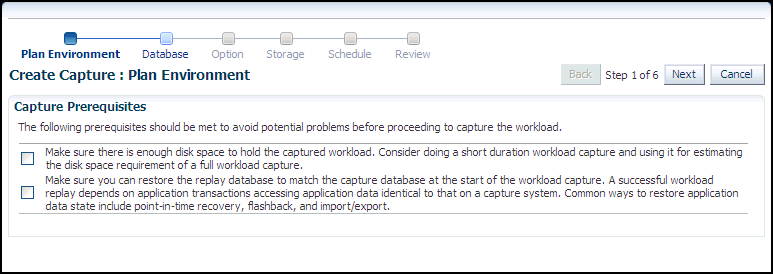
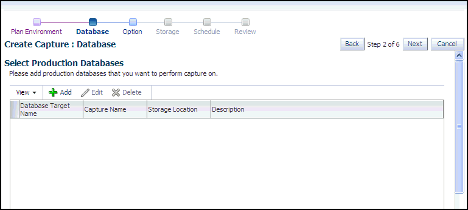
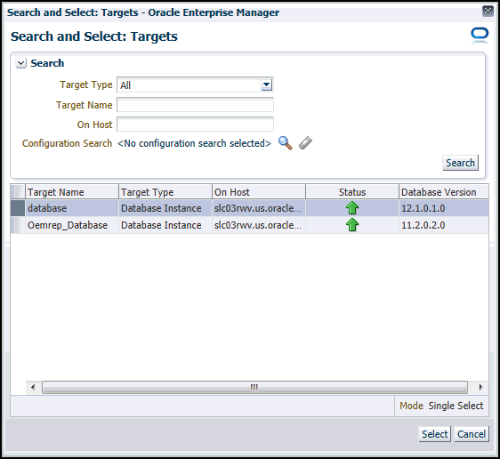
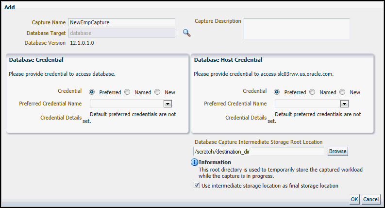
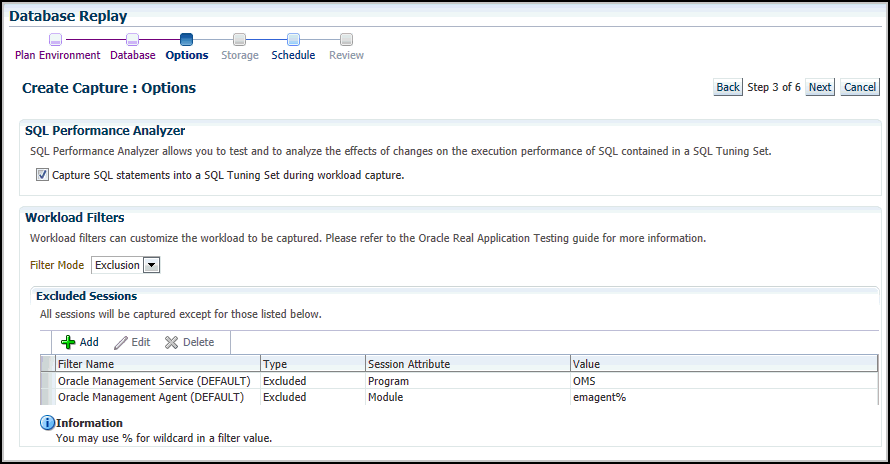
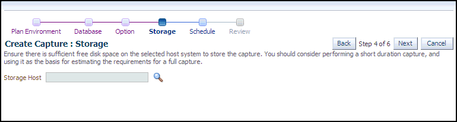
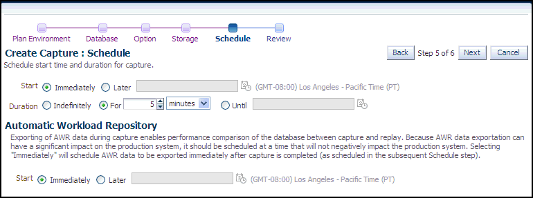
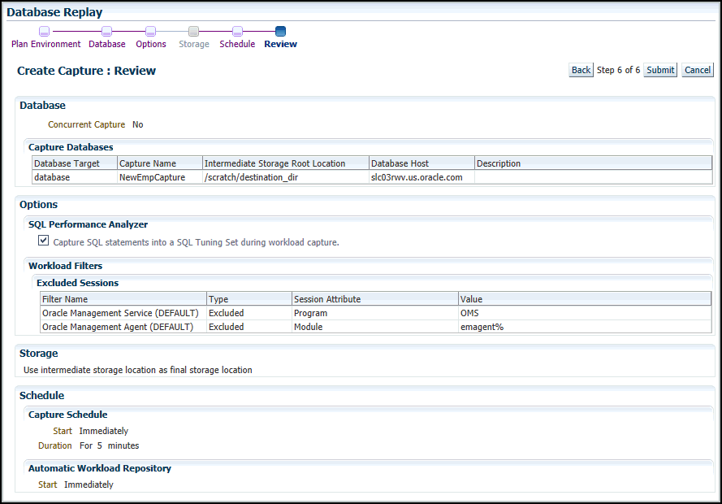
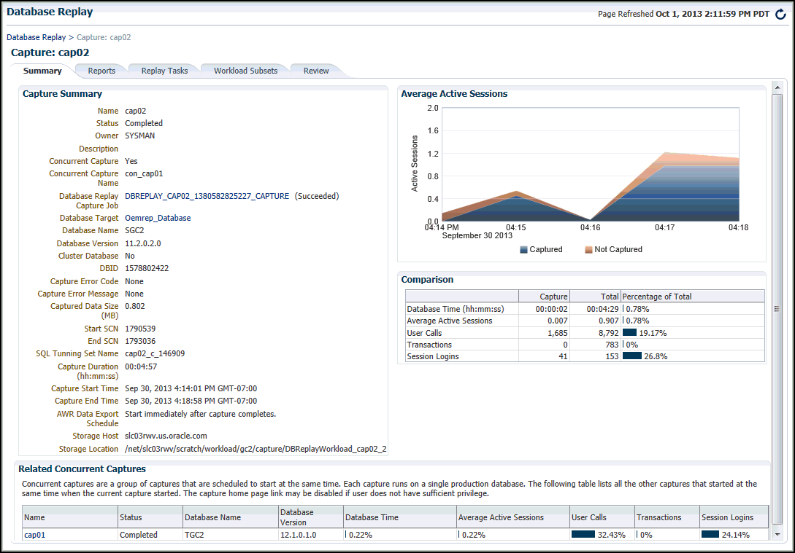

## 9 Capturing a Database Workload

This chapter describes how to capture a database workload on the production system. The first step in using Database Replay is to capture the production workload. For more information about how capturing a database workload fits within the Database Replay architecture, see ["Workload Capture"](dbr_intro.md).

This chapter contains the following sections:

## 9.1 Prerequisites for Capturing a Database Workload

Before starting a workload capture, you should have a strategy in place to restore the database on the test system. Before a workload can be replayed, the logical state of the application data on the replay system should be similar to that of the capture system when replay begins. To accomplish this, consider using one of the following methods:

- Recovery Manager (RMAN) `DUPLICATE` command
- Snapshot standby
- Data Pump Import and Export

This will allow you to restore the database on the replay system to the application state as of the workload capture start time.

See Also:

- [Oracle Database Backup and Recovery User's Guide](https://docs.oracle.com/cd/E11882_01/backup.112/e10642/rcmdupdb.htm#BRADV010) for information about duplicating a database using RMAN
- [Oracle Data Guard Concepts and Administration](https://docs.oracle.com/cd/E11882_01/server.112/e41134/manage_ps.htm#SBYDB00700) for information about managing snapshot standby databases
- [Oracle Database Utilities](https://docs.oracle.com/cd/E11882_01/server.112/e22490/dp_overview.htm#SUTIL100) for information about using Data Pump

## 9.2 Workload Capture Options

Proper planning before workload capture is required to ensure that the capture will be accurate and useful when replayed in another environment.

Before capturing a database workload, carefully consider the following options:

- Restarting the Database
- Using Filters with Workload Capture
- Setting Up the Capture Directory

### 9.2.1 Restarting the Database

While this step is not required, Oracle recommends that the database be restarted before capturing the workload to ensure that ongoing and dependent transactions are allowed to be completed or rolled back before the capture begins. If the database is not restarted before the capture begins, transactions that are in progress or have yet to be committed will not be fully captured in the workload. Ongoing transactions will thus not be replayed properly, because only the part of the transaction whose calls were captured will be replayed. This may result in undesired replay divergence when the workload is replayed. Any subsequent transactions with dependencies on the incomplete transactions may also generate errors during replay. On a busy system, it is normal to see some replay divergence, but the replay can still be used to perform meaningful analysis of a system change if the diverged calls do not make up a significant portion of the replay in terms of DB time and other such key attributes.

Before restarting the database, determine an appropriate time to shut down the production database before the workload capture when it is the least disruptive. For example, you may want to capture a workload that begins at 8:00 a.m. However, to avoid service interruption during normal business hours, you may not want to restart the database during this time. In this case, you should consider starting the workload capture at an earlier time, so that the database can be restarted at a time that is less disruptive.

Once the database is restarted, it is important to start the workload capture before any user sessions reconnect and start issuing any workload. Otherwise, transactions performed by these user sessions will not be replayed properly in subsequent database replays, because only the part of the transaction whose calls were executed after the workload capture is started will be replayed. To avoid this problem, consider restarting the database in `RESTRICTED` mode using `STARTUP RESTRICT`, which will only allow the `SYS` user to login and start the workload capture. By default, once the workload capture begins, any database instance that are in `RESTRICTED` mode will automatically switch to `UNRESTRICTED` mode, and normal operations can continue while the workload is being captured.

Only one workload capture can be performed at any given time. If you have a Oracle Real Application Clusters (Oracle RAC) configuration, workload capture is performed for the entire database. To enable a clean state before starting to capture the workload, all the instances need to be restarted.

To restart all instances in a Oracle RAC configuration before workload capture:

1. Shut down all the instances.
2. Restart one of the instances.
3. Start workload capture.
4. Restart the rest of the instances.

See Also:

- [Oracle Database Administrator's Guide](https://docs.oracle.com/cd/E11882_01/server.112/e25494/start.htm#ADMIN11146) for information about restricting access to an instance at startup

### 9.2.2 Using Filters with Workload Capture

By default, all user sessions are recorded during workload capture. You can use workload filters to specify which user sessions to include in or exclude from the workload during workload capture. There are two types of workload filters: inclusion filters and exclusion filters. You can use either inclusion filters or exclusion filters in a workload capture, but not both.

Inclusion filters enable you to specify user sessions that will be captured in the workload. This is useful if you want to capture only a subset of the database workload.

Exclusion filters enable you to specify user sessions that will not be captured in the workload. This is useful if you want to filter out session types that do not need to captured in the workload, such as those that monitor the infrastructure—like Oracle Enterprise Manager (EM) or Statspack—or other such processes that are already running on the test system. For example, if the system where the workload will be replayed is running EM, replaying captured EM sessions on the system will result in duplication of workload. In this case, you may want to use exclusion filters to filter out EM sessions.

### 9.2.3 Setting Up the Capture Directory

Determine the location and set up a directory where the captured workload will be stored. Before starting the workload capture, ensure that the directory is empty and has ample disk space to store the workload. If the directory runs out of disk space during a workload capture, the capture will stop. To estimate the amount of disk space that is required, you can run a test capture on your workload for a short duration (such as a few minutes) to extrapolate how much space you will need for a full capture. To avoid potential performance issues, you should also ensure that the target replay directory is mounted on a separate file system.

For Oracle RAC, consider using a shared file system. Alternatively, you can set up one capture directory path that resolves to separate physical directories on each instance, but you will need to consolidate the files created in each of these directories into a single directory. The entire content of the local capture directories on each instance (not only the capture files) must be copied to the shared directory before it can be used for preprocessing or data masking. For example, assume that you are:

- Running a Oracle RAC environment in Linux with two database instances named `host1` and `host2`
- Using a capture directory object named `CAPDIR` that resolves to `/$ORACLE_HOME/rdbms/capture` on both instances
- Using a shared directory that resides in `/nfs/rac_capture`

You will need to login into each host and run the following command:

```
cp -r /$ORACLE_HOME/rdbms/capture/* /nfs/rac_capture
```

After this is done for both instances, the `/nfs/rac_capture` shared directory is ready to be preprocessed or masked.

## 9.3 Workload Capture Restrictions

Certain types of user sessions and client requests may sometimes be captured in a workload, but they are not supported by Database Replay. Capturing these session and request types in a workload may result in errors during workload replay.

The following types of user sessions and client requests are not supported by Database Replay:

- Direct path load of data from external files using utilities such as SQL\*Loader
- Non-PL/SQL based Advanced Queuing (AQ)
- Flashback queries
- Oracle Call Interface (OCI) based object navigations
- Non SQL-based object access
- Distributed transactions
	Any distributed transactions that are captured will be replayed as local transactions.
- XA transactions
	XA transactions are not captured or replayed. All local transactions are captured.
- `JAVA_XA` transactions
	If the workload uses the `JAVA_XA` package, `JAVA_XA` function and procedure calls are captured as normal PL/SQL workload. To avoid problems during workload replay, consider dropping the `JAVA_XA` package on the replay system to enable the replay to complete successfully.
- Database Resident Connection Pooling (DRCP)
- Workloads using OUT binds
- Multi-threaded Server (MTS) and shared server sessions with synchronization mode set to `OBJECT_ID`
- Migrated sessions
	The workload is captured for migrated sessions. However, user logins or session migration operations are not captured. Without a valid user login or session migration, the replay may cause errors because the workload may be replayed by a wrong user.

Typically, Database Replay refrains from capturing these types of non-supported user sessions and client requests. Even when they are captured, Database Replay will not replay them. Therefore, it is usually not necessary to manually filter out non-supported user sessions and client requests. In cases where they are captured and found to cause errors during replay, consider using workload capture filters to exclude them from the workload.

See Also:

- "Using Filters with Workload Capture" for information about using workload capture filters
- ["Using Filters with Workload Replay"](dbr_replay.md) for information about using workload replay filters

## 9.4 Enabling and Disabling the Workload Capture Feature

Database Replay supports capturing a database workload on a system running Oracle Database 10g Release 2 that can be used to test database upgrades to Oracle Database 11g and subsequent releases. By default, the workload capture feature is not enabled in Oracle Database 10g Release 2 (10.2). You can enable or disable this feature by specifying the `PRE_11G_ENABLE_CAPTURE` initialization parameter.

Note:

It is only necessary to enable the workload capture feature if you are capturing a database workload on a system running Oracle Database 10g Release 2.

If you are capturing a database workload on a system running Oracle Database 11g Release 1 or a later release, it is not necessary to enable the workload capture feature because it is enabled by default. Furthermore, the `PRE_11G_ENABLE_CAPTURE` initialization parameter is only valid with Oracle Database 10g Release 2 (10.2) and cannot be used with subsequent releases.

To enable the workload capture feature on a system running Oracle Database 10g Release 2, run the `wrrenbl.sql` script at the SQL prompt:

```
@$ORACLE_HOME/rdbms/admin/wrrenbl.sql
```

The `wrrenbl.sql` script calls the `ALTER SYSTEM` SQL statement to set the `PRE_11G_ENABLE_CAPTURE` initialization parameter to `TRUE`. If a server parameter file (spfile) is being used, the `PRE_11G_ENABLE_CAPTURE` initialization parameter will be modified for the currently running instance and recorded in the spfile, so that the new setting will persist when the database is restarted. If a spfile is not being used, the `PRE_11G_ENABLE_CAPTURE` initialization parameter will only be modified for the currently running instance, and the new setting will not persist when the database is restarted. To make the setting persistent without using a spfile, you will need to manually specify the parameter in the initialization parameter file (`init.ora`).

To disable workload capture, run the `wrrdsbl.sql` script at the SQL prompt:

```
@$ORACLE_HOME/rdbms/admin/wrrdsbl.sql
```

The `wrrdsbl.sql` script calls the `ALTER SYSTEM` SQL statement to set the `PRE_11G_ENABLE_CAPTURE` initialization parameter to `FALSE`. If a server parameter file (spfile) is being used, the `PRE_11G_ENABLE_CAPTURE` initialization parameter will be modified for the currently running instance and also recorded in the spfile, so that the new setting will persist when the database is restarted. If a spfile is not being used, the `PRE_11G_ENABLE_CAPTURE` initialization parameter will only be modified for the currently running instance, and the new setting will not persist when the database is restarted. To make the setting persistent without using a spfile, you will need to manually specify the parameter in the initialization parameter file (`init.ora`).

Note:

The `PRE_11G_ENABLE_CAPTURE` initialization parameter can only be used with Oracle Database 10g Release 2 (10.2). This parameter is not valid in subsequent releases. After upgrading the database, you will need to remove the parameter from the server parameter file (spfile) or the initialization parameter file (`init.ora`); otherwise, the database will fail to start up.

See Also:

- [Oracle Database Reference](https://docs.oracle.com/cd/E11882_01/server.112/e40402/initparams_part.htm#REFRN001) for more information about the `PRE_11G_ENABLE_CAPTURE` initialization parameter

## 9.5 Enterprise Manager Privileges and Roles

The Database Replay resource type privileges enable you to view or operate any Database Replay entities. Additionally, you need the target operator privilege for the target from which the workload was captured to access the entities associated with the workload. For a target that does not exist anymore, the Enterprise Manager user who owns the entities or the Enterprise Manager super user can still access the entities.

The two security roles discussed in the following sections make it easier to grant or revoke privileges related to Database Replay entities.

### 9.5.1 Database Replay Viewer Role

Users who have the Database Replay Viewer role can view any Database Replay entity. By default, no Enterprise Manager user is granted this role. However, the EM\_ALL\_VIEWER role includes this role by default.

The Database Replay Viewer role consists of the following privilege:

- Database Replay Viewer (resource type privilege)

### 9.5.2 Database Replay Operator Role

The Database Replay Operator role includes the Database Replay Viewer role and thus its privileges. Users who have the Database Replay Operator role can also edit and delete any Database Replay entity. By default, no Enterprise Manager user is granted this role. However, the EM\_ALL\_OPERATOR role includes this role by default.

The Database Replay Operator role consists of the following privileges:

- Database Replay Operator (resource type privilege)
- Create new Named Credential (resource type privilege)
- Create new job (resource type privilege)
- Connect to any viewable target (target type privilege)
- Execute Command Anywhere (target type privilege)

To capture or replay a workload on a database target, an Enterprise Manager user needs all the privileges granted by the Database Replay Operator role plus the target operator privilege for the database target.

## 9.6 Capturing a Database Workload Using Enterprise Manager

This section describes how to capture a database workload using Enterprise Manager. The primary tool for capturing database workloads is Oracle Enterprise Manager.

Tip:

If Oracle Enterprise Manager is unavailable, you can capture database workloads using APIs, as described in "Capturing a Database Workload Using APIs".

To capture a database workload using Enterprise Manager:

1. From the Enterprise menu of the Enterprise Manager Cloud Control console, select Quality Management, then Database Replay.
	If the Database Login page appears, log in as a user with administrator privileges.
	The Database Replay page appears.
	

> The following text appears: "Database Replay allows workloads to be captured from production systems and re-executed with high fidelity on test copies of production databases. This enables detailed analysis of how the proposed changes may affect production systems; for instance, patching or upgrading database software."
>
> An overview diagram showing the database replay process follows.
>
> Below the diagram are the Captured Workloads and Replay Tasks tabs, and the Replay Tasks tab is open.
>
> A table follows with the following columns: Name, Owner, Replays, Consolidated Replay, Creation Date, and Description. Three rows appear in the table with values for all of the columns except for Description, which is blank.
>
> The following user controls appear above the table: View, Create, Edit, Delete, and Detach.
>
> End of description.

2. From the Database Replay page, click the Captured Workloads tab, then click Create in the toolbar.
	The Create Capture: Plan Environment page appears.
	

> On the right of the page, the following text appears: Step 1 of 6. The Back button is to the left of the text, and the Next and Cancel buttons are to the right of the text.
>
> The following text appears:
>
> The following prerequisites should be met to avoid potential problems before proceeding to capture the workload.
>
> Two check boxes with text follow:
>
> The first check box has the following text: Make sure there is enough disk space to hold the captured workload. Consider doing a short duration workload capture and using it for estimating the disk space requirement of a full workload capture.
>
> The second check box has the following text: Make sure you can restore the replay database to match the capture database at the start of the workload capture. A successful workload replay depends on application transactions accessing application data identical to that on a capture system. Common ways to restore application data state include point-in-time recovery, flashback, and import/export.
>
> End of description.

3. Verify that you have met both prerequisites described on this page, then enable both checkboxes and click Next.
	The Create Capture: Database page appears.
	Tip:
	For information about the prerequisites, see "Prerequisites for Capturing a Database Workload".
	

> On the right of the page, the following text appears: Step 1 of 6. The Back button is to the left of the text, and the Next and Cancel buttons are to the right of the text.
>
> The following text appears:
>
> Please add production databases that you want to perform capture on.
>
> A table appears below this with the following column names: Database Target Name, Capture Name, Storage Location, and Description. The following user controls appear above the table: View, Add, Edit, and Delete. The table is blank with no entries.
>
> End of description.

4. Click Add.
	The Add pop-up appears.
5. Provide a capture name, provide an optional description, then click the Target Database search icon.
	The Search and Select: Targets pop-up appears.
	

> The top of the pop-up has a Search section with the following user controls: Target Type drop-down menu, Target Name input field, and On Host input field. Below these fields is a Search button.
>
> Below this section is a table with the following columns: Target Name, Target Type, On Host, Status, and Database Version. There are four rows in the table. The cursor points to the top row. The Target Name is "database," the Target Type is "Database Instance," On Host is "adc2101027.us.oracle.com," the Status shows a green arrow pointing up, and the Database Version is "12.1.0.0.2."
>
> Two buttons on the lower right corner of the pop-up are Select and Cancel.
>
> End of description.

6. Choose a target database from the list, then click Select.
	The Add pop-up reappears with added sections for Database Credential and Database Host Credential.
7. Provide database credentials, database host credentials, a Database Capture Intermediate Storage Location, then click OK.
	- The capture database places the capture files in the intermediate storage location. After the capture, the files are copied to the storage location. For captures on an Oracle RAC database, Enterprise Manager only supports Oracle RAC configured with a shared file system.
	

> The text at the top of the page reads "Database Replay drives a test from a single database target. Select a target to begin a new test scenario."
>
> Three input fields appear below the text. The first is Capture Name, and the input is "NewEmpCapture." The second field is Capture Description, and the field is blank. The third field is Target Database, which is read-only, and the input is "database."
>
> Below these fields are two sections: Database Credential on the left, and Database Host Credential on the right. The Database Credential section shows that the Named Credential radio button is selected. The Credential Name drop-down shows that TESTDB is selected. The Credential Details table shows Attribute and Value columns. The Attribute column has entries of User Name, Password, and Role. The corresponding Value entries are system, \*\*\*\*\*\*, and normal.
>
> The Database Host Credential section shows that the Named Credential radio button is selected. The Credential Name drop-down shows that TESTHOST is selected. The Credential Details table shows Attribute and Value columns. The Attribute column has entries of User Name and Password. The corresponding Value entries are tkan and \*\*\*\*\*\*.
>
> Below the Database Host Credential section is a Database Capture Intermediate Storage Location input field.
>
> OK and Cancel buttons appear in the lower right corner of the pop-up.
>
> End of description.
  
	  
	The selected target database now appears in the list of databases in the Select Production Databases table.
8. Click Next.
	The Create Capture: Options page appears.
	

> On the right of the page, the following text appears: Step 3 of 6. The Cancel button appears to the left of the text, and the Next and Cancel buttons appear to the right of the text.
>
> Below the buttons, the following text appears in the SQL Performance Analyzer section: "SQL Performance Analyzer allows you to test and to analyze the effects of changes on the execution performance of SQL contained in a SQL Tuning Set." Below the text is a check box that reads "Capture SQL statements into a SQL tuning set during workload capture."
>
> Under Workload Filters, the following text appears:
>
> Workload filters can customize the workload to be captured. By default, most external client requests made to the database are captured. Refer to the Oracle Real Application Testing User's Guide for more information.
>
> In the Filter Mode list, Exclusion is selected.
>
> Under Excluded Sessions, the following text appears: "All sessions will be captured except for those listed below."
>
> A table follows with the following columns: Filter Name, Type, Session Attribute, and Value.
>
> Row 1 has the following values: Oracle Management Service (DEFAULT), Excluded, Program, and OMS.
>
> Row 2 has the following values: Oracle Management Agent (DEFAULT), Excluded, Module, and emagent%.
>
> End of description.

9. Select the workload capture options:
	- Under the SQL Performance Analyzer section, select whether to capture SQL statements into a SQL tuning set during workload capture.
		While Database Replay provides an analysis of how a change affects your entire system, you can use a SQL tuning set in conjunction with the SQL Performance Analyzer to gain a more SQL-centric analysis of how the change affects SQL statements and execution plans.
		By capturing a SQL tuning set during workload capture and another SQL tuning set during workload replay, you can use the SQL Performance Analyzer to compare these SQL tuning sets to each other without having to re-execute the SQL statements. This enables you to obtain a SQL Performance Analyzer report and compare the SQL performance, before and after changes, while running Database Replay.
		Note:
		Capturing SQL statements into a SQL Tuning Set is the default, and is the recommended workload capture option. Capturing SQL statements into a SQL Tuning Set is not available for Oracle RAC.
		- Under the Workload Filters section, select whether to use exclusion filters by selecting Exclusion in the Filter Mode list, or inclusion filters by selecting Inclusion in the Filter Mode list.
		To add filters, click Add and enter the filter name, session attribute, and value in the corresponding fields.
		Tip:
		For more information, see "Using Filters with Workload Capture".
	After selecting the desired workload capture options, click Next.
	The Create Capture: Storage page appears.
	

> On the right of the page, the following text appears: Step 4 of 6. The Back buttons appears to the left of the text, and the Next and Cancel buttons appear to the right of the text.
>
> The following text appears:
>
> "Ensure there is sufficient free disk space on the selected host system to store the capture. You should consider performing a short duration capture, and using it as the basis for estimating the requirements for a full capture."
>
> Below the text is a Storage Host input field with a magnifying glass icon you can click to search for the host.
>
> End of description.

10. Click the Storage Host icon, choose a target from the list, then click Select.
	The Storage page now requests Host Credentials and a Storage Location.
11. Provide Host Credentials, click Browse to select a Storage Location, select the location and click OK, then click Next.
	The Create Capture: Schedule page appears.
	

> On the right of the page, the following text appears: Step 5 of 6. The Back button appears to the left of the text, and the Next and Cancel buttons appear to the right of the text.
>
> The following text appears: "Schedule start time and duration for capture."
>
> Next to Start, the following options are listed:
>
> - Immediately (selected)
> - Later (a field follows to specify the time)
>
> Next to Duration, the following options are listed:
>
> - Indefinitely
> - For (selected. Drop-downs follow to select the number of hours and minutes, and an Until field appears to specify the cut-off time for execution.)
>
> Under the Automatic Workload Repository section, the following text appears:
>
> "Exporting of AWR data during capture enables performance comparison of the database between capture and replay. Because AWR data exportation can have a significant impact on the production system, it should be scheduled at a time that will not negatively impact the production system. Selecting "Immediately" will schedule AWR data to be exported immediately after capture is complete (as scheduled in the subsequent Schedule step)."
>
> Below this text are Start Immediately and Start Later radio buttons. The Later radio button has a field to input the time.
>
> End of description.

12. Schedule the starting time and duration for the capture, schedule the exporting of AWR data, then click Next.
	- The default capture duration is 5 minutes. Change the capture duration to capture representative activity over a time period of interest that needs to be tested.
	The Create Capture: Review page appears.
	

> On the right of the page, the following text appears: Step 6 of 6. The Back button appear to the left of the text, and the Submit and Cancel buttons appear to the right of the text.
>
> The Select Production Databases section contains a table with the following columns: Database Target Name, Name, Description, Storage Value.
>
> The single row entry has the following values: the Database Target Name is cdb121, the Name is MyCapture, there is no Description, and the Storage Location is /scratch/userxyz.
>
> End of description.

13. If all of the parameters appear as you have intended, click Submit to start the capture job.
	- The "Capture SQL statements into a SQL Tuning Set during workload capture" option is enabled by default. Uncheck this option if you do not want to compare SQL tuning sets at the end of the Replay.
	The Database Replay page reappears, displays a message that the capture was created successfully, and displays the status of the capture in the Captures list, such as "Scheduled."
14. For detailed information about the capture, double-click the name of the capture.
	The Capture Summary page appears, and displays several attributes, including the average active sessions, a workload comparison, and related concurrent captures, if any.

Tip:

After capturing a workload on the production system, you need to preprocess the captured workload, as described in [Chapter 10, "Preprocessing a Database Workload"](dbr_preprocess.md).

## 9.7 Capturing Workloads from Multiple Databases Concurrently

Concurrent capture refers to capturing the workload on multiple databases simultaneously.

To capture a concurrent database replay workload:

1. From the Enterprise menu of the Enterprise Manager Cloud Control console, select Quality Management, then Database Replay.
	If the Database Login page appears, log in as a user with administrator privileges.
	The Database Replay page appears.
2. From the Database Replay page, click the Captured Workloads tab, then click Create in the toolbar.
	The Create Capture: Plan Environment page appears.
3. Make sure that you have met both prerequisites described on this page, then enable both checkboxes and click Next.
	The Create Capture: Database page appears.
	Tip:
	For information about the prerequisites, see "Prerequisites for Capturing a Database Workload".
4. Click Add.
	The Add pop-up appears.
5. Provide a Capture name, provide an optional description, then click the Target Database search icon.
	The Search and Select: Targets pop-up appears.
6. Choose a target database from the list, then click Select.
	The Add pop-up reappears with added sections for Database Credential and Database Host Credential.
7. Provide database credentials, database host credentials, a Database Capture Intermediate Storage Location, then click OK.
	- The Capture database places the Capture files in the intermediate storage location. After the Capture, the files are copied to the storage location.
	The selected target database now appears in the list of databases in the Select Production Databases table.
8. Add another database for concurrent capture:
	1. Follow the instructions in steps [^1] through [^2].
		The Create Capture: Database page reappears, and displays the additional database for capture along with the first database you specified in steps [^1] through [^2].
		2. Provide a name and optional description for the concurrent capture, then click Next.
		The Create Capture: Options page appears.
9. Select the workload capture options:
	- Under the SQL Performance Analyzer section, select whether to capture SQL statements into a SQL tuning set during workload capture.
		While Database Replay provides an analysis of how a change affects your entire system, you can use a SQL tuning set in conjunction with the SQL Performance Analyzer to gain a more SQL-centric analysis of how the change affects SQL statements and execution plans.
		By capturing a SQL tuning set during workload capture and another SQL tuning set during workload replay, you can use the SQL Performance Analyzer to compare these SQL tuning sets to each other without having to re-execute the SQL statements. This enables you to obtain a SQL Performance Analyzer report and compare the SQL performance, before and after changes, while running Database Replay.
		Note:
		Capturing SQL statements into a SQL tuning set is the default and recommended workload capture option.
		- Under the Workload Filters section, select whether to use exclusion filters by selecting Exclusion in the Filter Mode list, or inclusion filters by selecting Inclusion in the Filter Mode list.
		To add filters, click Add and enter the filter name, session attribute, and value in the corresponding fields.
	After selecting the desired workload capture options, click Next.
	The Create Capture: Storage page appears.
10. Click the Storage Host icon, choose a target from the list, then click Select.
	The Storage page now requests Host Credentials and a Storage Location.
11. Provide Host Credentials, click Browse to select a Storage Location, then click Next.
	The Create Capture: Schedule page appears.
12. Schedule the starting time and duration for the capture, schedule the exporting of AWR data, then click Next.
	- The default capture duration is 5 minutes. Change the capture duration to capture representative activity over a time period of interest that needs to be tested.
	The Create Capture: Review page appears.
13. If all of the parameters appear as you have intended, click Submit to start the Capture job.
	- The "Capture SQL statements into a SQL Tuning Set during workload capture" option is enabled by default. Uncheck this option if you do not want to compare SQL tuning sets at the end of the Replay.
	The Database Replay page reappears, displays a message that the capture was created successfully, and displays the status of the capture in the Captures list, such as "Scheduled."
14. For detailed information about the capture, double-click the name of the capture.
	The Capture Summary page appears, and displays several attributes, including the average active sessions, a workload comparison, and related concurrent captures.

## 9.8 Monitoring a Workload Capture Using Enterprise Manager

This section describes how to monitor workload capture using Enterprise Manager. The primary tool for monitoring workload capture is Oracle Enterprise Manager. Using Enterprise Manager, you can:

- Monitor or stop an active workload capture
- View a completed workload capture

Tip:

If Oracle Enterprise Manager is unavailable, you can monitor workload capture using views, as described in "Monitoring Workload Capture Using Views".

This section contains the following topics:

- Monitoring an Active Workload Capture
- Stopping an Active Workload Capture
- Viewing a Completed Workload Capture

### 9.8.1 Monitoring an Active Workload Capture

This section describes how to monitor an active workload capture using Enterprise Manager.

To monitor an active workload capture:

1. From the Enterprise menu of the Enterprise Manager Cloud Control console, select Quality Management, then Database Replay.
	If the Database Login page appears, log in as a user with administrator privileges.
	The Database Replay page appears.
2. From the Captured Workloads tab of the Database Replay page for a capture that has a Status other than Completed, click the name of the desired capture from the Capture table.
	The Summary tab of the Database Replay page appears, showing detailed statistics, a chart for average active sessions that updates dynamically while the capture is in progress, a comparison of data for captured elements versus the same elements not captured, and related concurrent captures, if any.
	- The Not Captured data shown in the Active Average Sessions chart shows the database activity (database sessions) that is not being captured.
		- The values for the Total column in the Comparison section shows all of the captured and uncaptured activity in the database. Filtering, as determined by the Workload Filters you provided in the Options step of the Create Capture wizard, is primarily why some activity is captured or not. Additionally, background activities, database scheduler jobs, and unreplayable calls are not captured.
		- You can click the refresh icon in the upper right corner to update the capture while it is running.
3. To return to the Database Replay page, click the Database Replay breadcrumb.

### 9.8.2 Stopping an Active Workload Capture

This section describes how to stop an active workload capture using Enterprise Manager.

To stop an active workload capture:

1. From the Enterprise menu of the Enterprise Manager Cloud Control console, select Quality Management, then Database Replay.
	If the Database Login page appears, log in as a user with administrator privileges.
	The Database Replay page appears.
2. From the Captured Workloads tab of the Database Replay page for a capture that has a Status of Draft, click the name in the Capture table of the capture you want to stop.
	The Capture Summary page appears.
3. Click the Stop Capture button.
	The button label changes to Stopping Capture. When the process completes, the Status changes to Stopped.

### 9.8.3 Viewing a Completed Workload Capture

This section describes how to manage a completed workload capture using Enterprise Manager.

To view a completed workload capture:

1. From the Enterprise menu of the Enterprise Manager Cloud Control console, select Quality Management, then Database Replay.
	If the Database Login page appears, log in as a user with administrator privileges.
	The Database Replay page appears.
2. From the Capture Workloads tab of the Database Replay page, click the name of a capture that has a Status of Completed.
	The contents of the Summary tab of the Database Replay page appears as for a capture in progress, except the Average Active Sessions chart shows aggregated data for the capture time period, rather than dynamic data recorded during the capture.
	

> The page shows Summary, Reports, Replay Task, and Review tabs, and the Summary tab is open.
>
> The following text appears: Status In Progress. The Stop Capture button is to the right of the text.
>
> In the Capture Summary section, values are shown for the following read-only fields:
>
> Name
>
> Status
>
> Owner
>
> Description
>
> Concurrent Capture
>
> Concurrent Capture Name
>
> Database Replay Capture Job
>
> Capture Data Size (MB)
>
> Target Database
>
> Capture Database Version
>
> Cluster Database
>
> DBID
>
> Capture Error Code
>
> SQL Tuning Set Name
>
> Capture Error Message
>
> Captured Data Size (MB)
>
> Start SCN
>
> End SCN
>
> SQL Tuning Set Name
>
> Storage Host
>
> Storage Location
>
> Workload Duration
>
> Scheduled Capture Start Time
>
> Scheduled Capture End Time
>
> AWR Data Export Schedule
>
> The Average Active Sessions section contains a chart. The chart has a y-axis labeled Active Sessions. The y-axis values range from 0 to 2.0. The chart has a x-axis labeled Aug 6, 2010. The x-axis values range from 1:08 to 1:23. A legend containing the labels Captured (blue) and Not Captured (brown) appears below the chart.
>
> The Comparison section contains a table with the following columns: Capture, Total, and Percentage of Total.
>
> Row 1 shows values in these columns for Database Time (hh:mm:ss)
>
> Row 2 shows values in these columns for Average Active Sessions
>
> Row 3 shows values in these columns for User Calls
>
> Row 4 shows values in these columns for Transactions
>
> Row 5 shows values in these columns for Session Logins
>
> End of description.
  
	  
	The Average Active Sessions chart provides a graphic display of the captured session activity compared to the uncaptured session activity (such as background activities or filtered sessions). This chart appears only when Active Session History (ASH) data is available for the capture period.
	Under Comparison, various statistics for the workload capture are displayed:
	- Capture column
		Displays the statistics for the captured session activity.
		- Total column
		Displays the statistics for the total session activity.
		- Percentage of Total column
		Displays the percentage of total session activity that has been captured in the workload.
3. To return to the Database Replay page, click the Database Replay breadcrumb.

Tip:

See [Chapter 12, "Analyzing Captured and Replayed Workloads"](dbr_analyze.md) for information about accessing workload capture reports.

## 9.9 Importing a Workload External to Enterprise Manager

You can import a workload captured through the PL/SQL interface or through a different Enterprise Manager instance into Enterprise Manager to manage it as you would for a workload originally created within Enterprise Manager. The workload can be in the process of being captured, or the Capture can be completed and the workload stored on a file system. You can also preprocess and replay the workload as you would ordinarily do for a workload created within Enterprise Manager.

This feature is available for Cloud Control Database plug-in 12.1.0.5 and later releases.

To import a database workload external to Enterprise Manager:

1. From the Database Replay page, click the Captured Workloads tab, then click Import in the toolbar.
	The Import Workload: Source page appears.
2. Select one of the three choices available to import a captured workload, then click Next:
	- Import a completed captured workload from a directory in the file system
		This option typically applies for a workload created using an API, in which you now want to import it to Enterprise Manager for subsequent processing. In this case, Enterprise Manager may not even be managing the Capture database.
		- Import a completed captured workload from a database target
		In this case, Enterprise Manager is probably already managing the Capture database. The Capture could have been done on this database, or it could have been loaded in as would be the case for the option above.
		- Attach to a Capture running in a database target
		This option is similar to the option above, except this a Capture that is still in progress, rather than one that has already completed.
	The Import Workload: Database page appears.
3. Click the search icon next to the Database Target field and select a database from the pop-up that appears.
	Note:
	The target version of the database loading the workload must be at least as high as the one you used to capture the workload. For instance, if you captured using Oracle Database 12x, the database you select to read the Capture must be at least version 12x.
	- The system now requests database and host credentials.
		- In the previous step, if you chose to import a completed captured workload from a directory in the file system, the system also requires a workload location.
		- A consolidated Replay has a different directory structure in which there are at least two capture directories. Consequently, if the workload directory contains a consolidated Replay, you need to enable the check box so that Enterprise Manager can be aware of the consolidated Replay during the import operation.
4. Provide the requisite input for the step above, then click Next.
	The Import Workload: Workload page appears.
	- If you chose "Import a completed captured workload from a directory in the file system” in step [^3], this page provides a Load Workload button.
		- If you chose ”Import a completed captured workload from a database target” or ”Attach to a Capture running in a database target” in step [^3], this page provides a Discover Workload button.
5. Click either Load Workload or Discover Workload, depending on which button is available in accordance with your selection in step [^3].
	The system displays workloads, if found, in the Discovered Workloads table.
6. Either click Next to load the workload, or select one of the workloads, then click Next to continue importing the workload.
	The Import Workload: Replay page appears only under the following conditions:
	- You chose "Import a completed captured workload from a directory in the file system” in step [^3].
		- The workload contains one or more Replays.
7. Optional: Select one or more Replays, if desired, provide a Replay Task Name, then click Next.
	The Import Workload: Review page appears.
8. If everything appears as you have intended, click Submit.
	The Database Replay page reappears and displays a message stating that the job was submitted successfully. The Status column for your loaded or imported workload in the Captured Workload table will show In Progress.
	Tip:
	You can check on the job's progress by clicking on the captured workload name that you just submitted in the Review step. A Capture Summary page appears, and you can click the Database Replay Import Job link to see the progress of the job execution steps.

## 9.10 Creating Subsets from an Existing Workload

For cases in which you have captured a large workload covering a long period of time, you may only want to replay a portion of it to accelerate testing. The Database Replay Workload Subsetting feature enables you to create new workloads by extracting portions of an existing captured workload.

Enterprise Manager provides a wizard to extract a subset of data from an existing workload that you can use for Replay on a test system. Each extracted subset is a legitimate workload that can be replayed on its own or with other workloads in a consolidated Replay.

To perform a Replay, you need to preprocess the workloads.

This feature is available for Cloud Control Database plug-in 12.1.0.5 and later releases.

To extract subsets from a workload:

1. From the Captured Workloads tab of the Database Replay page, select a workload for which you want to extract a subset, then click Subset.
	The Subset Workload: Define page appears, showing an Active Sessions History chart for the workload.
2. Select a starting and ending time for the subset you want to extract from the workload:
	1. Click Add above the Subsets table at the bottom of the page.
		The Create Subset pop-up appears.
		2. Select either snapshot or calendar times, provide start and end times, then click OK.
		Note:
		Snapshot time is the preferred choice, because not all performance data may be available for the calendar time you select.
		Your selected time period now appears in the Active Sessions chart as a greyed-out segment.
		3. Optional: Define one or more additional subsets with different time periods than those you selected in the step above.
		4. Optional: In the Advanced Parameters section, indicate whether you want to include incomplete calls after the subset workload ends. The default is to include incomplete calls when the subset workload begins.
		- These parameters enable you to include the calls outside of your defined boundaries. For example, when you specify a starting and ending time as the boundaries for a transaction, the transaction may have started before your indicated start time, and may also have continued after your indicated end time.
3. Click Next.
	The Subset Workload: Database page appears.
4. Click the search icon next to the Database Target field and select a database for subsetting from the Search and Select: Targets pop-up that appears.
	The system now requests database and host credentials.
5. Provide the requisite input for the step above, then click Next.
	The Subset Workload: Location page appears.
	- If the source host and staged database host are the same, the location is pre-populated, so you do not need to provide the location for the source workload files.
		- If the source host and staged database host are not the same, do the following:
		1. Choose whether you want to access the workload files from the host name shown in the Host field, or whether you want to copy the files from the source host to the Destination Host shown.
			Access Directly means that the database to be used to subset the workload can access the original workload directly using the specified file system location. This is typically the case when the original workload is stored at a network shared location.
			Access Copy means that the two hosts are not in the shared network path. You need to provide the source host credentials so that Enterprise Manager can copy the original workload from its current location to the specified location on the subset database host.
				2. Depending on your choice above, either provide the directory location containing the workload files, or provide the location for the destination host.
6. In the Subset field, specify the storage location for each subset, then click Next.
	The Subset Workload: Schedule page appears.
7. Indicate when you want to start the subset job, then click Next.
	The Subset Workload: Review page appears.
8. If everything appears as you have intended, click Submit.
	The Database Replay page reappears and displays a message stating that the job was submitted successfully. The Status column for your subset in the Replay Tasks table will show In Progress.
	Tip:
	You can check on the job's progress by clicking on the subset name that you just submitted in the Review step. A Capture Summary page appears, and you can click the Database Replay Subset Job link to see the progress of the job execution steps.

## 9.11 Copying or Moving a Workload to a New Location

You can use the copy function for two purposes:

- Duplicate the Capture files from the source to another host and location.
- Move the Capture files to a new host and location, and delete the source files from the original location.

This feature is available for Cloud Control Database plug-in 12.1.0.5 and later releases.

To copy a workload to a new location:

1. From the Captured Workloads tab of the Database Replay page, select a workload you want to copy to a new location, then click Copy.
	The Copy Workload page appears, and displays the current source location of the workload directory you selected.
2. Provide or change credentials for the storage host, if necessary. The system automatically picks up the previously defined credentials for the current storage host.
3. Leave the After Copy radio button enabled, which is "Keep original workload in the source location."
4. Select the Storage Host for the new location of the workload directory.
5. Provide credentials for the new storage host.
6. Select the directory for the new Destination Location for the workload.
7. Schedule the job, then click Submit.
	The Database Replay page reappears and displays a message stating that the job was submitted and that the storage location has been updated successfully.
	Tip:
	You can check on the job's progress by going to the Job Activity page, searching for the job name that appeared in the submit message, then clicking its link to access the Job Run page.

## 9.12 Capturing a Database Workload Using APIs

This section describes how to capture a database workload using APIs. You can also use Oracle Enterprise Manager to capture database workloads, as described in "Capturing a Database Workload Using Enterprise Manager".

Capturing a database workload using the `DBMS_WORKLOAD_CAPTURE` package involves:

- Defining Workload Capture Filters
- Starting a Workload Capture
- Stopping a Workload Capture
- Exporting AWR Data for Workload Capture

See Also:

- [Oracle Database PL/SQL Packages and Types Reference](https://docs.oracle.com/cd/E11882_01/appdev.112/e40758/d_workload_capture.htm#ARPLS207) for information about the `DBMS_WORKLOAD_CAPTURE` package

### 9.12.1 Defining Workload Capture Filters

This section describes how to add and remove workload capture filters. For information about using workload filters with workload capture, see "Using Filters with Workload Capture".

To add filters to a workload capture, use the `ADD_FILTER` procedure:

```
BEGIN
  DBMS_WORKLOAD_CAPTURE.ADD_FILTER (
                           fname => 'user_ichan',
                           fattribute => 'USER',
                           fvalue => 'ICHAN');
END;
/
```

In this example, the `ADD_FILTER` procedure adds a filter named user\_ichan, which can be used to filter out all sessions belonging to the user name ICHAN.

The `ADD_FILTER` procedure in this example uses the following parameters:

- The `fname` required parameter specifies the name of the filter that will be added.
- The `fattribute` required parameter specifies the attribute on which the filter will be applied. Valid values include PROGRAM, MODULE, ACTION, SERVICE, INSTANCE\_NUMBER, and USER.
- The `fvalue` required parameter specifies the value for the corresponding attribute on which the filter will be applied. It is possible to use wildcards such as % with some of the attributes, such as modules and actions.

To remove filters from a workload capture, use the `DELETE_FILTER` procedure:

```
BEGIN
  DBMS_WORKLOAD_CAPTURE.DELETE_FILTER (fname => 'user_ichan');
END;
/
```

In this example, the `DELETE_FILTER` procedure removes the filter named user\_ichan from the workload capture.

The `DELETE_FILTER` procedure in this example uses the `fname` required parameter, which specifies the name of the filter to be removed. The `DELETE_FILTER` procedure will not remove filters that belong to completed captures; it only applies to filters of captures that have yet to start.

### 9.12.2 Starting a Workload Capture

Before starting a workload capture, you must first complete the prerequisites for capturing a database workload, as described in "Prerequisites for Capturing a Database Workload". You should also review the workload capture options, as described in "Workload Capture Options".

It is important to have a well-defined starting point for the workload so that the replay system can be restored to that point before initiating a replay of the captured workload. To have a well-defined starting point for the workload capture, it is preferable not to have any active user sessions when starting a workload capture. If active sessions perform ongoing transactions, those transactions will not be replayed properly in subsequent database replays, since only that part of the transaction whose calls were executed after the workload capture is started will be replayed. To avoid this problem, consider restarting the database in restricted mode using `STARTUP RESTRICT` before starting the workload capture. Once the workload capture begins, the database will automatically switch to unrestricted mode and normal operations can continue while the workload is being captured. For more information about restarting the database before capturing a workload, see "Restarting the Database".

To start the workload capture, use the `START_CAPTURE` procedure:

```
BEGIN
  DBMS_WORKLOAD_CAPTURE.START_CAPTURE (name => 'dec10_peak', 
                           dir => 'dec10',
                           duration => 600,
                           capture_sts => TRUE,
                           sts_cap_interval => 300);
END;
/
```

In this example, a workload named `dec10_peak` will be captured for 600 seconds and stored in the file system defined by the database directory object named `dec10`. A SQL tuning set will also be captured in parallel with the workload capture.

The `START_CAPTURE` procedure in this example uses the following parameters:

- The `name` required parameter specifies the name of the workload that will be captured.
- The `dir` required parameter specifies a directory object pointing to the directory where the captured workload will be stored.
- The `duration` parameter specifies the number of seconds before the workload capture will end. If a value is not specified, the workload capture will continue until the `FINISH_CAPTURE` procedure is called.
- The `capture_sts` parameter specifies whether to capture a SQL tuning set in parallel with the workload capture. If this parameter is set to `TRUE`, you can capture a SQL tuning set during workload capture, then capture another SQL tuning set during workload replay, and use SQL Performance Analyzer to compare the SQL tuning sets without having to re-execute the SQL statements. This enables you to obtain a SQL Performance Analyzer report and compare the SQL performance—before and after the change—while running Database Replay. You can also export the resulting SQL tuning set with its AWR data using the `EXPORT_AWR` procedure, as described in "Exporting AWR Data for Workload Capture".
	This feature is not supported for Oracle RAC. Workload capture filters that are defined using `DBMS_WORKLOAD_CAPTURE` do not apply to the SQL tuning set capture. The default value for this parameter is `FALSE`.
- The `sts_cap_interval` parameter specifies the duration of the SQL tuning set capture from the cursor cache in seconds. The default value is 300. Setting the value of this parameter below the default value may cause additional overhead with some workloads and is not recommended.

### 9.12.3 Stopping a Workload Capture

To stop the workload capture, use the `FINISH_CAPTURE` procedure:

```
BEGIN
  DBMS_WORKLOAD_CAPTURE.FINISH_CAPTURE (); 
END;
/
```

In this example, the `FINISH_CAPTURE` procedure finalizes the workload capture and returns the database to a normal state.

Tip:

After capturing a workload on the production system, you need to preprocess the captured workload, as described in [Chapter 10, "Preprocessing a Database Workload"](dbr_preprocess.md).

### 9.12.4 Exporting AWR Data for Workload Capture

Exporting AWR data enables detailed analysis of the workload. This data is also required if you plan to run the Replay Compare Period report or the AWR Compare Period report on a pair of workload captures or replays.

To export AWR data, use the `EXPORT_AWR` procedure:

```
BEGIN
  DBMS_WORKLOAD_CAPTURE.EXPORT_AWR (capture_id => 2);
END;
/
```

In this example, the AWR snapshots that correspond to the workload capture with a capture ID of 2 are exported, along with any SQL tuning set that may have been captured during workload capture.

The `EXPORT_AWR` procedure uses the `capture_id` required parameter, which specifies the ID of the capture whose AWR snapshots will be exported. This procedure will work only if the corresponding workload capture was performed in the current database and the AWR snapshots that correspond to the original capture time period are still available.

## 9.13 Monitoring Workload Capture Using Views

This section summarizes the views that you can display to monitor workload capture. You can also use Oracle Enterprise Manager to monitor workload capture, as described in "Monitoring a Workload Capture Using Enterprise Manager".

To access these views, you need DBA privileges:

- The `DBA_WORKLOAD_CAPTURES` view lists all the workload captures that have been captured in the current database.
- The `DBA_WORKLOAD_FILTERS` view lists all workload filters used for workload captures defined in the current database.

See Also:

- [Oracle Database Reference](https://docs.oracle.com/cd/E11882_01/server.112/e40402/toc.htm) for information about these views

[^1]: Click Add.

The Add pop-up appears.

[^undefined]: Provide a Capture name, provide an optional description, then click the Target Database search icon.

The Search and Select: Targets pop-up appears.

[^undefined]: Choose a target database from the list, then click Select.

The Add pop-up reappears with added sections for Database Credential and Database Host Credential.

[^2]: Provide database credentials, database host credentials, a Database Capture Intermediate Storage Location, then click OK.

- The Capture database places the Capture files in the intermediate storage location. After the Capture, the files are copied to the storage location.

The selected target database now appears in the list of databases in the Select Production Databases table.

[^undefined]: Add another database for concurrent capture:

1. Follow the instructions in steps 4 through 7.
	The Create Capture: Database page reappears, and displays the additional database for capture along with the first database you specified in steps 4 through 7.
2. Provide a name and optional description for the concurrent capture, then click Next.
	The Create Capture: Options page appears.

[^undefined]: Select the workload capture options:

- Under the SQL Performance Analyzer section, select whether to capture SQL statements into a SQL tuning set during workload capture.
	While Database Replay provides an analysis of how a change affects your entire system, you can use a SQL tuning set in conjunction with the SQL Performance Analyzer to gain a more SQL-centric analysis of how the change affects SQL statements and execution plans.
	By capturing a SQL tuning set during workload capture and another SQL tuning set during workload replay, you can use the SQL Performance Analyzer to compare these SQL tuning sets to each other without having to re-execute the SQL statements. This enables you to obtain a SQL Performance Analyzer report and compare the SQL performance, before and after changes, while running Database Replay.
	Note:
	Capturing SQL statements into a SQL tuning set is the default and recommended workload capture option.
- Under the Workload Filters section, select whether to use exclusion filters by selecting Exclusion in the Filter Mode list, or inclusion filters by selecting Inclusion in the Filter Mode list.
	To add filters, click Add and enter the filter name, session attribute, and value in the corresponding fields.

After selecting the desired workload capture options, click Next.

The Create Capture: Storage page appears.

[^undefined]: Click the Storage Host icon, choose a target from the list, then click Select.

The Storage page now requests Host Credentials and a Storage Location.

[^undefined]: Provide Host Credentials, click Browse to select a Storage Location, then click Next.

The Create Capture: Schedule page appears.

[^undefined]: Schedule the starting time and duration for the capture, schedule the exporting of AWR data, then click Next.

- The default capture duration is 5 minutes. Change the capture duration to capture representative activity over a time period of interest that needs to be tested.

The Create Capture: Review page appears.

[^undefined]: If all of the parameters appear as you have intended, click Submit to start the Capture job.

- The "Capture SQL statements into a SQL Tuning Set during workload capture" option is enabled by default. Uncheck this option if you do not want to compare SQL tuning sets at the end of the Replay.

The Database Replay page reappears, displays a message that the capture was created successfully, and displays the status of the capture in the Captures list, such as "Scheduled."

[^undefined]: For detailed information about the capture, double-click the name of the capture.

The Capture Summary page appears, and displays several attributes, including the average active sessions, a workload comparison, and related concurrent captures.

[^3]: Select one of the three choices available to import a captured workload, then click Next:

- Import a completed captured workload from a directory in the file system
	This option typically applies for a workload created using an API, in which you now want to import it to Enterprise Manager for subsequent processing. In this case, Enterprise Manager may not even be managing the Capture database.
- Import a completed captured workload from a database target
	In this case, Enterprise Manager is probably already managing the Capture database. The Capture could have been done on this database, or it could have been loaded in as would be the case for the option above.
- Attach to a Capture running in a database target
	This option is similar to the option above, except this a Capture that is still in progress, rather than one that has already completed.

The Import Workload: Database page appears.

[^undefined]: Click the search icon next to the Database Target field and select a database from the pop-up that appears.

Note:

The target version of the database loading the workload must be at least as high as the one you used to capture the workload. For instance, if you captured using Oracle Database 12x, the database you select to read the Capture must be at least version 12x.
- The system now requests database and host credentials.
- In the previous step, if you chose to import a completed captured workload from a directory in the file system, the system also requires a workload location.
- A consolidated Replay has a different directory structure in which there are at least two capture directories. Consequently, if the workload directory contains a consolidated Replay, you need to enable the check box so that Enterprise Manager can be aware of the consolidated Replay during the import operation.

[^undefined]: Provide the requisite input for the step above, then click Next.

The Import Workload: Workload page appears.

- If you chose "Import a completed captured workload from a directory in the file system” in step 2, this page provides a Load Workload button.
- If you chose ”Import a completed captured workload from a database target” or ”Attach to a Capture running in a database target” in step 2, this page provides a Discover Workload button.

[^undefined]: Click either Load Workload or Discover Workload, depending on which button is available in accordance with your selection in step 2.

The system displays workloads, if found, in the Discovered Workloads table.

[^undefined]: Either click Next to load the workload, or select one of the workloads, then click Next to continue importing the workload.

The Import Workload: Replay page appears only under the following conditions:

- You chose "Import a completed captured workload from a directory in the file system” in step 2.
- The workload contains one or more Replays.

[^undefined]: Optional: Select one or more Replays, if desired, provide a Replay Task Name, then click Next.

The Import Workload: Review page appears.

[^undefined]: If everything appears as you have intended, click Submit.

The Database Replay page reappears and displays a message stating that the job was submitted successfully. The Status column for your loaded or imported workload in the Captured Workload table will show In Progress.

Tip:

You can check on the job's progress by clicking on the captured workload name that you just submitted in the Review step. A Capture Summary page appears, and you can click the Database Replay Import Job link to see the progress of the job execution steps.