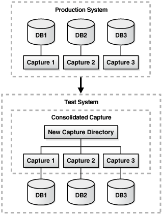
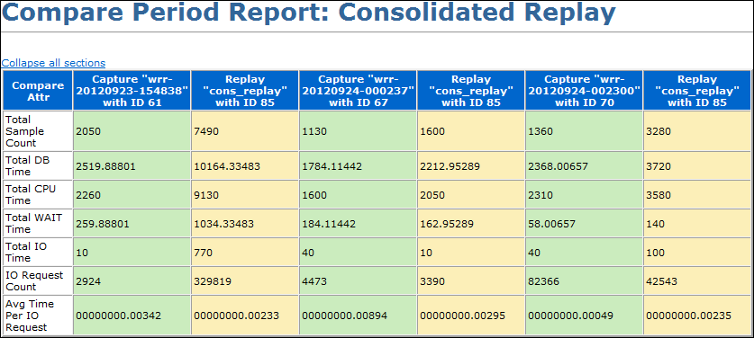

## 13 Using Consolidated Database Replay

Database Replay enables you to capture a workload on the production system and replay it on a test system. This can be very useful when evaluating or adopting new database technologies because these changes can be tested on a test system without affecting the production system. However, some situations may require you to replay multiple workloads concurrently to accurately predict how additional workloads are handled by a system.

For example, you may want to conduct stress testing on a system by adding workloads to an existing workload capture and replaying them together. You may also want to perform scale-up testing by folding an existing workload capture or remapping database schemas.

Consolidated Database Replay enables you to consolidate multiple workloads captured from one or multiple systems and replay them concurrently on a test system. This enables you to perform more comprehensive testing such as stress testing and scale-up testing.

This chapter describes how to use Consolidated Database Replay and contains the following sections:

Note:

Consolidated Database Replay is only available after applying the appropriate patches for Oracle Database 11g Release 2 (11.2). For information about the required patches, contact Oracle Support or refer to My Oracle Support (MOS) note 560977.1.

## 13.1 Overview of Consolidated Database Replay

Consolidated Database Replay enables you to replay multiple workloads captured from one or multiple systems concurrently. During the replay, every workload capture that is consolidated will start to replay when the consolidated replay begins. Depending on the use case, you can employ various workload scale-up techniques when using Consolidated Database Replay.

This section contains the following topics:

- Use Cases for Consolidated Database Replay
- Workload Scale-Up Techniques

### 13.1.1 Use Cases for Consolidated Database Replay

Some typical use cases for Consolidated Database Replay include:

- Stress Testing
- Scale-Up Testing

#### 13.1.1.1 Stress Testing

One use for Consolidated Database Replay is for stress testing or capacity planning. For example, assume that you are expecting the workload for the Sales application to double during the holiday season. You can use Consolidated Database Replay to test the added stress on the system by doubling the workload and replaying the combined workload. To perform stress testing on your system, consider using time shifting.

See Also:

"About Time Shifting"

#### 13.1.1.2 Scale-Up Testing

Another use for Consolidated Database Replay is for scale-up testing. For example, assume that you want to test if your system can handle captured workloads from the Financials application and the Orders application concurrently. You can use Consolidated Database Replay to test the effects of the scaled-up workload on your system by combining the workloads and replaying them simultaneously. To perform scale-up testing on your system, consider using workload folding or schema remapping.

See Also:

- "About Workload Folding"
- "About Schema Remapping"

### 13.1.2 Workload Scale-Up Techniques

This section describes the following workload scale-up techniques:

- About Time Shifting
- About Workload Folding
- About Schema Remapping

#### 13.1.2.1 About Time Shifting

Database Replay enables you to perform time shifting when replaying captured workloads. This technique is useful in cases where you want to conduct stress testing on a system by adding workloads to an existing workload capture and replaying them together.

For example, assume that there are three workloads captured from three applications: Sales, CRM, and DW. In order to perform stress testing, you can align the peaks of these workload captures and replay them together using Consolidated Database Replay.

See Also:

- "Stress Testing" for information about using Consolidated Database Replay for stress testing
- "Using Time Shifting" for an example of using time shifting

#### 13.1.2.2 About Workload Folding

Database Replay enables you to perform scale-up testing by folding an existing workload capture. For example, assume that a workload was captured from 2 a.m. to 8 p.m. You can use Database Replay to fold the original workload into three capture subsets: one from 2 a.m. to 8 a.m., a second from 8 a.m. to 2 p.m., and a third from 2 p.m. to 8 p.m. By replaying the three capture subsets together, you can fold the original capture and triple the workload during replay to perform scale-up testing.

See Also:

- "Scale-Up Testing" for information about using Consolidated Database Replay for scale-up testing
- "Capture Subsets" for information about capture subsets
- "Using Workload Folding" for an example of using workload folding

#### 13.1.2.3 About Schema Remapping

Database Replay enables you to perform scale-up testing by remapping database schemas. This technique is useful in cases when you are deploying multiple instances of the same application—such as a multi-tenet application—or adding a new geographical area to an existing application.

For example, assume that a single workload exists for a Sales application. To perform scale-up testing and identify possible host bottlenecks, set up the test system with multiple schemas from the Sales schema.

See Also:

- "Scale-Up Testing" for information about using Consolidated Database Replay for scale-up testing
- "Using Schema Remapping" for an example of using schema remapping

## 13.2 Steps for Using Consolidated Database Replay

This section describes the steps involved when using Consolidated Workload Replay and contains the following topics:

- Capturing Database Workloads for Consolidated Database Replay
- Setting Up the Test System for Consolidated Database Replay
- Preprocessing Database Workloads for Consolidated Database Replay
- Replaying Database Workloads for Consolidated Database Replay
- Reporting and Analysis for Consolidated Database Replay

### 13.2.1 Capturing Database Workloads for Consolidated Database Replay

Consolidated Database Replay does not require any special steps for capturing database workloads. The steps for capturing database workloads are exactly the same as for capturing a single workload for Database Replay, as described in [Chapter 9, "Capturing a Database Workload"](dbr_capture.md).

This section contains the following topics for workload captures that are specific to Consolidated Database Replay:

- Supported Types of Workload Captures
- Capture Subsets

#### 13.2.1.1 Supported Types of Workload Captures

Consolidated Database Replay supports multiple workloads captured from one or multiple systems running Oracle Database 9i Release 2 (release 9.2.0.8.0) or higher on one or multiple operating systems. For example, you can use workloads captured from one system running Oracle Database 9i Release 2 (release 9.2.0.8.0) on HP-UX and another system running Oracle Database 10g Release 2 (release 10.2.0.4.0) on AIX.

Note:

Consolidated Database Replay is only available on Oracle Database 11g Release 2 (release 11.2.0.2.0) and higher.

#### 13.2.1.2 Capture Subsets

Consolidated Database Replay enables you to transform existing workload captures into new, smaller pieces of capture subsets. You can then generate new workload captures from the capture subsets that can be used in different use cases, as described in "Use Cases for Consolidated Database Replay".

A capture subset is a piece of a workload capture that is defined from an existing workload capture by applying a time range. The time range is specified as an offset from the start of the workload capture. All user workloads captured within the specified time range are included in the defined capture subset.

For example, assume that a workload was captured from 2 a.m. to 8 p.m. and the peak workload is identified to be from 10 a.m. to 4 p.m. You can define a capture subset to represent the peak workload by applying a time range that starts at 8 hours after the start of the workload (or 10 a.m.) and ends at 14 hours after the start of the workload (or 4 p.m.).

However, if a capture subset only contains recorded user workloads that satisfy the specified time range, user logins that occurred before the specified time range are not recorded. If these user logins are required for replay, then the capture subset may not be replayable. For example, if a user session starts at 9:30 a.m. and ends at 10:30 a.m. and the specified time range for the capture subset is 10:00 a.m. to 4:00 p.m., the replay may fail if the user login at 9:30 a.m. is not included in the workload. Similarly, the specified time range may also include incomplete user calls that are only partially recorded if a user sessions starts at 3:30 p.m. but does not complete until 4:30 p.m.

Consolidated Database Replay addresses this problem by including only incomplete user calls caused by the start time of the specified time range. To avoid including the same incomplete user calls twice if the workload capture is folded, incomplete user calls caused by the end time are not included by default. Therefore, a capture subset is essentially the minimal number of recorded user calls during a specified time range that are required for proper replay, including the necessary user logins, alter session statements, and incomplete user calls caused by the start time.

See Also:

"Generating Capture Subsets Using APIs"

### 13.2.2 Setting Up the Test System for Consolidated Database Replay

Setting up the test system for Consolidated Database Replay is similar to setting up a test system for Database Replay, as described in ["Steps for Replaying a Database Workload"](dbr_replay.md). However, there are some additional considerations when setting up a replay database for Consolidated Database Replay.

To minimize divergence during the replay, the test system should contain the same application data and the state of the application data should be logically equivalent to that of the capture system at the start time of each workload capture. However, because a consolidated capture may contain multiple workload captures from different production systems, the test system needs to be set up for all the captures.

For Consolidated Database Replay, all participating workload captures must be placed under a new capture directory on the test system. You can copy all the workload captures into the new capture directory, or create symbolic links pointing to the original workload captures. Before consolidating the workload captures, ensure that the new capture directory has enough disk space to store all participating captures.

Figure 13-1 illustrates how to set up the test system and new capture directory to consolidate three workload captures.

Figure 13-1 Setting Up the Test System for Consolidated Database Replay



> This diagram shows how to set up the test system to consolidate three workload captures. There are two main parts in this diagram.
>
> The upper part of the diagram consists of a dotted box labeled Production System. It contains three databases and three captures, one capture for each database. An arrow points down from the Production System part to the lower part of the diagram.
>
> The lower part of the diagram consists of a dotted box labeled Test System. It contains a dotted box labeled Consolidated Capture. The Consolidated Capture dotted box contains a label named New Capture Directory. Under New Capture Directory are three labels representing each of the three captures. Each capture is connected to an individual database, one for each database in the Production System part of the diagram.
>
> End of description.
  

See Also:

"Setting the Replay Directory Using APIs"

### 13.2.3 Preprocessing Database Workloads for Consolidated Database Replay

Preprocessing a database workload for Consolidated Database Replay is similar to preprocessing a database workload for Database Replay, as described in [Chapter 10, "Preprocessing a Database Workload"](dbr_preprocess.md).

For Consolidated Database Replay, preprocess each captured workload into its own directory. Do not combine different workload captures into one directory for preprocessing. Preprocessing of captured workloads must be performed using a database running the same version of Oracle Database as that of the test system where the workloads will be replayed.

### 13.2.4 Replaying Database Workloads for Consolidated Database Replay

Replaying consolidated workloads using Consolidated Database Replay is quite different from replaying a single database workload using Database Replay.

This section contains the following topics for replaying workloads that are specific to Consolidated Database Replay:

- Defining Replay Schedules
- Remapping Connections for Consolidated Database Replay
- Remapping Users for Consolidated Database Replay
- Preparing for Consolidated Database Replay
- Replaying Individual Workloads

#### 13.2.4.1 Defining Replay Schedules

A replay schedule adds one or multiple workload captures to a consolidated replay and specifies the order in which the captures will start during replay. A replay schedule must be created before a consolidated replay can be initialized. Multiple replay schedules can be defined for a consolidated replay. During replay initialization, you can select from any of the existing replay schedules.

Replay schedules perform two types of operation:

- Adding Workload Captures
- Adding Schedule Orders

See Also:

"Defining Replay Schedules Using APIs"

##### 13.2.4.1.1 Adding Workload Captures

The first type of operation performed by a replay schedule is to add the participating workload captures to a replay.

When a workload capture is added to a replay schedule, a unique number is returned to identify the workload capture. A workload capture can be added to a replay schedule more than once, as it will be assigned a different capture number each time it is added. The replay schedule will point to the same capture directory each time to avoid a waste of disk space by copying the capture each time it is added.

See Also:

"Adding Workload Captures to Replay Schedules Using APIs"

##### 13.2.4.1.2 Adding Schedule Orders

The second type of operation performed by a replay schedule is to add schedule orders that specify the order in which the participating workload captures will start during replay.

A schedule order defines an order between the start of two workload captures that have been added to the replay schedule. Multiple schedule orders can be added to a replay schedule. For example, assume that a replay schedule has three workload captures added. One schedule order can be added to specify that Capture 2 must wait for Capture 1 to complete before starting. Another schedule order can be added to specify that Capture 3 must wait for Capture 1 to complete before starting. In this case, both Capture 2 and Capture 3 must wait for Capture 1 to complete before starting.

It is possible for a replay schedule to not contain any schedule orders. In this case, all participating workload captures in the replay schedule will start to replay simultaneously when the consolidated replay begins.

See Also:

"Adding Schedule Orders to Replay Schedules Using APIs"

#### 13.2.4.2 Remapping Connections for Consolidated Database Replay

As in the case with replaying a single database workload using Database Replay, captured connection strings used to connect to the production system need to be remapped to the replay system, as described in ["Remapping Connections"](dbr_replay.md).

For Consolidated Database Replay, you need to remap captured connection strings from multiple workload captures to different connection strings during replay.

See Also:

"Remapping Connection Using APIs"

#### 13.2.4.3 Remapping Users for Consolidated Database Replay

As in the case with replaying a single database workload using Database Replay, usernames of database users and schemas used to connect to the production system can be remapped during replay, as described in ["User Remapping"](dbr_replay.md).

For Consolidated Database Replay, you can choose to remap the captured users from multiple workload captures to different users or schemas during replay.

See Also:

"Remapping Users Using APIs"

#### 13.2.4.4 Preparing for Consolidated Database Replay

As is the case with replaying a single database workload using Database Replay, replay options are defined during preparation of a replay, as described in ["Specifying Replay Options"](dbr_replay.md).

For Consolidated Database Replay, all participating workload captures in a consolidated replay use the same replay options during replay that are defined during replay preparation.

See Also:

"Preparing for Consolidated Database Replay Using APIs"

#### 13.2.4.5 Replaying Individual Workloads

It is recommended that each of the participating workloads be replayed individually before replaying the consolidated workload, as described in [Chapter 11, "Replaying a Database Workload"](dbr_replay.md).

The individual replays can establish a baseline performance for each workload capture and be used to analyze the performance of the consolidated replay.

### 13.2.5 Reporting and Analysis for Consolidated Database Replay

Reporting and analysis for Consolidated Database Replay is performed using the replay compare period report, as described in ["Using Compare Period Reports"](dbr_analyze.md).

The replay compare period report for Consolidated Database Replay identifies the Active Session History (ASH) data for each individual workload capture and compares the ASH data from the workload capture to the filtered ASH data from the consolidated replay. Use this report to compare replays of the same consolidated workload capture.

The replay compare period report for Consolidated Database Replay treats the consolidated replay as multiple Capture vs. Replay comparisons. The summary section of the report contains a table that summarizes all individual Capture vs. Replay comparisons. Review the information in this section to gain a general understanding of how the consolidated replay ran.

Figure 13-2 shows the summary section of a sample replay compare period report for Consolidated Database Replay.

Figure 13-2 Compare Period Report: Consolidated Replay



> The summary section of a sample compare period report for Consolidated Database Replay is shown in the graphic. This section contains a table with seven columns: Compare Attr, Capture "wrr-20120923-154838" with ID 61, Replay "cons\_replay" with ID 85, Capture "wrr-20120924-000237" with ID 67, Replay "cons\_replay" with ID 85, Capture "wrr-20120924-002300" with ID 70, Replay "cons\_replay" with ID 85. The values of each row in this table are as follows:
>
> - Total Sample Count, 2050, 7490, 1130, 1600, 1360, 3280
> - Total DB Time, 2519.88801, 10164.33483, 1784.11442, 2212.95289, 2368.00657, 3720
> - Total CPU Time, 2260, 9130, 1600, 2050, 2310, 3580
> - Total WAIT Time, 259.88801, 1034.33483, 184.11442, 162.95289, 58.00657, 140
> - Total IO Time, 10, 770, 40, 10, 40, 100
> - IO Request Count, 2924, 329819, 4473, 3390, 82366, 42543
> - Avg Time Per IO Request, 00000000.00342, 00000000.00233, 00000000.00894, 00000000.00295, 00000000.00049, 00000000.00235
>
> End of image description.
  

The rest of the sections in the report resemble the ASH Data Comparison section of the replay compare period report and are formed by joining all Capture vs. Replay reports in the consolidated replay. For a description of this section, see ["ASH Data Comparison"](dbr_analyze.md).

## 13.3 Using Consolidated Database Replay with Enterprise Manager

This section describes how to use Consolidated Database Replay with Enterprise Manager.

The primary tool for replaying consolidated database workloads is Oracle Enterprise Manager. If Oracle Enterprise Manager is unavailable, you can also replay consolidated database workloads using APIs, as described in "Using Consolidated Database Replay with APIs".

The process for replaying a consolidated database workload is nearly identical to that of replaying a single database workload. The differences are documented in the procedures for single replays in the following sections:

- ["Creating a Database Replay Task"](dbr_preprocess.md) in [Chapter 10, "Preprocessing a Database Workload"](dbr_preprocess.md)
- ["Preprocessing the Workload and Deploying the Replay Clients"](dbr_preprocess.md) in [Chapter 10, "Preprocessing a Database Workload"](dbr_preprocess.md)
- ["Replaying a Database Workload Using Enterprise Manager"](dbr_replay.md) in [Chapter 11, "Replaying a Database Workload"](dbr_replay.md)

The following list provides a summary of the differences between replaying a consolidated database workload versus replaying a single database workload:

- When creating a replay task, you need to select two or more captured workloads from the Select Captures table in the Create Task page.
- The Preprocess Captured Workload: Copy Workload step of the wizard has more than one choice for the Capture Name drop-down, so you may need to enter multiple credentials for the current location of the workload directory.
- The Preprocess Captured Workload: Select Directory step of the wizard does not display a Capture Summary as it does for single replays.
- The Replay Workload: Copy Workload step of the wizard has more than one choice for the Capture Name drop-down, so you may need to enter multiple credentials for the current location of the workload directory.
- The Replay Workload: Select Directory step of the wizard does not display a Capture Summary as it does for single replays.
- The Replay Workload: Initialize Options step of the wizard does not display the Identify Source section.
- The Replay Workload: Customize Options step of the wizard has more than one choice for the Capture Name drop-down in the Connection Mappings tab, so you can remap connections for each captured workload. The option to use a single connect descriptor or net service name is not available.

## 13.4 Using Consolidated Database Replay with APIs

This section describes how to create and replay consolidated workloads using the `DBMS_WORKLOAD_REPLAY` package.

Creating and replay a consolidated workload using APIs is a multi-step process that involves:

- Generating Capture Subsets Using APIs
- Setting the Replay Directory Using APIs
- Defining Replay Schedules Using APIs
- Running Consolidated Database Replay Using APIs

See Also:

[Oracle Database PL/SQL Packages and Types Reference](https://docs.oracle.com/cd/E11882_01/appdev.112/e40758/d_workload_replay.htm#ARPLS208) for information about the `DBMS_WORKLOAD_REPLAY` package

### 13.4.1 Generating Capture Subsets Using APIs

This section describes how to generate capture subsets from existing workload captures using the `DBMS_WORKLOAD_REPLAY` package. For information about capture subsets, see "Capture Subsets".

To generate a capture subset from existing workload captures:

1. Use the `GENERATE_CAPTURE_SUBSET` procedure:
	```
	DBMS_WORKLOAD_REPLAY.GENERATE_CAPTURE_SUBSET (
	   input_capture_dir        IN VARCHAR2,
	   output_capture_dir       IN VARCHAR2,
	   new_capture_name         IN VARCHAR2,
	   begin_time               IN NUMBER,
	   begin_include_incomplete IN BOOLEAN   DEFAULT TRUE,
	   end_time                 IN NUMBER,
	   end_include_incomplete   IN BOOLEAN   DEFAULT FALSE,
	   parallel_level           IN NUMBER    DEFAULT NULL);
	```
2. Set the `input_capture_dir` parameter to the name of the directory object that points to an existing workload capture.
3. Set the `output_capture_dir` parameter to the name of the directory object that points to an empty directory where the new workload capture will be stored.
4. Set the `new_capture_name` parameter to the name of the new workload capture that is to be generated.
5. Set the other parameters, which are optional, as appropriate.
	For information about these parameters, see [Oracle Database PL/SQL Packages and Types Reference](https://docs.oracle.com/cd/E11882_01/appdev.112/e40758/d_workload_replay.htm#ARPLS73989).

Example 13-1 shows how to create a capture subset named `peak_wkld` at directory object `peak_capdir` from an existing workload capture at directory object `rec_dir`. The capture subset includes workload from 2 hours after the start of the workload capture (or 7,200 seconds) to 3 hours after the start of the workload capture (or 10,800 seconds).

Example 13-1 Generating a Capture Subset

```
EXEC DBMS_WORKLOAD_REPLAY.GENERATE_CAPTURE_SUBSET ('rec_dir', 'peak_capdir',
     'peak_wkld', 7200, TRUE, 10800, FALSE, 1);
```

See Also:

[Oracle Database PL/SQL Packages and Types Reference](https://docs.oracle.com/cd/E11882_01/appdev.112/e40758/d_workload_replay.htm#ARPLS73988) for information about the `GENERATE_CAPTURE_SUBSET` procedure

### 13.4.2 Setting the Replay Directory Using APIs

This section describes how to set the replay directory on the test system using the `DBMS_WORKLOAD_REPLAY` package. Set the replay directory to a directory on the test system that contains the workload captures to be replayed. For information about setting up the test system, see "Setting Up the Test System for Consolidated Database Replay".

To set the replay directory:

1. Use the `SET_REPLAY_DIRECTORY` procedure:
	```
	DBMS_WORKLOAD_REPLAY.SET_REPLAY_DIRECTORY (
	   replay_dir IN VARCHAR2);
	```
2. Set the `replay_dir` parameter to the name of the directory object that points to the operating system directory containing the workload captures to be used for workload consolidation.

Example 13-2 shows how to set the replay directory to a directory object named `rep_dir`.

Example 13-2 Setting the Replay Directory

```
EXEC DBMS_WORKLOAD_REPLAY.SET_REPLAY_DIRECTORY ('rep_dir');
```

You can also use the `DBMS_WORKLOAD_REPLAY` package to view the current replay directory that has been set by the `SET_REPLAY_DIRECTORY` procedure.

To view the current replay directory that has been set:

- Use the `GET_REPLAY_DIRECTORY` function:
	```
	DBMS_WORKLOAD_REPLAY.GET_REPLAY_DIRECTORY RETURN VARCHAR2;
	```
	If no replay directory has been set, then the function returns `NULL`.

See Also:

- [Oracle Database PL/SQL Packages and Types Reference](https://docs.oracle.com/cd/E11882_01/appdev.112/e40758/d_workload_replay.htm#ARPLS73107) for information about the `SET_REPLAY_DIRECTORY` procedure
- [Oracle Database PL/SQL Packages and Types Reference](https://docs.oracle.com/cd/E11882_01/appdev.112/e40758/d_workload_replay.htm#ARPLS73993) for information about the `GET_REPLAY_DIRECTORY` function

### 13.4.3 Defining Replay Schedules Using APIs

This section describes how to define replay schedules using the `DBMS_WORKLOAD_REPLAY` package. For information about replay schedules, see "Defining Replay Schedules".

Before defining replay schedules, ensure that the following prerequisites are met:

- All workload captures are preprocessed using the `PROCESS_CAPTURE` procedure on a system running the same database version as the replay system, as described in [Chapter 10, "Preprocessing a Database Workload"](dbr_preprocess.md).
- All capture directories are copied to the replay directory on the replay system
- Replay directory is set using the `SET_REPLAY_DIRECTORY` procedure, as described in "Setting the Replay Directory Using APIs".
- Database state is not in replay mode

To define replay schedules:

1. Create a new replay schedule, as described in "Creating Replay Schedules Using APIs".
2. Add workload captures to the replay schedule, as described in "Adding Workload Captures to Replay Schedules Using APIs".
3. Add schedule orders to the replay schedule, as described in "Adding Schedule Orders to Replay Schedules Using APIs".
4. Save the replay schedule, as described in "Saving Replay Schedules Using APIs".

#### 13.4.3.1 Creating Replay Schedules Using APIs

This section describes how to create replay schedules using the `DBMS_WORKLOAD_REPLAY` package. For information about replay schedules, see "Defining Replay Schedules".

To create a replay schedule:

1. Use the `BEGIN_REPLAY_SCHEDULE` procedure:
	```
	DBMS_WORKLOAD_REPLAY.BEGIN_REPLAY_SCHEDULE (
	   schedule_name  IN VARCHAR2);
	```
2. Set the `schedule_name` parameter to the name of this replay schedule.

Note:

The `BEGIN_REPLAY_SCHEDULE` procedure initiates the creation of a reusable replay schedule. Only one replay schedule can be defined at a time. Calling this procedure again while a replay schedule is being defined will result in an error.

Example 13-3 shows how to create a replay schedule named `peak_schedule`.

Example 13-3 Creating a Replay Schedule

```
EXEC DBMS_WORKLOAD_REPLAY.BEGIN_REPLAY_SCHEDULE ('peak_schedule');
```

See Also:

[Oracle Database PL/SQL Packages and Types Reference](https://docs.oracle.com/cd/E11882_01/appdev.112/e40758/d_workload_replay.htm#ARPLS73985) for information about the `BEGIN_REPLAY_SCHEDULE` procedure

#### 13.4.3.2 Adding Workload Captures to Replay Schedules Using APIs

This section describes how to add workload captures to and remove workload captures from replay schedules using the `DBMS_WORKLOAD_REPLAY` package. For information about adding workload captures to replay schedules, see "Adding Workload Captures".

Before adding workload captures to a replay schedule, ensure that the following prerequisite is met:

- A replay schedule to which the workload captures are to be added is created.
	For information about creating a replay schedule, see "Creating Replay Schedules Using APIs".

To add workload captures to a replay schedule:

1. Use the `ADD_CAPTURE` function:
	```
	DBMS_WORKLOAD_REPLAY.ADD_CAPTURE (
	   capture_dir_name    IN VARCHAR2,
	   start_delay_seconds IN NUMBER  DEFAULT 0,
	   stop_replay         IN BOOLEAN DEFAULT FALSE,
	   take_begin_snapshot IN BOOLEAN DEFAULT FALSE,
	   take_end_snapshot   IN BOOLEAN DEFAULT FALSE,
	   query_only          IN BOOLEAN DEFAULT FALSE)
	RETURN NUMBER;
	```
	```
	DBMS_WORKLOAD_REPLAY.ADD_CAPTURE (
	   capture_dir_name    IN VARCHAR2,
	   start_delay_seconds IN NUMBER,
	   stop_replay         IN VARCHAR2,
	   take_begin_snapshot IN VARCHAR2 DEFAULT 'N',
	   take_end_snapshot   IN VARCHAR2 DEFAULT 'N',
	   query_only          IN VARCHAR2 DEFAULT 'N')
	RETURN NUMBER;
	```
	This function returns an unique identifier that identifies the workload capture in this replay schedule.
2. Set the `capture_dir_name` parameter to the name of the directory object that points to the workload capture under the top-level replay directory.
	The directory must contain a valid workload capture that is preprocessed on a system running the same database version as the replay system.
3. Set the other parameters, which are optional, as appropriate.
	For information about these parameters, see [Oracle Database PL/SQL Packages and Types Reference](https://docs.oracle.com/cd/E11882_01/appdev.112/e40758/d_workload_replay.htm#ARPLS73982).

Example 13-4 shows how to add a workload capture named `peak_wkld` to a replay schedule by using the `ADD_CAPTURE` function in a `SELECT` statement.

Example 13-4 Adding a Workload Capture to a Replay Schedule

```
SELECT DBMS_WORKLOAD_REPLAY.ADD_CAPTURE ('peak_wkld')
  FROM dual;
```

You can also use the `DBMS_WORKLOAD_REPLAY` package to remove workload captures from a replay schedule.

To remove workload captures from a replay schedule:

1. Use the `REMOVE_CAPTURE` procedure:
	```
	DBMS_WORKLOAD_REPLAY.REMOVE_CAPTURE (
	   schedule_capture_number IN NUMBER);
	```
2. Set the `schedule_capture_number` parameter to the unique identifier that identifies the workload capture in this replay schedule.
	The unique identifier is the same identifier that was returned by the `ADD_CAPTURE` function when the workload capture was added to the replay schedule.

See Also:

- [Oracle Database PL/SQL Packages and Types Reference](https://docs.oracle.com/cd/E11882_01/appdev.112/e40758/d_workload_replay.htm#ARPLS73981) for information about the `ADD_CAPTURE` function
- [Oracle Database PL/SQL Packages and Types Reference](https://docs.oracle.com/cd/E11882_01/appdev.112/e40758/d_workload_replay.htm#ARPLS73998) for information about the `REMOVE_CAPTURE` procedure

#### 13.4.3.3 Adding Schedule Orders to Replay Schedules Using APIs

This section describes how to add schedule orders to and remove schedule orders from replay schedules using the DBMS\_WORKLOAD\_REPLAY package. For information about adding schedule orders to replay schedules, see "Adding Schedule Orders".

Before adding schedule orders to a replay schedule, ensure that the following prerequisites are met:

- A replay schedule to which the schedule orders are to be added is created.
	For information about creating a replay schedule, see "Creating Replay Schedules Using APIs".
- All workload captures participating in the schedule order are added to the replay schedule.
	For information about adding workload captures to a replay schedule, see "Adding Workload Captures to Replay Schedules Using APIs".

Note:

Adding schedule orders to a replay schedule is optional. If you do not add a schedule order to a replay schedule, then all workload captures added to the replay schedule will start to replay simultaneously when the consolidated replay begins.

To add schedule orders to a replay schedule:

1. Use the `ADD_SCHEDULE_ORDERING` function:
	```
	DBMS_WORKLOAD_REPLAY.ADD_SCHEDULE_ORDERING (
	   schedule_capture_id IN VARCHAR2,
	   wait_for_capture_id IN VARCHAR2)
	RETURN NUMBER;
	```
	This function adds a schedule order between two workload captures that have been added to the replay schedule. If a schedule order cannot be added, it returns a non-zero error code.
2. Set the `schedule_capture_id` parameter to the workload capture that you want to wait in this schedule order.
3. Set the `wait_for_capture_id` parameter to the workload capture that you want to be completed before the other workload capture can start in this schedule order.

You can also use the DBMS\_WORKLOAD\_REPLAY package to remove schedule orders from a replay schedule.

To remove schedule orders from a replay schedule:

1. Use the `REMOVE_SCHEDULE_ORDERING` procedure:
	```
	DBMS_WORKLOAD_REPLAY.REMOVE_SCHEDULE ORDERING (
	   schedule_capture_id IN VARCHAR2,
	   wait_for_capture_id IN VARCHAR2);
	```
2. Set the `schedule_capture_id` parameter to the workload capture waiting in this schedule order.
3. Set the `wait_for_capture_id` parameter to the workload capture that needs to be completed before the other workload capture can start in this schedule order.

To view schedule orders:

- Use the `DBA_WORKLOAD_SCHEDULE_ORDERING` view.

See Also:

- [Oracle Database PL/SQL Packages and Types Reference](https://docs.oracle.com/cd/E11882_01/appdev.112/e40758/d_workload_replay.htm#ARPLS72130) for information about the `ADD_SCHEDULE_ORDERING` function
- [Oracle Database PL/SQL Packages and Types Reference](https://docs.oracle.com/cd/E11882_01/appdev.112/e40758/d_workload_replay.htm#ARPLS74000) for information about the `REMOVE_SCHEDULE_ORDERING` procedure
- [Oracle Database Reference](https://docs.oracle.com/cd/E11882_01/server.112/e40402/statviews_5098.htm#REFRN23844) for information about the `DBA_WORKLOAD_SCHEDULE_ORDERING` view

#### 13.4.3.4 Saving Replay Schedules Using APIs

This section describes how to save replay schedules that been defined using the `DBMS_WORKLOAD_REPLAY` package.

Before saving a replay schedule, ensure that the following prerequisites are met:

- A replay schedule that will be saved is created.
	For information about creating a replay schedule, see "Creating Replay Schedules Using APIs".
- All workload captures participating in the schedule order are added to the replay schedule.
	For information about adding workload captures to a replay schedule, see "Adding Workload Captures to Replay Schedules Using APIs".
- Any schedule orders that you want to use are added to the replay schedule (this step is optional).
	For information about adding schedule orders to a replay schedule, see "Adding Schedule Orders to Replay Schedules Using APIs".

To save a replay schedule:

- Use the `END_REPLAY_SCHEDULE` procedure:
	```
	DBMS_WORKLOAD_REPLAY.END_REPLAY_SCHEDULE;
	```
	This procedure completes the creation of a replay schedule. The replay schedule is saved and associated with the replay directory. Once a replay schedule is saved, you can use it for a consolidated replay.

To view replay schedules:

- Use the `DBA_WORKLOAD_REPLAY_SCHEDULES` view.

See Also:

- [Oracle Database PL/SQL Packages and Types Reference](https://docs.oracle.com/cd/E11882_01/appdev.112/e40758/d_workload_replay.htm#ARPLS73987) for information about the `END_REPLAY_SCHEDULE` procedure
- [Oracle Database Reference](https://docs.oracle.com/cd/E11882_01/server.112/e40402/statviews_5097.htm#REFRN23843) for information about the `DBA_WORKLOAD_REPLAY_SCHEDULES` view

### 13.4.4 Running Consolidated Database Replay Using APIs

This section describes how to run Consolidated Database Replay using the `DBMS_WORKLOAD_REPLAY` package. For information about consolidated replay, see "Replaying Database Workloads for Consolidated Database Replay".

Before running Consolidated Database Replay, ensure that the following prerequisites are met:

- All workload captures are preprocessed using the `PROCESS_CAPTURE` procedure on a system running the same database version as the replay system, as described in [Chapter 10, "Preprocessing a Database Workload"](dbr_preprocess.md).
- All capture directories are copied to the replay directory on the replay system
- Replay directory is set using the `SET_REPLAY_DIRECTORY` procedure, as described in "Setting the Replay Directory Using APIs".
- Database is logically restored to the same application state as that of all the capture systems at the start time of all workload captures.

To run Consolidated Database Replay:

1. Initialize the replay data, as described in "Initializing Consolidated Database Replay Using APIs".
2. Remap connections strings, as described in "Remapping Connection Using APIs".
3. Remap users, as described in "Remapping Users Using APIs".
	Remapping users is optional.
4. Prepare the consolidated replay, as described in "Preparing for Consolidated Database Replay Using APIs".
5. Set up and start the replay clients, as described in ["Setting Up Replay Clients"](dbr_replay.md).
6. Start the consolidated replay, as described in "Starting Consolidated Database Replay Using APIs".
7. Generate reports and perform analysis, as described in "Reporting and Analysis for Consolidated Database Replay".

#### 13.4.4.1 Initializing Consolidated Database Replay Using APIs

This section describes how to initialize the replay data for a consolidated replay using the `DBMS_WORKLOAD_REPLAY` package.

Initializing the replay data performs the following operations:

- Puts the database state in initialized mode for the replay of a consolidated workload.
- Points to the replay directory that contains all workload captures participating in the replay schedule.
- Loads the necessary metadata into tables required for replay.
	For example, captured connection strings are loaded into a table where they can be remapped for replay.

To initialize Consolidated Database Replay:

1. Use the `INITIALIZED_CONSOLIDATED_REPLAY` procedure:
	```
	DBMS_WORKLOAD_REPLAY.INITIALIZE_CONSOLIDATED_REPLAY (
	   replay_name    IN VARCHAR2,
	   schedule_name  IN VARCHAR2);
	```
2. Set the `replay_name` parameter to the name of the consolidated replay.
3. Set the `schedule_name` parameter to the name of the replay schedule to use.
	The `schedule_name` parameter is the name of the replay schedule used during its creation, as described in "Creating Replay Schedules Using APIs".

Example 13-5 shows how to initialize a consolidated replay named `peak_replay` using the replay schedule named `peak_schedule`.

Example 13-5 Initializing Consolidated Database Replay

```
EXEC DBMS_WORKLOAD_REPLAY.INITIALIZE_CONSOLIDATED_REPLAY ('peak_replay',
     'peak_schedule');
```

See Also:

[Oracle Database PL/SQL Packages and Types Reference](https://docs.oracle.com/cd/E11882_01/appdev.112/e40758/d_workload_replay.htm#ARPLS73994) for information about the `INITIALIZE_CONSOLIDATED_REPLAY` procedure

#### 13.4.4.2 Remapping Connection Using APIs

This section describes how to remap connection strings for a consolidated replay using the `DBMS_WORKLOAD_REPLAY` package. For information about connection remapping, see "Remapping Connections for Consolidated Database Replay".

To remap connection strings:

1. Use the `REMAP_CONNECTION` procedure:
	```
	DBMS_WORKLOAD_REPLAY.REMAP_CONNECTION (
	   schedule_cap_id   IN NUMBER,
	   connection_id     IN NUMBER,
	   replay_connection IN VARCHAR2);
	```
	This procedure remaps the captured connection to a new connection string for all participating workload captures in the replay schedule.
2. Set the `schedule_capture_id` parameter to a participating workload capture in the current replay schedule.
	The `schedule_capture_id` parameter is the unique identifier returned when adding the workload capture to the replay schedule, as described in "Adding Workload Captures to Replay Schedules Using APIs".
3. Set the `connection_id` parameter to the connection to be remapped.
	The `connection_id` parameter is generated when replay data is initialized and corresponds to a connection from the workload capture.
4. Set the `replay_connection` parameter to the new connection string that will be used during replay.

See Also:

[Oracle Database PL/SQL Packages and Types Reference](https://docs.oracle.com/cd/E11882_01/appdev.112/e40758/d_workload_replay.htm#ARPLS69093) for information about the `REMAP_CONNECTION` procedure

#### 13.4.4.3 Remapping Users Using APIs

This section describes how to remap users for a consolidated replay using the `DBMS_WORKLOAD_REPLAY` package. For information about remapping users, see "Remapping Users for Consolidated Database Replay".

Before remapping users, ensure that the following prerequisites are met:

- Replay data is initialized, as described in "Initializing Consolidated Database Replay Using APIs".
- The database state is not in replay mode.

To remap users:

1. Use the `SET_USER_MAPPING` procedure:
	```
	DBMS_WORKLOAD_REPLAY.SET_USER_MAPPING (
	   schedule_cap_id IN NUMBER,
	   capture_user    IN VARCHAR2,
	   replay_user     IN VARCHAR2);
	```
2. Set the `schedule_capture_id` parameter to a participating workload capture in the current replay schedule.
	The `schedule_capture_id` parameter is the unique identifier returned when adding the workload capture to the replay schedule, as described in "Adding Workload Captures to Replay Schedules Using APIs".
3. Set the `capture_user` parameter to the username of the user or schema captured during the time of the workload capture.
4. Set the `replay_user` parameter to the username of a new user or schema to which the captured user is remapped during replay.
	If this parameter is set to `NULL`, then the mapping is disabled.

Example 13-6 shows how to remap the `PROD` user used during capture to the `TEST` user during replay for the workload capture identified as `1001`.

Example 13-6 Remapping an User

```
EXEC DBMS_WORKLOAD_REPLAY.SET_USER_MAPPING (1001, 'PROD', 'TEST');
```

See Also:

[Oracle Database PL/SQL Packages and Types Reference](https://docs.oracle.com/cd/E11882_01/appdev.112/e40758/d_workload_replay.htm#ARPLS69069) for information about the `SET_USER_MAPPING` procedure

#### 13.4.4.4 Preparing for Consolidated Database Replay Using APIs

This section describes how to prepare a consolidated replay using the `DBMS_WORKLOAD_REPLAY` package. For information about preparing consolidated replays, see "Preparing for Consolidated Database Replay".

Before preparing a consolidated replay, ensure that the following prerequisites are met:

- Replay data is initialized, as described in "Initializing Consolidated Database Replay Using APIs".
- Captured connections are remapped, as described in "Remapping Connection Using APIs".
- Users are mapped, as described in "Remapping Users Using APIs".
	Remapping users is optional. However, if you are planning to remap users during replay, then it must be completed before preparing the consolidated replay.

Preparing a consolidated replay performs the following operations:

- Specifies the replay options, such as synchronization mode (or `COMMIT` order), session connection rate, and session request rate.
- Puts the database state in replay mode.
- Enables the start of replay clients.

Note:

Consolidated Database Replay only supports unsynchronized mode and `OBJECT_ID` -based synchronization. SCN-based synchronization is currently not supported.

To prepare a consolidated replay:

- Use the `PREPARE_CONSOLIDATED_REPLAY` procedure:
	```
	DBMS_WORKLOAD_REPLAY.PREPARE_CONSOLIDATED_REPLAY (
	   synchronization         IN VARCHAR2 DEFAULT 'OBJECT_ID',
	   connect_time_scale      IN NUMBER   DEFAULT 100,
	   think_time_scale        IN NUMBER   DEFAULT 100,
	   think_time_auto_correct IN BOOLEAN  DEFAULT TRUE,
	   capture_sts             IN BOOLEAN  DEFAULT FALSE,
	   sts_cap_interval        IN NUMBER   DEFAULT 300);
	```
	For information about these parameters and how to set them, see ["Specifying Replay Options"](dbr_replay.md).

See Also:

[Oracle Database PL/SQL Packages and Types Reference](https://docs.oracle.com/cd/E11882_01/appdev.112/e40758/d_workload_replay.htm#ARPLS73996) for information about the `PREPARE_CONSOLIDATED_REPLAY` procedure

#### 13.4.4.5 Starting Consolidated Database Replay Using APIs

This section describes how to start a consolidated replay using the `DBMS_WORKLOAD_REPLAY` package.

Before starting a consolidated replay, ensure that the following prerequisites are met:

- The consolidated replay is prepared, as described in "Preparing for Consolidated Database Replay Using APIs".
- An adequate number of replay clients are started.
	For information about setting up and starting replay clients, see ["Setting Up Replay Clients"](dbr_replay.md).

To start a consolidated replay:

- Use the `START_CONSOLIDATED_REPLAY` procedure:
	```
	DBMS_WORKLOAD_REPLAY.START_CONSOLIDATED_REPLAY;
	```

See Also:

[Oracle Database PL/SQL Packages and Types Reference](https://docs.oracle.com/cd/E11882_01/appdev.112/e40758/d_workload_replay.htm#ARPLS74454) for information about the `START_CONSOLIDATED_REPLAY` procedure

## 13.5 Examples: Using Consolidated Database Replay

This section contains the following examples of using workload scale-up techniques with Consolidated Database Replay to perform stress testing and scale-up testing:

- Using Time Shifting
- Using Workload Folding
- Using Schema Remapping

### 13.5.1 Using Time Shifting

This section describes how to use time shifting with Consolidated Database Replay, and assumes a scenario where you want to use time shifting to align the peaks of workloads captured from three applications and replay them simultaneously. The scenario demonstrates how to use time shifting for stress testing. For more information about time shifting, see "About Time Shifting".

This scenario uses the following assumptions:

- The first workload is captured from the Sales application.
- The second workload is captured from the CRM application and its peak time occurs 1 hour before that of the Sales workload.
- The third workload is captured from the DW application and its peak time occurs 30 minutes before that of the Sales workload.
- To align the peaks of these workloads, time shifting is performed by adding a delay of one hour to the CRM workload and a delay of 30 minutes to the DW workload during replay.

To perform time shifting in this scenario:

1. On the replay system which will undergo stress testing, create a directory object for the root directory where the captured workloads are stored:
	```
	CREATE OR REPLACE DIRECTORY cons_dir AS '/u01/test/cons_dir';
	```
2. Preprocess the individual workload captures into separate directories:
	- For the Sales workload:
		1. Create a directory object:
			```
			CREATE OR REPLACE DIRECTORY sales AS '/u01/test/cons_dir/cap_sales';
			```
				2. Ensure that the captured workload from the Sales application is stored in this directory.
				3. Preprocess the workload:
			```
			EXEC DBMS_WORKLOAD_REPLAY.PROCESS_CAPTURE ('SALES');
			```
		- For the CRM workload:
		1. Create a directory object:
			```
			CREATE OR REPLACE DIRECTORY crm AS '/u01/test/cons_dir/cap_crm';
			```
				2. Ensure that the captured workload from the CRM application is stored in this directory.
				3. Preprocess the workload:
			```
			EXEC DBMS_WORKLOAD_REPLAY.PROCESS_CAPTURE ('CRM');
			```
		- For the DW workload:
		1. Create a directory object:
			```
			CREATE OR REPLACE DIRECTORY DW AS '/u01/test/cons_dir/cap_dw';
			```
				2. Ensure that the captured workload from the DW application is stored in this directory.
				3. Preprocess the workload:
			```
			EXEC DBMS_WORKLOAD_REPLAY.PROCESS_CAPTURE ('DW');
			```
3. Set the replay directory to the root directory:
	```
	EXEC DBMS_WORKLOAD_REPLAY.SET_REPLAY_DIRECTORY ('CONS_DIR');
	```
4. Create a replay schedule and add the workload captures:
	```
	EXEC DBMS_WORKLOAD_REPLAY.BEGIN_REPLAY_SCHEDULE ('align_peaks_schedule');
	SELECT DBMS_WORKLOAD_REPLAY.ADD_CAPTURE ('SALES') FROM dual;
	SELECT DBMS_WORKLOAD_REPLAY.ADD_CAPTURE ('CRM', 3600) FROM dual;
	SELECT DBMS_WORKLOAD_REPLAY.ADD_CAPTURE ('DW', 1800) FROM dual;
	EXEC DBMS_WORKLOAD_REPLAY.END_REPLAY_SCHEDULE;
	```
	Note that a delay of 3,600 seconds (or 1 hour) is added to the CRM workload, and a delay of 1,800 seconds (or 30 minutes) is added to the DW workload.
5. Initialize the consolidated replay:
	```
	EXEC DBMS_WORKLOAD_REPLAY.INITIALIZE_CONSOLIDATED_REPLAY ('align_peaks_replay',
	                          'align_peaks_schedule');
	```
6. Remap connections:
	1. Query the `DBA_WORKLOAD_CONNECTION_MAP` view for the connection mapping information:
		```
		SELECT schedule_cap_id, conn_id, capture_conn, replay_conn
		  FROM dba_workload_connection_map;
		```
		2. Remap the connections:
		```
		EXEC DBMS_WORKLOAD_REPLAY.REMAP_CONNECTION (schedule_cap_id => 1,
		     conn_id => 1, replay_connection => 'inst1');
		EXEC DBMS_WORKLOAD_REPLAY.REMAP_CONNECTION (schedule_cap_id => 1,
		     conn_id => 2, replay_connection => 'inst1');
		EXEC DBMS_WORKLOAD_REPLAY.REMAP_CONNECTION (schedule_cap_id => 2,
		     conn_id => 1, replay_connection => 'inst2');
		EXEC DBMS_WORKLOAD_REPLAY.REMAP_CONNECTION (schedule_cap_id => 2,
		     conn_id => 2, replay_connection => 'inst2');
		EXEC DBMS_WORKLOAD_REPLAY.REMAP_CONNECTION (schedule_cap_id => 3,
		     conn_id => 1, replay_connection => 'inst3');
		EXEC DBMS_WORKLOAD_REPLAY.REMAP_CONNECTION (schedule_cap_id => 3,
		     conn_id => 2, replay_connection => 'inst3');
		```
		The `replay_connection` parameter represents the services that are defined on the test system.
		3. Verify the connection remappings:
		```
		SELECT schedule_cap_id, conn_id, capture_conn, replay_conn
		  FROM dba_workload_connection_map;
		```
7. Prepare the consolidated replay:
	```
	EXEC DBMS_WORKLOAD_REPLAY.PREPARE_CONSOLIDATED_REPLAY;
	```
8. Start replay clients:
	1. Estimate the number of replay clients that are required:
		```
		wrc mode=calibrate replaydir=/u01/test/cons_dir/cap_sales
		wrc mode=calibrate replaydir=/u01/test/cons_dir/cap_crm
		wrc mode=calibrate replaydir=/u01/test/cons_dir/cap_dw
		```
		2. Add the output to determine the number of replay clients required.
		You will need to start at least one replay client per workload capture contained in the consolidated workload.
		3. Start the required number of replay clients by repeating this command:
		```
		wrc username/password mode=replay replaydir=/u01/test/cons_dir
		```
		The `replaydir` parameter is set to the root directory in which the workload captures are stored.
9. Start the consolidated replay:
	```
	EXEC DBMS_WORKLOAD_REPLAY.START_CONSOLIDATED_REPLAY;
	```

### 13.5.2 Using Workload Folding

This section describes how to use workload folding with Consolidated Database Replay, and assumes a scenario where you want to use workload folding to triple a captured workload. The scenario demonstrates how to use workload folding for scale-up testing. For more information about workload folding, see "About Workload Folding".

This scenario uses the following assumptions:

- The original workload was captured from 2 a.m. to 8 p.m. and folded into three capture subsets.
- The first capture subset contains part of the original workload from 2 a.m. to 8 a.m.
- The second capture subset contains part of the original workload from 8 a.m. to 2 p.m.
- The third capture subset contains part of the original workload from 2 p.m. to 8 p.m.
- To triple the workload during replay, workload folding is performed by replaying the three capture subsets simultaneously.

To perform workload folding in this scenario:

1. On the replay system where you plan to perform scale-up testing, create a directory object for the root directory where the captured workloads are stored:
	```
	CREATE OR REPLACE DIRECTORY cons_dir AS '/u01/test/cons_dir';
	```
2. Create a directory object for the directory where the original workload is stored:
	```
	CREATE OR REPLACE DIRECTORY cap_monday AS '/u01/test/cons_dir/cap_monday';
	```
3. Create directory objects for the directories where you are planning to store the capture subsets:
	1. Create a directory object for the first capture subset:
		```
		CREATE OR REPLACE DIRECTORY cap_mon_2am_8am
		                           AS '/u01/test/cons_dir/cap_monday_2am_8am';
		```
		2. Create a directory object for the second capture subset:
		```
		CREATE OR REPLACE DIRECTORY cap_mon_8am_2pm
		                           AS '/u01/test/cons_dir/cap_monday_8am_2pm';
		```
		3. Create a directory object for the third capture subset:
		```
		CREATE OR REPLACE DIRECTORY cap_mon_2pm_8pm
		                           AS '/u01/test/cons_dir/cap_monday_2pm_8pm';
		```
4. Create the capture subsets:
	1. Generate the first capture subset for the time period from 2 a.m. to 8 a.m.:
		```
		EXEC DBMS_WORKLOAD_REPLAY.GENERATE_CAPTURE_SUBSET ('CAP_MONDAY',
		                          'CAP_MON_2AM_8AM', 'mon_2am_8am_wkld',
		                          0, TRUE, 21600, FALSE, 1);
		```
		2. Generate the second capture subset for the time period from 8 a.m. to 2 p.m.:
		```
		EXEC DBMS_WORKLOAD_REPLAY.GENERATE_CAPTURE_SUBSET ('CAP_MONDAY',
		                          'CAP_MON_8AM_2PM', 'mon_8am_2pm_wkld',
		                          21600, TRUE, 43200, FALSE, 1);
		```
		3. Generate the third capture subset for the time period from 2 p.m. to 8 p.m.:
		```
		EXEC DBMS_WORKLOAD_REPLAY.GENERATE_CAPTURE_SUBSET ('CAP_MONDAY',
		                          'CAP_MON_2PM_8PM', 'mon_2pm_8pm_wkld',
		                          43200, TRUE, 0, FALSE, 1);
		```
5. Preprocess the capture subsets:
	```
	EXEC DBMS_WORKLOAD_REPLAY.PROCESS_CAPTURE ('CAP_MON_2AM_8AM');
	EXEC DBMS_WORKLOAD_REPLAY.PROCESS_CAPTURE ('CAP_MON_8AM_2PM');
	EXEC DBMS_WORKLOAD_REPLAY.PROCESS_CAPTURE ('CAP_MON_2PM_8PM');
	```
6. Set the replay directory to the root directory:
	```
	EXEC DBMS_WORKLOAD_REPLAY.SET_REPLAY_DIRECTORY ('CONS_DIR');
	```
7. Create a replay schedule and add the capture subsets:
	```
	EXEC DBMS_WORKLOAD_REPLAY.BEGIN_REPLAY_SCHEDULE ('monday_folded_schedule');
	SELECT DBMS_WORKLOAD_REPLAY.ADD_CAPTURE ('CAP_MON_2AM_8AM') FROM dual;
	SELECT DBMS_WORKLOAD_REPLAY.ADD_CAPTURE ('CAP_MON_8AM_2PM') FROM dual;
	SELECT DBMS_WORKLOAD_REPLAY.ADD_CAPTURE ('CAP_MON_2PM_8PM') FROM dual;
	EXEC DBMS_WORKLOAD_REPLAY.END_REPLAY_SCHEDULE;
	```
8. Initialize the consolidated replay:
	```
	EXEC DBMS_WORKLOAD_REPLAY.INITIALIZE_CONSOLIDATED_REPLAY (
	                          'monday_folded_replay', 'monday_folded_schedule);
	```
9. Remap connections:
	1. Query the `DBA_WORKLOAD_CONNECTION_MAP` view for the connection mapping information:
		```
		SELECT schedule_cap_id, conn_id, capture_conn, replay_conn
		  FROM dba_workload_connection_map;
		```
		2. Remap the connections:
		```
		EXEC DBMS_WORKLOAD_REPLAY.REMAP_CONNECTION (schedule_cap_id => 1,
		     conn_id => 1, replay_connection => 'inst1');
		EXEC DBMS_WORKLOAD_REPLAY.REMAP_CONNECTION (schedule_cap_id => 1,
		     conn_id => 2, replay_connection => 'inst1');
		EXEC DBMS_WORKLOAD_REPLAY.REMAP_CONNECTION (schedule_cap_id => 2,
		     conn_id => 1, replay_connection => 'inst2');
		EXEC DBMS_WORKLOAD_REPLAY.REMAP_CONNECTION (schedule_cap_id => 2,
		     conn_id => 2, replay_connection => 'inst2');
		EXEC DBMS_WORKLOAD_REPLAY.REMAP_CONNECTION (schedule_cap_id => 3,
		     conn_id => 1, replay_connection => 'inst3');
		EXEC DBMS_WORKLOAD_REPLAY.REMAP_CONNECTION (schedule_cap_id => 3,
		     conn_id => 2, replay_connection => 'inst3');
		```
		The `replay_connection` parameter represents the services that are defined on the test system.
		3. Verify the connection remappings:
		```
		SELECT schedule_cap_id, conn_id, capture_conn, replay_conn
		  FROM dba_workload_connection_map;
		```
10. Prepare the consolidated replay:
	```
	EXEC DBMS_WORKLOAD_REPLAY.PREPARE_CONSOLIDATED_REPLAY;
	```
11. Start replay clients:
	1. Estimate the number of replay clients that are required:
		```
		wrc mode=calibrate replaydir=/u01/test/cons_dir/cap_monday_2am_8am
		wrc mode=calibrate replaydir=/u01/test/cons_dir/cap_monday_8am_2pm
		wrc mode=calibrate replaydir=/u01/test/cons_dir/cap_monday_2pm_8pm
		```
		2. Add the output to determine the number of replay clients required.
		You will need to start at least one replay client per workload capture contained in the consolidated workload.
		3. Start the required number of replay clients by repeating this command:
		```
		wrc username/password mode=replay replaydir=/u01/test/cons_dir
		```
		The `replaydir` parameter is set to the root directory in which the workload captures are stored.
12. Start the consolidated replay:
	```
	EXEC DBMS_WORKLOAD_REPLAY.START_CONSOLIDATED_REPLAY;
	```

### 13.5.3 Using Schema Remapping

This section describes how to use schema remapping with Consolidated Database Replay, and assumes a scenario where you want to use schema remapping to identify possible host bottlenecks when deploying multiple instances of an application. The scenario demonstrates how to use schema remapping for scale-up testing. For more information about schema remapping, see "About Schema Remapping".

This scenario uses the following assumptions:

- A single workload exists that is captured from the Sales application.
- To set up the replay system with multiple schemas from the Sales schema, schema remapping is performed by adding the captured workload multiple times into a replay schedule and remapping the users to different schemas.

To perform schema remapping in this scenario:

1. On the replay system where you plan to perform scale-up testing, create a directory object for the root directory where the captured workloads are stored:
	```
	CREATE OR REPLACE DIRECTORY cons_dir AS '/u01/test/cons_dir';
	```
2. Create a directory object for the directory where the captured workload is stored:
	```
	CREATE OR REPLACE DIRECTORY cap_sales AS '/u01/test/cons_dir/cap_sales';
	```
	Ensure that the captured workload from the Sales application is stored in this directory.
3. Preprocess the captured workload:
	```
	EXEC DBMS_WORKLOAD_REPLAY.PROCESS_CAPTURE ('CAP_SALES');
	```
4. Set the replay directory to the root directory:
	```
	EXEC DBMS_WORKLOAD_REPLAY.SET_REPLAY_DIRECTORY ('CONS_DIR');
	```
5. Create a replay schedule and add the captured workload multiple times:
	```
	EXEC DBMS_WORKLOAD_REPLAY.BEGIN_REPLAY_SCHEDULE ('double_sales_schedule');
	SELECT DBMS_WORKLOAD_REPLAY.ADD_CAPTURE ('CAP_SALES') FROM dual;
	SELECT DBMS_WORKLOAD_REPLAY.ADD_CAPTURE ('CAP_SALES') FROM dual;
	EXEC DBMS_WORKLOAD_REPLAY.END_REPLAY_SCHEDULE;
	```
6. Initialize the consolidated replay:
	```
	EXEC DBMS_WORKLOAD_REPLAY.INITIALIZE_CONSOLIDATED_REPLAY (
	                          'double_sales_replay', 'double_sales_schedule);
	```
7. Remap the users:
	```
	EXEC DBMS_WORKLOAD_REPLAY.SET_USER_MAPPING (2, 'sales_usr', 'sales_usr_2');
	```
8. Prepare the consolidated replay:
	```
	EXEC DBMS_WORKLOAD_REPLAY.PREPARE_CONSOLIDATED_REPLAY;
	```
9. Start replay clients:
	1. Estimate the number of replay clients that are required:
		```
		wrc mode=calibrate replaydir=/u01/test/cons_dir/cap_sales
		```
		2. Add the output to determine the number of replay clients required.
		You will need to start at least one replay client per workload capture contained in the consolidated workload.
		3. Start the required number of replay clients by repeating this command:
		```
		wrc username/password mode=replay replaydir=/u01/test/cons_dir
		```
		The `replaydir` parameter is set to the root directory in which the workload captures are stored.
10. Start the consolidated replay:
	```
	EXEC DBMS_WORKLOAD_REPLAY.START_CONSOLIDATED_REPLAY;
	```