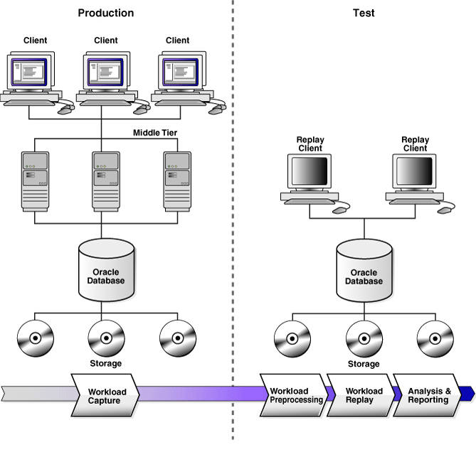

## 8 Introduction to Database Replay

You can use Database Replay to capture a workload on the production system and replay it on a test system with the exact timing, concurrency, and transaction characteristics of the original workload. This enables you to test the effects of a system change without affecting the production system.

Database Replay supports workload capture on a system running Oracle Database 10g Release 2 and newer releases. In order to capture a workload on a system running Oracle Database 10g Release 2, the database version can be 10.2.0.4 or higher. Workload replay is only supported on systems running Oracle Database 11g Release 1 and newer releases.

Note:

To use the workload capture feature on a system running Oracle9i Database or an earlier version of Oracle Database 10g Release 2, contact Oracle Support for more information.

Analyzing the effect of system changes using Database Replay involves the following steps, as illustrated in Figure 8-1:

Figure 8-1 Database Replay Workflow

> This diagram illustrates how Database Replay fits into a typical system architecture. The left side of the diagram shows the production system with the following components (from top to bottom): clients, middle tier, Oracle Database, and storage. The right side of the diagram shows the test system with the following components (from top to bottom): replay clients, Oracle Database, and storage. The bottom of the diagram shows a horizontal arrow pointing from the production system to the test system. The following steps are shown in the arrow (from left to right):
>
> - Workload capture
> - Workload preprocessing
> - Workload replay
> - Analysis and reporting
>
> End of description.
  

## 8.1 Workload Capture

The first step in using Database Replay is to capture the production workload. Capturing a workload involves recording all requests made by external clients to Oracle Database.

When workload capture is enabled, all external client requests directed to Oracle Database are tracked and stored in binary files—called capture files—on the file system. You can specify the location where the capture files will be stored. Once workload capture begins, all external database calls are written to the capture files. The capture files contain all relevant information about the client request, such as SQL text, bind values, and transaction information. Background activities and database scheduler jobs are not captured. These capture files are platform independent and can be transported to another system.

See Also:

- [Chapter 9, "Capturing a Database Workload"](dbr_capture.md) for information about how to capture a workload on the production system

## 8.2 Workload Preprocessing

Once the workload has been captured, the information in the capture files need to be preprocessed. Preprocessing creates all necessary metadata needed for replaying the workload. This must be done once for every captured workload before they can be replayed. After the captured workload is preprocessed, it can be replayed repeatedly on a replay system running the same version of Oracle Database. Typically, the capture files should be copied to another system for preprocessing. As workload preprocessing can be time consuming and resource intensive, it is recommended that this step be performed on the test system where the workload will be replayed.

See Also:

- [Chapter 10, "Preprocessing a Database Workload"](dbr_preprocess.md) for information about how to preprocess a captured workload

## 8.3 Workload Replay

After a captured workload has been preprocessed, it can be replayed on a test system. During the workload replay phase, Oracle Database performs the actions recorded during the workload capture phase on the test system by re-creating all captured external client requests with the same timing, concurrency, and transaction dependencies of the production system.

Database Replay uses a client program called the replay client to re-create all external client requests recorded during workload capture. Depending on the captured workload, you may need one or more replay clients to properly replay the workload. A calibration tool is provided to help determine the number of replay clients needed for a particular workload. Because the entire workload is replayed—including DML and SQL queries—the data in the replay system should be as logically similar to the data in the capture system as possible. This will minimize replay divergence and enable a more reliable analysis of the replay.

See Also:

- [Chapter 11, "Replaying a Database Workload"](dbr_replay.md) for information about how to replay a preprocessed workload on the test system

## 8.4 Analysis and Reporting

Once the workload is replayed, in-depth reporting is provided for you to perform detailed analysis of both workload capture and replay.

The workload capture report and workload replay report provide basic information about the workload capture and replay, such as errors encountered during replay and data divergence in rows returned by DML or SQL queries. A comparison of several statistics—such as database time, average active sessions, and user calls—between the workload capture and the workload replay is also provided.

The replay compare period report can be used to perform a high-level comparison of one workload replay to its capture or to another replay of the same capture. A divergence summary with an analysis of whether any data divergence occurred and if there were any significant performance changes is also provided. Furthermore, Automatic Database Diagnostic Monitor (ADDM) findings are incorporated into these reports.

For advanced analysis, Automatic Workload Repository (AWR) reports are available to enable detailed comparison of performance statistics between the workload capture and the workload replay. The information available in these reports is very detailed, and some differences between the workload capture and replay can be expected.

The SQL Performance Analyzer report can be used to compare a SQL tuning set from a workload capture to another SQL tuning set from a workload replay, or two SQL tuning sets from two workload replays. Comparing SQL tuning sets with Database Replay provides more information than SQL Performance Analyzer test-execute because it considers and shows all execution plans for each SQL statement, while SQL Performance Analyzer test-execute generates only one execution plan per SQL statement for each SQL trial. Moreover, the SQL statements are executed in a more authentic environment because Database Replay captures all bind values and reproduces dynamic session state such as PL/SQL package state more accurately. It is recommended that you run SQL Performance Analyzer test-execute first as a sanity test to ensure SQL statements have not regressed and the test system is set up properly before using Database Replay to perform load and currency testing.

Besides using replay divergence information to analyze replay characteristics of a given system change, you should also use an application-level validation procedure to assess the system change. Consider developing a script to assess the overall success of the replay. For example, if 10,000 orders are processed during workload capture, you should validate that a similar number of orders are also processed during replay.

After the replay analysis is complete, you can restore the database to its original state at the time of workload capture and repeat workload replay to test other changes to the system.

See Also:

- [Chapter 12, "Analyzing Captured and Replayed Workloads"](dbr_analyze.md) for information about how to analyze data and performance divergence using Database Replay reports