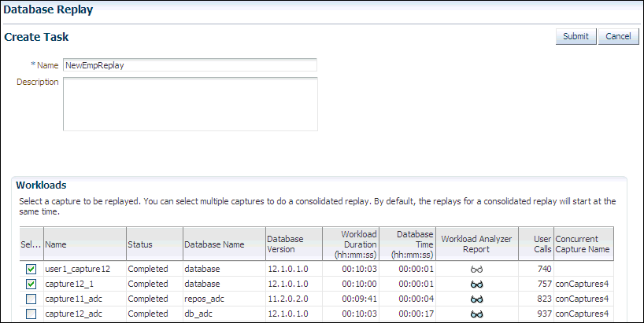
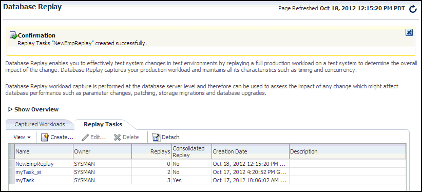
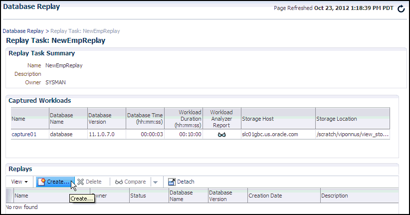
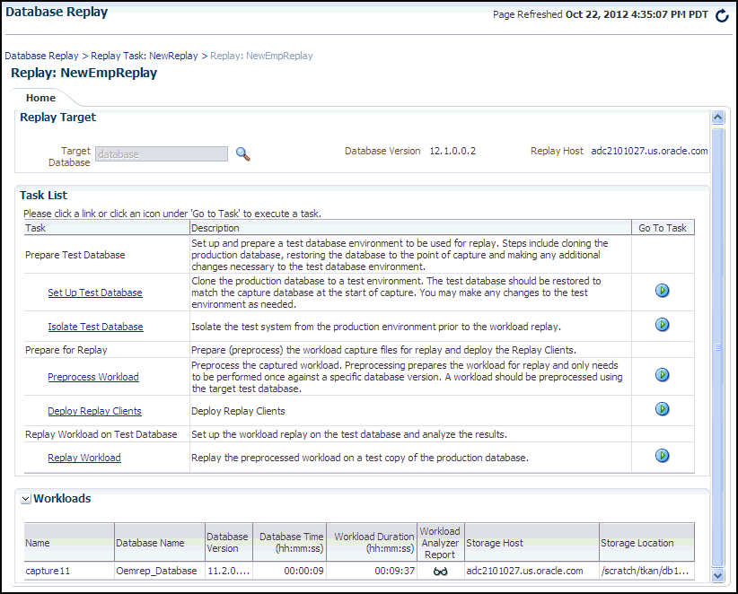
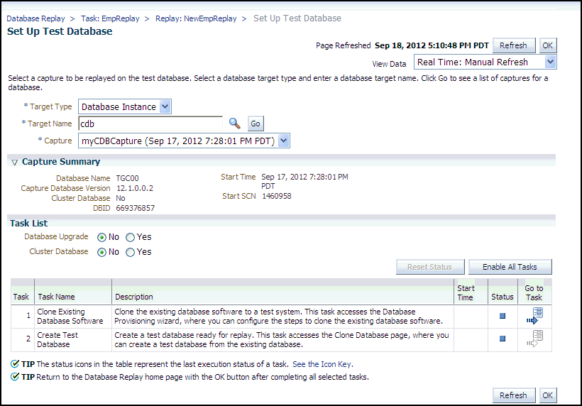
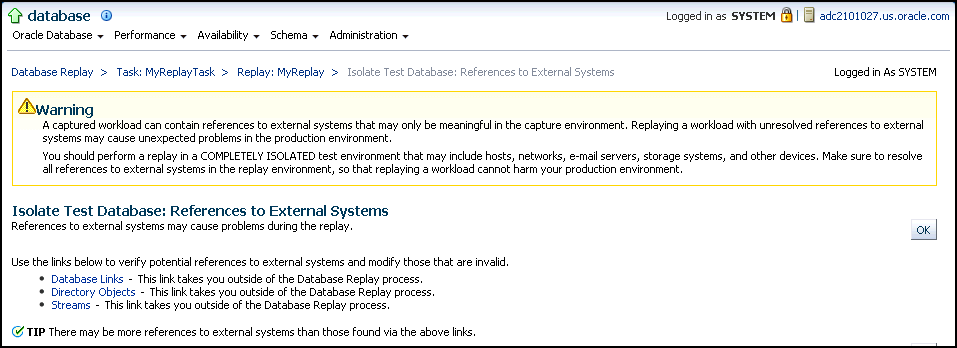
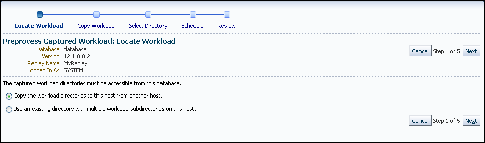
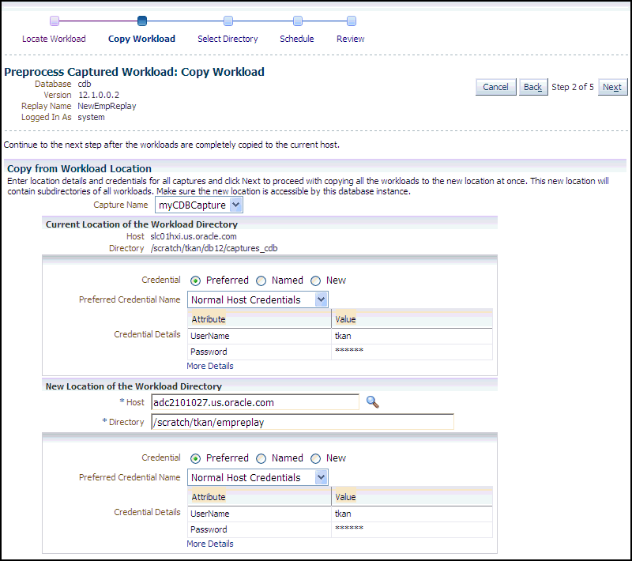
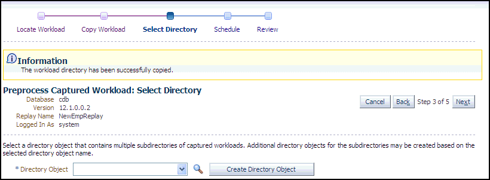
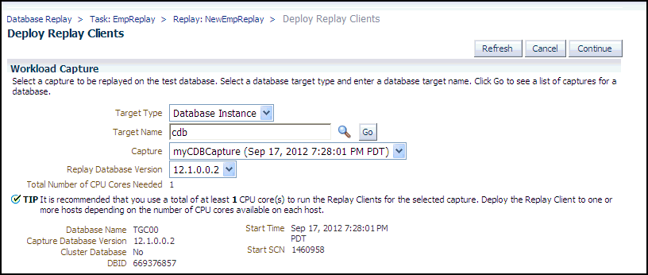

## 10 Preprocessing a Database Workload

After a workload is captured and setup of the test system is complete, the captured data must be preprocessed. Preprocessing a captured workload creates all necessary metadata for replaying the workload. This must be done once for every captured workload before they can be replayed. After the captured workload is preprocessed, it can be replayed repeatedly on a replay system.

To preprocess a captured workload, you will first need to move all captured data files from the directory where they are stored on the capture system to a directory on the instance where the preprocessing will be performed. Preprocessing is resource intensive and should be performed on a system that is:

- Separate from the production system
- Running the same version of Oracle Database as the replay system

For Oracle Real Application Clusters (Oracle RAC), select one database instance of the replay system for the preprocessing. This instance must have access to the captured data files that require preprocessing, which can be stored on a local or shared file system. If the capture directory path on the capture system resolves to separate physical directories in each instance, you will need to move all the capture files created in each of these directories into a single directory on which preprocessing will be performed.

Typically, you will preprocess the captured workload on the replay system. If you plan to preprocess the captured workload on a system that is separate from the replay system, you will also need to move all preprocessed data files from the directory where they are stored on the preprocessing system to a directory on the replay system after preprocessing is complete.

This chapter contains the following sections:

- Preparing a Single Database Workload Using Enterprise Manager
- Preprocessing a Database Workload Using APIs

Tip:

Before you can preprocess a captured workload, you need to capture the workload on the production system, as described in [Chapter 9, "Capturing a Database Workload"](dbr_capture.md).

## 10.1 Preparing a Single Database Workload Using Enterprise Manager

Preparing for a single workload consists of the following tasks:

- Creating a database replay task
- Creating a replay from a replay task
- Preparing the test database
- Preprocessing the workload and deploying the replay clients

Note:

Preparing the test database is only required if you have not done so already.

The following sections provide procedures for these tasks.

### 10.1.1 Creating a Database Replay Task

Before proceeding, the capture that you want to replay must have some captured user calls.

To create a database replay task:

1. From the Database Replay page, click the Replay Tasks tab, then click Create in the toolbar.
	The Create Task page appears.
	

> Buttons on the upper right side of the page are Submit and Cancel.
>
> Two input fields that appear on the left side of the page are Name and Description. NewEmpReplay appears in the Name field.
>
> In the Workloads section below this, the text reads as follows:
>
> "Select a capture to be replayed. You can select multiple captures to do a consolidated replay. By default, the replays for consolidated replay will start at the same time."
>
> A table appears below the text with these columns: Select, Name, Status, Database Name, Database Version, Workload Duration, Database Time, Workload Analyzer Report, User Calls, and Concurrent Capture Name. Two rows appear in the table with entries for each column, except for the Workload Analyzer Report, which has icon links to access the report.
>
> End of description.

2. Provide a Name for the task, select a capture to be replayed, then click Submit. For consolidated replays, select two or more captures.
	The Database Replay page reappears, and displays your newly created replay task in the table under the Replay Task tab.
	

> A confirmation message appears at the top of the page that states "Replay Tasks 'NewEmpReplay' created successfully."
>
> There are two tabs: Captured Workloads and Replay Tasks, and the Replay Tasks tab is open.
>
> A table appears in this open tab with the following columns: Name, Owner, Replays, Consolidated Replay, Creation Date, and Description. There are three rows in the table with entries for each column except for the Description column.
>
> The following user controls appear above the table: View, Create, Edit, Delete, and Detach.
>
> End of description.


### 10.1.2 Creating a Replay from a Replay Task

To create the replay:

1. From the Database Replay page, click the Replay Tasks tab.
2. Click the link for the desired replay task in the table.
	The Replay Task page for the capture appears.
	

> In the Replay Task Summary section, the Name is NewEmpReplay, and the Owner is SYSMAN.
>
> The Captured Workloads table contains one row of entries for the following columns: Name, Database Name, Database Version, Database Time, Workload Duration, Storage Host, and Storage Location. The Workload Analyzer Report has an icon link for accessing the report.
>
> The Replays table has no rows for the following columns: Name, Owner, Status, Database Name, Database Version, Creation Date, and Description.
>
> The user controls above this table are View, Create, Delete, Compare, and Detach. The cursor is placed over Create, and it is highlighted.
>
> End of description.

3. Click Create in the Replays section.
	The Create Replay pop-up appears.
4. Provide a required Name and optional description, then click the Target Database icon.
	The Search and Select: Targets pop-up appears.
5. Choose the desired database, then click Select.
6. Click OK in the Create Replay pop-up.
	The Database Replay page for your replay appears, which includes a Task List with links to perform the needed tasks.
	

> The Replay Target section shows a Target Database read-only field pre-populated with "database." To the right of this is the Database Version number and Replay Host address.
>
> The Task List table contains links to perform the following tasks: Set Up Test Database, Isolate Test Database, Preprocess Workload, Deploy Replay Clients, and Replay Workload.
>
> The Workloads table shows entries for a single row for the following columns: Name, Database Name, Database Version, Database Time, Workload Duration, Storage Host, and Storage Location. The Workload Analyzer Report column has a clickable icon to access the report.
>
> End of description.


You can now proceed to the first task in the Task List, described in the next section.

### 10.1.3 Preparing the Test Database

Preparing the test database consists of:

- Setting up the test database
- Isolating the test database

Note:

These tasks are optional. If you have already set up your test database, skip to "Preprocessing the Workload and Deploying the Replay Clients".

The following procedures explain how to perform each of these tasks, which you can do in any order.

To set up the test database:

1. From the Replay page for your particular replay, click the link for the Set Up Test Database task.
	The Set Up Test Database page appears.
	

> The buttons on the upper right portion of the page are Refresh and OK. Below these buttons is a View Data drop-down with Real Time: Manual Refresh selected.
>
> The following text precedes three required user input fields: "Select a capture to be replayed on the test database. Select a database target type and enter a database target name. Click Go to see a list of captures for a database. The Target Type is a drop-down list with Database Instance selected. The Target Name is "cdb." Capture is a drop-down list with "myCDBcapture."
>
> The Capture Summary section shows values for Database Name, Capture Database Version, Cluster Database, DBID, Start Time, and Start SCN.
>
> The Task List section shows No and Yes radio buttons for Database Upgrade and Cluster Database. The No buttons are selected.
>
> End of description.

2. Choose whether you want to upgrade the database or not, and indicate whether this is a cluster database.
3. Click the Go to Task icon for the Clone Existing Database Software sub-task, or click Enable All Tasks if you want to create the test database first.
4. Follow the instructions provided in the online help for the wizards.
	When the tasks are complete, a checkmark appears in the Status column for each task.
5. Click OK to return to the Database Replay page.

To isolate the test database:

1. From the Replay page for your particular replay, click the link for the Isolate Test Database task.
	A page appears explaining that references to external systems can cause problems during the replay.
	

> The following warning appears at the top of the page:
>
> "A captured workload can contain references to external systems that may only be meaningful in the capture environment. Replaying a workload with unresolved references to external systems may cause unexpected problems in the production environment. You should perform a replay in a COMPLETELY ISOLATED test environment that may include hosts, networks, e-mail servers, storage systems, and other devices. Make sure to resolve all references to external systems in the replay environment, so that replaying a workload cannot harm your production environment."
>
> The heading "Isolate Test Database: References to External Systems" appears below the warning. Below the heading is the text "References to external systems may cause problems during the replay."
>
> The following text precedes a bulleted list with three items: "Use the links below to verify potential references to external systems and modify those that are invalid."
>
> The links are Database Links, Directory Objects, and Streams. The text for each of these links reads "This link takes you outside of the Database Replay process."
>
> A tip follows the list that reads "There may be more references to external systems than those found via the above links."
>
> End of description.

2. Use the links provided to verify potential references to external systems, modify those that are invalid, then click OK.
	The Replay Summary page reappears.

### 10.1.4 Preprocessing the Workload and Deploying the Replay Clients

The final preparation for the replay consists of:

- Preprocessing the workload
	You need to preprocess each captured workload once for each version of the database against which the workload will be replayed. After you preprocess the workload once, you can use it for any subsequent replay tasks and replays without needing to preprocess again, as long as the test database is the same version as the database where the workload was preprocessed.For instance, for a replay task that contains two replays named "MyReplay1" and "MyReplay2," after you have preprocessed "MyReplay1", you can just directly reuse the directory object to replay "MyReplay2."
	The Workload Analyzer report is available after preprocessing.
- Deploying the replay clients
	You do not need to deploy the replay clients to other replay client hosts if these hosts can access the Oracle home of the test database you specified in the Database Target Name field.

The following procedures explain how to accomplish each of these tasks.

To preprocess the workload:

1. From the Replay page for your particular replay, click the link for the Preprocess Workload task.
	The Preprocess Captured Workload: Locate Workload page appears.
	

> The upper left portion of the page provides values for Database, Version, Replay Name, and Logged In As.
>
> The upper right portion of the page states "Step 1 of 5," a Cancel button appears to the left of this text, and a Next button appears to the right of this text.
>
> The lower half of the page contains the following text, followed by two radio buttons: "The captured workload directories must be accessible from this database."
>
> The text for the first radio button reads: "Copy the workload directories to this host from another host. The text for the second radio button reads: "Use an existing directory with multiple workload subdirectories on this host."
>
> End of description.

2. Select the desired workload location option, then click Next.
	Note:
	You initially need to select the copy option.
	The Preprocess Captured Workload: Copy Workload page appears.
	

> The upper left portion of the page provides values for Database, Version, Replay Name, and Logged In As.
>
> Following this, text appears that reads "Continue to the next step after the workloads are completely copied to the current host."
>
> The upper right portion of the page states "Step 2 of 5," a Cancel button appears to the left of this text, and a Next button appears to the right of this text.
>
> The Copy From Workload Location contains the following introductory text:
>
> "Enter location details and credentials and click Next to proceed with copying this workload from the current workload location to this new location. Make sure the new location of the workload is accessible by this database instance."
>
> A Capture Name drop-down appears below this text with myCDBCapture selected.
>
> A Current Location of the Workload Directory sub-section appears below the Copy from Workload Location section. It contains a read-only Host name and Directory path. Below this are three Credential radio buttons with Preferred selected. (The other two are Named and New.) A Preferred Credential Name drop-down shows that Normal Host Credentials is selected. Credential Details shows the UserName and Password.
>
> A New Location of the Workload Directory sub-section appears next. Required Host and Directory input fields appear first, then the credentials input area appears, and is the same as for the Current Location of the Workload Directory sub-section.
>
> End of description.

3. Provide the required credentials and the new location to which the workloads will be copied and preprocessed, then click Next.
	- For a consolidated replay, there are multiple source workloads, so multiple source credentials might be needed for the current location of the workload directory. For more information on consolidated replays, see ["Using Consolidated Database Replay with Enterprise Manager"](dbr_consolidated.md) in [Chapter 13, "Using Consolidated Database Replay."](dbr_consolidated.md)
	The system responds by displaying a progress bar graph during processing, then displays the Preprocess Captured Workload: Select Directory page after the copy operation concludes.
	

> An information message appears at the top of the page that states "The workload directory has been successfully copied."
>
> Below the message, the page provides values for Database, Version, Replay Name, and Logged In As.
>
> The upper right portion of the page states "Step 3 of 5," a Cancel button appears to the left of this text, and a Next button appears to the right of this text.
>
> The lower half of the page contains the following text: "Select a directory object that contains multiple subdirectories of captured workloads. Additional directory objects for the subdirectories may be created based on the selected directory object name."
>
> A Directory Object drop-down appears below this text, with a clickable magnifying glass icon to the right of the drop-down. A Create Directory Object button appears to the right of the icon.
>
> End of description.

4. Specify the Directory Object, or create a new Directory Object that points to the location that contains the workload. If you chose to copy from the workload location to a new location in the previous step, make sure that the directory object points to the exact location you specified in the New Location of the Workload Directory section.
	The system responds by displaying a Capture Summary. You can now expand the Capture Details section to see the workload profile and workload filters. The Capture Summary does not appear for consolidated replays.
	Click Next to display the Preprocess Captured Workload: Schedule page.
5. Provide input to schedule the preprocess job:
	1. Provide your own required job name or accept the system-supplied name. The job system automatically names the job in uppercase.
		2. Indicate whether you want the job to run as soon as you submit it, or whether you want it to run at a later time.
		3. Provide the host credentials, which are used to run the preprocess job in the operating system.
	Click Next to display the Preprocess Captured Workload: Review page.
6. Check to make sure that the settings are what you intend, then click Submit.
	The Database Replay page appears, and assuming that there were no errors in your input, a confirmation message at the top of the page states "Job JOBNAME to prepare the workload has been created successfully."
7. Click the JOBNAME link to check the status of the job. The job must succeed before you can proceed to the Replay Workload task.
	Note:
	A message may appear in the Task List stating that you need to install an additional PL/SQL package in the test database to generate a compare period report after the trial. Click Install PL/SQL Package to resolve this issue before proceeding to the Replay Workload task.
	Tip:
	After preprocessing a captured workload, you can replay it on the test system, as described in [Chapter 11, "Replaying a Database Workload"](dbr_replay.md).

To deploy the replay clients:

1. From the Replay page for your particular replay, click the link for the Deploy Replay Clients task.
	The Deploy Replay Clients page appears.
	

> Refresh, Cancel, and Continue buttons appear on the upper right portion of the page.
>
> A Workload Capture heading appears on the left side of the page below these buttons, and the text that follows reads "Select a capture to be replayed on the test database. Select a database target type and enter a database target name. Click Go to see a list of captures for a database."
>
> The following elements appear below this text:
>
> Target Type drop-down with Database Instance selected.
>
> Target Name input field with cdb entered. A clickable magnifying glass icon appears to the right of this field, and a Go button appears to the right of the icon.
>
> Capture drop-down with myCDBCapture selected.
>
> Replay Database Version drop-down with 12.1.0.0.2 selected.
>
> Total Number of CPU Cores Needed read-only field shows 1.
>
> A tip appears next that reads "It is recommended that you use a total of at least 1 CPU core(s) to run the Replay Clients for the selected capture. Deploy the Replay Client to one or more hosts depending on the number of CPU cores available on each host.
>
> The Capture Summary section shows values for Database Name, Capture Database Version, Cluster Database, DBID, Start Time, and Start SCN.
>
> End of description.

2. Accept the default values defined for the associated workload capture, or override these values, then click Continue.
	The Provision Oracle Database Client wizard appears.
3. Follow the instructions provided in the online help for each step of the wizard.
	After you click Submit in the Review step to run the deployment procedure according to the schedule you have set, the Replay Summary page reappears.

## 10.2 Preprocessing a Database Workload Using APIs

This section describes how to preprocess a captured workload using the `DBMS_WORKLOAD_REPLAY` package. You can also use Oracle Enterprise Manager to preprocess a captured workload, as described in "Preparing a Single Database Workload Using Enterprise Manager".

To preprocess a captured workload, use the `PROCESS_CAPTURE` procedure:

```
BEGIN
  DBMS_WORKLOAD_REPLAY.PROCESS_CAPTURE (capture_dir => 'dec06');
END;
/
```

In this example, the captured workload stored in the `dec06` directory will be preprocessed.

The `PROCESS_CAPTURE` procedure in this example uses the `capture_dir` required parameter, which specifies the directory that contains the captured workload to be preprocessed.

Tip:

After preprocessing a captured workload, you can replay it on the test system, as described in [Chapter 11, "Replaying a Database Workload"](dbr_replay.md).

See Also:

- [Oracle Database PL/SQL Packages and Types Reference](https://docs.oracle.com/cd/E11882_01/appdev.112/e40758/d_workload_replay.htm#ARPLS208) for information about the `DBMS_WORKLOAD_REPLAY` package

### 10.2.1 Running the Workload Analyzer Command-Line Interface

The Workload Analyzer is a Java program that analyzes a workload capture directory and identifies parts of a captured workload that may not replay accurately due to insufficient data, errors that occurred during workload capture, or usage features that are not supported by Database Replay. The results of the workload analysis are saved to an HTML report named `wcr_cap_analysis.html` located in the capture directory that is being analyzed. If an error can be prevented, the workload analysis report displays available preventive actions that can be implemented before replay. If an error cannot be corrected, the workload analysis report provides a description of the error so it can be accounted for during replay. Running Workload Analyzer is the default option and is strongly recommended.

Note:

If you are preprocessing a workload capture using Oracle Enterprise Manager, then you do not need to run Workload Analyzer in the command-line interface. Oracle Enterprise Manager enables you to run Workload Analyzer as part of the workload preprocessing.

Workload Analyzer is composed of two JAR files, `dbranalyzer.jar` and `dbrparser.jar`, located in the `$ORACLE_HOME/rdbms/jlib/` directory of a system running Oracle Database Enterprise Edition Release 11.2.0.2 or higher. Workload Analyzer requires Java 1.5 or higher and the `ojdbc6.jar` file located in the `$ORACLE_HOME/jdbc/lib/` directory. To run Workload Analyzer in the command-line interface, run the following `java` command on a single line:

```
java -classpath
$ORACLE_HOME/jdbc/lib/ojdbc6.jar:$ORACLE_HOME/rdbms/jlib/dbrparser.jar:
$ORACLE_HOME/rdbms/jlib/dbranalyzer.jar:
oracle.dbreplay.workload.checker.CaptureChecker
<capture_directory> <connection_string>
```

For the `capture_directory` parameter, input the operating system path of the capture directory. This directory should also contain the exported AWR data for the workload capture. For the `connection_string` parameter, input the connection string of an Oracle database that is release 11.1 or higher.

The Workload Analyzer program will then prompt you to input the username and password of a database user with `EXECUTE` privileges for the `DBMS_WORKLOAD_CAPTURE` package and the `SELECT_CATALOG` role on the target database.

An example of this command may be:

```
java -classpath
$ORACLE_HOME/jdbc/lib/ojdbc6.jar:$ORACLE_HOME/rdbms/jlib/dbrparser.jar:
$ORACLE_HOME/rdbms/jlib/dbranalyzer.jar:
oracle.dbreplay.workload.checker.CaptureChecker /scratch/capture
jdbc:oracle:thin:@myhost.mycompany.com:1521:orcl
```