## 11 Replaying a Database Workload

After a captured workload is preprocessed, it can be replayed repeatedly on a replay system that is running the same version of Oracle Database. Typically, the replay system where the preprocessed workload will be replayed should be a test system that is separate from the production system.

This chapter describes how to replay a database workload on the test system and contains the following sections:

Tip:

Before you can replay a database workload, you must first:
- Capture the workload on the production system, as described in [Chapter 9, "Capturing a Database Workload"](dbr_capture.md)
- Preprocess the captured workload, as described in [Chapter 10, "Preprocessing a Database Workload"](dbr_preprocess.md)

## 11.1 Steps for Replaying a Database Workload

Proper planning of the workload replay and preparation of the replay system ensures that the replay will be accurate. Before replaying a database workload, review and complete the following steps as appropriate:

- Setting Up the Replay Directory
- Restoring the Database
- Resolving References to External Systems
- Remapping Connections
- User Remapping
- Specifying Replay Options
- Using Filters with Workload Replay
- Setting Up Replay Clients

### 11.1.1 Setting Up the Replay Directory

The captured workload must have been preprocessed and copied to the replay system. A directory object for the directory to which the preprocessed workload is copied must exist in the replay system.

### 11.1.2 Restoring the Database

Before a workload can be replayed, the application data state of the replay system should be logically equivalent to that of the capture system at the start time of workload capture. This minimizes replay divergence during replay. The method for restoring the database depends on the backup method that was used before capturing the workload. For example, if RMAN was used to back up the capture system, you can use RMAN `DUPLICATE` capabilities to create the test database. For more information, see ["Prerequisites for Capturing a Database Workload"](dbr_capture.md).

After the database is created with the appropriate application data on the replay system, perform the system change you want to test, such as a database or operating system upgrade. The primary purpose of Database Replay is to test the effect of system changes on a captured workload. Therefore, the system changes you make should define the test you are conducting with the captured workload.

### 11.1.3 Resolving References to External Systems

A captured workload may contain references to external systems, such as database links or external tables. Typically, you should reconfigure these external interactions to avoid impacting other production systems during replay. External references that need to be resolved before replaying a workload include:

- Database links
	It is typically not desirable for the replay system to interact with other databases. Therefore, you should reconfigure all database links to point to an appropriate database that contains the data needed for replay.
- External tables
	All external files specified using directory objects referenced by external tables need to be available to the database during replay. The content of these files should be the same as during capture, and the filenames and directory objects used to define the external tables should also be valid.
- Directory objects
	You should reconfigure any references to directories on the production system by appropriately redefining the directory objects present in the replay system after restoring the database.
- URLs
	URLs/URIs that are stored in the database need to be configured so that Web services accessed during the workload capture will point to the proper URLs during replay. If the workload refers to URLs that are stored in the production system, you should isolate the test system network during replay.
- E-mails
	To avoid resending E-mail notifications during replay, any E-mail server accessible to the replay system should be configured to ignore requests for outgoing E-mails.

Tip:

To avoid impacting other production systems during replay, Oracle strongly recommends running the replay within an isolated private network that does not have access to the production environment hosts.

### 11.1.4 Remapping Connections

During workload capture, connection strings used to connect to the production system are captured. In order for the replay to succeed, you need to remap these connection strings to the replay system. The replay clients can then connect to the replay system using the remapped connections.

For Oracle Real Application Clusters (Oracle RAC) databases, you can map all connection strings to a load balancing connection string. This is especially useful if the number of nodes on the replay system is different from the capture system. Alternatively, if you want to direct workload to specific instances, you can use services or explicitly specify the instance identifier in the remapped connection strings.

### 11.1.5 User Remapping

During workload capture, the username of the database user or schema used to connect to the production system is captured. You can choose to remap the captured username to that of a new user or schema.

### 11.1.6 Specifying Replay Options

After the database is restored and connections are remapped, you can set the following replay options as appropriate:

- Preserving COMMIT Order
- Controlling Session Connection Rate
- Controlling Request Rate Within a Session

#### 11.1.6.1 Preserving COMMIT Order

The `synchronization` parameter controls whether the `COMMIT` order in the captured workload will be preserved during replay.

If this parameter is set to `SCN`, the `COMMIT` order in the captured workload will be preserved during replay and all replay actions will be executed only after all dependent `COMMIT` actions have completed.

If this parameter is set to `OBJECT_ID`, all replay actions will be executed only after all relevant `COMMIT` actions have completed. Relevant `COMMIT` actions must meet the following criteria:

- Issued before the given action in the workload capture
- Modified at least one of the database objects for which the given action is referencing, either implicitly or explicitly

Setting this parameter to `OBJECT_ID` allows for more concurrency during workload replays for `COMMIT` actions that do not reference the same database objects during workload capture.

You can disable this option by setting the parameter to `OFF`, but the replay will likely yield significant replay divergence. However, this may be desirable if the workload consists primarily of independent transactions, and divergence during unsynchronized replay is acceptable.

#### 11.1.6.2 Controlling Session Connection Rate

The `connect_time_scale` parameter enables you to scale the elapsed time between the time when the workload capture began and each session connects. You can use this option to manipulate the session connect time during replay with a given percentage value. The default value is 100, which will attempt to connect all sessions as captured. Setting this parameter to 0 will attempt to connect all sessions immediately.

#### 11.1.6.3 Controlling Request Rate Within a Session

User think time is the elapsed time while the replayed user waits between issuing calls within a single session. To control replay speed, use the `think_time_scale` parameter to scale user think time during replay.

If user calls are being executed slower during replay than during capture, you can make the database replay attempt to catch up by setting the `think_time_auto_correct` parameter to `TRUE`. This will make the replay client shorten the think time between calls, so that the overall elapsed time of the replay will more closely match the captured elapsed time.

If user calls are being executed faster during replay than during capture, setting the `think_time_auto_correct` parameter to `TRUE` will not change the think time. The replay client will not increase the think time between calls to match the captured elapsed time.

### 11.1.7 Using Filters with Workload Replay

By default, all captured database calls are replayed during workload replay. You can use workload filters to specify which database calls to include in or exclude from the workload during workload replay.

Workload replay filters are first defined and then added to a replay filter set so they can be used in a workload replay. There are two types of workload filters: inclusion filters and exclusion filters. Inclusion filters enable you to specify database calls that will be replayed. Exclusion filters enable you to specify database calls that will not be replayed. You can use either inclusion filters or exclusion filters in a workload replay, but not both. The workload filter is determined as an inclusion or exclusion filter when the replay filter set is created.

### 11.1.8 Setting Up Replay Clients

The replay client is a multithreaded program (an executable named `wrc` located in the `$ORACLE_HOME/bin` directory) where each thread submits a workload from a captured session. Before replay begins, the database will wait for replay clients to connect. At this point, you need to set up and start the replay clients, which will connect to the replay system and send requests based on what has been captured in the workload.

Before starting replay clients, ensure that the:

- Replay client software is installed on the hosts where it will run
- Replay clients have access to the replay directory
- Replay directory contains the preprocessed workload capture
- Replay user has the correct user ID, password, and privileges (the replay user needs the DBA role and cannot be the `SYS` user)
- Replay clients are not started on a system that is running the database
- Replay clients read the capture directory on a file system that is different from the one on which the database files reside
	To do this, copy the capture directory to the system where the replay client will run. After the replay is completed, you can delete the capture directory.

After these prerequisites are met, you can proceed to set up and start the replay clients using the `wrc` executable. The `wrc` executable uses the following syntax:

```
wrc [user/password[@server]] MODE=[value] [keyword=[value]]
```

The parameters `user`, `password` and `server` specify the username, password and connection string used to connect to the replay database. The parameter `mode` specifies the mode in which to run the `wrc` executable. Possible values include `replay` (the default), `calibrate`, and `list_hosts`. The parameter `keyword` specifies the options to use for the execution and is dependent on the mode selected. To display the possible keywords and their corresponding values, run the `wrc` executable without any arguments.

The following sections describe the modes that you can select when running the `wrc` executable:

- Calibrating Replay Clients
- Starting Replay Clients
- Displaying Host Information

#### 11.1.8.1 Calibrating Replay Clients

Since one replay client can initiate multiple sessions with the database, it is not necessary to start a replay client for each session that was captured. The number of replay clients that need to be started depends on the number of workload streams, the number of hosts, and the number of replay clients for each host.

To estimate the number of replay clients and hosts that are required to replay a particular workload, run the `wrc` executable in calibrate mode.

In calibrate mode, the `wrc` executable accepts the following keywords:

- `replaydir` specifies the directory that contains the preprocessed workload capture you want to replay. If unspecified, it defaults to the current directory.
- `process_per_cpu` specifies the maximum number of client processes that can run per CPU. The default value is 4.
- `threads_per_process` specifies the maximum number of threads that can run within a client process. The default value is 50.

The following example shows how to run the `wrc` executable in calibrate mode:

```
%> wrc mode=calibrate replaydir=./replay
```

In this example, the `wrc` executable is executed to estimate the number of replay clients and hosts that are required to replay the workload capture stored in a subdirectory named `replay` under the current directory. In the following sample output, the recommendation is to use at least 21 replay clients divided among 6 CPUs:

```
Workload Replay Client: Release 11.2.0.0.2 - Production on Fri May 1
13:06:33 2009
 
Copyright (c) 1982, 2009, Oracle.  All rights reserved.
 
Report for Workload in: /oracle/replay/
-----------------------
 
Recommendation:
Consider using at least 21 clients divided among 6 CPU(s).
 
Workload Characteristics:
- max concurrency: 1004 sessions
- total number of sessions: 1013
 
Assumptions:
- 1 client process per 50 concurrent sessions
- 4 client process per CPU
- think time scale = 100
- connect time scale = 100
- synchronization = TRUE
```

#### 11.1.8.2 Starting Replay Clients

After determining the number of replay clients that are needed to replay the workload, you need to start the replay clients by running the `wrc` executable in replay mode on the hosts where they are installed. Once started, each replay client will initiate one or more sessions with the database to drive the workload replay.

In replay mode, the `wrc` executable accepts the following keywords:

- `userid` and `password` specify the user ID and password of a replay user for the replay client. If unspecified, these values default to the `system` user.
- `server` specifies the connection string that is used to connect to the replay system. If unspecified, the value defaults to an empty string.
- `replaydir` specifies the directory that contains the preprocessed workload capture you want to replay. If unspecified, it defaults to the current directory.
- `workdir` specifies the directory where the client logs will be written. This parameter is only used with the `debug` parameter for debugging purposes.
- `debug` specifies whether debug data will be created. Possible values include:
	- `on`
		Debug data will be written to files in the working directory
		- `off`
		No debug data will be written (the default value)
	Note:
	Before running the `wrc` executable in debug mode, contact Oracle Support for more information.
- `connection_override` specifies whether to override the connection mappings stored in the `DBA_WORKLOAD_CONNECTION_MAP` view. If set to `TRUE`, connection remappings stored in the `DBA_WORKLOAD_CONNECTION_MAP` view will be ignored and the connection string specified using the `server` parameter will be used. If set to `FALSE`, all replay threads will connect using the connection remappings stored in the `DBA_WORKLOAD_CONNECTION_MAP` view. This is the default setting.

The following example shows how to run the `wrc` executable in replay mode:

```
%> wrc system/password@test mode=replay replaydir=./replay
```

In this example, the `wrc` executable starts the replay client to replay the workload capture stored in a subdirectory named `replay` under the current directory.

After all replay clients have connected, the database will automatically distribute workload capture streams among all available replay clients and workload replay can begin. You can monitor the status of the replay clients using the `V$WORKLOAD_REPLAY_THREAD` view. After the replay finishes, all replay clients will disconnect automatically.

#### 11.1.8.3 Displaying Host Information

You can display the hosts that participated in a workload capture and workload replay by running the `wrc` executable in list\_hosts mode.

In list\_hosts mode, the `wrc` executable accepts the keyword `replaydir`, which specifies the directory that contains the preprocessed workload capture you want to replay. If unspecified, it defaults to the current directory.

The following example shows how to run the `wrc` executable in list\_hosts mode:

```
%> wrc mode=list_hosts replaydir=./replay
```

In this example, the `wrc` executable is executed to list all hosts that participated in capturing or replaying the workload capture stored in a subdirectory named `replay` under the current directory. In the following sample output, the hosts that participated in the workload capture and three subsequent replays are shown:

```
Workload Replay Client: Release 11.2.0.0.2 - Production on Fri May 1 13:44:48 2009
 
Copyright (c) 1982, 2009, Oracle.  All rights reserved.
 
Hosts found:
Capture:
        prod1
        prod2
Replay 1:
        test1
Replay 2:
        test1
        test2
Replay 3:
        testwin
```

## 11.2 Replaying a Database Workload Using Enterprise Manager

This section describes how to replay a database workload using Enterprise Manager.

The primary tool for replaying database workloads is Oracle Enterprise Manager. If Oracle Enterprise Manager is unavailable, you can also replay database workloads using APIs, as described in "Replaying a Database Workload Using APIs".

Note:

Before proceeding, you must already have created a replay task and created a replay from the replay task. To do this, see ["Preparing a Single Database Workload Using Enterprise Manager"](dbr_preprocess.md).

To replay a database workload using Enterprise Manager:

1. From the Enterprise menu of the Enterprise Manager Cloud Control console, select Quality Management, then Database Replay.
	If the Database Login page appears, log in as a user with administrator privileges.
	The Database Replay page appears.
	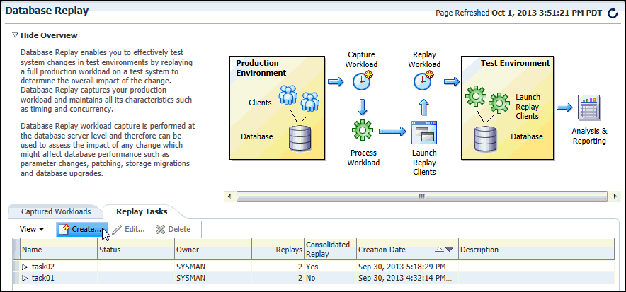

> The following text appears: "Database Replay allows workloads to be captured from production systems and re-executed with high fidelity on test copies of production databases. This enables detailed analysis of how the proposed changes may affect production systems; for instance, patching or upgrading database software."
>
> An overview diagram showing the database replay process follows.
>
> Below the diagram are the Captured Workloads and Replay Tasks tabs, and the Replay Tasks tab is open.
>
> A table follows with the following columns: Name, Owner, Replays, Consolidated Replay, Creation Date, and Description. Three rows appear in the table with values for all of the columns except for Description, which is blank.
>
> The following user controls appear above the table: View, Create, Edit, Delete, and Detach.
>
> End of description.

2. Select the Replay Tasks tab, then click the link for the desired replay task in the table.
	The Replay Task page for the replay appears.
	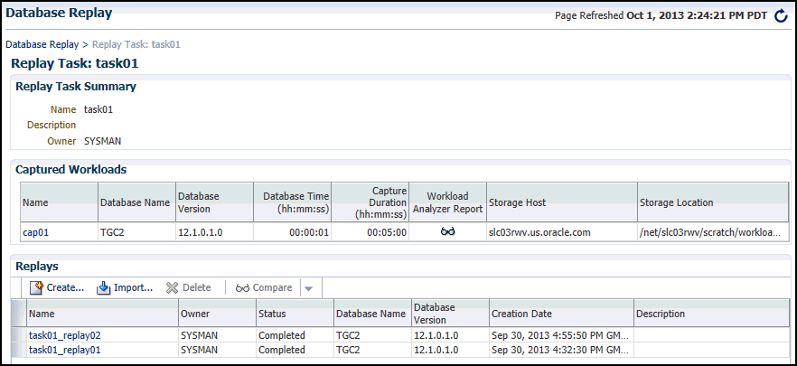

> The Replay Task Summary section provides the Name, Description, and Owner.
>
> The Captured Workloads table appears below this, and shows one row with entries for the following columns: Name, Database Name, Database Version, Database Time, Workload Duration, Storage Host, and Storage Location. The Workload Analyzer Report column shows a clickable icon to access the report.
>
> The Replays table appears below the Captured Workloads table, and shows one row with entries for the following columns: Name, Owner, Status, Database Name, Database Version, and Creation Date. The last column, Description, is blank. The following user controls appear above the table: View, Create, Delete, Compare, and Detach.
>
> End of description.

3. Click Create in the Replays section to create the replay.
	The Create Replay pop-up appears.
4. Provide a required Name and optional description, then click the Target Database icon.
	The Search and Select: Targets pop-up appears.
5. Choose the appropriate database, then click Select.
6. Click OK in the Create Replay pop-up.
	The Database Replay page for your replay appears, which includes a Task List with a link to perform the replay.
	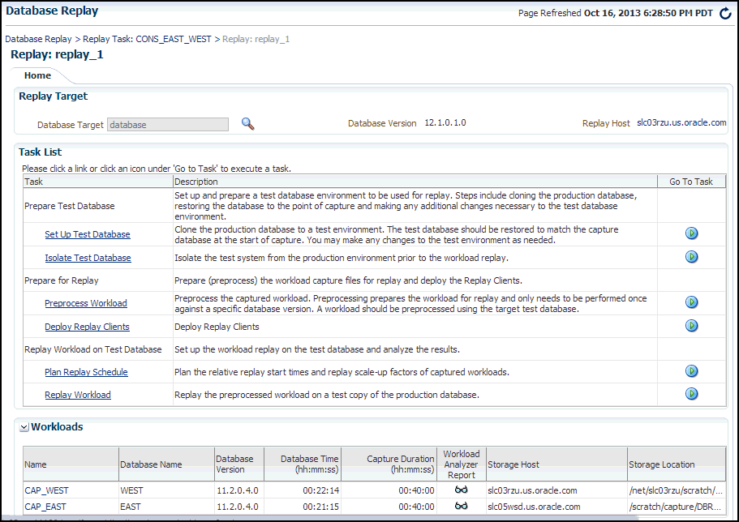

> The Replay Target section shows a Target Database read-only field pre-populated with "database." To the right of this is the Database Version number and Replay Host address.
>
> The Task List table contains links to perform tasks, with a description for each task. The following advisory information appears above the table: "An additional PL/SQL package needs to be installed in the test database to generate a compare period report after the trial. If you have not done so, please click. To the right of this text is the Install PL/SQL Package button.
>
> The Task List table contains links to perform the following tasks: Set Up Test Database, Isolate Test Database, Preprocess Workload, Deploy Replay Clients, and Replay Workload.
>
> The Workloads table shows entries for a single row for the following columns: Name, Database Name, Database Version, Database Time, Workload Duration, Storage Host, and Storage Location. The Workload Analyzer Report column has a clickable icon to access the report.
>
> End of description.

7. Click the link for the Replay Workload task.
	The Replay Workload: Locate Workload page appears.
	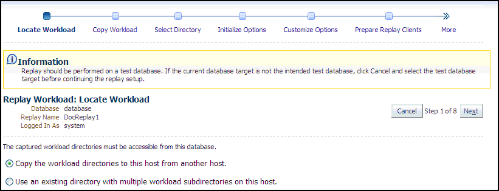

> An information message appears at the top of the page that states "Replay should be performed on a test database. If the current database target is not in the intended test database, click Cancel and select the test database target before continuing the replay setup."
>
> The heading Replay Workload: Locate Workload appears next on the left side of the page. Below this heading are values for Database, Replay Name, and Logged In As. Parallel to this area on the right side of the page are the Cancel button followed by the text "Step 1 of 8" followed by the Next button.
>
> The bottom of the page has two radio buttons preceded by the text "The captured workload directories must be accessible from this database." The first radio button is selected, and the text for this button reads "Copy the workload directories to this host from another host." The text for the second button reads "Use an existing directory with multiple workload subdirectories on this host."
>
> End of description.

8. Select the desired workload location option.
	If you have not previously copied the workload from its storage location to the replay location where the replay clients can access it, select the option to copy the workload. Otherwise, select the option to use the existing replay directory that contains the workload to be replayed.
	Click Next to display the Replay Workload: Copy Workload page.
	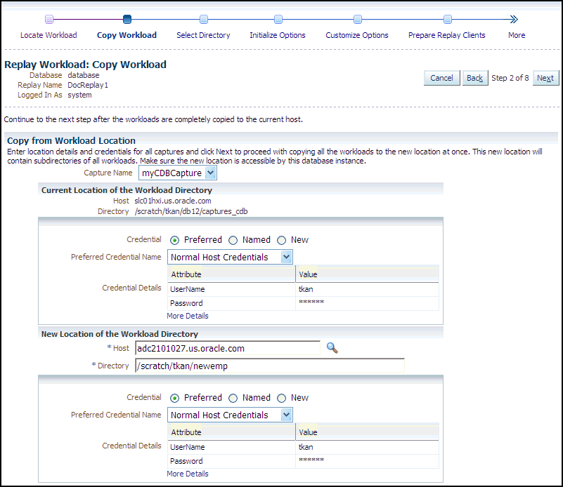

> The upper left portion of the page provides values for Database, Replay Name, and Logged In As.
>
> Following this, text appears that reads "Continue to the next step after the workloads are completely copied to the current host."
>
> The upper right portion of the page states "Step 2 of 8," Cancel and Back buttons appears to the left of this text, and a Next button appears to the right of this text.
>
> The Copy From Workload Location contains the following introductory text:
>
> "Enter location details and credentials and click Next to proceed with copying this workload from the current workload location to this new location. Make sure the new location of the workload is accessible by this database instance."
>
> A Capture Name drop-down appears below this text with myCDBCapture selected.
>
> A Current Location of the Workload Directory sub-section appears below the Copy from Workload Location section. It contains a read-only Host name and Directory path. Below this are three Credential radio buttons with Preferred selected. (The other two are Named and New.) A Preferred Credential Name drop-down shows that Normal Host Credentials is selected. Credential Details shows the UserName and Password.
>
> A New Location of the Workload Directory sub-section appears next. Required Host and Directory input fields appear first, then the credentials input area appears, and is the same as for the Current Location of the Workload Directory sub-section.
>
> End of description.

9. Provide the required credentials and the new location of the workload directory to which you want to copy the workload, then click Next.
	- There are multiple source workloads for a consolidated replay, so multiple source credentials might be needed for the current location of the workload directory. For more information on consolidated replays, see ["Using Consolidated Database Replay with Enterprise Manager"](dbr_consolidated.md) in [Chapter 13, "Using Consolidated Database Replay."](dbr_consolidated.md)
	The system responds by displaying a progress bar graph during processing, then displays the Replay Workload: Select Directory page after the copy operation concludes.
	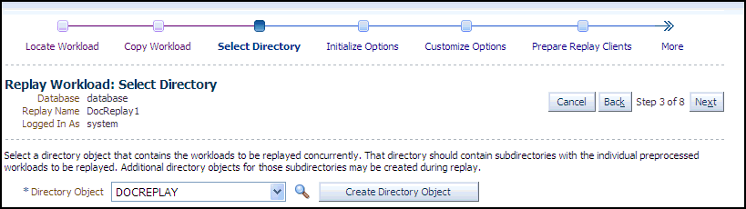

> Below the message, the page provides values for Database, Replay Name, and Logged In As.
>
> The upper right portion of the page states "Step 3 of 5," a Cancel button appears to the left of this text, and a Next button appears to the right of this text.
>
> The lower half of the page contains the following text: "Select a directory object that contains the workloads to be replayed concurrently. That directory should contain subdirectories with the individual preprocessed workloads to be replayed. Additional directory objects for those subdirectories may be created during replay."
>
> A Directory Object drop-down appears below this text, with a clickable magnifying glass icon to the right of the drop-down. DOCREPLAY is selected as the directory object. A Create Directory Object button appears to the right of the icon.
>
> End of description.

10. Specify the Directory Object, or create a new Directory Object that points to the location that contains the workload. If you chose to copy from the workload location to a new location in the previous step, make sure that the directory object points to the exact location you specified in the New Location of the Workload Directory section.
	The system responds by displaying a Capture Summary. You can expand the Capture Details section to see the workload profile and workload filters. You can also generate a Workload Capture Analyzer Report and Database Capture Report. The Capture Summary does not appear for consolidated replays.
	Click Next to display the Replay Workload: Initialize Options page.
	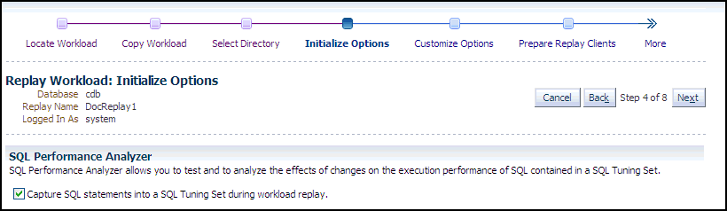

> The heading Replay Workload: Initialize Options appears on the upper left portion of the page. Below the heading are values for Database, Replay Name, and Logged In As.
>
> The upper right portion of the page states "Step 4 of 8," Cancel and Back buttons appear to the left of this text, and a Next button appears to the right of this text.
>
> The SQL Performance Analyzer section contains the following introductory text:
>
> "SQL Performance Analyzer allows you to test and analyze the effects of changes on the execution performance of SQL contained in a SQL Tuning Set."
>
> Below this text is an enabled check box with the text "Capture SQL statements into a SQL Tuning Set during workload replay."
>
> End of description.

11. In the SQL Performance Analyzer section, retain or disable the Capture SQL Statements option, which is enabled by default and recommended. You can disable this option if you do not want to compare SQL tuning sets at the end of the Replay.
	- The SQL Performance Analyzer can initiate an impact analysis of environmental changes on the performance of SQL statements within a SQL Tuning Set. You can create and analyze SQL Performance Analyzer tasks to test the effects of a database upgrade, initialization parameter change, Exadata simulation, or custom experiments. A task compares the effects of before-trial changes with after-trial changes.
		Although Database Replay provides an analysis of how a change affects your entire system, you can use a SQL tuning set in conjunction with the SQL Performance Analyzer to gain a more SQL-centric analysis of how the change affects SQL statements and execution plans.
		By capturing a SQL tuning set during workload replay, you can use SQL Performance Analyzer to compare this SQL tuning set to another SQL tuning set captured during workload capture, without having to re-execute the SQL statements. This enables you to obtain a SQL Performance Analyzer report and compare the SQL performance, before and after change, while running Database Replay.
		- In the Identify Source section, initial replay options refer to the connection mappings and parameters on the Customize Options page. Connections are captured along with the workload.
		Note:
		This section does not appear for consolidated replays or Oracle RAC.
	Click Next to display the Replay Workload: Customize Options page.
	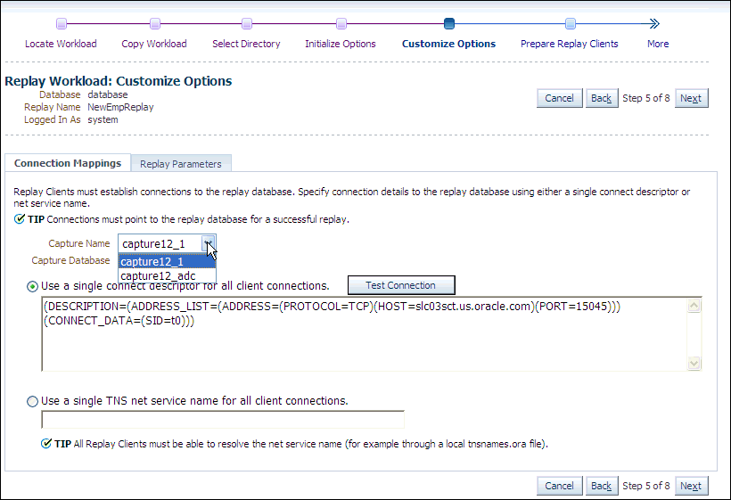

> The heading Replay Workload: Customize Options appears on the upper left portion of the page. Below the heading are values for Database, Replay Name, and Logged In As.
>
> The upper right portion of the page states "Step 5 of 8," Cancel and Back buttons appear to the left of this text, and a Next button appears to the right of this text.
>
> There are two tabs: Connection Mappings, and Replay Parameters, and the Connection Mappings tab is open.
>
> The text at the top of this tab reads: "Replay Clients must establish connections to the replay database. Specify connector details to the replay database using either a single connector descriptor or net service name." A tip follows this that reads: "Connections must point to the replay database for a successful replay."
>
> Below this text is a Capture Name drop-down with myCapture112 selected, and a Capture Database read-only field with Oemrep\_Database appearing.
>
> Below these are two radio buttons with the first one selected, and each radio button has user input fields. The first radio button has the following text: "Use a single connect descriptor for all client connections." A Test Connection button appears to the right of this text. The user input text is as follows:
>
> (DESCRIPTION=(ADDRESS\_LIST=(ADDRESS=(PROTOCOL=TCP)(HOST=slc01xhi.us.oracle.com)(PORT=15045)))(CONNECT\_DATA=(SID=tgc00)))
>
> The second radio button has the following text: "Use a single TNS net service name for all client connections." The following tip text appears below the input field for this radio button: "All Replay Clients must be able to resolve the net service name (for example, through a local tnsnames.ora file)."
>
> End of description.

12. Remap captured connection strings to connection strings that point to the replay system. Note that you need to remap each capture connection. For example, in the illustration above, you would need to remap the connection for both capture12\_1 and capture12\_adc.
	(You can remap connections per workload for consolidated replay. There is a Capture Name drop-down to choose the workload.)
	Click the Connection Mappings tab. There are several methods you can use to remap captured connection strings. You can choose to:
	- Use a single connect descriptor for all client connections by selecting this option and entering the connect descriptor you want to use. The connect descriptor should point to the replay system.
		To test the connection, click Test Connection. If the connect descriptor is valid, an Information message is displayed to inform you that the connection was successful.
		- Use a single TNS net service name for all client connections by selecting this option and entering the net service name you want to use. All replay clients must be able to resolve the net service name, which can be done using a local `tnsnames.ora` file.
		- Use a separate connect descriptor or net service name for each client connect descriptor captured in the workload by selecting this option and, for each capture system value, entering a corresponding replay system value that the replay client will be use. If you selected the "Use replay options from a previous replay" option in the Initialize Options step, the "Use a separate connect descriptor" option is selected, and the previous Replay system values appear in the text field below.
		Note:
		This option does not apply to consolidated replays.
	For more information, see "Remapping Connections".
13. Specify the replay options using the replay parameters, which control some aspects of the Replay.
	To modify the replay behavior, click the Replay Parameters tab and enter the desired values for each replay parameter. Using the default values is recommended. For information about setting the replay parameters, see "Specifying Replay Options".
	After setting the replay parameters, click Next.
	The Replay Workload: Prepare Replay Clients page appears.
	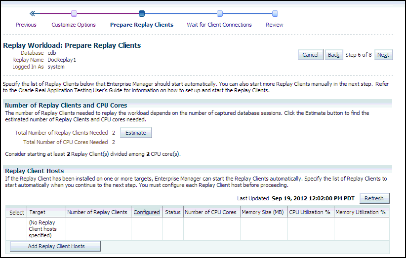

> The heading Replay Workload: Prepare Replay Clients appears on the upper left portion of the page. Below the heading are values for Database, Replay Name, and Logged In As.
>
> The upper right portion of the page states "Step 6 of 8," Cancel and Back buttons appear to the left of this text, and a Next button appears to the right of this text.
>
> There are two tabs: Connection Mappings, and Replay Parameters, and the Connection Mappings tab is open.
>
> The text at the top of this tab reads: "Replay Clients must establish connections to the replay database. Specify connector details to the replay database using either a single connector descriptor or net service name." A tip follows this that reads: "Connections must point to the replay database for a successful replay."
>
> Below this text is a Capture Name drop-down with myCapture112 selected, and a Capture Database read-only field with Oemrep\_Database appearing.
>
> Below these are two radio buttons with the first one selected, and each radio button has user input fields. The first radio button has the following text: "Use a single connect descriptor for all client connections." A Test Connection button appears to the right of this text. The user input text is as follows:
>
> (DESCRIPTION=(ADDRESS\_LIST=(ADDRESS=(PROTOCOL=TCP)(HOST=slc01xhi.us.oracle.com)(PORT=15045)))(CONNECT\_DATA=(SID=tgc00)))
>
> The second radio button has the following text: "Use a single TNS net service name for all client connections." The following tip text appears below the input field for this radio button: "All Replay Clients must be able to resolve the net service name (for example, through a local tnsnames.ora file)."
>
> End of description.

14. Ensure that the replay clients are prepared for replay:
	Before proceeding, the replay clients must be set up. For more information, see "Setting Up Replay Clients".
	1. Click Estimate to determine how many Replay clients and CPUs are required for the Replay.
		2. Click Add Replay Client Hosts to add a host or hosts for the Replay clients. (If you do not want to add any replay client hosts, you can still continue and start the replay clients from the command line outside of Enterprise Manager).
		The Search and Select: Replay Client Host pop-up appears.
		- Specify a Target Name and then click Go, or just click Go to display the entire list of available hosts.
				- Choose a host and then click Select.
		3. When the host name appears in the Target column of the Replay Client Hosts table, specify the number of Replay clients recommended from the estimate results, then make sure that the number of CPUs listed for the host satisfies the minimum recommendation in the estimate results. You should start at least one replay client per captured workload.
		4. In the Configured column, click the No link to configure the Replay client host in the pop-up that appears.
		5. Click Apply after you have finished providing input in the pop-up. The Configured column now displays Yes in the Replay Client Hosts table.
15. Click Next to start the replay clients and display the Replay Workload: Wait for Client Connections page.
	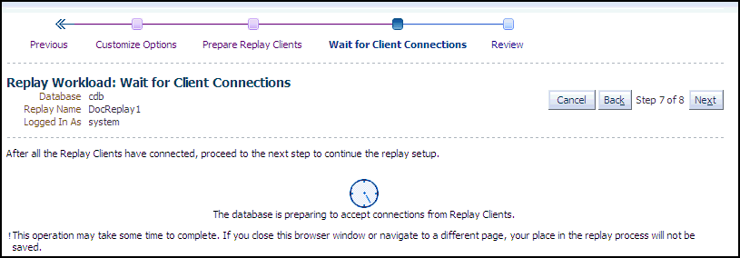

> The heading Replay Workload: Wait for Client Connections appears on the upper left portion of the page. Below the heading are values for Database, Replay Name, and Logged In As.
>
> The upper right portion of the page states "Step 7 of 8," Cancel and Back buttons appear to the left of this text, and a Next button appears to the right of this text.
>
> The following text appears below the aforementioned items: "After all the Replay Clients have connected, proceed to the next step to continue the replay setup."
>
> A turning progress clock appears below this text with the following explanatory information: "The database is preparing to accept connections from Replay Clients."
>
> On separate line below this, the following text appears: "This operation may take some time to complete. If you close the browser window or navigate to a different page, your place in the replay process will not be saved."
>
> End of description.
  
	  
	For information about starting replay clients, see "Setting Up Replay Clients".
	Note:
	If you have reached this step in the process from the Enterprise menu, you also need to enter credentials for the replay job and for the replay result storage host.
	- As replay clients are started, the replay client connections are displayed in the Client Connections table.
		- The text below the clock changes if a replay client is connected.
		- The Client Connections table is populated when at least one replay client is connected.
	When all replay clients have connected, enter host credentials at the bottom of the page to start the replay job, then click Next to display the Replay Workload: Review page.
16. Review the options and parameters that have been defined for the workload replay.
	- The value for Connected Replay Clients must be at least 1 in order to successfully submit the Replay Workload job.
		- The Submit button is enabled only if at least one Replay client is connected.
17. If everything appears as you have intended, click Submit to submit the Replay job.
	After the replay starts, the Home tab of the Database Replay page for this replay reappears with a system message that states "The workload replay has started."

For information about monitoring an active workload replay, see "Monitoring an Active Workload Replay".

## 11.3 Setting Up the Replay Schedule and Parameters Using Enterprise Manager

The Replay schedule feature enables you to scale up the instances of captured workloads to be included in a consolidated Replay, and then control the relative playback scheduling of the instances within the Replay. The relative scheduling of the captured workload instances is visually displayed by updating the alignment of the active session chart for each instance.

This feature is available for Cloud Control Database plug-in 12.1.0.5 and later releases.

This feature enables you to accomplish the following tasks:

- Offset instances so that they execute at different time intervals
	You can adjust the relative replay start time of each workload instance to align the average active sessions peak times for scheduled instances of Capture workloads. This alignment of the workload peaks potentially maximizes the load on the system, so that you can experiment with how the test system responds under different workload conditions.
- Scale up the Replay workload by adding instances of the Captured workload
	Each added instance is replayed independently of the other instances.
	When you scale up a workload by specifying multiple instances of it, the default and recommended configuration is to replay the DML statements in one of the instances. All of the additional instances will only replay the query (ready-only) statements.
	For example, if a workload has a SQL Insert to an employee database, you normally would want to have only one instance that executes the Insert, and the others would bypass user calls that modify the database with this Insert. However, you can override the default setting of an instance by unchecking the Replay Query-only check box to replay all statements in the workload.

To access the Plan Replay Schedule page:

1. From the Database Replay home page, click on the Replay Tasks tab.
2. Click on the name of an existing Replay task with more than one workload to navigate to the Replay Task page.
3. Click Create to create a new Replay.
4. Provide the requisite information in the Create Replay pop-up, then click OK.
	The new Replay appears in the Replays table.
5. Click the name of your new Replay in the Replays table.
	A Task List now appears in the Replay page.
6. Click the Plan Replay Schedule link.
	The Plan Replay Schedule page appears.

To scale up a Replay:

1. In the drop-down next to the Add Workload Instance button, select the Capture workload for which you want to add an instance.
2. Click Add Workload Instance to add the instance.

To schedule the time intervals:

1. From the Replay Delay column, either leave the default value of 0 for the first Capture instance, or adjust the number of minutes desired before the instance starts to execute.
2. Repeat the step above for each Capture instance until you have set all of the values to represent how you want the performance spikes to execute for your testing needs.

To auto-align workload peaks:

1. Click the Auto-align button.

To specify query-only instances:

1. For each instance that you want to be query-only, enable the Replay Query-only check box.

To review the updated schedule:

1. From the Replay Task tab of the Database Replay page, click the Replay task link containing your scheduled Replay.
	The Replay Task page appears.
2. Click the scheduled Replay in the Replays table.
3. Select the Review tab in the Replay page.

## 11.4 Monitoring a Workload Replay Using Enterprise Manager

This section describes how to monitor workload replay using Enterprise Manager. The primary tool for monitoring workload replay is Oracle Enterprise Manager. Using Enterprise Manager, you can:

- Monitor or stop an active workload replay
- View a completed workload replay

If Oracle Enterprise Manager is unavailable, you can monitor workload replay using APIs and views, as described in "Monitoring Workload Replay Using APIs".

This section contains the following topics:

- Monitoring an Active Workload Replay
- Viewing a Completed Workload Replay

### 11.4.1 Monitoring an Active Workload Replay

This section describes how to monitor an active workload replay using Enterprise Manager.

To monitor an active workload replay:

1. From the Database Replay page, click the Replay Tasks tab.
2. Click the name of the replay task that contains the replay for which you want to monitor replay progress.
3. From the Replays section of the Replay Task page, click the name of the replay you have submitted for processing in the Create Replay wizard. (The Status column for this replay should show In Progress.)
	The Home tab of the Database Replay page appears, and the Replay Summary shows a Status of Running.
	- The replay line in the Replay Progress chart updates dynamically while the Replay is in progress. You can update the chart by clicking the Refresh button.
		- The user calls line in the Replay Progress chart indicates how much of the workload the database has serviced relative to the capture at the same time.
		- Data for the Replay Divergence Summary is not available until the Replay completes.

### 11.4.2 Viewing a Completed Workload Replay

This section describes how to view a completed workload replay using Enterprise Manager.

To view a completed workload replay:

1. From the Database Replay page, click the Replay Tasks tab.
2. Click the name of the replay task that contains the completed replay you want to view.
3. From the Replays section of the Replay Task page, click the name of the replay you have submitted for processing in the Create Replay wizard. (The Status column for this replay should show Completed.)
	The Home tab of the Database Replay page appears, and the Replay Summary shows a Status of Completed.
	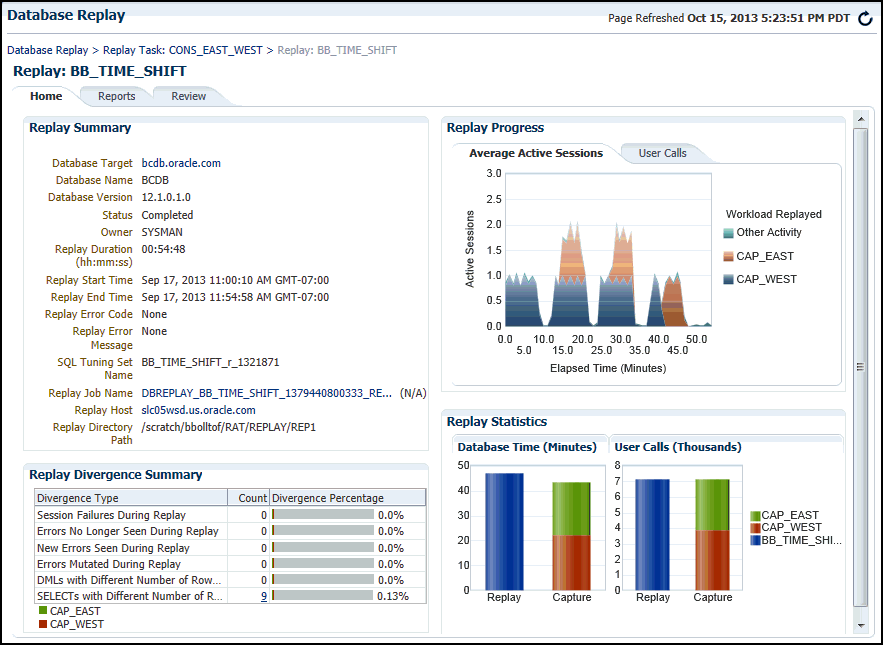

> There are three tabs on this page: Home, Reports, and Review. The Home tab is open in this graphic.
>
> The Replay Summary section appears in the upper left corner, and values are shown for the following read-only fields:
>
> Target Database
>
> Database Version
>
> Status
>
> Owner
>
> Replay Duration
>
> Replay Start Time
>
> Replay End Time
>
> Replay Error Code
>
> Replay Error Message
>
> Replay Host
>
> Replay Directory Path
>
> SQL Tuning Set Name
>
> Replay Job Name
>
> The Replay Divergence Summary section appears in the lower left corner, and a table appears with the following columns: Divergence Type, Count, and Divergence Percentage. There are five rows with the following divergence types:
>
> Session Failures During Replay
>
> Errors No Longer Seen During Replay
>
> New Errors Seen During Replay
>
> Errors Mutated During Replay
>
> DMLs with Different Number of Replays
>
> SELECTS with Different Number of Replays
>
> There are values for each row for the Count column and Divergence Percentage column.
>
> The Replay Progress section appears in the upper right corner, and contains the User Calls tab, which is open, and the Average Active Sessions tab.
>
> The User Calls tab contains a chart. The chart has a y-axis labeled User Calls (thousands.) The y-axis values range from 0.0 to 1.4. The chart has an x-axis labeled Elapsed Time (Minutes). The x-axis values range from 0.0 to 9.5. The chart shows value lines for Replay:myTrial\_2, Capture:capture12, and Capture:capture11. Below the chart is text that reads "Clients 2" and "Clients Finished 2."
>
> The Replay Statistics section appears in the lower right corner, and contains Database Time and User Calls (Thousands) vertical charts for Replay and Capture. Values are shown for capture11, capture12, and myTrial\_2.
>
> End of description.
  
	  
	- The replay line in the User Calls chart graphically represents the replay progress during the course of the entire replay from initiation to conclusion. The elapsed time in the Replay Progress chart equates to the number of minutes that were set up for the associated Capture.
		The chart shows how much time it has taken to replay the same workload compared to the elapsed time during the workload capture in terms of user calls. If the Replay line is above or to the left of the Capture line, the replay system is processing the workload faster than the capture system.
		- Under the Replay Divergence Summary, any errors and data discrepancies between the replay system and the capture system are displayed as diverged database calls during replay. You can use the percentage of total calls that diverged as a measure of the replay quality.
		To view details about the diverged calls, click the link that corresponds to the type of diverged call in the Count column to access the Diverged Calls During Replay page. The Diverged Calls During Replay page shows the most relevant set of replayed calls that diverged from the workload captured by grouping them based on common attribute values and specified filter conditions. To view details about a particular diverged call—such as the call attributes, SQL text, and bind variables—click the corresponding link in the SQL ID column to bring up the Replay Diverged Statement page.
4. To return to the Database Replay page, click the Database Replay breadcrumb.
	Tip:
	See [Chapter 12, "Analyzing Captured and Replayed Workloads"](dbr_analyze.md) for information about accessing workload replay reports.

## 11.5 Importing a Replay External to Enterprise Manager

As with importing workloads external to Enterprise Manager, you can import Replays into Enterprise Manager to manage them. To import a Replay, you import it from a Replay task, which can contain one or more workloads and one or more Replays. The Replay task is at the top of the database Replay hierarchy, and serves as the container for these other subordinate components.

A Replay to be imported can be running in the test database, or the Replay can be completed and the replay directory stored on a file system.

This feature is available for Cloud Control Database plug-in 12.1.0.5 and later releases.

To import a Replay external to Enterprise Manager:

1. From the Database Replay page, click the Replay Tasks tab, then select the desired Replay task.
	The Replay Task page appears.
2. Click Import in the Replays section.
	The Import Replay: Source page appears
3. Select one of the three choices available to import a Replay, then click Next.
	- Import one or more completed Replays from a directory in the file system
		This option typically applies for a Replay created using an API, in which you now want to import it to Enterprise Manager for subsequent processing. In this case, Enterprise Manager may not be necessarily managing the Replay database.
		- Import one or more completed Replays from a database target
		In this case, Enterprise Manager is probably already managing the Replay database. The Replay could have been done on this database, or it could have been loaded in as would be the case for the option above.
		- Attach to a Replay of this Replay task running in a database target
		This option is similar to the option above, except this a Replay that is still in progress, rather than one that has already completed.
	The Import Replay: Database page appears.
4. Click the search icon next to the Database Target field and select a database from the pop-up that appears.
	Note:
	The target version of the database reading the Replay must be at least as high as the one you used in the Replay task. For instance, if the Replay task used Oracle Database 12x, the database you select to read the Replay must be at least version 12x.
	- The system now requests database and host credentials.
		- In the previous step, if you chose to import one or more completed Replays from a directory in the file system, the system also requires a workload location.
		- The Replay task can determine if this is a consolidated Replay based on the number of workloads contained in the Replay task. If this is a consolidated Replay, this step asks you to enter a consolidated Replay directory for the workload location.
5. Provide the requisite input for the step above, then click Next.
	The Import Replay: Replay page appears.
	- If you chose "Import one or more completed Replays from a directory in the file system” in step 3, this page provides a Load Replay button.
		- If you chose ”Import one or more completed Replays from a database target” or ”Attach to a Replay of this Replay task running in a database target” in step 3, this page provides a Discover Replay button.
6. Click either Load Replay or Discover Replay, depending on which button is available in accordance with your selection in step 3.
	The system displays one or more Replays, if found, in the Discovered Replays table.
7. Either click Next to load the Replay, or select one or more Replays, then click Next to continue importing the Replays.
	The Import Replay: Review page appears.
8. If everything appears as you have intended, click Submit.
	The Database Replay page reappears and displays a message stating that the job was submitted successfully. The Status column in the table for your imported Replay will show In Progress.
	Tip:
	You can check on the job's progress by clicking on the Replay name that you just submitted in the Review step. A Replay Summary page appears, and you can click the Database Replay Import Job link to see the progress of the job execution steps.

## 11.6 Replaying a Database Workload Using APIs

This section describes how to replay a database workload using the `DBMS_WORKLOAD_REPLAY` package. You can also use Oracle Enterprise Manager to replay a database workload, as described in "Replaying a Database Workload Using Enterprise Manager".

Replaying a database workload using the `DBMS_WORKLOAD_REPLAY` package is a multi-step process that involves:

- Initializing Replay Data
- Connection Remapping
- Setting Workload Replay Options
- Defining Workload Replay Filters and Replay Filter Sets
- Setting the Replay Timeout Action
- Starting a Workload Replay
- Pausing a Workload Replay
- Resuming a Workload Replay
- Cancelling a Workload Replay
- Exporting AWR Data for Workload Replay

See Also:

- [Oracle Database PL/SQL Packages and Types Reference](https://docs.oracle.com/cd/E11882_01/appdev.112/e40758/d_workload_replay.htm#ARPLS208) for information about the `DBMS_WORKLOAD_REPLAY` package

### 11.6.1 Initializing Replay Data

After the workload capture is preprocessed and the test system is properly prepared, the replay data can be initialized. Initializing replay data loads the necessary metadata into tables required by workload replay. For example, captured connection strings are loaded into a table where they can be remapped for replay.

To initialize replay data, use the `INITIALIZE_REPLAY` procedure:

```
BEGIN
  DBMS_WORKLOAD_REPLAY.INITIALIZE_REPLAY (replay_name => 'dec06_102',
                           replay_dir => 'dec06');
END;
/
```

In this example, the `INITIALIZE_REPLAY` procedure loads preprocessed workload data from the `dec06` directory into the database.

The `INITIALIZE_REPLAY` procedure in this example uses the following parameters:

- The `replay_name` required parameter specifies a replay name that can be used with other APIs to retrieve settings and filters of previous replays.
- The `replay_dir` required parameter specifies the directory that contains the workload capture that will be replayed.

See Also:

- ["Preprocessing a Database Workload Using APIs"](dbr_preprocess.md) for information about preprocessing a workload capture
- "Steps for Replaying a Database Workload" for information preparing the test system

### 11.6.2 Connection Remapping

After the replay data is initialized, connection strings used in the workload capture need to be remapped so that user sessions can connect to the appropriate databases and perform external interactions as captured during replay. To view connection mappings, use the `DBA_WORKLOAD_CONNECTION_MAP` view. For information about connection remapping, see "Remapping Connections".

To remap connections, use the `REMAP_CONNECTION` procedure:

```
BEGIN
  DBMS_WORKLOAD_REPLAY.REMAP_CONNECTION (connection_id => 101,
                           replay_connection => 'dlsun244:3434/bjava21');
END;
/
```

In this example, the connection that corresponds to the connection ID 101 will use the new connection string defined by the `replay_connection` parameter.

The `REMAP_CONNECTION` procedure in this example uses the following parameters:

- The `connection_id` required parameter is generated when initializing replay data and corresponds to a connection from the workload capture.
- The `replay_connection` required parameter specifies the new connection string that will be used during workload replay.

### 11.6.3 Setting Workload Replay Options

After the replay data is initialized and the connections are appropriately remapped, you need to prepare the database for workload replay. For information about workload replay preparation, see "Steps for Replaying a Database Workload".

To prepare workload replay on the replay system, use the `PREPARE_REPLAY` procedure:

```
BEGIN
  DBMS_WORKLOAD_REPLAY.PREPARE_REPLAY (synchronization => OBJECT_ID,
                           capture_sts => TRUE,
                           sts_cap_interval => 300);
END;
/
```

In this example, the `PREPARE_REPLAY` procedure prepares a replay that has been previously initialized. A SQL tuning set will also be captured in parallel with the workload replay.

The `PREPARE_REPLAY` procedure uses the following parameters:

- The `synchronization` required parameter determines if synchronization will be used during workload replay.
	If this parameter is set to `OBJECT_ID` (the default value), all replay actions will be executed only after all relevant `COMMIT` actions have completed. Relevant `COMMIT` actions must meet the following criteria:
	- Issued before the given action in the workload capture
		- Modified at least one of the database objects for which the given action is referencing, either implicitly or explicitly
	Setting this parameter to `OBJECT_ID` allows for more concurrency during workload replays for `COMMIT` actions that do not reference the same database objects during workload capture.
	If this parameter is set to `SCN`, the `COMMIT` order in the captured workload will be preserved during replay and all replay actions will be executed only after all dependent `COMMIT` actions have completed.
	You can disable this option by setting the parameter to `OFF`, but the replay will likely yield significant replay divergence. However, this may be desirable if the workload consists primarily of independent transactions, and divergence during unsynchronized replay is acceptable.
- The `connect_time_scale` parameter scales the elapsed time from when the workload capture started to when the session connects with the specified value and is interpreted as a % value. Use this parameter to increase or decrease the number of concurrent users during replay. The default value is 100.
- The `think_time_scale` parameter scales the elapsed time between two successive user calls from the same session and is interpreted as a % value. Setting this parameter to 0 will send user calls to the database as fast as possible during replay. The default value is 100.
- The `think_time_auto_correct` parameter corrects the think time (based on the `think_time_scale` parameter) between calls when user calls take longer to complete during replay than during capture. This parameter can be set to either `TRUE` or `FALSE`. Setting this parameter to `TRUE` reduces the think time if the workload replay is taking longer than the workload capture. The default value is `TRUE`.
- The `scale_up_multiplier` parameter defines the number of times the workload is scaled up during replay. Each captured session will be replayed concurrently for as many times as specified by this parameter. However, only one session in each set of identical replay sessions will execute both queries and updates. The rest of the sessions will only execute queries.
- The `capture_sts` parameter specifies whether to capture a SQL tuning set in parallel with the workload replay. If this parameter is set to `TRUE`, you can capture a SQL tuning set during workload replay and use SQL Performance Analyzer to compare it to another SQL tuning set without having to re-execute the SQL statements. This enables you to obtain a SQL Performance Analyzer report and compare the SQL performance—before and after the change—while running Database Replay. You can also export the resulting SQL tuning set with its AWR data using the `EXPORT_AWR` procedure, as described in "Exporting AWR Data for Workload Replay".
	This feature is not supported for Oracle RAC. Workload replay filters that are defined using `DBMS_WORKLOAD_REPLAY` do not apply to the SQL tuning set capture. The default value for this parameter is `FALSE`.
- The `sts_cap_interval` parameter specifies the duration of the SQL tuning set capture from the cursor cache in seconds. The default value is 300. Setting the value of this parameter below the default value may cause additional overhead with some workloads and is not recommended.

For more information about setting these parameters, see "Specifying Replay Options".

### 11.6.4 Defining Workload Replay Filters and Replay Filter Sets

This section describes how to add and remove workload replay filters, and how to create and use replay filter sets. For information about using workload filters and replay filter sets with workload replay, see "Using Filters with Workload Replay".

This section contains the following topics:

- Adding Workload Replay Filters
- Deleting Workload Replay Filters
- Creating a Replay Filter Set
- Using a Replay Filter Set

#### 11.6.4.1 Adding Workload Replay Filters

To add a new filter to be used in a replay filter set, use the `ADD_FILTER` procedure:

```
BEGIN
  DBMS_WORKLOAD_REPLAY.ADD_FILTER (
                           fname => 'user_ichan',
                           fattribute => 'USER',
                           fvalue => 'ICHAN');
END;
/
```

In this example, the `ADD_FILTER` procedure adds a filter named user\_ichan, which can be used to filter out all sessions belonging to the user name ICHAN.

The `ADD_FILTER` procedure in this example uses the following parameters:

- The `fname` required parameter specifies the name of the filter that will be added.
- The `fattribute` required parameter specifies the attribute on which the filter will be applied. Valid values include PROGRAM, MODULE, ACTION, SERVICE, USER, and CONNECTION\_STRING. You must specify a valid captured connection string that will be used during replay as the CONNECTION\_STRING attribute.
- The `fvalue` required parameter specifies the value for the corresponding attribute on which the filter will be applied. It is possible to use wildcards such as % with some of the attributes, such as modules and actions.

Once all workload replay filters are added, you can create a replay filter set that can be used when replaying the workload.

#### 11.6.4.2 Deleting Workload Replay Filters

To delete workload replay filters, use the `DELETE_FILTER` procedure:

```
BEGIN
  DBMS_WORKLOAD_REPLAY.DELETE_FILTER (fname => 'user_ichan');
END;
/
```

In this example, the `DELETE_FILTER` procedure removes the filter named user\_ichan.

The `DELETE_FILTER` procedure in this example uses the `fname` required parameter, which specifies the name of the filter to be removed.

#### 11.6.4.3 Creating a Replay Filter Set

After the workload replay filters are added, you can create a set of replay filters to use with workload replay. When creating a replay filter set, all workload replay filters that were added since the previous replay filter set was created will be used.

To create a replay filter set, use the `CREATE_FILTER_SET` procedure:

```
BEGIN
  DBMS_WORKLOAD_REPLAY.CREATE_FILTER_SET (
                           replay_dir => 'apr09',
                           filter_set => 'replayfilters',
                           default_action => 'INCLUDE');
END;
/
```

In this example, the `CREATE_FILTER_SET` procedure creates a replay filter set named replayfilters, which will replay all captured calls for the replay stored in the `apr09` directory, except for the part of the workload defined by the replay filters.

The `CREATE_FILTER_SET` procedure in this example uses the following parameters:

- The `replay_dir` parameter specifies the directory where the replay to be filtered is stored
- The `filter_set` parameter specifies the name of the filter set to create
- The `default_action` parameter determines if every captured database call should be replayed and whether the workload replay filters should be considered as inclusion or exclusion filters.
	If this parameter is set to `INCLUDE`, all captured database calls will be replayed, except for the part of the workload defined by the replay filters. In this case, all replay filters will be treated as exclusion filters, since they will define the part of the workload that will not be replayed. This is the default behavior.
	If this parameter is set to `EXCLUDE`, none of the captured database calls will be replayed, except for the part of the workload defined by the replay filters. In this case, all replay filters will be treated as inclusion filters, since they will define the part of the workload that will be replayed.

#### 11.6.4.4 Using a Replay Filter Set

Once the replay filter set is created and the replay is initialized, you can use the replay filter set to filter the replay in the `replay_dir` directory.

To use a replay filter set, use the `USE_FILTER_SET` procedure:

```
BEGIN
  DBMS_WORKLOAD_REPLAY.USE_FILTER_SET (filter_set => 'replayfilters');
END;
/
```

In this example, the `USE_FILTER_SET` procedure uses the filter set named replayfilters.

The `USE_FILTER_SET` procedure in this example uses the `filter_set` required parameter, which specifies the name of the filter set to be used in the replay.

### 11.6.5 Setting the Replay Timeout Action

This section describes how to set a timeout action for the workload replay. You can set a replay timeout action to abort user calls that are significantly slower during replay or cause a replay to hang. For example, you may want to set a replay timeout action to abort runaway queries caused by sub-optimal execution plans following a database upgrade.

When a replay timeout action is enabled, a user call will exit with an `ORA-15569` error if it is delayed beyond the conditions specified by the replay timeout action. The aborted call and its error are reported as error divergence.

To set a replay timeout, use the `SET_REPLAY_TIMEOUT` procedure:

```
BEGIN
  DBMS_WORKLOAD_REPLAY.SET_REPLAY_TIMEOUT (
                           enabled => TRUE,
                           min_delay => 20,
                           max_delay => 60,
                           delay_factor => 10);
END;
/
```

In this example, the `SET_REPLAY_TIMEOUT` procedure defines a replay timeout action that will abort a user call if the delay during replay is more than 60 minutes, or if the delay during replay is over 20 minutes and the elapsed time is 10 times greater than the capture elapsed time.

The `SET_REPLAY_TIMEOUT` procedure in this example uses the following parameters:

- The `enabled` parameter specifies if the replay timeout action is enabled or disabled. The default value is `TRUE`.
- The `min_delay` parameter defines the lower bound value of call delay in minutes. The replay timeout action is only activated when the delay is over this value. The default value is 10.
- The `max_delay` parameter defines the upper bound value of call delay in minutes. The replay timeout action is activated and issues an error when the delay is over this value. The default value is 120.
- The `delay_factor` parameter defines a factor for the call delays that are between the values of `min_delay` and `max_delay`. The replay timeout action issues an error when the current replay elapsed time is higher than the multiplication of the capture elapsed time and this value. The default value is 8.

To retrieve the replay timeout action setting, use the `GET_REPLAY_TIMEOUT` procedure:

```
DECLARE
  enabled        BOOLEAN;
  min_delay      NUMBER;
  max_delay      NUMBER;
  delay_factor   NUMBER;
BEGIN
  DBMS_WORKLOAD_REPLAY.GET_REPLAY_TIMEOUT(enabled, min_delay, max_delay,
                           delay_factor);
END;
/
```

The `GET_REPLAY_TIMEOUT` procedure in this example returns the following parameters:

- The `enabled` parameter returns whether the replay timeout action is enabled or disabled.
- The `min_delay` parameter returns the lower bound value of call delay in minutes.
- The `max_delay` parameter returns the upper bound value of call delay in minutes.
- The `delay_factor` parameter returns the delay factor.

### 11.6.6 Starting a Workload Replay

Before starting a workload replay, you must first:

- Preprocess the captured workload, as described in ["Preprocessing a Database Workload Using APIs"](dbr_preprocess.md)
- Initialize the replay data, as described in "Initializing Replay Data"
- Specify the replay options, as described in "Setting Workload Replay Options"
- Start the replay clients, as described in "Starting Replay Clients"

Note:

Once a workload replay is started, new replay clients will not be able to connect to the database. Only replay clients that were started before the `START_REPLAY` procedure is executed will be used to replay the captured workload.

To start a workload replay, use the `START_REPLAY` procedure:

```
BEGIN
  DBMS_WORKLOAD_REPLAY.START_REPLAY ();
END;
/
```

### 11.6.7 Pausing a Workload Replay

To pause a workload replay that is in progress, use the `PAUSE_REPLAY` procedure:

```
BEGIN
  DBMS_WORKLOAD_REPLAY.PAUSE_REPLAY ();
END;
/
```

Pausing a workload replay will halt all subsequent user calls issued by the replay clients until the workload replay is either resumed or cancelled. User calls that are already in progress will be allowed to complete. This option enables you to temporarily stop the replay to perform a change and observe its impact for the remainder of the replay.

### 11.6.8 Resuming a Workload Replay

To resume a workload replay that is paused, use the `RESUME_REPLAY` procedure:

```
BEGIN
  DBMS_WORKLOAD_REPLAY.RESUME_REPLAY ();
END;
/
```

### 11.6.9 Cancelling a Workload Replay

To cancel a workload replay, use the `CANCEL_REPLAY` procedure:

```
BEGIN
  DBMS_WORKLOAD_REPLAY.CANCEL_REPLAY ();
END;
/
```

### 11.6.10 Exporting AWR Data for Workload Replay

Exporting AWR data enables detailed analysis of the workload. This data is also required if you plan to run the AWR Compare Period report on a pair of workload captures or replays.

To export AWR data, use the `EXPORT_AWR` procedure:

```
BEGIN
  DBMS_WORKLOAD_REPLAY.EXPORT_AWR (replay_id => 1);
END;
/
```

In this example, the AWR snapshots that correspond to the workload replay with a replay ID of 1 are exported, along with any SQL tuning set that may have been captured during workload replay. The `EXPORT_AWR` procedure uses the `replay_id` required parameter, which specifies the ID of the replay whose AWR snapshots will be exported. This procedure will work only if the corresponding workload replay was performed in the current database and the AWR snapshots that correspond to the original replay time period are still available.

## 11.7 Monitoring Workload Replay Using APIs

This section describes how to monitor workload replay using APIs and views. You can also use Oracle Enterprise Manager to monitor workload replay, as described in "Monitoring a Workload Replay Using Enterprise Manager".

This section contains the following topics:

- Retrieving Information About Diverged Calls
- Monitoring Workload Replay Using Views

### 11.7.1 Retrieving Information About Diverged Calls

During replay, any error and data discrepancies between the replay system and the capture system are recorded as diverged calls.

To retrieve information about a diverged call—including its SQL identifier, SQL text, and bind values—call the `GET_DIVERGING_STATEMENT` function using the following parameters:

- Set the `replay_id` parameter to the ID of the replay in which the call diverged
- Set the `stream_id` parameter to the stream ID of the diverged call
- Set the `call_counter` parameter to the call counter of the diverged call

To view these information about a diverged call, use the `DBA_WORKLOAD_REPLAY_DIVERGENCE` view. The following example illustrates a function call:

```
DECLARE
  r                   CLOB;
  ls_stream_id        NUMBER;
  ls_call_counter     NUMBER;
  ls_sql_cd           VARCHAR2(20);
  ls_sql_err          VARCHAR2(512);
  CURSOR c IS
  SELECT stream_id, call_counter
  FROM DBA_WORKLOAD_REPLAY_DIVERGENCE
  WHERE replay_id = 72;
BEGIN
  OPEN c;
  LOOP
  FETCH c INTO ls_stream_id, ls_call_counter;
  EXIT when c%notfound;
  DBMS_OUTPUT.PUT_LINE (ls_stream_id||''||ls_call_counter);
  r:=DBMS_WORKLOAD_REPLAY.GET_DIVERGING_STATEMENT(replay_id => 72,
  stream_id => ls_stream_id, call_counter => ls_call_counter);
  DBMS_OUTPUT.PUT_LINE (r);
  END LOOP;
END;
/
```

See Also:

- [Oracle Database PL/SQL Packages and Types Reference](https://docs.oracle.com/cd/E11882_01/appdev.112/e40758/d_workload_replay.htm#ARPLS208) for information about the `DBMS_WORKLOAD_REPLAY` package

### 11.7.2 Monitoring Workload Replay Using Views

This section summarizes the views that you can display to monitor workload replay. You need DBA privileges to access these views.

- The `DBA_WORKLOAD_CAPTURES` view lists all the workload captures that have been captured in the current database.
- The `DBA_WORKLOAD_FILTERS` view lists all workload filters for workload captures defined in the current database.
- The `DBA_WORKLOAD_REPLAYS` view lists all the workload replays that have been replayed in the current database.
- The `DBA_WORKLOAD_REPLAY_DIVERGENCE` view enables you to view information about diverged calls, such as the replay identifier, stream identifier, and call counter.
- The `DBA_WORKLOAD_REPLAY_FILTER_SET` view lists all workload filters for workload replays defined in the current database.
- The `DBA_WORKLOAD_CONNECTION_MAP` view lists the connection mapping information for workload replay.
- The `V$WORKLOAD_REPLAY_THREAD` view lists information about all sessions from the replay clients.

See Also:

- [Oracle Database Reference](https://docs.oracle.com/cd/E11882_01/server.112/e40402/toc.htm) for information about these views