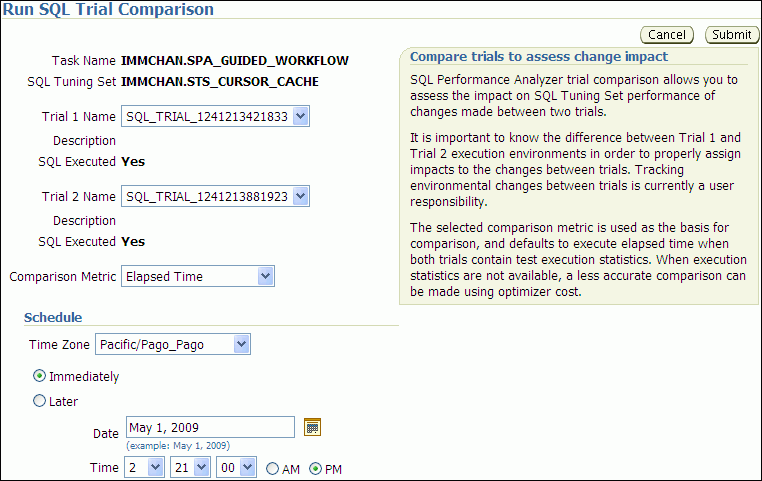
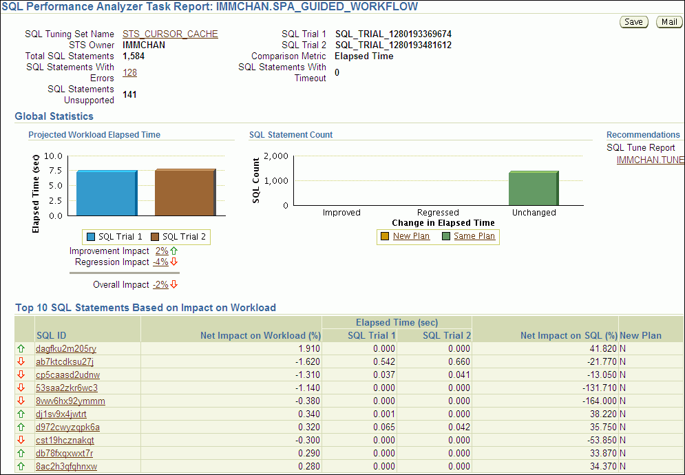
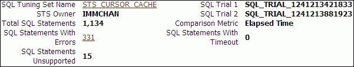
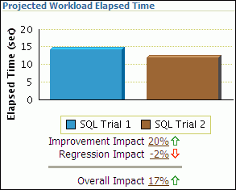
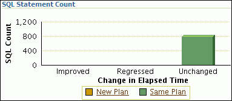

## 6 Comparing SQL Trials

After the post-change SQL performance data is built, you can compare the performance data collected in the pre-change SQL trial to the post-change SQL trial by running a comparison analysis using SQL Performance Analyzer. After the comparison analysis is completed, you can generate a report to identify the SQL statements that have improved, remained unchanged, or regressed due to the system change. The SQL Performance Analyzer report calculates two chief impact measurements for the change in performance of each SQL statement:

- Impact on workload
	This represents the percentage of impact that this change to the SQL statement has on the cumulative execution time of the workload, after accounting for execution frequency. For example, a change that causes a SQL statement's cumulative execution time to improve from 101 seconds to 1 second—where the rest of the workload had a total execution time of 99 seconds before the change—would have a 50% (2x) value for this measurement.
- Impact on SQL
	This represents the percentage of impact that this change to the SQL statement has on the SQL statement's response time. For example, a change that causes a SQL statement's response time to improve from 10 seconds to 1 second will have a 90% (10x) value for this measurement.

For more information, see ["Comparing Performance Measurements"](spa_intro.md).

This chapter describes how to compare and analyze the performance data from the pre-change and post-change SQL trials and contains the following topics:

- Comparing SQL Trials Using Oracle Enterprise Manager
- Comparing SQL Trials Using APIs

Note:

The primary interface for comparing SQL trials is Oracle Enterprise Manager. If for some reason Oracle Enterprise Manager is unavailable, you can compare SQL trials using the `DBMS_SQLPA` PL/SQL package.

Tip:

Before comparing SQL trials, you need to create a post-change SQL trial, as described in [Chapter 5, "Creating a Post-Change SQL Trial"](spa_post_change.md).

## 6.1 Comparing SQL Trials Using Oracle Enterprise Manager

Comparing SQL trials using Oracle Enterprise Manager involves the following steps:

### 6.1.1 Analyzing SQL Performance Using Oracle Enterprise Manager

This section describes how to analyze SQL performance before and after the system change using Oracle Enterprise Manager.

To analyze SQL performance using Enterprise Manager:

1. On the Guided Workflow page, click the Execute icon for Compare Step 2 and Step 3.
	The Run SQL Trial Comparison page appears.
	

> The Run SQL Trial Comparison page is shown.
>
> The Cancel and Submit buttons are on the right of the page.
>
> The Task Name is IMMCHAN.SPA\_GUIDED\_WORKFLOW. The SQL Tuning Set is IMMCHAN.STS\_CURSOR\_CACHE.
>
> The Trial 1 Name is SQL\_TRIAL\_1241213421833. The Description field is empty. The SQL Executed field is Yes.
>
> The Trial 2 Name list shows SQL\_TRIAL\_1241213881923. The Description field is empty. The SQL Executed field is Yes.
>
> The Comparison Metric list shows Elapsed Time.
>
> The Schedule section follows. The Time Zone list shows Pacific/Pago\_Pago. Possible options are Immediately (selected) and Later. The Date is May 1, 2009. The Time is 2:21:00 PM.
>
> End of description.
  
	  
	In this example, the `SQL_TRIAL_1241213421833` and `SQL_TRIAL_1241213881923` trials are selected for comparison.
2. To compare trials other than those listed by default, select the desired trials in the Trial 1 Name and Trial 2 Name lists.
	Note that you cannot compare a statistical trial with a trial that tests the explain plan only.
3. In the Comparison Metric list, select the comparison metric to use for the comparison analysis:
	- Elapsed Time
		- CPU Time
		- User I/O Time
		- Buffer Gets
		- Physical I/O
		- Optimizer Cost
		- I/O Interconnect Bytes
	Optimizer Cost is the only comparison metric available if you generated execution plans only in the SQL trials.
	To perform the comparison analysis by using more than one comparison metric, perform separate comparison analyses by repeating this procedure with different metrics.
4. In the Schedule section:
	1. In the Time Zone list, select your time zone code.
		2. Select Immediately to start the task now, or Later to schedule the task to start at a time specified using the Date and Time fields.
5. Click Submit.
	The Guided Workflow page appears when the comparison analysis begins.
	The status icon of this step changes to an arrow icon while the comparison analysis is in progress. To refresh the status icon, click Refresh. Depending on the amount of performance data collected from the pre-change and post-change executions, the comparison analysis may take a long time to complete. After the comparison analysis is completed, the Status icon changes to a check mark and the Execute icon for the next step is enabled.
6. Once SQL Performance Analyzer has analyzed the pre-change and post-change performance data, generate a SQL Performance Analyzer report that you can use for further analysis.
	On the Guided Workflow page, click the Execute icon for View Trial Comparison Report.
	The SQL Performance Analyzer Task Report page appears. Review the report, as described in "Reviewing the SQL Performance Analyzer Report Using Oracle Enterprise Manager".

### 6.1.2 Reviewing the SQL Performance Analyzer Report Using Oracle Enterprise Manager

When a SQL Performance Analyzer task is completed, the resulting data is generated into a SQL Performance Analyzer report that compares the pre-change and post-change SQL performance.

Figure 6-1 shows a sample SQL Performance Analyzer report. This sample report uses the elapsed time comparison metric to compare the pre-change and post-change executions of a SQL workload.

Figure 6-1 SQL Performance Analyzer Report



> The SQL Performance Analyzer Task Report: IMMCHAN.SPA\_GUIDED\_WORKFLOW page is shown.
>
> In the summary at the top of the page, the SQL Tuning Set Name is STS\_CURSOR\_CACHE. The STS Owner is IMMCHAN. The Total SQL Statements field shows 1,584. The SQL Statements With Errors field shows 128. The SQL Statements Unsupported shows 411. The SQL Trial 1 field shows SQL\_TRIAL\_1280193369674. The SQL Trial 2 field shows SQL\_TRIAL\_1280193481612. The Comparison Metric field is Elapsed Time. The SQL Statements With Timeout field is 0.
>
> Below the summary is the Global Statistics section, which includes two bar charts.
>
> The chart on the left is labeled Projected Workload Elapsed Time. It has a y-axis labeled Elapsed Time (sec). The y-axis values range from 0 to 10. The x-axis values are SQL Trial 1 (blue) and SQL Trial 2 (orange). The y-axis value of SQL Trial 1 (blue) is 7.298. The y-axis value of SQL Trial 2 (orange) is 7.416. The Improvement Impact is 2%. The Regression Impact is -4%. The Overall Impact is -2%.
>
> The chart on the right is labeled SQL Statement Count. The y-axis is labeled SQL Count and ranges from 0 to 2,000. The x-axis is labeled Change in Elapsed Time. The x-axis has the following values: Improved, Regressed, and Unchanged. The bar for Improved has a y-axis value of 0. The bar for Regressed has a y-axis value of 0. The bar for Unchanged is green and has a y-axis value of 1,308, which represents Same Plan. There are no bars colored orange, which represents New Plan.
>
> To the right of the SQL Statement Count chart is the Recommendations section. The text reads "SQL Tune Report". A link to IMMCHAN.TUNE\_COMPARE\_1280193562885 is shown.
>
> Below the Global Statistics section is the Top 10 SQL Statements Based on Impact on Workload section. The table contains the following columns: null, SQL ID, Net Impact on Workload (%), Elapsed Time (sec) SQL Trial 1, Elapsed Time (sec) SQL Trial 2, Net Impact on SQL (%), New Plan.
>
> End of description.
  

Tip:

Before you can view the SQL Performance Analyzer report, compare the pre-change version of performance data with the post-change version, as described in "Comparing SQL Trials Using Oracle Enterprise Manager"

To generate and review the SQL Performance Analyzer report:

1. On the Software and Support page, under Real Application Testing, click SQL Performance Analyzer.
	The SQL Performance Analyzer page appears. A list of existing SQL Performance Analyzer tasks are displayed.
2. Under SQL Performance Analyzer Tasks, select the task for which you want to view a SQL Performance Analyzer report and click View Latest Report.
	The SQL Performance Analyzer Task Report page appears.
3. Review the general information about the performance analysis, as described in "Reviewing the SQL Performance Analyzer Report: General Information".
4. Review general statistics, as described in "Reviewing the SQL Performance Analyzer Report: Global Statistics".
5. Optionally, review the detailed statistics, as described in "Reviewing the SQL Performance Analyzer Report: Global Statistics Details".
6. To generate an active report, click Save to generate and save the report, or Mail to generate and mail the report as an HTML attachment.
	Active reports include information about the top SQL statements from each category (such as improved, regressed, and changed plans) with pre-change and post-change statistics, explain plans, and task summary.
	For more information, see "About SQL Performance Analyzer Active Reports".

#### 6.1.2.1 Reviewing the SQL Performance Analyzer Report: General Information

The General Information section contains basic information and metadata about the workload comparison performed by SQL Performance Analyzer.

To review general information:

1. On the SQL Performance Analyzer Task Report page, review the summary at the top of the page.
	

> The general information section of the SQL Performance Analyzer Task Report page is shown.
>
> The SQL Tuning Set Name is STS\_CURSOR\_CACHE. The STS Owner is IMMCHAN. The Total SQL Statements field shows 1,134. The SQL Statements With Errors field shows 331. The SQL Statements Unsupported shows 15. The SQL Trial 1 shows SQL\_TRIAL\_1241213421833. The SQL Trial 2 shows SQL\_TRIAL\_1241213881923. The Comparison Metric is Elapsed Time. The SQL Statements With Timeout is 0.
>
> End of description.
  
	  
	This summary includes the following information:
	- The name and owner of the SQL tuning set
		- The total number of SQL statements in the tuning set and the number of SQL statements that had errors, are unsupported, or timed out
		- The names of the SQL trials and the comparison metric used
2. Optionally, click the link next to SQL Tuning Set Name.
	The SQL Tuning Set page appears.
	This page contains information—such as SQL ID and SQL text—about every SQL statement in the SQL tuning set.
3. Click the link next to SQL Statements With Errors if errors were found.
	The Errors table reports all errors that occurred while executing a given SQL workload. An error may be reported at the SQL tuning set level if it is common to all SQL executions in the SQL tuning set, or at the execution level if it is specific to a SQL statement or execution plan.
4. Review the global statistics, as described in "Reviewing the SQL Performance Analyzer Report: Global Statistics".

#### 6.1.2.2 Reviewing the SQL Performance Analyzer Report: Global Statistics

The Global Statistics section reports statistics that describe the overall performance of the entire SQL workload. This section is a very important part of the SQL Performance Analyzer analysis, because it reports on the impact of the system change on the overall performance of the SQL workload. Use the information in this section to understand the tendency of the workload performance, and determine how it will be affected by the system change.

To review global statistics:

1. Review the chart in the Projected Workload Elapsed Time subsection.
	Note:
	The name of the subsection may vary based on the comparison metric that is selected.
	The chart shows the two trials on the x-axis and the elapsed time (in seconds) on the y-axis.
	

> The Projected Workload Elapsed Time section of the SQL Performance Analyzer Task Report page is shown. This section includes a bar chart.
>
> It has a y-axis labeled Elapsed Time (sec). The y-axis values ranged from 0 to 20. The x-axis values are SQL Trial 1 (blue) and SQL Trial 2 (orange). The y-axis value of SQL Trial 1 is 14.244. The y-axis value of SQL Trial 2 (orange) is 11.877. The Improvement Impact is 20%. The Regression Impact is -2%. The Overall Impact is 17%.
>
> End of description.
  
	  
	The first bar (on the left) in the chart represents the cumulative elapsed time for all SQL statements before the system change, weighed by the execution frequency of each SQL statement. The second bar (on the right) represents the cumulative elapsed time for all SQL statements after the system change, weighed by the execution frequency of each SQL statement. The overall impact is the difference between the improvement impact and the regression impact and is given as a percentage.
	You can click the link for any impact statistic to obtain more details, as described in "Reviewing the SQL Performance Analyzer Report: Global Statistics Details".
	Note:
	The overall impact percentage may sometimes be off by 1% compared to the sum of the improvement impact and the regression impact. This discrepancy may be caused by rounding or if the SQL and workload time limits are set at 1%, which is the recommended value. This enables the analysis to focus on SQL statements with higher impact by filtering out those that have a minimal impact.
2. Review the chart in the SQL Statement Count subsection.
	The x-axis of the chart shows the number of SQL statements whose performance improved, regressed, or remain unchanged after the system change. The y-axis shows the number of SQL statements. The chart also indicates whether the explain plans changed for the SQL statements.
	

> The SQL Statement Count section of the SQL Performance Analyzer Task Report page is shown.
>
> A bar chart is shown. The y-axis is labeled SQL Count and ranges from 0 to 1,200. The x-axis is labeled Change in Elapsed Time. The x-axis has the following values: Improved, Regressed, and Unchanged. The bar for Improved has a y-axis value of 0. The bar for Regressed has a y-axis value of 0. The bar for Unchanged is green and has a y-axis value of 782, which represents Plan Unchanged. There are no bars colored orange, which represents Plans Changed.
>
> End of description.
  
	  
	This chart enables you to quickly weigh the relative performance of the SQL statements. You can click any bar in the chart to obtain more details about the SQL statements, as described in "Reviewing the SQL Performance Analyzer Report: Global Statistics Details". Only up to the top 100 SQL statements will be displayed, even if the actual number of SQL statements exceeds 100.

#### 6.1.2.3 Reviewing the SQL Performance Analyzer Report: Global Statistics Details

You can use the SQL Performance Analyzer Report to obtain detailed statistics for the SQL workload comparison. The details chart enables you to drill down into the performance of SQL statements that appears in the report. Use the information in this section to investigate why the performance of a particular SQL statement regressed.

Note:

The report displays only up to the top 100 SQL statements, even if the actual number of SQL statements exceeds 100.

To review global statistics details:

1. In the Projected Workload Elapsed Time subsection, click the impact percentage of the SQL statements for which you want to view details. To view SQL statements whose performance:
	- Improved, click the percentage for Improvement Impact
		- Regressed, click the percentage for Regression Impact
		- Improved or regressed, click the percentage for Overall Impact
	A table including the detailed statistics appears. Depending on the type of SQL statements chosen, the following columns are included:
	- SQL ID
		This column indicates the ID of the SQL statement.
		- Net Impact on Workload (%)
		This column indicates the impact of the system change relative to the performance of the SQL workload.
		- Elapsed Time
		This column indicates the total time (in seconds) of the SQL statement execution.
		- Net Impact on SQL (%)
		This column indicates the local impact of the change on the performance of a particular SQL statement.
		- New Plan
		This column indicates whether the SQL execution plan changed.
2. To view details about a particular SQL statement, click the SQL ID link for the SQL statement that you are interested in.
	The SQL Details page appears.
	You can use this page to access the SQL text and obtain low-level details about the SQL statement, such as its execution statistics and execution plan.

#### 6.1.2.4 About SQL Performance Analyzer Active Reports

SQL Performance Analyzer active reports are HTML files that display all reporting data using a Web-hosted interactive user interface. Similar to the SQL Performance Analyzer reports available in Oracle Enterprise Manager, active reports include information about the top SQL statements from each category (such as improved, regressed, and changed plans) with pre-change and post-change statistics, explain plans, and task summary.

SQL Performance Analyzer active reports are more useful than traditional HTML or text reports because they offer a similar user interface as Oracle Enterprise Manager, yet they can be viewed even when the database is unavailable, or even after a database is dropped. Hence active reports offer the advantages of traditional reporting and dynamic Oracle Enterprise Manager analysis, but eliminates the disadvantages of both. Moreover, active reports contain more information about the comparison analysis and provide more user interactive options. It is strongly recommended that you use active reports instead of HTML or text reports.

The active report user interface components are very similar to those displayed in Oracle Enterprise Manager. For descriptions of the user interface components, see the related sections described in "Reviewing the SQL Performance Analyzer Report Using Oracle Enterprise Manager".

### 6.1.3 Tuning Regressed SQL Statements Using Oracle Enterprise Manager

After reviewing the SQL Performance Analyzer report, you should tune any regressed SQL statements that are identified after comparing the SQL performance. If there are large numbers of SQL statements that appear to have regressed, you should try to identify the root cause and make system-level changes to rectify the problem. In cases when only a few SQL statements have regressed, consider using one of the following tuning methods to implement a point solution for them:

- Creating SQL Plan Baselines
- Running SQL Tuning Advisor

After tuning the regressed SQL statements, you should test these changes using SQL Performance Analyzer. Run a new SQL trial on the test system, followed by a second comparison (between this new SQL trial and the first SQL trial) to validate your results. Once SQL Performance Analyzer shows that performance has stabilized, the testing is complete. Implement the fixes from this step to your production system.

Starting with Oracle Database 11g Release 1, SQL Tuning Advisor performs an alternative plan analysis when tuning a SQL statement. SQL Tuning Advisor searches the current system for previous execution plans, including the plans from the first SQL trial. If the execution plans from the first SQL trial differ from those of the second SQL trial, SQL Tuning Advisor will recommend the plans from the first SQL trial. If these execution plans produce better performance, you can create plan baselines using the plans from the first SQL trial.

Note:

SQL Performance Analyzer does not provide the option to create SQL plan baselines or run SQL Tuning Advisor directly after after completing a remote SQL trial. In such cases, you need to use APIs to manually transport the SQL tuning set and complete the appropriate procedure on the remote database.

See Also:

- [Oracle Database Performance Tuning Guide](https://docs.oracle.com/cd/E11882_01/server.112/e41573/sql_tune.htm#PFGRF95155) for information about alternative plan analysis

#### 6.1.3.1 Creating SQL Plan Baselines

Creating SQL plan baselines enables the optimizer to avoid performance regressions by using execution plans with known performance characteristics. If a performance regression occurs due to plan changes, a SQL plan baseline can be created and used to prevent the optimizer from picking a new, regressed execution plan.

To create SQL plan baselines:

1. On the SQL Performance Analyzer Task Result page, under Recommendations, click Create SQL Plan Baselines.
	The Create SQL Plan Baselines page appears. The Regressed SQL Statements section lists the regressed SQL statements that will be associated with the new SQL plan baselines.
2. Under Job Parameters, specify the parameters for the job:
	1. In the Job Name field, enter a name for the job.
		2. In the Description field, optionally enter a description for the job.
3. Under Schedule, select:
	- Immediately to start the job now.
		- Later to schedule the job to start at a time specified using the Time Zone, Date, and Time fields.
4. Click OK.
	The SQL Performance Analyzer Task Result page appears. A message is displayed to inform you that the job has been submitted successfully.

See Also:

- [Oracle Database 2 Day + Performance Tuning Guide](https://docs.oracle.com/cd/E11882_01/server.112/e10822/tdppt_sqltune.htm#TDPPT335) for information about creating and managing SQL plan baselines

#### 6.1.3.2 Running SQL Tuning Advisor

The SQL Tuning Advisor performs an in-depth analysis of regressed SQL statements and attempts to fix the root cause of the problem.

To run SQL Tuning Advisor:

1. On the SQL Performance Analyzer Task Result page, under Recommendations, click Run SQL Tuning Advisor.
	The Schedule SQL Tuning Task page appears.
2. In the Tuning Task Name field, enter a name for the SQL tuning task.
3. In the Tuning Task Description field, optionally enter a name for the SQL tuning task.
4. Under Schedule, select:
	- Immediately to start the job now.
		- Later to schedule the job to start at a time specified using the Time Zone, Date, and Time fields.
5. Click OK.
	The SQL Performance Analyzer Task Result page appears. A link to the SQL tuning report appears under Recommendations.
6. To view the SQL tuning report, click the SQL Tune Report link.
	The SQL Tuning Results page appears.

See Also:

- [Oracle Database 2 Day + Performance Tuning Guide](https://docs.oracle.com/cd/E11882_01/server.112/e10822/tdppt_sqltune.htm#TDPPT161) for information about running the SQL Tuning Advisor

## 6.2 Comparing SQL Trials Using APIs

Comparing SQL trials using APIs involves the following steps:

- Analyzing SQL Performance Using APIs
- Reviewing the SQL Performance Analyzer Report Using APIs
- Comparing SQL Tuning Sets Using APIs
- Tuning Regressed SQL Statements Using APIs
- Tuning Regressed SQL Statements From a Remote SQL Trial Using APIs
- Creating SQL Plan Baselines Using APIs
- Using SQL Performance Analyzer Views

### 6.2.1 Analyzing SQL Performance Using APIs

After the post-change SQL performance data is built, you can compare the pre-change version of performance data to the post-change version. Run a comparison analysis using the `DBMS_SQLPA.EXECUTE_ANALYSIS_TASK` procedure or function.

To compare the pre-change and post-change SQL performance data:

1. Call the `EXECUTE_ANALYSIS_TASK` procedure or function using the following parameters:
	- Set the `task_name` parameter to the name of the SQL Performance Analyzer task.
		- Set the `execution_type` parameter to `COMPARE PERFORMANCE`. This setting will analyze and compare two versions of SQL performance data.
		- Specify a name to identify the execution using the `execution_name` parameter. If not specified, it will be generated by SQL Performance Analyzer and returned by the function.
		- Specify two versions of SQL performance data using the `execution_params` parameters. The `execution_params` parameters are specified as (name, value) pairs for the specified execution. Set the execution parameters that are related to comparing and analyzing SQL performance data as follows:
		- Set the `execution_name1` parameter to the name of the first execution (before the system change was made). This value should correspond to the value of the `execution_name` parameter specified in ["Creating a Pre-Change SQL Trial Using APIs"](spa_pre_change.md).
				- Set the `execution_name2` parameter to the name of the second execution (after the system change was made). This value should correspond to the value of the `execution_name` parameter specified in ["Creating a Post-Change SQL Trial Using APIs"](spa_post_change.md) when you executed the SQL workload after the system change. If the caller does not specify the executions, then by default SQL Performance Analyzer will always compare the last two task executions.
				- Set the `comparison_metric` parameter to specify an expression of execution statistics to use in the performance impact analysis. Possible values include the following metrics or any combination of them: `elapsed_time` (default), `cpu_time`, `buffer_gets`, `disk_reads`, `direct_writes`, `optimizer_cost`, and `io_interconnect_bytes`.
		For other possible parameters that you can set for comparison, see the description of the `DBMS_SQLPA` package in [Oracle Database PL/SQL Packages and Types Reference](https://docs.oracle.com/cd/E11882_01/appdev.112/e40758/d_sqlpa.htm#ARPLS229).
	The following example illustrates a function call:
	```
	EXEC DBMS_SQLPA.EXECUTE_ANALYSIS_TASK(task_name => 'my_spa_task', - 
	       execution_type => 'COMPARE PERFORMANCE', -
	       execution_name => 'my_exec_compare', -
	       execution_params => dbms_advisor.arglist(-
	                             'comparison_metric', 'buffer_gets'));
	```
2. Call the `REPORT_ANALYSIS_TASK` function using the following parameters:
	- Set the `task_name` parameter to the name of the SQL Performance Analyzer task.
		- Set the `execution_name` parameter to the name of the execution to use. This value should match the `execution_name` parameter of the execution for which you want to generate a report.
		To generate a report to display the results of:
		- Execution plans generated for the SQL workload, set this value to match the `execution_name` parameter of the desired `EXPLAIN PLAN` execution.
				- Execution plans and execution statistics generated for the SQL workload, set this parameter to match the value of the `execution_name` parameter used in the desired `TEST EXECUTE` execution.
				- A comparison analysis, set this value to match the `execution_name` parameter of the desired `ANALYZE PERFORMANCE` execution.
		If unspecified, SQL Performance Analyzer generates a report for the last execution.
		- Set the `type` parameter to specify the type of report to generate. Possible values include `TEXT` (default), `HTML`, `XML`, and `ACTIVE`.
		Active reports provides in-depth reporting using an interactive user interface that enables you to perform detailed analysis even when disconnected from the database or Oracle Enterprise Manager. It is recommended that you use active reports instead of HTML or text reports when possible.
		For information about active reports, see "About SQL Performance Analyzer Active Reports".
		- Set the `level` parameter to specify the format of the recommendations. Possible values include `TYPICAL` (default), `ALL`, `BASIC`, `CHANGED`, `CHANGED_PLANS`, `ERRORS`, `IMPROVED`, `REGRESSED`, `TIMEOUT`, `UNCHANGED`, `UNCHANGED_PLANS`, and `UNSUPPORTED`.
		- Set the `section` parameter to specify a particular section to generate in the report. Possible values include `SUMMARY` (default) and `ALL`.
		- Set the `top_sql` parameter to specify the number of SQL statements in a SQL tuning set to generate in the report. By default, the report shows the top 100 SQL statements impacted by the system change.
	To generate an active report, run the following script:
	```
	set trimspool on
	set trim on
	set pages 0
	set linesize 1000
	set long 1000000
	set longchunksize 1000000
	spool spa_active.html
	SELECT DBMS_SQLPA.REPORT_ANALYSIS_TASK(task_name => 'my_spa_task',
	          type => 'active', section => 'all') FROM dual;
	spool off
	```
	The following example illustrates a portion of a SQL script that you could use to create and display a comparison summary report in text format:
	```
	VAR rep   CLOB;
	EXEC :rep := DBMS_SQLPA.REPORT_ANALYSIS_TASK('my_spa_task', -
	                'text', 'typical', 'summary');
	SET LONG 100000 LONGCHUNKSIZE 100000 LINESIZE 130
	PRINT :rep
	```
3. Review the SQL Performance Analyzer report, as described in "Reviewing the SQL Performance Analyzer Report Using APIs".

See Also:

- [Oracle Database PL/SQL Packages and Types Reference](https://docs.oracle.com/cd/E11882_01/appdev.112/e40758/d_sqlpa.htm#ARPLS229) for information about the `DBMS_SQLPA.EXECUTE_ANALYSIS_TASK` and `DBMS_SQLPA.REPORT_ANALYSIS_TASK` functions

### 6.2.2 Reviewing the SQL Performance Analyzer Report Using APIs

The SQL Performance Analyzer report is divided into the following sections:

- General Information
- Result Summary
- Result Details

This section uses a sample report to illustrate how to review the SQL Performance Analyzer report. The sample report uses `buffer_gets` as the comparison metric to compare the pre-change and post-change executions of a SQL workload.

#### 6.2.2.1 General Information

The General Information section contains basic information and metadata about the SQL Performance Analyzer task, the SQL tuning set used, and the pre-change and post-change executions. Example 6-1 shows the General Information section of a sample report.

Example 6-1 General Information

```
---------------------------------------------------------------------------------------------
General Information
---------------------------------------------------------------------------------------------

 Task Information:                              Workload Information:
 ---------------------------------------------  ---------------------------------------------
  Task Name    : my_spa_task                     SQL Tuning Set Name        : my_sts
  Task Owner   : APPS                            SQL Tuning Set Owner       : APPS
  Description  :                                 Total SQL Statement Count  : 101

Execution Information:
---------------------------------------------------------------------------------------------
  Execution Name  : my_exec_compare        Started             : 05/21/2007 11:30:09
  Execution Type  : ANALYZE PERFORMANCE    Last Updated        : 05/21/2007 11:30:10
  Description     :                        Global Time Limit   : UNLIMITED
  Scope           : COMPREHENSIVE          Per-SQL Time Limit  : UNUSED
  Status          : COMPLETED              Number of Errors    : 0

Analysis Information:
---------------------------------------------------------------------------------------------
 Comparison Metric: BUFFER_GETS
 ------------------
 Workload Impact Threshold: 1%
 --------------------------
 SQL Impact Threshold: 1%
 ----------------------
 Before Change Execution:                       After Change Execution:
 ---------------------------------------------  ---------------------------------------------
  Execution Name      : my_exec_BEFORE_change    Execution Name      : my_exec_AFTER_change
  Execution Type      : TEST EXECUTE             Execution Type      : TEST EXECUTE
  Description         :                          Description         :
  Scope               : COMPREHENSIVE            Scope               : COMPREHENSIVE
  Status              : COMPLETED                Status              : COMPLETED
  Started             : 05/21/2007 11:22:06      Started             : 05/21/2007 11:25:56
  Last Updated        : 05/21/2007 11:24:01      Last Updated        : 05/21/2007 11:28:30
  Global Time Limit   : 1800                     Global Time Limit   : 1800
  Per-SQL Time Limit  : UNUSED                   Per-SQL Time Limit  : UNUSED
  Number of Errors    : 0                        Number of Errors    : 0

---------------------------------------------------------------------------------------------
```

In Example 6-1, the Task Information section indicates that the task name is `my_spa_task`. The Workload Information section indicates that the task compares executions of the `my_sts` SQL tuning set, which contains 101 SQL statements. As shown in the Execution Information section, the comparison execution is named `my_exec_compare`.

The Analysis Information sections shows that SQL Performance Analyzer compares two executions of the `my_sts` SQL tuning set, `my_exec_BEFORE_change` and `my_exec_AFTER_change`, using `buffer_gets` as a comparison metric.

#### 6.2.2.2 Result Summary

The Result Summary section summarizes the results of the SQL Performance Analyzer task. The Result Summary section is divided into the following subsections:

- Overall Performance Statistics
- Performance Statistics of SQL Statements
- Errors

##### 6.2.2.2.1 Overall Performance Statistics

The Overall Performance Statistics subsection displays statistics about the overall performance of the entire SQL workload. This section is a very important part of the SQL Performance Analyzer analysis because it shows the impact of the system change on the overall performance of the SQL workload. Use the information in this section to understand the change of the workload performance, and determine whether the workload performance will improve or degrade after making the system change.

Example 6-2 shows the Overall Performance Statistics subsection of a sample report.

Example 6-2 Overall Performance Statistics

```
Report Summary
---------------------------------------------------------------------------------------------
 
Projected Workload Change Impact:
-------------------------------------------
 Overall Impact      :   47.94%
 Improvement Impact  :   58.02%
 Regression Impact   :  -10.08%
 
SQL Statement Count
-------------------------------------------
 SQL Category  SQL Count  Plan Change Count
 Overall       101        6
 Improved      2          2
 Regressed     1          1
 Unchanged     98         3
.
.
.
---------------------------------------------------------------------------------------------
```

This example indicates that the overall performance of the SQL workload improved by 47.94%, even though regressions had a negative impact of -10.08%. This means that if all of the regressions are fixed in this example, the overall change impact will be 58.02%. After the system change, 2 of the 101 SQL statements ran faster, while 1 ran slower. Performance of 98 statements remained unchanged.

##### 6.2.2.2.2 Performance Statistics of SQL Statements

The Performance Statistics subsection highlights the SQL statements that are the most impacted by the system change. The pre-change and post-change performance data for each SQL statement in the workload are compared based on the following criteria:

- Execution frequency, or importance, of each SQL statement
- Impact of the system change on each SQL statement relative to the entire SQL workload
- Impact of the system change on each SQL statement
- Whether the structure of the execution plan for each SQL statement has changed

Example 6-3 shows the Performance Statistics of SQL Statements subsection of a sample report. The report has been altered slightly to fit on the page.

Example 6-3 Performance Statistics of SQL Statements

```
SQL Statements Sorted by their Absolute Value of Change Impact on the Workload
---------------------------------------------------------------------------------------------
---------------------------------------------------------------------------------------------
|           |               | Impact on | Execution |  Metric  |  Metric  | Impact | Plan   |
| object_id | sql_id        | Workload  | Frequency |  Before  |  After   | on SQL | Change |
---------------------------------------------------------------------------------------------
|    205    | 73s2sgy2svfrw |   29.01%  |   100000  |  1681683 |  220590  | 86.88% |   y    |
|    206    | gq2a407mv2hsy |   29.01%  |   949141  |  1681683 |  220590  | 86.88% |   y    |
|    204    | 2wtgxbjz6u2by |  -10.08%  |   478254  |  1653012 |  2160529 | -30.7% |   y    |
---------------------------------------------------------------------------------------------
```

The SQL statements are sorted in descending order by the absolute value of the net impact on the SQL workload, that is, the sort order does not depend on whether the impact was positive or negative.

##### 6.2.2.2.3 Errors

The Errors subsection reports all errors that occurred during an execution. An error may be reported at the SQL tuning set level if it is common to all executions in the SQL tuning set, or at the execution level if it is specific to a SQL statement or execution plan.

Example 6-4 shows an example of the Errors subsection of a SQL Performance Analyzer report.

Example 6-4 Errors

```
----------------------------------------------------------------------------------
                             SQL STATEMENTS WITH ERRORS
----------------------------------------------------------------------------------
SQL ID        Error
------------- --------------------------------------------------------------------
47bjmcdtw6htn ORA-00942: table or view does not exist
br61bjp4tnf7y ORA-00920: invalid relational operator
----------------------------------------------------------------------------------
```

#### 6.2.2.3 Result Details

The Result Details section represents a drill-down into the performance of SQL statements that appears in the Result Summary section of the report. Use the information in this section to investigate why the performance of a particular SQL statement regressed.

This section will contain an entry of every SQL statement processed in the SQL performance impact analysis. Each entry is organized into the following subsections:

- SQL Details
- Execution Statistics
- Execution Plans

##### 6.2.2.3.1 SQL Details

This section of the report summarizes the SQL statement, listing its information and execution details.

Example 6-5 shows the SQL Details subsection of a sample report.

Example 6-5 SQL Details

```
SQL Details:
-----------------------------
 Object ID            : 204
 Schema Name          : APPS
 SQL ID               : 2wtgxbjz6u2by
 Execution Frequency  : 1
 SQL Text             : SELECT /* my_query_14_scott */ /*+ ORDERED INDEX(t1)
                        USE_HASH(t1) */ 'B' || t2.pg_featurevalue_05_id
                        pg_featurevalue_05_id, 'r' || t4.elementrange_id
                        pg_featurevalue_15_id, 'G' || t5.elementgroup_id
                        pg_featurevalue_01_id, 'r' || t6.elementrange_id . . .
.
.
.
---------------------------------------------------------------------------------------------
```

In Example 6-5, the report summarizes the regressed SQL statement whose ID is `2wtgxbjz6u2by` and corresponding object ID is `204`.

##### 6.2.2.3.2 Execution Statistics

The Execution Statistics subsection compares execution statistics of the SQL statement from the pre-change and post-change executions and then summarizes the findings.

Example 6-6 shows the Execution Statistics subsection of a sample report.

Example 6-6 Execution Statistics

```
Execution Statistics:
-----------------------------
---------------------------------------------------------------------------------------
|              | Impact on | Value   | Value   | Impact     | % Workload | % Workload |
| Stat Name    | Workload  | Before  | After   | on SQL     | Before     | After      |
---------------------------------------------------------------------------------------
| elapsed_time |    -95.54%|  36.484 | 143.161 |   -292.39% |     32.68% |     94.73% |
| parse_time   |    -12.37%|    .004 |    .062 |     -1450% |       .85% |     11.79% |
| exec_elapsed |    -95.89%|   36.48 | 143.099 |   -292.27% |     32.81% |     95.02% |
| exec_cpu     |    -19.73%|  36.467 |  58.345 |    -59.99% |     32.89% |     88.58% |
| buffer_gets  |    -10.08%| 1653012 | 2160529 |     -30.7% |     32.82% |     82.48% |
| cost         |     12.17%|   11224 |    2771 |     75.31% |     16.16% |      4.66% |
| reads        |  -1825.72%|    4091 |  455280 | -11028.82% |     16.55% |     96.66% |
| writes       |     -1500%|       0 |      15 |     -1500% |         0% |       100% |
| rows         |           |     135 |     135 |            |            |            |
---------------------------------------------------------------------------------------

Notes:
-----------------------------
Before Change:
1. The statement was first executed to warm the buffer cache.
2. Statistics shown were averaged over next 9 executions.

After Change:
1. The statement was first executed to warm the buffer cache.
2. Statistics shown were averaged over next 9 executions.

Findings (2):
-----------------------------
1. The performance of this SQL has regressed.
2. The structure of the SQL execution plan has changed.
---------------------------------------------------------------------------------------------
```

##### 6.2.2.3.3 Execution Plans

The Execution Plans subsection displays the pre-change and post-change execution plans for the SQL statement. In cases when the performance regressed, this section also contains findings on root causes and symptoms.

Example 6-7 shows the Execution Plans subsection of a sample report.

Example 6-7 Execution Plans

```
Execution Plan Before Change:
-----------------------------
 Plan Id          : 1
 Plan Hash Value  : 3412943215
 
----------------------------------------------------------------------------------------------------------
| Id   | Operation                           | Name                | Rows   | Bytes   | Cost  | Time     |
----------------------------------------------------------------------------------------------------------
|    0 | SELECT STATEMENT                    |                     |      1 |     126 | 11224 | 00:02:15 |
|    1 |   HASH GROUP BY                     |                     |      1 |     126 | 11224 | 00:02:15 |
|    2 |    NESTED LOOPS                     |                     |      1 |     126 | 11223 | 00:02:15 |
|  * 3 |     HASH JOIN                       |                     |      1 |     111 | 11175 | 00:02:15 |
|  * 4 |      TABLE ACCESS FULL              | LU_ELEMENTGROUP_REL |      1 |      11 |   162 | 00:00:02 |
|  * 5 |      HASH JOIN                      |                     |    487 |   48700 | 11012 | 00:02:13 |
|    6 |       MERGE JOIN                    |                     |     14 |     924 |  1068 | 00:00:13 |
|    7 |        SORT JOIN                    |                     |   5391 |  274941 |  1033 | 00:00:13 |
|  * 8 |         HASH JOIN                   |                     |   5391 |  274941 |   904 | 00:00:11 |
|  * 9 |          TABLE ACCESS FULL          | LU_ELEMENTGROUP_REL |    123 |    1353 |   175 | 00:00:03 |
| * 10 |          HASH JOIN                  |                     |   5352 |  214080 |   729 | 00:00:09 |
| * 11 |           TABLE ACCESS FULL         | LU_ITEM_293         |   5355 |  128520 |    56 | 00:00:01 |
| * 12 |           TABLE ACCESS FULL         | ADM_PG_FEATUREVALUE |   1629 |   26064 |   649 | 00:00:08 |
| * 13 |        FILTER                       |                     |        |         |       |          |
| * 14 |         SORT JOIN                   |                     |      1 |      15 |    36 | 00:00:01 |
| * 15 |          TABLE ACCESS FULL          | LU_ELEMENTRANGE_REL |      1 |      15 |    35 | 00:00:01 |
|   16 |       INLIST ITERATOR               |                     |        |         |       |          |
| * 17 |        TABLE ACCESS BY INDEX ROWID  | FACT_PD_OUT_ITM_293 | 191837 | 6522458 |  9927 | 00:02:00 |
|   18 |         BITMAP CONVERSION TO ROWIDS |                     |        |         |       |          |
| * 19 |          BITMAP INDEX SINGLE VALUE  | FACT_274_PER_IDX    |        |         |       |          |
| * 20 |     TABLE ACCESS FULL               | LU_ELEMENTRANGE_REL |      1 |      15 |    49 | 00:00:01 |
----------------------------------------------------------------------------------------------------------
.
.
.

Execution Plan After Change:
-----------------------------
 Plan Id          : 102
 Plan Hash Value  : 1923145679
 
------------------------------------------------------------------------------------------------------
| Id   | Operation                           | Name                | Rows | Bytes  | Cost | Time     |
------------------------------------------------------------------------------------------------------
|    0 | SELECT STATEMENT                    |                     |    1 |    126 | 2771 | 00:00:34 |
|    1 |   HASH GROUP BY                     |                     |    1 |    126 | 2771 | 00:00:34 |
|    2 |    NESTED LOOPS                     |                     |    1 |    126 | 2770 | 00:00:34 |
|  * 3 |     HASH JOIN                       |                     |    1 |    111 | 2722 | 00:00:33 |
|  * 4 |      HASH JOIN                      |                     |    1 |    100 | 2547 | 00:00:31 |
|  * 5 |       TABLE ACCESS FULL             | LU_ELEMENTGROUP_REL |    1 |     11 |  162 | 00:00:02 |
|    6 |       NESTED LOOPS                  |                     |      |        |      |          |
|    7 |        NESTED LOOPS                 |                     |  484 |  43076 | 2384 | 00:00:29 |
|  * 8 |         HASH JOIN                   |                     |   14 |    770 |  741 | 00:00:09 |
|    9 |          NESTED LOOPS               |                     |    4 |    124 |  683 | 00:00:09 |
| * 10 |           TABLE ACCESS FULL         | LU_ELEMENTRANGE_REL |    1 |     15 |   35 | 00:00:01 |
| * 11 |           TABLE ACCESS FULL         | ADM_PG_FEATUREVALUE |    4 |     64 |  649 | 00:00:08 |
| * 12 |          TABLE ACCESS FULL          | LU_ITEM_293         | 5355 | 128520 |   56 | 00:00:01 |
|   13 |         BITMAP CONVERSION TO ROWIDS |                     |      |        |      |          |
| * 14 |          BITMAP INDEX SINGLE VALUE  | FACT_274_ITEM_IDX   |      |        |      |          |
| * 15 |        TABLE ACCESS BY INDEX ROWID  | FACT_PD_OUT_ITM_293 |   36 |   1224 | 2384 | 00:00:29 |
| * 16 |      TABLE ACCESS FULL              | LU_ELEMENTGROUP_REL |  123 |   1353 |  175 | 00:00:03 |
| * 17 |     TABLE ACCESS FULL               | LU_ELEMENTRANGE_REL |    1 |     15 |   49 | 00:00:01 |
------------------------------------------------------------------------------------------------------
```

### 6.2.3 Comparing SQL Tuning Sets Using APIs

You can compare two SQL tuning sets using SQL Performance Analyzer APIs. For example, while using Database Replay, you may have captured a SQL tuning set on the production system during workload capture, and another SQL tuning set on a test system during workload replay. You can then use SQL Performance Analyzer to compare these SQL tuning sets, without having to re-execute the SQL statements. This is useful in cases where you already have another utility to run your workload before and after making the system change, such as a custom script.

When comparing SQL tuning sets, SQL Performance Analyzer uses the runtime statistics captured in the SQL tuning sets to perform its comparison analysis, and reports on any new or missing SQL statements that are found in one SQL tuning set, but not in the other. Any changes in execution plans between the two SQL tuning sets are also reported. For each SQL statement in both SQL tuning sets, improvement and regression findings are reported for each SQL statement—calculated based on the average statistic value per execution—and for the entire workload—calculated based on the cumulative statistic value.

To compare SQL tuning sets using the `DBMS_SQLPA` package:

1. Create a SQL Performance Analyzer task:
	```
	VAR aname varchar2(30);
	EXEC :aname := 'compare_s2s';
	EXEC :aname := DBMS_SQLPA.CREATE_ANALYSIS_TASK(task_name => :aname);
	```
	It is not necessary to associate a SQL tuning set to the task during creation.
2. Create the first SQL trial and convert the first SQL tuning set:
	```
	EXEC DBMS_SQLPA.EXECUTE_ANALYSIS_TASK(task_name => :aname, -
	          execution_type => 'convert sqlset', -
	          execution_name => 'first trial', -
	          execution_params => DBMS_ADVISOR.ARGLIST(
	                               'sqlset_name', 'my_first_sts', -
	                               'sqlset_owner', 'APPS'));
	```
	Specify the name and owner of the SQL tuning set using the `SQLSET_NAME` and `SQLSET_OWNER` task parameters. The content of the SQL tuning set will not be duplicated by the SQL Performance Analyzer task. Instead, a reference to the SQL tuning set is recorded in association to the new SQL trial, which in this example is "first trial".
3. Create a second SQL trial and associate it to the second SQL tuning second to which you want to compare:
	```
	EXEC DBMS_SQLPA.EXECUTE_ANALYSIS_TASK(task_name => :aname, -
	          execution_type => 'convert sqlset', -
	          execution_name => 'second trial', -
	          execution_params => DBMS_ADVISOR.ARGLIST(
	                               'sqlset_name', 'my_second_sts', -
	                               'sqlset_owner', 'APPS'));
	```
4. Compare the performance data from the two SQL trials (or SQL tuning sets) by running a comparison analysis:
	```
	EXEC DBMS_SQLPA.EXECUTE_ANALYSIS_TASK(task_name => :aname, -
	          execution_type => 'compare', -
	          execution_name => 'comparison', -
	          execution_params => DBMS_ADVISOR.ARGLIST(
	                               'workload_impact_threshold', 0, -
	                               'sql_impact_threshold', 0));
	```
	In this example, the workload and per-SQL impact threshold are set to 0% for comparison (the default value is 1%).
5. After the comparison analysis is complete, generate a SQL Performance Analyzer report using the `DBMS_SQLPA.REPORT_ANALYSIS_TASK` function.
	For information about generating a SQL Performance Analyzer report using APIs, see "Analyzing SQL Performance Using APIs".

Once the report is generated, review it to identify any differences between the contents of the two SQL tuning sets. Example 6-8 shows the Analysis Information and Report Summary sections of a sample report generated by comparing two SQL tuning sets:

Example 6-8 Analysis Information and Report Summary

```
Analysis Information:
------------------------------------------------------------------------------------------------
 Before Change Execution:                          After Change Execution:
 ---------------------------------------------     ---------------------------------------------
  Execution Name      : first trial                 Execution Name      : second trial
  Execution Type      : CONVERT SQLSET              Execution Type      : CONVERT SQLSET
  Status              : COMPLETED                   Status              : COMPLETED
  Started             : …
  Last Updated        : …
 
 Before Change Workload:                           After Change Workload:
 ---------------------------------------------     ---------------------------------------------
  SQL Tuning Set Name        : my_first_sts         SQL Tuning Set Name        : my_second_sts
  SQL Tuning Set Owner       : APPS                 SQL Tuning Set Owner       : APPS
  Total SQL Statement Count  : 5                    Total SQL Statement Count  : 6
 
------------------------------------------------------------------------------------------------
Report Summary
------------------------------------------------------------------------------------------------
 
Projected Workload Change Impact:
-------------------------------------------
 Overall Impact      :  72.32%
 Improvement Impact  :  47.72%
 Regression Impact   :   -.02%
 Missing-SQL Impact  :   33.1%
 New-SQL Impact      :  -8.48%
 
SQL Statement Count
-------------------------------------------
 SQL Category   SQL Count  Plan Change Count
 Overall                7                  1
 Common                 4                  1
  Improved              3                  1
  Regressed             1                  0
 Different              3                  0
  Missing SQL           1                  0
  New SQL               2                  0
```

As shown in Example 6-8, this report contains two additional categories that are not found in standard SQL Performance Analyzer reports; both categories are grouped under the heading Different:

- Missing SQL
	This category represents all SQL statements that are present in the first SQL tuning set, but are not found in the second SQL tuning set. In this example, only one SQL statement is missing. As shown in Example 6-9, this SQL statement has:
	- A `sql_id` value of gv7xb8tyd1v91
		- A performance impact on the workload of 33.1% based on the change
		- No performance impact on the SQL statement based on the change because its "Total Metric After" change value is missing
- New SQL
	This category represents all SQL statements that are present in the second SQL tuning set, but are not found in the first SQL tuning set. In this example, only two SQL statements are new in the second SQL tuning set. As shown in Example 6-9, these SQL statements have:
	- `sql_id` values of 4c8nrqxhtb2sf and 9utadgu5udmh4
		- A total performance impact on the workload of -8.48%
		- Missing "Total Metric Before" change values

Example 6-9 shows a table in the sample report that lists the missing and new SQL statements, as well as other top SQL statements as determined by their impact on the workload:

Example 6-9 Top 7 SQL Sorted by Absolute Value of Change Impact on the Workload

```
Top 7 SQL Sorted by Absolute Value of Change Impact on the Workload
------------------------------------------------------------------------------------------
------------------------------------------------------------------------------------------
|           |               | Impact on | Total Metric | Total Metric | Impact  | Plan   |
| object_id | sql_id        | Workload  |    Before    |    After     | on SQL  | Change |
------------------------------------------------------------------------------------------
|         4 | 7gj3w9ya4d9sj |    41.04% |       812791 |        36974 |     95% | y      |
|         7 | gv7xb8tyd1v91 |     33.1% |       625582 |              |         | n      |
|         2 | 4c8nrqxhtb2sf |    -8.35% |              |       157782 |         | n      |
|         1 | 22u3tvrt0yr6g |     4.58% |       302190 |       215681 |  28.63% | n      |
|         6 | fgdd0fd56qmt0 |      2.1% |       146128 |       106369 |  27.21% | n      |
|         5 | 9utadgu5udmh4 |     -.13% |              |         2452 |         | n      |
|         3 | 4dtv43awxnmv3 |     -.02% |         3520 |         3890 | -47.35% | n      |
------------------------------------------------------------------------------------------
```

Once you have identified a SQL statement of interest, you can generate a report for the SQL statement to perform more detailed investigation. For example, you may want to investigate the SQL statement with the `sql_id` value of 7gj3w9ya4d9sj and `object_id` value of 4 because it has the highest impact on the workload:

```
SELECT DBMS_SQLPA.REPORT_ANALYSIS_TASK(task_name => :aname, object_id => 4) rep
FROM dual;
```

Example 6-10 shows a sample report generated for this SQL statement:

Example 6-10 Sample Report for SQL Statement

```
SQL Details:
-----------------------------
 Object ID  : 4
 SQL ID     : 7gj3w9ya4d9sj
 SQL Text   : /* my_csts_query1 */ select * FROM emp where empno=2
 
SQL Execution Statistics (average):
---------------------------------------
---------------------------------------------------------
|              | Impact on | Value   | Value   | Impact |
| Stat Name    | Workload  | Before  | After   | on SQL |
---------------------------------------------------------
| elapsed_time |    41.04% | .036945 | .001849 |    95% |
| cpu_time     |    13.74% | .004772 |  .00185 | 61.24% |
| buffer_gets  |     9.59% |       8 |       2 | 69.01% |
| cost         |    11.76% |       1 |       1 |    10% |
| reads        |     4.08% |       0 |       0 | 63.33% |
| writes       |        0% |       0 |       0 |     0% |
| rows         |           |       0 |       0 |        |
| executions   |           |      22 |      20 |        |
| plan_count   |           |       3 |       2 |        |
---------------------------------------------------------
Findings (2):
-----------------------------
 1. The performance of this SQL has improved.
 2. The structure of the SQL execution plan has changed.
 
Plan Execution Statistics (average):
---------------------------------------
----------------------------------------------------------------------------------
| Statistic Name  | Plans Before Change              | Plans After Change        |
----------------------------------------------------------------------------------
| plan hash value | 440231712  571903972  3634526668 | 571903972  3634526668     |
| --------------- | ---------  ---------  ---------- | ---------  ----------     |
|  schema name    | APPS1      APPS2      APPS2      | APPS2      APPS2          |
|  executions     | 7          5          10         | 10         10             |
|  cost           | 2          1          2          | 1          2              |
|  elapsed_time   | .108429    .000937    .00491     | .000503    .003195        |
|  cpu_time       | .00957     .0012      .0032      | .0005      .0032          |
|  buffer_gets    | 18         0          5          | 0          5              |
|  reads          | 0          0          0          | 0          0              |
|  writes         | 0          0          0          | 0          0              |
|  rows           | 0          0          0          | 0          0              |
----------------------------------------------------------------------------------
Execution Plans Before Change:
-----------------------------
Plan Hash Value  : 440231712
---------------------------------------------------------------------------
| Id | Operation              | Name     | Rows | Bytes | Cost | Time     |
---------------------------------------------------------------------------
|  0 | SELECT STATEMENT       |          |      |       |    2 |          |
|  1 |   PX COORDINATOR       |          |      |       |      |          |
|  2 |    PX SEND QC (RANDOM) | :TQ10000 |    1 |    87 |    2 | 00:00:01 |
|  3 |     PX BLOCK ITERATOR  |          |    1 |    87 |    2 | 00:00:01 |
|  4 |      TABLE ACCESS FULL | EMP      |    1 |    87 |    2 | 00:00:01 |
---------------------------------------------------------------------------
Note
-----
- dynamic sampling used for this statement
Plan Hash Value  : 571903972
----------------------------------------------------------------------------------
| Id | Operation                     | Name       | Rows | Bytes | Cost | Time   |
----------------------------------------------------------------------------------
|  0 | SELECT STATEMENT              |            |      |       |    1 |        |
|  1 |   TABLE ACCESS BY INDEX ROWID | EMP        |    1 |    87 |    1 |00:00:01|
|  2 |    INDEX UNIQUE SCAN          | MY_EMP_IDX |    1 |       |    0 |        |
----------------------------------------------------------------------------------
Plan Hash Value  : 3634526668
--------------------------------------------------------------------
| Id | Operation           | Name | Rows | Bytes | Cost | Time     |
--------------------------------------------------------------------
|  0 | SELECT STATEMENT    |      |      |       |    2 |          |
|  1 |   TABLE ACCESS FULL | EMP  |    1 |    87 |    2 | 00:00:01 |
--------------------------------------------------------------------
Note
-----
- dynamic sampling used for this statement
 
Executions Plan After Change:
-----------------------------
Plan Hash Value  : 571903972
----------------------------------------------------------------------------------
| Id | Operation                     | Name       | Rows | Bytes | Cost | Time   |
----------------------------------------------------------------------------------
|  0 | SELECT STATEMENT              |            |      |       |    1 |        |
|  1 |   TABLE ACCESS BY INDEX ROWID | EMP        |    1 |    87 |    1 |00:00:01|
|  2 |    INDEX UNIQUE SCAN          | MY_EMP_IDX |    1 |       |    0 |        |
----------------------------------------------------------------------------------
Plan Hash Value  : 3634526668
--------------------------------------------------------------------
| Id | Operation           | Name | Rows | Bytes | Cost | Time     |
--------------------------------------------------------------------
|  0 | SELECT STATEMENT    |      |      |       |    2 |          |
|  1 |   TABLE ACCESS FULL | EMP  |    1 |    87 |    2 | 00:00:01 |
--------------------------------------------------------------------
Note
-----
- dynamic sampling used for this statement
----------------------------------------------------------------------------------
```

The SQL Execution Statistics section shows the average runtime statistics (per execution) of the SQL statement. The data in this table reveals that this SQL statement is present in both SQL tuning sets, but that it has only three execution plans in the first SQL tuning set and two execution plans in the second SQL tuning set. Furthermore, the SQL statement was executed 22 times in the first SQL tuning set, but only 20 times in the second SQL tuning set.

The Plan Execution Statistics section shows runtime statistics per execution plan (or plan hash value). The Plans Before Change column lists plans and their associated execution statistics for the first SQL tuning set; the Plans After Change columns lists these values for the second SQL tuning set. Execution plans structures for both SQL tuning sets are shown at the end of the report.

You can use these sections in the report to identify changes in execution plans between two SQL tuning sets. This is important because changes in execution plans may be a result of test changes that can have a direct impact to performance. When comparing two SQL tuning sets, SQL Performance Analyzer reports execution plan changes when a SQL statement has:

- One plan in both SQL tuning sets, but the plan structure is different
- More than one plan, and the number of plans in both SQL tuning sets are:
	- The same, but at least one plan in the second SQL tuning set is different from all plans in the first SQL tuning set
		- Different

After evaluating the SQL statement and plan changes, determine if further action is required. If the SQL statement has regressed, perform one of the following actions:

- Tune the regressed SQL statement, as described in "Tuning Regressed SQL Statements Using APIs"
- Create SQL plan baselines, as described in "Creating SQL Plan Baselines Using APIs"

### 6.2.4 Tuning Regressed SQL Statements Using APIs

After reviewing the SQL Performance Analyzer report, you should tune any regressed SQL statements that are identified after comparing the SQL performance. If there are large numbers of SQL statements that appear to have regressed, you should try to identify the root cause and make system-level changes to rectify the problem. In cases when only a few SQL statements have regressed, consider using the SQL Tuning Advisor to implement a point solution for them, or creating SQL plan baselines to instruct the optimizer to select the original execution plan in the future.

To tune regressed SQL statements reported by SQL Performance Analyzer using APIs, create a SQL tuning task for the SQL Performance Analyzer execution by using the `CREATE_TUNING_TASK` function in the `DBMS_SQLTUNE` package:

```
BEGIN
  DBMS_SQLTUNE.CREATE_TUNING_TASK(
    spa_task_name => 'my_spa_task',
    spa_task_owner => 'immchan',
    spa_compare_exec => 'my_exec_compare');
  DBMS_SQLTUNE.EXECUTE_TUNING_TASK(spa_task_name => 'my_spa_task');
END;
/
```

This example creates and executes a SQL tuning task to tune the SQL statements that regressed in the compare performance execution named `my_exec_compare` of the SQL Performance Analyzer task named `my_spa_task`. In this case, it is important to use this version of the `CREATE_TUNING_TASK` function call. Otherwise, SQL statements may be tuned in the environment from the production system where they were captured, which will not reflect the system change.

Note:

If you chose to execute the SQL workload remotely on a separate database, you should not use this version of the `CREATE_TUNING_TASK` function call to tune regressed SQL statements. Instead, you should tune any regressions identified by the SQL trials on the remote database, because the application schema is not on the database running SQL Performance Analyzer. Therefore, you need to run SQL Tuning Advisor on the database where the schema resides and where the change was made. For more information, see "Tuning Regressed SQL Statements From a Remote SQL Trial Using APIs".

Table 6-1 lists the SQL Performance Analyzer parameters that can be used with the `DBMS_SQLTUNE`.`CREATE_TUNING_TASK` function.

Table 6-1 CREATE\_TUNING\_TASK Function SQL Performance Analyzer Parameters

| Parameter | Description |
| --- | --- |
| `SPA_TASK_NAME` | Name of the SQL Performance Analyzer task. |
| `SPA_TASK_OWNER` | Owner of the specified SQL Performance Analyzer task. If unspecified, this parameter will default to the current user. |
| `SPA_COMPARE_EXEC` | Execution name of the compare performance trial for the specified SQL Performance Analyzer task. If unspecified, this parameter defaults to the most recent execution of the `COMPARE PERFORMANCE` type for the given SQL Performance Analyzer task. |

After tuning the regressed SQL statements, you should test these changes using SQL Performance Analyzer. Run a new SQL trial on the test system, followed by a second comparison (between this new SQL trial and the first SQL trial) to validate your results. Once SQL Performance Analyzer shows that performance has stabilized, implement the fixes from this step to your production system.

Starting with Oracle Database 11g Release 2, SQL Tuning Advisor performs an alternative plan analysis when tuning a SQL statement. SQL Tuning Advisor reviews the execution history of the SQL statement, including any historical plans stored in the Automatic Workload Repository. If SQL Tuning Advisor finds alternate plans, it allows you to choose a specific plan and create a plan baseline to ensure that the desired execution plan is used for that SQL statement.

See Also:

- [Oracle Database Performance Tuning Guide](https://docs.oracle.com/cd/E11882_01/server.112/e41573/sql_tune.htm#PFGRF028) for information about using the SQL Tuning Advisor
- [Oracle Database Performance Tuning Guide](https://docs.oracle.com/cd/E11882_01/server.112/e41573/sql_tune.htm#PFGRF95155) for information about alternative plan analysis
- [Oracle Database PL/SQL Packages and Types Reference](https://docs.oracle.com/cd/E11882_01/appdev.112/e40758/d_sqltun.htm#ARPLS220) for information about the `DBMS_SQLTUNE` package

### 6.2.5 Tuning Regressed SQL Statements From a Remote SQL Trial Using APIs

If you chose to execute the SQL workload remotely on a separate database, then you should tune any regressions identified by the SQL trials on the remote database, instead of the system where the SQL Performance Analyzer task resides.

To tune regressed SQL statements from a remote SQL trial:

1. On the system running SQL Performance Analyzer, create a subset of the regressed SQL statements as a SQL tuning set:
	```
	DECLARE
	  sqlset_cur  DBMS_SQLTUNE.SQLSET_CURSOR;
	BEGIN
	  DBMS_SQLTUNE.CREATE_SQLSET('SUB_STS1', 'test purpose');
	 
	  OPEN sqlset_cur FOR
	    SELECT value(p)
	    FROM table(
	      DBMS_SQLTUNE.SELECT_SQLPA_TASK(
	        task_name  => 'SPA_TASK1',
	        execution_name => 'COMP',
	        level_filter => 'REGRESSED')) p;
	   
	  DBMS_SQLTUNE.LOAD_SQLSET('SUB_STS1', sqlset_cur);
	 
	  CLOSE sqlset_cur;
	END;
	/
	```
	Other than `'REGRESSED'`, you can use other filters to select SQL statements for the SQL tuning set, such as `'CHANGED'`, `'ERRORS'`, or `'CHANGED_PLANS'`. For more information, see [Oracle Database PL/SQL Packages and Types Reference](https://docs.oracle.com/cd/E11882_01/appdev.112/e40758/d_sqltun.htm#ARPLS73150).
2. Create a staging table to where the SQL tuning set will be exported:
	```
	BEGIN
	  DBMS_SQLTUNE.CREATE_STGTAB_SQLSET(
	    table_name  => 'STG_TAB1',
	    schema_name => 'JOHNDOE',
	    tablespace_name => 'TBS_1',
	    db_version => DBMS_SQLTUNE.STS_STGTAB_11_1_VERSION);
	END;
	/
	```
	Use the `db_version` parameter to specify the appropriate database version to where the SQL tuning set will be exported and tuned. In this example, the staging table will be created with a format so that it can be exported to a system running Oracle Database 11g Release 1, where it will later be tuned using SQL Tuning Advisor. For other database versions, see [Oracle Database PL/SQL Packages and Types Reference](https://docs.oracle.com/cd/E11882_01/appdev.112/e40758/toc.htm) for that release.
3. Export the SQL tuning set into the staging table:
	```
	BEGIN
	  DBMS_SQLTUNE.PACK_STGTAB_SQLSET(
	    sqlset_name => 'SUB_STS1', 
	    sqlset_owner => 'JOHNDOE', 
	    staging_table_name => 'STG_TAB1', 
	    staging_schema_owner => 'JOHNDOE', 
	    db_version => DBMS_SQLTUNE.STS_STGTAB_11_1_VERSION);
	END;
	/
	```
4. Move the staging table to the remote database (where the SQL workload was executed) using the mechanism of choice (such as Oracle Data Pump or database link).
5. On the remote database, import the SQL tuning set from the staging table:
	```
	BEGIN
	  DBMS_SQLTUNE.UNPACK_STGTAB_SQLSET(
	    sqlset_name => 'SUB_STS1', 
	    staging_table_name => 'STG_TAB1', 
	    replace => TRUE);
	END;
	/
	```
6. Tune the regressed SQL statements in the SQL tuning set by running SQL Tuning Advisor:
	```
	BEGIN
	  sts_name  := 'SUB_STS1';
	  sts_owner := 'JOHNDOE';
	  tune_task_name := 'TUNE_TASK1';
	  tname := DBMS_SQLTUNE.CREATE_TUNING_TASK(sqlset_name  => sts_name, 
	                                           sqlset_owner => sts_owner, 
	                                           task_name    => tune_task_name);
	  EXEC DBMS_SQLTUNE.SET_TUNING_TASK_PARAMETER(:tname, 
	                                              'APPLY_CAPTURED_COMPILENV', 
	                                              'FALSE');
	  exec_name := DBMS_SQLTUNE.EXECUTE_TUNING_TASK(tname);
	END;
	/
	```
	Note:
	The `APPLY_CAPTURED_COMPILENV` parameter used in this example is only supported by Oracle Database 11g Release 1 and newer releases. If you are testing a database upgrade from an earlier version of Oracle Database, SQL Tuning Advisor will use the environment variables stored in the SQL tuning set instead.

After tuning the regressed SQL statements, you should test these changes using SQL Performance Analyzer. Run a new SQL trial on the test system, followed by a second comparison (between this new SQL trial and the first SQL trial) to validate your results. Once SQL Performance Analyzer shows that performance has stabilized, implement the fixes from this step to your production system.

See Also:

- [Oracle Database Performance Tuning Guide](https://docs.oracle.com/cd/E11882_01/server.112/e41573/sql_tune.htm#PFGRF028) for information about using the SQL Tuning Advisor and transporting SQL tuning sets
- [Oracle Database PL/SQL Packages and Types Reference](https://docs.oracle.com/cd/E11882_01/appdev.112/e40758/d_sqltun.htm#ARPLS220) for information about the `DBMS_SQLTUNE` package

### 6.2.6 Creating SQL Plan Baselines Using APIs

Creating SQL plan baselines for regressed SQL statements with plan changes is another option to running the SQL Tuning Advisor. Doing so instructs the optimizer to use the original execution plans for these SQL statements in the future.

To create SQL plan baselines for the original plans, first create a subset of a SQL tuning set of only the regressed SQL statements. Next, create SQL plan baselines for this subset of SQL statements by loading their plans using the `LOAD_PLANS_FROM_SQLSET` function of the `DBMS_SPM` package, as shown in the following example:

```
DECLARE
  my_plans PLS_INTEGER;
BEGIN
  my_plans := DBMS_SPM.LOAD_PLANS_FROM_SQLSET(
    sqlset_name => 'regressed_sql');
END;
/
```

See Also:

- [Oracle Database Performance Tuning Guide](https://docs.oracle.com/cd/E11882_01/server.112/e41573/optplanmgmt.htm#PFGRF007) for information about using SQL plan baselines
- [Oracle Database PL/SQL Packages and Types Reference](https://docs.oracle.com/cd/E11882_01/appdev.112/e40758/d_spm.htm#ARPLS150) for information about the `DBMS_SPM` package

### 6.2.7 Using SQL Performance Analyzer Views

You can query the following views to monitor SQL Performance Analyzer and view its analysis results:

Note:

The information available in these views are also contained in the SQL Performance Analyzer report. It is recommended that you use the SQL Performance Analyzer report to view analysis results instead. Consider using these views only for performing more advanced analysis of the results.
- The `DBA_ADVISOR_TASKS` and `USER_ADVISOR_TASKS` views display descriptive information about the SQL Performance Analyzer task that was created.
- The `DBA_ADVISOR_EXECUTIONS` and `USER_ADVISOR_EXECUTIONS` views display information about task executions. SQL Performance Analyzer creates at least three executions to analyze the SQL performance impact caused by a database change on a SQL workload. The first execution collects a pre-change version of the performance data. The second execution collects a post-change version of the performance data. The third execution performs the comparison analysis.
- The `DBA_ADVISOR_FINDINGS` and `USER_ADVISOR_FINDINGS` views display the SQL Performance Analyzer findings. SQL Performance Analyzer generates the following types of findings:
	- Problems, such as performance regression
		- Symptoms, such as when the structure of an execution plan has changed
		- Errors, such as nonexistence of an object or view
		- Informative messages, such as when the structure of an execution plan in the pre-change version is different than the one stored in the SQL tuning set
- The `DBA_ADVISOR_SQLPLANS` and `USER_ADVISOR_SQLPLANS` views display a list of all execution plans.
- The `DBA_ADVISOR_SQLSTATS` and `USER_ADVISOR_SQLSTATS` views display a list of all SQL compilations and execution statistics.
- The `V$ADVISOR_PROGRESS` view displays the operation progress of SQL Performance Analyzer. Use this view to monitor how many SQL statements have completed or are awaiting execution in a SQL trial. The `SOFAR` column indicates the number of SQL statements processed so far, and the `TOTAL WORK` column shows the total number of SQL statements to be processed by the task execution.

You must have the `SELECT_CATALOG_ROLE` role to access the DBA views.

See Also:

- [Oracle Database Reference](https://docs.oracle.com/cd/E11882_01/server.112/e40402/toc.htm) for information about the `DBA_ADVISOR_TASKS`, `DBA_ADVISOR_EXECUTIONS`, and `DBA_ADVISOR_SQLPLANS` views