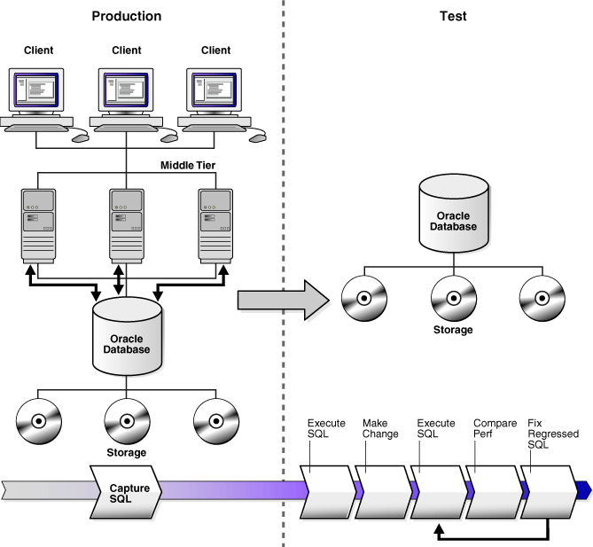

## 2 Introduction to SQL Performance Analyzer

You can run SQL Performance Analyzer on a production system or a test system that closely resembles the production system. Testing a system change on a production system will impact the system's throughput because SQL Performance Analyzer must execute the SQL statements that you are testing. Any global changes made on the system to test the performance effect may also affect other users of the system. If the system change does not impact many sessions or SQL statements, then running SQL Performance Analyzer on the production system may be acceptable. However, for systemwide changes—such as a database upgrade—using a production system is not recommended. Instead, consider running SQL Performance Analyzer on a separate test system so that you can test the effects of the system change without affecting the production system. Using a test system also ensures that other workloads running on the production system will not affect the analysis performed by SQL Performance Analyzer. Running SQL Performance Analyzer on a test system is the recommended approach and the methodology described here. If you choose to run the SQL Performance Analyzer on the production system, then substitute the production system for the test system where applicable.

Analyzing the SQL performance effect of system changes using SQL Performance Analyzer involves the following steps, as illustrated in Figure 2-1:

Figure 2-1 SQL Performance Analyzer Workflow

> The SQL Performance Analyzer workflow is shown. The diagram is divided vertically with a dotted line into two halves. The left side is labeled Production and the right side is labeled Test. Production shows three client machines at the top, three middle tier machines, and an Oracle database. Beneath the database are three disks representing storage. The right side of the diagram shows an Oracle database with three disks representing storage. An arrow points from the database on the Production side to the storage on the Test side. Underneath the diagram is a colored band pointing to the right. Underneath the Production side is an arrow labeled "Capture SQL." Five arrows on the right side are labeled as follows: "Execute SQL", "Make Change", "Execute SQL", "Compare Perf", and "Fix Regressed SQL".
>
> End of description
  

Note:

Oracle Enterprise Manager provides automated workflows for steps [^1] through [^4] to simplify this process.

## 2.1 Capturing the SQL Workload

Before running SQL Performance Analyzer, capture a set of SQL statements on the production system that represents the SQL workload which you intend to analyze.

The captured SQL statements should include the following information:

- SQL text
- Execution environment
	- SQL binds, which are bind values needed to execute a SQL statement and generate accurate execution statistics
		- Parsing schema under which a SQL statement can be compiled
		- Compilation environment, including initialization parameters under which a SQL statement is executed
- Number of times a SQL statement was executed

Capturing a SQL workload has a negligible performance impact on your production system and should not affect throughput. A SQL workload that contains more SQL statements will better represent the state of the application or database. This will enable SQL Performance Analyzer to more accurately forecast the potential impact of system changes on the SQL workload. Therefore, you should capture as many SQL statements as possible. Ideally, you should capture all SQL statements that are either called by the application or are running on the database.

You can store captured SQL statements in a SQL tuning set and use it as an input source for SQL Performance Analyzer. A SQL tuning set is a database object that includes one or more SQL statements, along with their execution statistics and execution context. SQL statements can be loaded into a SQL tuning set from different sources, including the cursor cache, Automatic Workload Repository (AWR), and existing SQL tuning sets. Capturing a SQL workload using a SQL tuning set enables you to:

- Store the SQL text and any necessary auxiliary information in a single, persistent database object
- Populate, update, delete, and select captured SQL statements in the SQL tuning set
- Load and merge content from various data sources, such as the Automatic Workload Repository (AWR) or the cursor cache
- Export the SQL tuning set from the system where the SQL workload is captured and import it into another system
- Reuse the SQL workload as an input source for other advisors, such as the SQL Tuning Advisor and the SQL Access Advisor

See Also:

- [Oracle Database 2 Day + Performance Tuning Guide](https://docs.oracle.com/cd/E11882_01/server.112/e10822/tdppt_sqltune.htm#TDPPT162) for information about creating SQL tuning sets using Oracle Enterprise Manager
- [Oracle Database Performance Tuning Guide](https://docs.oracle.com/cd/E11882_01/server.112/e41573/sql_tune.htm#PFGRF02604) for information about creating SQL tuning sets using APIs

## 2.2 Setting Up the Test System

After you have captured the SQL workload into a SQL tuning set on the production system, you can conduct SQL Performance Analyzer analysis on the same database where the workload was captured or on a different database. Because the analysis is resource-intensive, it is recommended that you capture the workload on a production database and transport it to a separate test database where the analysis can be performed. To do so, export the SQL tuning set from the production system and import it into a separate system where the system change will be tested.

There are many ways to create a test database. For example, you can use the `DUPLICATE` command of Recovery Manager (RMAN), Oracle Data Pump, or transportable tablespaces. Oracle recommends using RMAN because it can create the test database from pre-existing backups or from the active production datafiles. The production and test databases can reside on the same host or on different hosts.

You should configure the test database environment to match the database environment of the production system as closely as possible. In this way, SQL Performance Analyzer can more accurately forecast the effect of the system change on SQL performance.

After the test system is properly configured, export the SQL tuning set from the production system to a staging table, then import it from the staging table into the test system.

See Also:

- [Oracle Database Backup and Recovery User's Guide](https://docs.oracle.com/cd/E11882_01/backup.112/e10642/rcmdupdb.htm#BRADV010) for information about duplicating a database with RMAN
- [Oracle Database 2 Day + Performance Tuning Guide](https://docs.oracle.com/cd/E11882_01/server.112/e10822/tdppt_sqltune.htm#TDPPT159) for information about transporting SQL tuning sets using Oracle Enterprise Manager
- [Oracle Database Performance Tuning Guide](https://docs.oracle.com/cd/E11882_01/server.112/e41573/sql_tune.htm#PFGRF02604) for information about transporting SQL tuning sets using APIs

## 2.3 Creating a SQL Performance Analyzer Task

After the SQL workload is captured and transported to the test system, and the initial database environment is properly configured, you can run SQL Performance Analyzer to analyze the effects of a system change on SQL performance.

To run SQL Performance Analyzer, you must first create a SQL Performance Analyzer task. A task is a container that encapsulates all of the data about a complete SQL Performance Analyzer analysis. A SQL Performance Analyzer analysis comprises of at least two SQL trials and a comparison. A SQL trial encapsulates the execution performance of a SQL tuning set under specific environmental conditions. When creating a SQL Performance Analyzer task, you will need to select a SQL tuning set as its input source. When building SQL trials using the test execute or explain plan methods, the SQL tuning set will be used as the source for SQL statements. The SQL Performance Analyzer analysis will show the impact of the environmental differences between the two trials.

See Also:

- [Chapter 3, "Creating an Analysis Task"](spa_task.md) for information about how to create a SQL Performance Analyzer task

## 2.4 Measuring the Pre-Change SQL Performance

Create a pre-change SQL trial before making the system change. You can use the following methods to generate the performance data needed for a SQL trial with SQL Performance Analyzer:

- Test execute
	This method test executes SQL statements through SQL Performance Analyzer. This can be done on the database running SPA Performance Analyzer or on a remote database.
- Explain plan
	This method generates execution plans only for SQL statements through SQL Performance Analyzer. This can be done on the database running SPA Performance Analyzer or on a remote database. Unlike the `EXPLAIN PLAN` statement, SQL trials using the explain plan method take bind values into account and generate the actual execution plan.
- Convert SQL tuning set
	This method converts the execution statistics and plans stored in a SQL tuning set. This is only supported for APIs.

The test execute method runs each of the SQL statements contained in the workload to completion. During execution, SQL Performance Analyzer generates execution plans and computes execution statistics for each SQL statement in the workload. Each SQL statement in the SQL tuning set is executed separately from other SQL statements, without preserving their initial order of execution or concurrency. This is done at least twice for each SQL statement, for as many times as possible until the execution times out (up to a maximum of 10 times). The first execution is used to warm the buffer cache. All subsequent executions are then used to calculate the run-time execution statistics for the SQL statement based on their averages. The actual number of times that the SQL statement is executed depends on how long it takes to execute the SQL statement. Long-running SQL statement will only be executed a second time, and the execution statistics from this execution will be used. Other (faster-running) SQL statements are executed multiple times, and their execution statistics are averaged over these executions (statistics from the first execution are not used in the calculation). By averaging statistics over multiple executions, SQL Performance Analyzer can calculate more accurate execution statistics for each SQL statement. To avoid a potential impact to the database, DDLs are not supported. By default, only the query portion of DMLs is executed. Using APIs, you can execute the full DML by using the `EXECUTE_FULLDML` task parameter. Parallel DMLs are not supported and the query portion is not executed unless the parallel hints are removed.

Depending on its size, executing a SQL workload can be time and resource intensive. With the explain plan method, you can choose to generate execution plans only, without collecting execution statistics. This technique shortens the time to run the trial and lessens the effect on system resources, but a comprehensive performance analysis is not possible because only the execution plans will be available during the analysis. However, unlike generating a plan with the `EXPLAIN PLAN` command, SQL Performance Analyzer provides bind values to the optimizer when generating execution plans, which provides a more reliable prediction of what the plan will be when the SQL statement is executed.

In both cases, you can execute the SQL workload remotely on a separate database using a database link. SQL Performance Analyzer will establish a connection to the remote database using the database link, execute the SQL statements on that database, collect the execution plans and run-time statistics for each SQL statement, and store the results in a SQL trial on the local database that can be used for later analysis. This method is useful in cases where you want to:

- Test a database upgrade
- Execute the SQL workload on a system running another version of Oracle Database
- Store the results from the SQL Performance Analyzer analysis on a separate test system
- Perform testing on multiple systems with different hardware configurations
- Use the newest features in SQL Performance Analyzer even if you are using an older version of Oracle Database on your production system

Once the SQL workload is executed, the resulting execution plans and run-time statistics are stored in a SQL trial.

You can also build a SQL trial using the execution statistics and plan stored in a SQL tuning set. While this method is only supported for APIs, it may be useful in cases where you have another method to run your workload (such as Database Replay or another application testing tool), and you do not need SQL Performance Analyzer to drive the workload on the test system. In such cases, if you capture a SQL tuning set during your test runs, you can build SQL trials from these SQL tuning sets using SQL Performance Analyzer to view a more comprehensive analysis report. Unlike a standard SQL Performance Analyzer report—which has only one execution plan in each trial and one set of execution statistics generated by executing the SQL statement with one set of binds—you can generate a report that compares SQL trials built from SQL tuning sets that show all execution plans from both trials with potentially many different sets of binds across multiple executions.

See Also:

- [Chapter 4, "Creating a Pre-Change SQL Trial"](spa_pre_change.md) for information about how to measure the pre-change performance
- [Chapter 7, "Testing a Database Upgrade"](spa_upgrade.md) for information about executing a SQL workload on a remote system to test a database upgrade

## 2.5 Making a System Change

Make the change whose effect on SQL performance you intend to measure. SQL Performance Analyzer can analyze the effect of many types of system changes. For example, you can test a database upgrade, new index creation, initialization parameter changes, or optimizer statistics refresh. If you are running SQL Performance Analyzer on the production system, then consider making a change using a private session to avoid affecting the rest of the system.

## 2.6 Measuring the Post-Change SQL Performance

After performing the system change, create a post-change SQL trial. It is highly recommended that you create the post-change SQL trial using the same method as the pre-change SQL trial. Once built, the post-change SQL trial represents a new set of performance data that can be used to compare to the pre-change version. The results are stored in a new, or post-change, SQL trial.

See Also:

- [Chapter 5, "Creating a Post-Change SQL Trial"](spa_post_change.md) for information about how to measure the post-change performance

## 2.7 Comparing Performance Measurements

SQL Performance Analyzer compares the performance of SQL statements before and after the change and produces a report identifying any changes in execution plans or performance of the SQL statements.

SQL Performance Analyzer measures the impact of system changes both on the overall execution time of the SQL workload and on the response time of every individual SQL statement in the workload. By default, SQL Performance Analyzer uses elapsed time as a metric for comparison. Alternatively, you can choose the metric for comparison from a variety of available SQL run-time statistics, including:

- CPU time
- User I/O time
- Buffer gets
- Physical I/O
- Optimizer cost
- I/O interconnect bytes
- Any combination of these metrics in the form of an expression

If you chose to generate explain plans only in the SQL trials, then SQL Performance Analyzer will use the optimizer cost stored in the SQL execution plans.

Once the comparison is complete, the resulting data is generated into a SQL Performance Analyzer report that compares the pre-change and post-change SQL performance. The SQL Performance Analyzer report can be viewed as an HTML, text, or active report. Active reports provides in-depth reporting using an interactive user interface that enables you to perform detailed analysis even when disconnected from the database or Oracle Enterprise Manager.

See Also:

- [Chapter 6, "Comparing SQL Trials"](spa_analyze.md) for information about comparing performance measurements and reporting

## 2.8 Fixing Regressed SQL Statements

If the performance analysis performed by SQL Performance Analyzer reveals regressed SQL statements, then you can make changes to remedy the problem. For example, you can fix regressed SQL by running SQL Tuning Advisor or using SQL plan baselines. You can then repeat the process of executing the SQL statements and comparing its performance to the first execution. Repeat these steps until you are satisfied with the outcome of the analysis.

See Also:

- [Chapter 6, "Comparing SQL Trials"](spa_analyze.md) for information about fixing regressed SQL statements

[^1]: On the test system, create a SQL Performance Analyzer task, as described in "Creating a SQL Performance Analyzer Task".

[^undefined]: Build the pre-change SQL trial by test executing or generating execution plans for the SQL statements stored in the SQL tuning set, as described in "Measuring the Pre-Change SQL Performance"

[^undefined]: Perform the system change, as described in "Making a System Change"

[^2]: Build the post-change SQL trial by re-executing the SQL statements in the SQL tuning set on the post-change test system, as described in "Measuring the Post-Change SQL Performance"

[^undefined]: Compare and analyze the pre-change and post-change versions of performance data, and generate a report to identify the SQL statements that have improved, remained unchanged, or regressed after the system change, as described in "Comparing Performance Measurements"

[^3]: Tune any regressed SQL statements that are identified, as described in "Fixing Regressed SQL Statements".

[^4]: Ensure that the performance of the tuned SQL statements is acceptable by repeating steps 6 through 8 until your performance goals are met.

For each comparison, you can use any previous SQL trial as the pre-change SQL trial and the current SQL trial as the post-change SQL trial. For example, you may want to compare the first SQL trial to the current SQL trial to assess the total change, or you can compare the most recent SQL trial to the current SQL trial to assess just the most recent change.