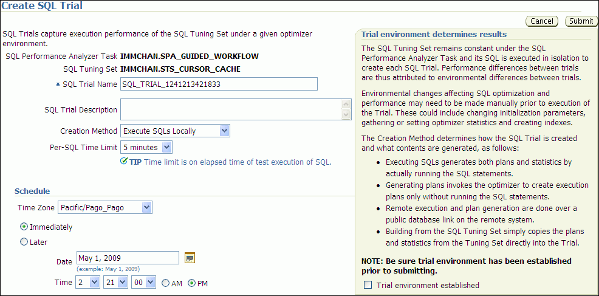

## 4 Creating a Pre-Change SQL Trial

After creating a SQL Performance Analyzer task and selecting a SQL tuning set as the input source, you need to establish the initial environment on the test system. Establishing the database environment on the test system involves manually making any necessary environmental changes that affect SQL optimization and performance. These changes may include changing initialization parameters, gathering or setting optimizer statistics, and creating indexes. It is recommended that you build a test system that is as similar to the production system as possible. The dedicated workflows in Enterprise Manager simplifies this process by creating both SQL trials automatically and performing the change restricted to the testing session. For information about setting up the database environment, see ["Setting Up the Test System"](spa_intro.md).

Note:

You can optionally run SQL trials on a remote system by providing access to a public database link. When conducting remote SQL trials, the database version of the remote database where the SQL statements are executed must be less than or equal to the database version of the database to which it connects. Starting with Oracle Database release 11.2.0.2, the remote database can be a read-only database, such as an Oracle Active Data Guard instance.

Once the environment on the test system is properly configured, you can build the pre-change version of performance data before performing the system change. You can build SQL trials using SQL Performance Analyzer by using one of the following methods:

- Executing the SQL statements in the workload
- Generating execution plans for the SQL statements in the workload
- Loading performance data and execution plans from a SQL tuning set (APIs only)

For more information, see ["Measuring the Pre-Change SQL Performance"](spa_intro.md)

This chapter described how to create the pre-change SQL trial and contains the following topics:

- Creating a Pre-Change SQL Trial Using Enterprise Manager
- Creating a Pre-Change SQL Trial Using APIs

Note:

The primary interface for creating a pre-change SQL trial is Oracle Enterprise Manager. If for some reason Oracle Enterprise Manager is unavailable, you can create a pre-change SQL trial using the `DBMS_SQLPA` PL/SQL package.

Tip:

Before creating a pre-change SQL trial, you need to create a SQL Performance Analyzer task, as described in [Chapter 3, "Creating an Analysis Task"](spa_task.md).

## 4.1 Creating a Pre-Change SQL Trial Using Enterprise Manager

This section describes how to collect the pre-change SQL performance data using Oracle Enterprise Manager.

To create a pre-change SQL trial using Enterprise Manager:

1. On the Guided Workflow page, click the Execute icon for the Create SQL Trial in Initial Environment step.
	The Create SQL Trial page appears. A summary of the selected SQL tuning set containing the SQL workload is displayed.
	

> The Create SQL Trial page is shown.
>
> The Cancel and Submit buttons are on the right of the page.
>
> The SQL Performance Analyzer Task is IMMCHAN.SPA\_GUIDED\_WORKFLOW. The SQL Tuning Set field is IMMCHAN.STS\_CURSOR\_CACHE. The SQL Trial Name is SQL\_TRIAL\_1241213421833. The SQL Trial Description field is empty. The Creation Method list shows Execute SQLs Locally. The Per-SQL Time Limit list shows 5 minutes.
>
> The Schedule section is shown. The Time Zone list shows Pacific/Pago\_Pago. The possible options are Immediately (selected) and Later. The Date is May 1, 2009. The Time is 2:21:00 PM.
>
> End of description.

2. In the SQL Trial Name field, enter the name of the SQL trial.
3. In the SQL Trial Description field, enter a description of the SQL trial.
4. In the Creation Method list, determine how the SQL trial is created and what contents are generated by performing one of the following actions:
	- Select Execute SQLs Locally.
		The SQL trial generates both execution plans and statistics for each SQL statement in the SQL tuning set by actually running the SQL statements locally on the test system.
		- Select Execute SQLs Remotely.
		The SQL trial generates both execution plans and statistics for each SQL statement in the SQL tuning set by actually running the SQL statements remotely on another test system over a public database link.
		- Select Generate Plans Locally.
		The SQL trial invokes the optimizer to create execution plans locally on the test system, after taking bind values and optimizer configuration into account, without actually running the SQL statements.
		- Select Generate Plans Remotely.
		The SQL trial invokes the optimizer to create execution plans remotely on another test system, after taking bind values and optimizer configuration into account, over a public database link without actually running the SQL statements.
		- Select Build From SQL Tuning Set.
		The SQL trial copies the execution plans and statistics from the SQL tuning set directly into the trial.
	For more information about the different methods, see ["Measuring the Pre-Change SQL Performance"](spa_intro.md).
5. In the Per-SQL Time Limit list, determine the time limit for SQL execution during the trial by performing one of the following actions:
	- Select 5 minutes.
		The execution will run each SQL statement in the SQL tuning set up to 5 minutes and gather performance data.
		- Select Unlimited.
		The execution will run each SQL statement in the SQL tuning set to completion and gather performance data. Collecting execution statistics provides greater accuracy in the performance analysis but takes a longer time. Using this setting is not recommended because the task may be stalled by one SQL statement for a prolonged period.
		- Select Customize and enter the specified number of seconds, minutes, or hours.
6. Ensure that the database environment on the test system matches the production environment as closely as possible, and select Trial environment established.
7. In the Schedule section:
	1. In the Time Zone list, select your time zone code.
		2. Select Immediately to start the task now, or Later to schedule the task to start at a time specified using the Date and Time fields.
8. Click Submit.
	The Guided Workflow page appears when the execution begins.
	The status icon of this step changes to a clock while the execution is in progress. To refresh the status icon, click Refresh. Depending on the options selected and the size of the SQL workload, the execution may take a long time to complete. After the execution is completed, the Status icon will change to a check mark and the Execute icon for the next step is enabled.
9. Once the pre-change performance data is built, you can make the system change and build the post-change performance data by re-executing the SQL statements in the SQL tuning set on the post-change test system, as described in [Chapter 5, "Creating a Post-Change SQL Trial"](spa_post_change.md).

## 4.2 Creating a Pre-Change SQL Trial Using APIs

This section describes how to build the pre-change performance data by using the `DBMS_SQLPA.EXECUTE_ANALYSIS_TASK` procedure.

Call the `EXECUTE_ANALYSIS_TASK` procedure using the following parameters:

- Set the `task_name` parameter to the name of the SQL Performance Analyzer task that you want to execute.
- Set the `execution_type` parameter in one of the following ways:
	- Set to `EXPLAIN PLAN` to generate execution plans for all SQL statements in the SQL tuning set without executing them.
		- Set to `TEST EXECUTE` (recommended) to execute all statements in the SQL tuning set and generate their execution plans and statistics. When `TEST EXECUTE` is specified, the procedure generates execution plans and execution statistics. The execution statistics enable SQL Performance Analyzer to identify SQL statements that have improved or regressed. Collecting execution statistics in addition to generating execution plans provides greater accuracy in the performance analysis, but takes longer.
		- Set to `CONVERT SQLSET` to refer to a SQL tuning set for the execution statistics and plans for the SQL trial. Values for the execution parameters `SQLSET_NAME` and `SQLSET_OWNER` should also be specified.
- Specify a name to identify the execution using the `execution_name` parameter. If not specified, then SQL Performance Analyzer automatically generates a name for the task execution.
- Specify execution parameters using the `execution_params` parameters. The `execution_params` parameters are specified as (name, value) pairs for the specified execution. For example, you can set the following execution parameters:
	- The `time_limit` parameter specifies the global time limit to process all SQL statements in a SQL tuning set before timing out.
		- The `local_time_limit` parameter specifies the time limit to process each SQL statement in a SQL tuning set before timing out.
		- To perform a remote test execute, set the `DATABASE_LINK` task parameter to the global name of a public database link connecting to a user with the `EXECUTE` privilege for the `DBMS_SQLPA` package and the `ADVISOR` privilege on the test system.
		- To fully execute DML statements—including acquiring row locks and modifying row—set the `EXECUTE_FULLDML` parameter to `TRUE`. SQL Performance Analyzer will issue a rollback after executing the DML statements to prevent persistent changes from being made. The default value for this parameter is `FALSE`, which executes only the query portion of the DML statement without modifying the data.
		- To restore the relevant captured `init.ora` settings during a test execute, set the `APPLY_CAPTURED_COMPILENV` parameter to `TRUE`. This is not the default behavior because typically you are running SQL trials to test changes when changing the environment. However, this method may be used in cases when the `init.ora` settings are not being changed (such as creating an index). This method is not supported for remote SQL trials.

The following example illustrates a function call made before a system change:

```
EXEC DBMS_SQLPA.EXECUTE_ANALYSIS_TASK(task_name => 'my_spa_task', -
       execution_type => 'TEST EXECUTE', - 
       execution_name => 'my_exec_BEFORE_change');
```

Once the pre-change performance data is built, you can make the system change and build the post-change performance data by re-executing the SQL statements in the SQL tuning set on the post-change test system, as described in [Chapter 5, "Creating a Post-Change SQL Trial"](spa_post_change.md).

See Also:

- [Oracle Database PL/SQL Packages and Types Reference](https://docs.oracle.com/cd/E11882_01/appdev.112/e40758/d_sqlpa.htm#ARPLS229) to learn about the `DBMS_SQLPA.EXECUTE_ANALYSIS_TASK` function