## 3 Creating an Analysis Task

Once you have captured a SQL workload that you want to analyze into a SQL tuning set, you can run SQL Performance Analyzer to analyze the effects of a system change on SQL performance. To run SQL Performance Analyzer, you must first create a SQL Performance Analyzer task. A task is a container that encapsulates all of the data about a complete SQL Performance Analyzer analysis. A SQL Performance Analyzer analysis comprises of at least two SQL trials and a comparison. A SQL trial captures the execution performance of a SQL tuning set under specific environmental conditions and can be generated automatically using SQL Performance Analyzer by one of the following methods:

- Test executing SQL statements
- Generating execution plans for SQL statements
- Referring to execution statistics and plans captured in a SQL tuning set

When creating a SQL Performance Analyzer task, you will need to select a SQL tuning set as its input source. The SQL tuning set will be used as the source for test executing or generating execution plans for SQL trials. Thus, performance differences between trials are caused by environmental differences. For more information, see ["Creating a SQL Performance Analyzer Task"](spa_intro.md).

This chapter described how to create a SQL Performance Analyzer task and contains the following topics:

- Creating an Analysis Task Using Enterprise Manager
- Creating an Analysis Task Using APIs

Note:

The primary interface for running SQL Performance Analyzer is Oracle Enterprise Manager. If for some reason Oracle Enterprise Manager is unavailable, you can run SQL Performance Analyzer using the `DBMS_SQLPA` PL/SQL package.

Tip:

Before running SQL Performance Analyzer, capture the SQL workload to be used in the performance analysis into a SQL tuning set on the production system, then transport it to the test system where the performance analysis will be performed, as described in ["Capturing the SQL Workload"](spa_intro.md).

## 3.1 Creating an Analysis Task Using Enterprise Manager

There are several workflows available in Oracle Enterprise Manager for creating a SQL Performance Analyzer task.

To create an analysis task using Enterprise Manager:

1. On the Software and Support page, under Real Application Testing, click SQL Performance Analyzer.
	The SQL Performance Analyzer page appears.
	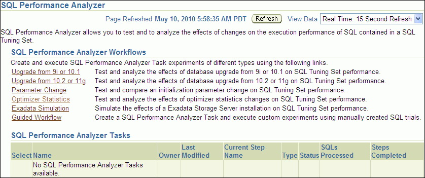

> The SQL Performance Analyzer page is shown.
>
> At the top of the page, the following text appears: Page Refreshed May 10, 2010 5:58:35 AM PDT. The Refresh button is to the right of the text. The View Data list is to the right of the Refresh button. "Real Time: 15 Second Refresh" is selected.
>
> The following text appears: "SQL Performance Analyzer allows you to test and to analyze the effects of changes on the execution performance of SQL contained in a SQL Tuning Set."
>
> The "SQL Performance Analyzer Workflows" section follows. The first sentence is: "Create and execute SQL Performance Analyzer Task experiments of different types using the following links."
>
> 6 links with associated descriptions follow:
>
> - The Upgrade from 9i or 10.1 link has the following description: "Test and analyze the effects of database upgrade from 9i or 10.1 on SQL Tuning Set performance."
> - The Upgrade from 10.2 or 11g link has the following description: "Test and analyze the effects of database upgrade from 10.2 or 11g on SQL Tuning Set performance."
> - The Parameter Change link has the following description: "Test and compare an initialization parameter change on SQL Tuning Set performance."
> - The Optimizer Statistics link has the following description: "Test and analyze the effects of optimizer statistics changes on SQL Tuning Set performance.
> - The Exadata Simulation link has the following description: "Simulate the effects of a Exadata Storage Server installation on SQL Tuning Set performance."
> - The Guided Workflow link has the following description: "Create a SQL Performance Analyzer Task and execute custom experiments using manually created SQL trials."
>
> The SQL Performance Analyzer Tasks table follows. The table has the following columns: Select, Name, Owner, Last Modified, Current Step Name, Type, Status, SQLs Processed, and Steps Completed.
>
> End of description.

2. Under SQL Performance Analyzer Workflows, select the workflow for creating the desired type of analysis task:
	- Upgrade from 9i or 10.1
		Use the upgrade from 9i or 10.1 workflow to test a database upgrade from Oracle9i Database or Oracle Database 10g Release 1 to Oracle Database 10g Release 2 and newer releases, as described in ["Upgrading from Oracle9i Database and Oracle Database 10g Release 1"](spa_upgrade.md).
		- Upgrade from 10.2 or 11g
		Use the upgrade from 10.2 or 11g workflow to test a database upgrade from Oracle Database 10g Release 2 or Oracle Database 11g to a later release, as described in ["Upgrading from Oracle Database 10g Release 2 and Newer Releases"](spa_upgrade.md).
		- Parameter Change
		Use the parameter change workflow to determine how a database initialization parameter change will affect SQL performance, as described in "Using the Parameter Change Workflow".
		- Optimizer Statistics
		Use the optimizer statistics workflow to analyze how changes to optimizer statistics will affect SQL performance, as described in "Using the Optimizer Statistics Workflow".
		- Exadata Simulation
		Use the Exadata simulation workflow to simulate how using Oracle Exadata will affect SQL performance, as described in "Using the Exadata Simulation Workflow".
		- Guided workflow
		Use the guided workflow to compare SQL performance for all other types of system changes, as described in "Using the Guided Workflow".

### 3.1.1 Using the Parameter Change Workflow

The parameter change workflow enables you to test the performance effect on a SQL workload when you change the value of a single environment initialization parameter. For example, you can compare SQL performance by setting the `OPTIMIZER_FEATURES_ENABLE` initialization parameter set to 10.2.0.4 and 11.2.0.1.

After you select a SQL tuning set and a comparison metric, SQL Performance Analyzer creates a task and performs a trial with the initialization parameter set to the original value. SQL Performance Analyzer then performs a second trial with the parameter set to the changed value by issuing an `ALTER SESSION` statement. The impact of the change is thus contained locally to the testing session. Any regression or change in performance is reported in a system-generated SQL Performance Analyzer report.

Note:

To create an analysis task for other types of system changes, use the guided workflow instead, as described in "Using the Guided Workflow".

To use the SQL Performance Analyzer parameter change workflow:

1. On the SQL Performance Analyzer page, under SQL Performance Analyzer Workflows, click Parameter Change.
	The Parameter Change page appears.
	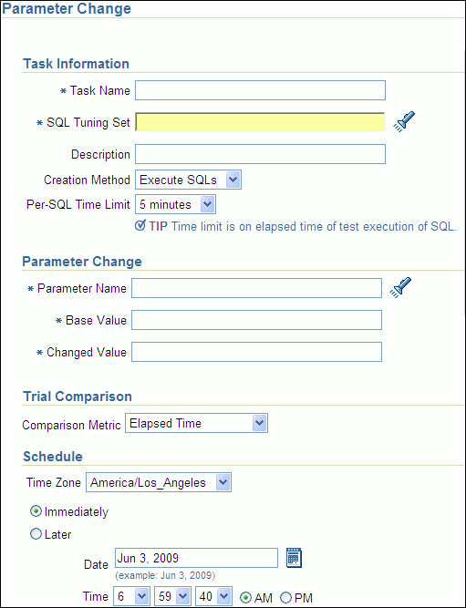

> The Parameter Change page is shown.
>
> The Task Information section is shown. The Task Name field is empty. The SQL Tuning Set field is empty. The Description field is empty. The Creation Method field is set to Execute SQLs. The Per-SQL Time Limit list is set to 5 minutes.
>
> The Parameter Change section is below the Task Information section. The Parameter Name field is empty. The Base Value field is empty. The Changed Value field is empty.
>
> The Trial Comparison section is below the Parameter Change section and includes the Comparison Metric list, which is set to Elapsed Time.
>
> The Schedule section is below the Trial Comparison section and includes the Time Zone list, which is set to America/Los\_Angeles. The available options are Immediately (selected) and Later. The Date field is set to Jun 3, 2009. The Time lists are set to 6:59:40 AM.
>
> End of description.

2. In the Task Name field, enter the name of the task.
3. In the SQL Tuning Set field, enter the name of the SQL tuning set that contains the SQL workload to be analyzed.
	Alternatively, click the search icon to search for a SQL tuning set using the Search and Select: SQL Tuning Set window.
	The selected SQL tuning set now appears in the SQL Tuning Set field.
4. In the Description field, optionally enter a description of the task.
5. In the Creation Method list, determine how the SQL trial is created and what contents are generated by performing one of the following actions:
	- Select Execute SQLs.
		The SQL trial generates both execution plans and statistics for each SQL statement in the SQL tuning set by actually running the SQL statements.
		- Select Generate Plans.
		The SQL trial invokes the optimizer to create execution plans only without actually running the SQL statements.
6. In the Per-SQL Time Limit list, determine the time limit for SQL execution during the trial by performing one of the following actions:
	- Select 5 minutes.
		The execution will run each SQL statement in the SQL tuning set up to 5 minutes and gather performance data.
		- Select Unlimited.
		The execution will run each SQL statement in the SQL tuning set to completion and gather performance data. Collecting execution statistics provides greater accuracy in the performance analysis but takes a longer time. Using this setting is not recommended because the task may be stalled by one SQL statement for a prolonged time period.
		- Select Customize and enter the specified number of seconds, minutes, or hours.
7. In the Parameter Change section, complete the following steps:
	1. In the Parameter Name field, enter the name of the initialization parameter whose value you want to modify, or click the Search icon to select an initialization parameter using the Search and Select: Initialization Parameters window.
		2. In the Base Value field, enter the current value of the initialization parameter.
		3. In the Changed Value field, enter the new value of the initialization parameter.
8. In the Comparison Metric list, select the comparison metric to use for the analysis:
	- If you selected Generate Plans in Step 5, then select Optimizer Cost.
		- If you selected Execute SQLs in Step 5, then select one of the following options:
		- Elapsed Time
				- CPU Time
				- User I/O Time
				- Buffer Gets
				- Physical I/O
				- Optimizer Cost
				- I/O Interconnect Bytes
	To perform the comparison analysis by using more than one comparison metric, perform separate comparison analyses by repeating this procedure using different metrics.
9. In the Schedule section:
	1. In the Time Zone list, select your time zone code.
		2. Select Immediately to start the task now, or Later to schedule the task to start at a time specified using the Date and Time fields.
10. Click Submit.
	The SQL Performance Analyzer page appears.
	In the SQL Performance Analyzer Tasks section, the status of this task is displayed. To refresh the status icon, click Refresh. After the task completes, the Status field changes to Completed.
	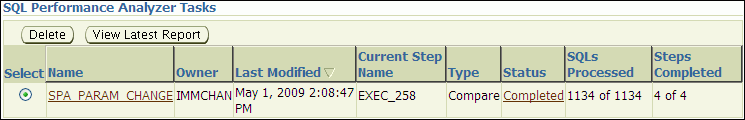

> The SQL Performance Analyzer Tasks section is shown.
>
> The Delete button is shown. To the right of the Delete button is the View Latest Report Button.
>
> The table has the following columns: Select, Name, Owner, Last Modified, Current Step Name, Type, Status, SQLs Processed, and Steps Completed.
>
> Row 1 has the following values: (selected), SPA\_PARAM\_CHANGE, IMMCHAN, May 1, 2009 2:08:47 PM, EXEC\_258, Compare, Completed, 1134 of 1134, 4 of 4.
>
> End of description.

11. In the SQL Performance Analyzer Tasks section, select the task and click the link in the Name column.
	The SQL Performance Analyzer Task page appears.
	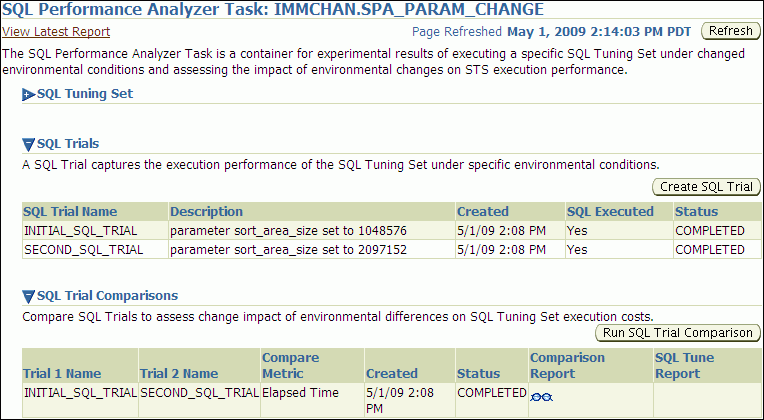

> The SQL Performance Analyzer Task: IMMCHAN.SPA\_PARAM\_CHANGE page is shown. The Page Refreshed field shows May 1, 2009 2:14:03 PM PDT. The Refresh button is shown.
>
> The SQL Tuning Set section is collapsed.
>
> The SQL Trials section includes the following text: "A SQL Trial captures the execution performance of the SQL Tuning Set under specific environmental conditions." The Create SQL Trial button is shown.
>
> The table includes the following columns: SQL Trial Name, Description, Created, SQL Executed, and Status.
>
> Row 1 has the following values: INITIAL\_SQL\_TRIAL, parameter sort\_area\_size set to 1048576, 5/1/09 2:08 PM, Yes, COMPLETED.
>
> Row 2 has the following values: SECOND\_SQL\_TRIAL, parameter sort\_area\_size set to 2097152, 5/1/09 2:08 PM, Yes, COMPLETED.
>
> The SQL Trial Comparisons section is shown. The text is: "Compare SQL Trials to assess change impact of environmental differences on SQL Tuning Set execution costs." The Run SQL Trial Comparison button is shown.
>
> The table has the following columns: Trial 1 Name, Trial 2 Name, Compare Metric, Created, Status, Comparison Report, and SQL Tune Report.
>
> Row 1 has the following values: INITIAL\_SQL\_TRIAL, SECOND\_SQL\_TRIAL, Elapsed Time, 5/1/09 2:08 PM, COMPLETED, (sunglasses icon), and null.
>
> End of description.
  
	  
	This page contains the following sections:
	- SQL Tuning Set
		This section summarizes information about the SQL tuning set, including its name, owner, description, and the number of SQL statements it contains.
		- SQL Trials
		This section includes a table that lists the SQL trials used in the SQL Performance Analyzer task.
		- SQL Trial Comparisons
		This section contains a table that lists the results of the SQL trial comparisons
12. Click the icon in the Comparison Report column.
	The SQL Performance Analyzer Task Result page appears.
13. Review the results of the performance analysis, as described in ["Reviewing the SQL Performance Analyzer Report Using Oracle Enterprise Manager"](spa_analyze.md).
14. In cases when regression are identified, click the icon in the SQL Tune Report column to view a SQL tuning report.

### 3.1.2 Using the Optimizer Statistics Workflow

The optimizer statistics workflow enables you to analyze the effects of optimizer statistics changes on the performance of a SQL workload.

SQL Performance Analyzer tests the effect of new optimizer statistics by enabling pending optimizer statistics in the testing session. The first SQL trial measures the baseline SQL tuning set performance; the second SQL trial uses the pending optimizer statistics. You can then run a comparison report for the two SQL trials.

To use the optimizer statistics workflow:

1. On the SQL Performance Analyzer page, under SQL Performance Analyzer Workflows, click Optimizer Statistics.
	The Optimizer Statistics page appears.
	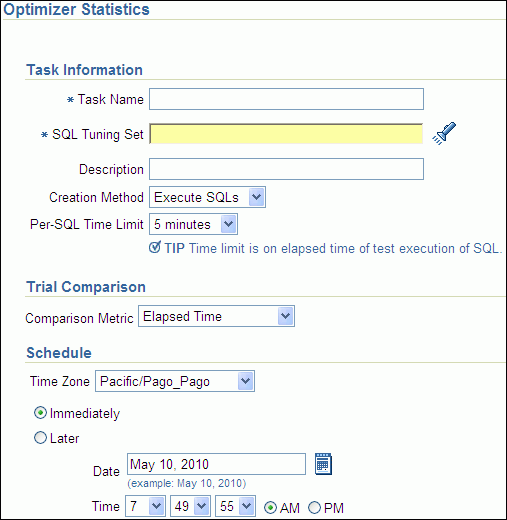

> The Optimizer Statistics page is shown.
>
> The Task Information section is shown. The Task Name field is empty. The SQL Tuning Set field is empty. The Description field is empty. The Creation Method field is set to Execute SQLs. The Per-SQL Time Limit list is set to 5 minutes.
>
> The Trial Comparison section is below the Task Information section and includes the Comparison Metric field, which is set to Elapsed Time.
>
> The Schedule section is below the Trial Comparison section and includes the Time Zone list, which is set to Pacific/Pago\_Pago. The available options are Immediately (selected) and Later. The Date field is set to May 10, 2010. The Time lists are set to 7:49:55 AM.
>
> End of description.

2. In the Task Name field, enter the name of the task.
3. In the SQL Tuning Set field, enter the name of the SQL tuning set that contains the SQL workload to be analyzed.
	Alternatively, click the search icon to search for a SQL tuning set using the Search and Select: SQL Tuning Set window.
	The selected SQL tuning set now appears in the SQL Tuning Set field.
4. In the Description field, optionally enter a description of the task.
5. In the Creation Method list, determine how the SQL trial is created and what contents are generated by performing one of the following actions:
	- Select Execute SQLs.
		The SQL trial generates both execution plans and statistics for each SQL statement in the SQL tuning set by actually running the SQL statements.
		- Select Generate Plans.
		The SQL trial invokes the optimizer to create execution plans only without actually running the SQL statements.
6. In the Per-SQL Time Limit list, determine the time limit for SQL execution during the trial by performing one of the following actions:
	- Select 5 minutes.
		The execution will run each SQL statement in the SQL tuning set up to 5 minutes and gather performance data.
		- Select Unlimited.
		The execution will run each SQL statement in the SQL tuning set to completion and gather performance data. Collecting execution statistics provides greater accuracy in the performance analysis but takes a longer time. Using this setting is not recommended because the task may be stalled by one SQL statement for a prolonged time period.
		- Select Customize and enter the specified number of seconds, minutes, or hours.
7. In the Comparison Metric list, select the comparison metric to use for the comparison analysis:
	- Elapsed Time
		- CPU Time
		- User I/O Time
		- Buffer Gets
		- Physical I/O
		- Optimizer Cost
		- I/O Interconnect Bytes
	Optimizer Cost is the only comparison metric available if you chose to generate execution plans only in the SQL trials.
	To perform the comparison analysis by using more than one comparison metric, perform separate comparison analyses by repeating this procedure with different metrics.
8. Ensure that pending optimizer statistics are collected, and select Pending optimizer statistics collected.
9. In the Schedule section:
	1. In the Time Zone list, select your time zone code.
		2. Select Immediately to start the task now, or Later to schedule the task to start at a time specified using the Date and Time fields.
10. Click Submit.
	The SQL Performance Analyzer page appears.
	In the SQL Performance Analyzer Tasks section, the status of this task is displayed. To refresh the status icon, click Refresh. After the task completes, the Status field changes to Completed.
	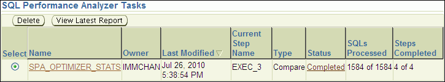

> The SQL Performance Analyzer Tasks section is shown.
>
> The Delete button is shown. To the right of the Delete button is the View Latest Report Button.
>
> The table has the following columns: Select, Name, Owner, Last Modified, Current Step Name, Type, Status, SQLs Processed, and Steps Completed.
>
> Row 1 has the following values: (selected), SPA\_OPTIMIZER\_STATS, IMMCHAN, July 26, 2010 5:38:54 PM, EXEC\_3, Compare, Completed, 1584 of 1584, 4 of 4.
>
> End of description.

11. In the SQL Performance Analyzer Tasks section, select the task and click the link in the Name column.
	The SQL Performance Analyzer Task page appears.
	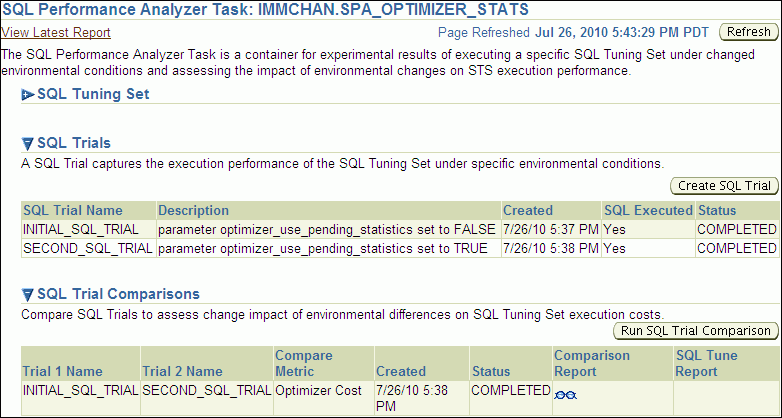

> The SQL Performance Analyzer Task: IMMCHAN.SPA\_OPTIMIZER\_STATS page is shown. The Page Refreshed field shows Jul 26, 2010 5:43:29 PM PDT. The Refresh button is shown.
>
> The SQL Tuning Set section is collapsed.
>
> The SQL Trials section includes the following text: "A SQL Trial captures the execution performance of the SQL Tuning Set under specific environmental conditions."
>
> The table includes the following columns: SQL Trial Name, Description, Created, SQL Executed, and Status.
>
> Row 1 has the following values: INITIAL\_SQL\_TRIAL, parameter optimizer\_use\_pending\_statistics set to FALSE, 7/26/10 5:37 PM, Yes, COMPLETED.
>
> Row 2 has the following values: SECOND\_SQL\_TRIAL, parameter optimizer\_use\_pending\_statistics set to TRUE, 7/26/10 5:38 PM, Yes, COMPLETED.
>
> The SQL Trial Comparisons section is shown. The text is: "Compare SQL Trials to assess change impact of environmental differences on SQL Tuning Set execution costs." The Run SQL Trial Comparison button is shown.
>
> The table has the following columns: Trial 1 Name, Trial 2 Name, Compare Metric, Created, Status, Comparison Report, and SQL Tune Report.
>
> Row 1 has the following values: INITIAL\_SQL\_TRIAL, SECOND\_SQL\_TRIAL, Optimizer Cost, 7/26/10 5:38 PM, COMPLETED, (sunglasses icon), and null.
>
> End of description.
  
	  
	This page contains the following sections:
	- SQL Tuning Set
		This section summarizes information about the SQL tuning set, including its name, owner, description, and the number of SQL statements it contains.
		- SQL Trials
		This section includes a table that lists the SQL trials used in the SQL Performance Analyzer task.
		- SQL Trial Comparisons
		This section contains a table that lists the results of the SQL trial comparisons
12. Click the icon in the Comparison Report column.
	The SQL Performance Analyzer Task Result page appears.
13. Review the results of the performance analysis, as described in ["Reviewing the SQL Performance Analyzer Report Using Oracle Enterprise Manager"](spa_analyze.md).
	Any regressions found in performance can be fixed using SQL plan baselines and the SQL Tuning Advisor. If the pending optimizer statistics produce satisfactory performance, you can publish for use.

### 3.1.3 Using the Exadata Simulation Workflow

The Exadata simulation workflow enables you to simulate the effects of an Exadata Storage Server installation on the performance of a SQL workload.

Oracle Exadata provides extremely large I/O bandwidth coupled with a capability to offload SQL processing from the database to storage. This allows Oracle Database to significantly reduce the volume of data sent through the I/O interconnect, while at the same time offloading CPU resources to the Exadata storage cells.

SQL Performance Analyzer can analyze the effectiveness of Exadata SQL offload processing by simulating an Exadata Storage Server installation and measuring the reduction in I/O interconnect usage for the SQL workload.

Running the Exadata simulation does not require any hardware or configuration changes to your system. After you select a SQL tuning set, SQL Performance Analyzer creates a task and performs an initial trial with the Exadata Storage Server simulation disabled. SQL Performance Analyzer then performs a second trial with the Exadata Storage Server simulation enabled. SQL Performance Analyzer then compares the two trials using the I/O Interconnect Bytes comparison metric and generates a SQL Performance Analyzer report, which estimates the amount of data that would not need to be sent from the Exadata storage cells to the database if Oracle Exadata is being used. In both SQL trials, the SQL statements are executed to completion and I/O interconnect bytes measurements are taken as the actual and simulated Exadata values for the first and second trials, respectively. The measured change in I/O interconnect bytes provides a good estimate of how much filtering can be performed in the Exadata storage cells and, in turn, the amount of CPU that normally would be used to process this data, but now can be offloaded from the database.

Note:

Using the Exadata simulation will not result in any plan changes. Execution plans do not change in an Exadata Storage Server installation because the simulation focuses on measuring the improvement in I/O interconnect usage. Moreover, I/O interconnect bytes will not increase, except when data compression is used (see next note), because Oracle Exadata will only decrease the amount of data sent to the database.

Note:

Because I/O interconnect bytes is the only metric used to measure the performance change impact of using an Exadata Storage Server installation, it will not work properly if Oracle Exadata is used with data compression. Since Exadata storage cells also decompress data, the I/O interconnect bytes with Oracle Exadata (or the second SQL trial) of a SQL statement may be greater than the I/O interconnect bytes without Oracle Exadata (or the first SQL trial) where the data is compressed. This comparison will be misleading because the SQL statement will be reported as a regression; when in fact, it is not.

Note:

The Exadata simulation workflow is used to simulate an Exadata Storage Server installation on non-Exadata hardware. To test changes on Exadata hardware, use the standard SQL Performance Analyzer workflows.

Note:

The Exadata simulation is supported for DSS and data warehouse workloads only.

To use the SQL Performance Analyzer Exadata simulation workflow:

1. On the SQL Performance Analyzer page, under SQL Performance Analyzer Workflows, click Exadata Simulation.
	The Exadata Simulation page appears.
	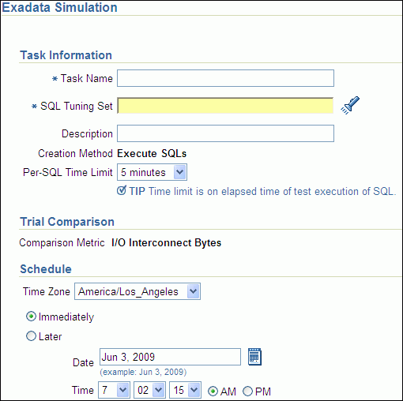

> The Exadata Simulation page is shown.
>
> The Task Information section is shown. The Task Name field is empty. The SQL Tuning Set field is empty. The Description field is empty. The Creation Method field is set to Execute SQLs. The Per-SQL Time Limit list is set to 5 minutes.
>
> The Trial Comparison section is below the Task Information section and includes the Comparison Metric field, which is set to I/O Interconnect Bytes.
>
> The Schedule section is below the Trial Comparison section and includes the Time Zone list, which is set to America/Los\_Angeles. The available options are Immediately (selected) and Later. The Date field is set to June 3, 2009. The Time lists are set to 7:02:15 AM.
>
> End of description.

2. In the Task Name field, enter the name of the task.
3. In the SQL Tuning Set field, enter the name of the SQL tuning set that contains the SQL workload to be analyzed.
	Alternatively, click the search icon to search for a SQL tuning set using the Search and Select: SQL Tuning Set window.
	The selected SQL tuning set now appears in the SQL Tuning Set field.
4. In the Description field, optionally enter a description of the task.
5. In the Per-SQL Time Limit list, determine the time limit for SQL execution during the trial by performing one of the following actions:
	- Select 5 minutes.
		The execution will run each SQL statement in the SQL tuning set up to 5 minutes and gather performance data.
		- Select Unlimited.
		The execution will run each SQL statement in the SQL tuning set to completion and gather performance data. Collecting execution statistics provides greater accuracy in the performance analysis but takes a longer time. Using this setting is not recommended because the task may be stalled by one SQL statement for a prolonged time period.
		- Select Customize and enter the specified number of seconds, minutes, or hours.
6. In the Schedule section:
	1. In the Time Zone list, select your time zone code.
		2. Select Immediately to start the task now, or Later to schedule the task to start at a time specified using the Date and Time fields.
7. Click Submit.
	The SQL Performance Analyzer page appears.
	In the SQL Performance Analyzer Tasks section, the status of this task is displayed. To refresh the status icon, click Refresh. After the task completes, the Status field changes to Completed.
	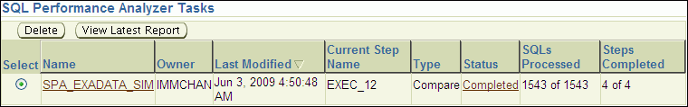

> The SQL Performance Analyzer Tasks section is shown.
>
> The Delete button is shown. To the right of the Delete button is the View Latest Report Button.
>
> The table has the following columns: Select, Name, Owner, Last Modified, Current Step Name, Type, Status, SQLs Processed, and Steps Completed.
>
> Row 1 has the following values: (selected), SPA\_EXADATA\_SIM, IMMCHAN, Jun 3, 2009 4:50:48 AM, EXEC\_12, Compare, Completed, 1543 of 1543, 4 of 4.
>
> End of description.

8. In the SQL Performance Analyzer Tasks section, select the task and click the link in the Name column.
	The SQL Performance Analyzer Task page appears.
	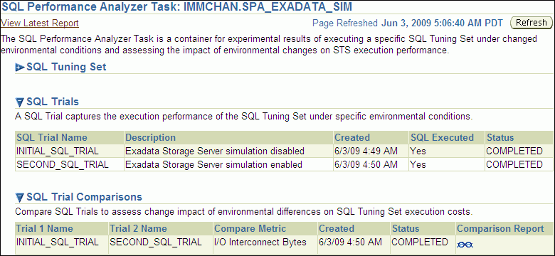

> The SQL Performance Analyzer Task: IMMCHAN.SPA\_EXADATA\_SIM page is shown. The Page Refreshed field shows Jun 3, 2009 5:06:40 AM PDT. The Refresh button is shown.
>
> The SQL Tuning Set section is collapsed.
>
> The SQL Trials section includes the following text: "A SQL Trial captures the execution performance of the SQL Tuning Set under specific environmental conditions."
>
> The table includes the following columns: SQL Trial Name, Description, Created, SQL Executed, and Status.
>
> Row 1 has the following values: INITIAL\_SQL\_TRIAL, Exadata Storage Server simulation disabled, 6/3/09 4:49 AM, Yes, COMPLETED.
>
> Row 2 has the following values: SECOND\_SQL\_TRIAL, Exadata Storage Server simulation enabled, 6/3/09 4:50 AM, Yes, COMPLETED.
>
> The SQL Trial Comparisons section is shown. The text is: "Compare SQL Trials to assess change impact of environmental differences on SQL Tuning Set execution costs." The Run SQL Trial Comparison button is shown.
>
> The table has the following columns: Trial 1 Name, Trial 2 Name, Compare Metric, Created, Status, Comparison Report, and SQL Tune Report.
>
> Row 1 has the following values: INITIAL\_SQL\_TRIAL, SECOND\_SQL\_TRIAL, I/O Interconnect Bytes, 6/3/09 4:50 AM, COMPLETED, (sunglasses icon), and null.
>
> End of description.
  
	  
	This page contains the following sections:
	- SQL Tuning Set
		This section summarizes information about the SQL tuning set, including its name, owner, description, and the number of SQL statements it contains.
		- SQL Trials
		This section includes a table that lists the SQL trials used in the SQL Performance Analyzer task.
		- SQL Trial Comparisons
		This section contains a table that lists the results of the SQL trial comparisons
9. Click the icon in the Comparison Report column.
	The SQL Performance Analyzer Task Result page appears.
10. Review the results of the performance analysis, as described in ["Reviewing the SQL Performance Analyzer Report Using Oracle Enterprise Manager"](spa_analyze.md).
	Any SQL performance improvement with the Exadata simulation between the first and second trials is captured in the report. In general, you can expect a greater impact if the SQL workload contains queries that scan a large number of rows or a small subset of table columns. Conversely, a SQL workload that queries indexed tables or tables with fewer rows will result in a lesser impact from the Exadata simulation.

### 3.1.4 Using the Guided Workflow

The guided workflow enables you to test the performance effect of any types of system changes on a SQL workload, as listed in ["SQL Performance Analyzer"](rat_intro.md).

Note:

To create an analysis task to test database initialization parameter changes, use the simplified parameter change workflow instead, as described in "Using the Parameter Change Workflow".

To use the SQL Performance Analyzer task guided workflow:

1. On the SQL Performance Analyzer page, under SQL Performance Analyzer Workflows, click Guided Workflow.
	The Guided Workflow page appears.
	The guided workflow enables you to test the performance effect on a SQL workload when you perform any type of system changes, as described in ["SQL Performance Analyzer"](rat_intro.md).
	This page lists the required steps in the SQL Performance Analyzer task in sequential order. Each step must be completed in the order displayed before the next step can begin.
	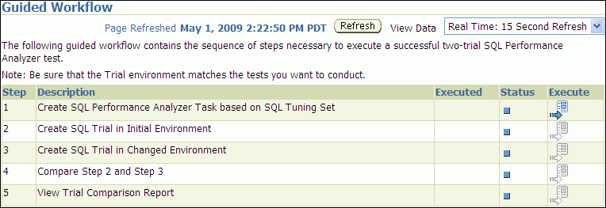

> The Guided Workflow page is shown.
>
> Page Refreshed show May 1, 2009 2:22:50 PM PDT. The Refresh button is shown. The View Data list shows Real Time: 15 Second Refresh. The text reads: "The following guided workflow contains the sequence of steps necessary to execute a successful two-trial SQL Performance Analyzer test. Note: Be sure that the Trial environment matches the tests you want to conduct."
>
> The table has the following columns: Step, Description, Executed, Status, and Execute.
>
> Row 1 has the following values: 1, Create SQL Performance Analyzer Task based on SQL Tuning Set, null, (small square icon), (arrow icon).
>
> Row 2 has the following values: 2, Create SQL Trial in Initial Environment, null, (small square icon), (grayed out arrow).
>
> Row 3 has the following values: 3, Create SQL Trial in Changed Environment, null, (small square icon), (grayed out arrow).
>
> Row 4 has the following values: 4, Compare Step 2 and Step 3, null, (small square icon), (grayed out arrow).
>
> Row 5 has the following values: 5, View Trial Comparison Report, null, (small square icon), (grayed out arrow).
>
> End of description.

2. On the Guided Workflow page, click the Execute icon for the Step 1: Create SQL Performance Analyzer Task based on SQL Tuning Set.
	The Create SQL Performance Analyzer Task page appears.
	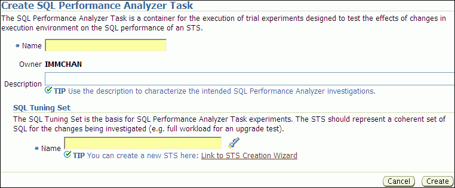

> The Create SQL Performance Analyzer Task page is shown.
>
> The sentence below the heading reads "The SQL Performance Analyzer Task is a container for the execution of trial experiments designed to test the effects of changes in execution environment on the SQL performance of an STS."
>
> The Name field is empty. The Owner is IMMCHAN. The Description field is empty.
>
> The SQL Tuning Set section is shown. The sentence below the heading reads: "The SQL Tuning Set is the basis for SQL Performance Analyzer Task experiments. The STS should represent a coherent set of SQL for the changes being investigated (e.g. full workload for an upgrade test)." The Name field is empty.
>
> The Cancel and Create buttons appear in the lower right corner.
>
> End of description.

3. In the Name field, enter the name of the task.
4. In the Description field, optionally enter a description of the task.
5. Under SQL Tuning Set, in the Name field, enter the name the SQL tuning set that contains the SQL workload to be analyzed.
	Alternatively, click the search icon to select a SQL tuning set from the Search and Select: SQL Tuning Set window.
6. Click Create.
	The Guided Workflow page appears.
	The Status icon of this step has changed to a check mark and the Execute icon for the next step is now enabled.
7. Once the analysis task is created, you can build the pre-change performance data by executing the SQL statements stored in the SQL tuning set, as described in [Chapter 4, "Creating a Pre-Change SQL Trial"](spa_pre_change.md).

## 3.2 Creating an Analysis Task Using APIs

This section describes how to create a SQL Performance Analyzer task by using the `DBMS_SQLPA.CREATE_ANALYSIS_TASK` function. A task is a database container for SQL Performance Analyzer execution inputs and results.

Tip:

Before proceeding, capture the SQL workload to be used in the performance analysis into a SQL tuning set on the production system, then transport it to the test system where the performance analysis will be performed, as described in ["Capturing the SQL Workload"](spa_intro.md).

Call the `CREATE_ANALYSIS_TASK` function to prepare the analysis of a SQL tuning set using the following parameters:

- Set `task_name` to specify an optional name for the SQL Performance Analyzer task.
- Set `sqlset_name` to the name of the SQL tuning set.
- Set `sqlset_owner` to the owner of the SQL tuning set. The default is the current schema owner.
- Set `basic_filter` to the SQL predicate used to filter the SQL from the SQL tuning set.
- Set `order_by` to specify the order in which the SQL statements will be executed.
	You can use this parameter to ensure that the more important SQL statements will be processed and not skipped if the time limit is reached.
- Set `top_sql` to consider only the top number of SQL statements after filtering and ranking.

The following example illustrates a function call:

```
VARIABLE t_name VARCHAR2(100);
EXEC :t_name := DBMS_SQLPA.CREATE_ANALYSIS_TASK(sqlset_name => 'my_sts', -
       task_name => 'my_spa_task');
```

Once the analysis task is created, you can build the pre-change performance data by executing the SQL statements stored in the SQL tuning set, as described in [Chapter 4, "Creating a Pre-Change SQL Trial"](spa_pre_change.md).

See Also:

- [Oracle Database PL/SQL Packages and Types Reference](https://docs.oracle.com/cd/E11882_01/appdev.112/e40758/d_sqlpa.htm#ARPLS229) to learn more about the `DBMS_SQLPA.CREATE_ANALYSIS_TASK` function

### 3.2.1 Running the Exadata Simulation Using APIs

This section describes how to run the Oracle Exadata simulation using APIs. For information about how SQL Performance Analyzer simulates the effects of an Exadata Storage Server installation on the performance of a SQL workload, see "Using the Exadata Simulation Workflow".

To enable Exadata simulation for an analysis task, call the `SET_ANALYSIS_TASK_PARAMETER` procedure before creating the post-change SQL trial, as shown in the following example:

```
EXEC DBMS_SQLPA.SET_ANALYSIS_TASK_PARAMETER(task_name => 'my_spa_task', -
       parameter => 'CELL_SIMULATION_ENABLED', - 
       value => 'TRUE');
```

This will enable Exadata simulation when you create the post-change SQL trial, which can then be compared to the pre-change SQL trial that was created with Exadata simulation disabled.

Alternatively, you can run the Exadata simulation using the `tcellsim.sql` script:

1. At the SQL prompt, enter:
	```
	@$ORACLE_HOME/rdbms/admin/tcellsim.sql
	```
2. Enter the name and owner of the SQL tuning set to use:
	```
	Enter value for sts_name: MY_STS
	Enter value for sts_owner: IMMCHAN
	```
	The script then runs the following four steps automatically:
	- Creates a SQL Performance Analyzer task
		- Test executes SQL statements with Exadata simulation disabled
		- Test executes SQL statements with Exadata simulation enabled
		- Compares performance and generates analysis report