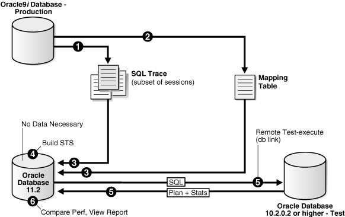
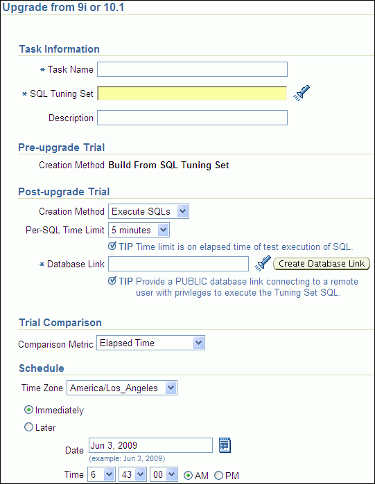
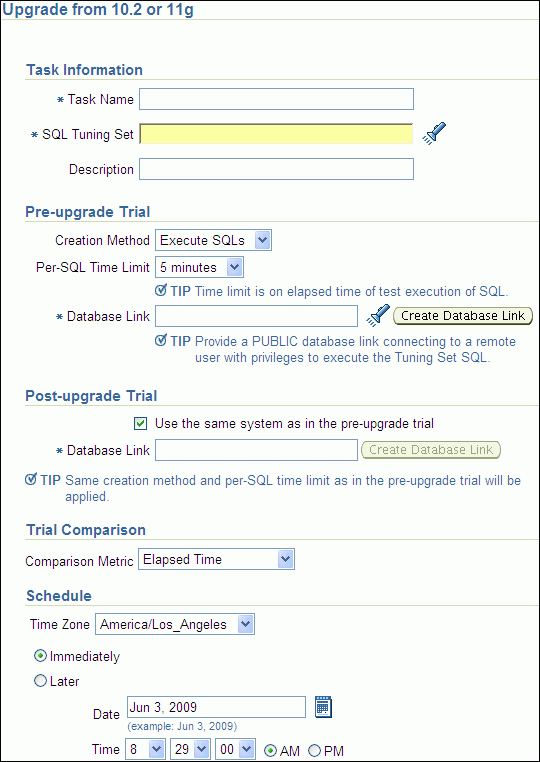

## 7 Testing a Database Upgrade

SQL Performance Analyzer supports testing database upgrades from Oracle9i and later releases to Oracle Database 10g Release 2 or newer releases. The methodology used to test a database upgrade from Oracle9i Database and Oracle Database 10g Release 1 is slightly different from the one used to test a database upgrade from Oracle Database 10g Release 2 and later releases, so both methodologies are described here.

This chapter describes how to use SQL Performance Analyzer in a database upgrade and contains the following sections:

Note:

For information about using SQL Performance Analyzer in other cases, see ["SQL Performance Analyzer"](rat_intro.md)

## 7.1 Upgrading from Oracle9i Database and Oracle Database 10g Release 1

As illustrated in Figure 7-1, SQL Performance Analyzer supports testing database upgrades of Oracle9i Database and Oracle Database 10g Release 1 to Oracle Database 10g Release 2 and later releases by building a SQL tuning set from SQL trace files captured on the production system, executing the SQL tuning set on the upgraded database remotely over a database link, and then comparing the results to those captured on the production system. Because SQL Performance Analyzer only accepts a set of SQL statements stored in a SQL tuning set as its input source, and SQL tuning sets are not supported in Oracle9i Database, a SQL tuning set must be constructed so that it can be used as an input source for SQL Performance Analyzer if you are upgrading from Oracle9i Database.

Figure 7-1 SQL Performance Analyzer Workflow for Database Upgrade from Oracle9i to Oracle Database 10g Release 2



> This diagram illustrates the workflow for using SQL Performance Analyzer in a database upgrade from Oracle9i to Oracle Database 10g Release 2. In the top left corner is a database labeled "Oracle9i Database - Production". An arrow labeled "1" points from this database to multiple documents labeled "SQL Trace (subset of sessions)". A second arrow labeled "2" points from this database to a single document labeled "Mapping Table". Two arrows labeled "3" point from both sets of documents to a second database in the lower left corner labeled "Oracle Database 11.2".
>
> From the second database labeled "Oracle Database 11.2", a line labeled "4" connects to the text "Build STS". A second unlabeled line connects to the text "No Data Necessary". An arrow labeled "5" points to a third database in the lower right corner labeled "Oracle Database 10.2.0.2 or higher - Test". This arrow is further labeled with the text "SQL" and "Remote Test-execute (db link)".
>
> From the third database labeled "Oracle Database 10.2.0.2 or higher - Test", another arrow labeled "5" points back to the second database labeled "Oracle Database 11.2". This arrow is further labeled with the text "Plan and Stats". A line labeled "6" connects to the text "Compare Perf, View Report" from this database.
>
> End of description.
  

The production system which you are upgrading from should be running Oracle9i or Oracle Database 10g Release 1. The test system which you are upgrading to should be running Oracle Database 10g Release 2 or a newer release. The database version can be release 10.2.0.2 or higher. If you are upgrading to Oracle Database 10g release 10.2.0.2, 10.2.0.3, or 10.2.0.4, you will also need to install a one-off patch before proceeding.

To ensure that the analysis made by SQL Performance Analyzer is accurate, the test system should resemble the production system as closely as possible because the performance on both systems will be compared to each other. Furthermore, the hardware configurations on both systems should also be as similar as possible.

Next, you will need to set up a separate SQL Performance Analyzer system running Oracle Database 11g Release 2. You will be using this system to build a SQL tuning set and to run SQL Performance Analyzer. Neither your production data or schema need to be available on this system, since the SQL tuning set will be built using statistics stored in the SQL trace files from the production system. SQL Performance Analyzer tasks will be executed remotely on the test system to generate the execution plan and statistics for the SQL trial over a database link that you specify. The database link must be a public database link that connects to a user with the `EXECUTE` privilege for the `DBMS_SQLPA` package and the `ADVISOR` privilege on the test system. You should also drop any existing `PLAN_TABLE` from the user's schema on the test system.

Once the upgrade environment is configured as described, perform the steps as described in the following procedure to use SQL Performance Analyzer in a database upgrade from Oracle9i or Oracle Database 10g Release 1 to a newer release.

1. Enable the SQL Trace facility on the production system, as described in "Enabling SQL Trace on the Production System".
	To minimize the performance impact on the production system and still be able to fully capture a representative set of SQL statements, consider enabling SQL Trace for only a subset of the sessions, for as long as required, to capture all important SQL statements at least once.
2. On the production system, create a mapping table, as described in "Creating a Mapping Table".
	This mapping table will be used to convert the user and object identifier numbers in the SQL trace files to their string equivalents.
3. Move the SQL trace files and the mapping table from the production system to the SQL Performance Analyzer system, as described in "Creating a Mapping Table".
4. On the SQL Performance Analyzer system, construct a SQL tuning set using the SQL trace files, as described in "Building a SQL Tuning Set".
	The SQL tuning set will contain the SQL statements captured in the SQL trace files, along with their relevant execution context and statistics.
5. On the SQL Performance Analyzer system, use SQL Performance Analyzer to create a SQL Performance Analyzer task and convert the contents in the SQL tuning set into a pre-upgrade SQL trial that will be used as a baseline for comparison, then remotely test execute the SQL statements on the test system over a database link to build a post-upgrade SQL trial, as described in "Testing Database Upgrades from Oracle9i Database and Oracle Database 10g Release 1".
6. Compare SQL performance and fix regressed SQL.
	SQL Performance Analyzer compares the performance of SQL statements read from the SQL tuning set during the pre-upgrade SQL trial to those captured from the remote test execution during the post-upgrade SQL trial. A report is produced to identify any changes in execution plans or performance of the SQL statements.
	If the report reveals any regressed SQL statements, you can make further changes to fix the regressed SQL, as described in "Tuning Regressed SQL Statements After Testing a Database Upgrade".
	Repeat the process of executing the SQL tuning set and comparing its performance to a previous execution to test any changes made until you are satisfied with the outcome of the analysis.

### 7.1.1 Enabling SQL Trace on the Production System

Oracle9i uses the SQL Trace facility to collect performance data on individual SQL statements. The information generated by SQL Trace is stored in SQL trace files. SQL Performance Analyzer consumes the following information from these files:

- SQL text and username under which parse occurred
- Bind values for each execution
- CPU and elapsed times
- Physical reads and logical reads
- Number of rows processed
- Execution plan for each SQL statement (only captured if the cursor for the SQL statement is closed)

Although it is possible to enable SQL Trace for an instance, it is recommended that you enable SQL Trace for a subset of sessions instead. When the SQL Trace facility is enabled for an instance, performance statistics for all SQL statements executed in the instance are stored into SQL trace files. Using SQL Trace in this way can have a severe performance impact and may result in increased system overhead, excessive CPU usage, and inadequate disk space. It is required that trace level be set to 4 to capture bind values, along with the execution plans.

For production systems running Oracle Database 10g Release 1, use the `DBMS_MONITOR`.`SESSION_TRACE_ENABLE` procedure to enable SQL Trace transparently in another session. You should also enable binds explicitly by setting the `binds` procedure parameter to `TRUE` (its default value is `FALSE`).

After enabling SQL Trace, identify the SQL trace files containing statistics for a representative set of SQL statements that you want to use with SQL Performance Analyzer. You can then copy the SQL trace files to the SQL Performance Analyzer system. Once the SQL workload is captured in the SQL trace files, disable SQL Trace on the production system.

See Also:

- [Oracle Database Performance Tuning Guide](https://docs.oracle.com/cd/E11882_01/server.112/e41573/sqltrace.htm#PFGRF010) for additional considerations when using SQL Trace, such as setting initialization parameters to manage SQL trace files
- [Oracle Database PL/SQL Packages and Types Reference](https://docs.oracle.com/cd/E11882_01/appdev.112/e40758/d_monitor.htm#ARPLS091) for information about the `DBMS_MONITOR` package

### 7.1.2 Creating a Mapping Table

To convert the user and object identifier numbers stored in the SQL trace files to their respective names, you need to provide a table that specifies each mapping. The SQL Performance Analyzer system will read this mapping table when converting the trace files into a SQL tuning set.

To create a mapping table, run the following SQL statements on the production database:

```
CREATE TABLE mapping AS
    SELECT object_id id, owner, SUBSTR(object_name, 1, 30) name FROM dba_objects
    WHERE object_type NOT IN ('CONSUMER GROUP', 'EVALUATION CONTEXT', 'FUNCTION',
                              'INDEXTYPE', 'JAVA CLASS', 'JAVA DATA',
                              'JAVA RESOURCE', 'LIBRARY', 'LOB', 'OPERATOR',
                              'PACKAGE', 'PACKAGE BODY', 'PROCEDURE', 'QUEUE',
                              'RESOURCE PLAN', 'SYNONYM', 'TRIGGER', 'TYPE',
                              'TYPE BODY')
    UNION ALL
    SELECT user_id id, username owner, null name FROM dba_users;
```

Once the mapping table is created, you can use Data Pump to transport it to the SQL Performance Analyzer system.

See Also:

- [Oracle Database Utilities](https://docs.oracle.com/cd/E11882_01/server.112/e22490/dp_overview.htm#SUTIL100) for information about using Data Pump

### 7.1.3 Building a SQL Tuning Set

Once the SQL trace files and mapping table are moved to the SQL Performance Analyzer system, you can build a SQL tuning set using the `DBMS_SQLTUNE` package.

To build a SQL tuning set:

1. Copy the SQL trace files to a directory on the SQL Performance Analyzer system.
2. Create a directory object for this directory.
3. Use the `DBMS_SQLTUNE`.`SELECT_SQL_TRACE` function to read the SQL statements from the SQL trace files.
	For each SQL statement, only information for a single execution is collected. The execution frequency of each SQL statement is not captured. Therefore, when performing a comparison analysis for a production system running Oracle Database 10g Release 1 and older releases, you should ignore the workload-level statistics in the SQL Performance Analyzer report and only evaluate performance changes on an execution level.
	The following example reads the contents of SQL trace files stored in the `sql_trace_prod` directory object and loads them into a SQL tuning set.
	```
	DECLARE
	  cur sys_refcursor;
	BEGIN
	  DBMS_SQLTUNE.CREATE_SQLSET('my_sts_9i');
	  OPEN cur FOR
	    SELECT VALUE (P) 
	    FROM table(DBMS_SQLTUNE.SELECT_SQL_TRACE('sql_trace_prod', '%ora%')) P;
	  DBMS_SQLTUNE.LOAD_SQLSET('my_sts_9i', cur);
	  CLOSE cur;
	END;
	/
	```

The syntax for the `SELECT_SQL_TRACE` function is as follows:

```
DBMS_SQLTUNE.SELECT_SQL_TRACE ( 
  directory              IN VARCHAR2,
  file_name              IN VARCHAR2 := NULL,
  mapping_table_name     IN VARCHAR2 := NULL,
  mapping_table_owner    IN VARCHAR2 := NULL,
  select_mode            IN POSITIVE := SINGLE_EXECUTION,
  options                IN BINARY_INTEGER := LIMITED_COMMAND_TYPE,
  pattern_start          IN VARCHAR2 := NULL,
  parttern_end           IN VARCHAR2 := NULL,
  result_limit           IN POSITIVE := NULL)
RETURN sys.sqlset PIPELINED;
```

Table 7-1 describes the available parameters for the `SELECT_SQL_TRACE` function.

Table 7-1 DBMS\_SQLTUNE.SELECT\_SQL\_TRACE Function Parameters

| Parameter | Description |
| --- | --- |
| `directory` | Specifies the directory object pointing to the directory where the SQL trace files are stored. |
| `file_name` | Specifies all or part of the name of the SQL trace files to process. If unspecified, the current or most recent trace file in the specified directory will be used. % wildcards are supported for matching trace file names. |
| `mapping_table_name` | Specifies the name of the mapping table. If set to the default value of `NULL`, mappings from the current database will be used. Note that the mapping table name is not case-sensitive. |
| `mapping_table_owner` | Specifies the schema where the mapping table resides. If set to `NULL`, the current schema will be used. |
| `select_mode` | Specifies the mode for selecting SQL statements from the trace files. The default value is `SINGLE_EXECUTION`. In this mode, only statistics for a single execution per SQL statement will be loaded into the SQL tuning set. The statistics are not cumulative, as is the case with other SQL tuning set data source table functions. |
| `options` | Specifies the options for the operation. The default value is `LIMITED_COMMAND_TYPE`, only SQL types that are meaningful to SQL Performance Analyzer (such as `SELECT`, `INSERT`, `UPDATE`, and `DELETE`) are returned from the SQL trace files. |
| `pattern_start` | Specifies the opening delimiting pattern of the trace file sections to consider. This parameter is currently not used. |
| `pattern_end` | Specifies the closing delimiting pattern of the trace file sections to process. This parameter is currently not used. |
| `result_limit` | Specifies the top SQL from the (filtered) source. The default value is 2 <sup>31</sup>, which represents unlimited. |

See Also:

- [Oracle Database PL/SQL Packages and Types Reference](https://docs.oracle.com/cd/E11882_01/appdev.112/e40758/d_sqltun.htm#ARPLS220) for information about the `DBMS_SQLTUNE` package

### 7.1.4 Testing Database Upgrades from Oracle9i Database and Oracle Database 10g Release 1

Once the SQL tuning set is built, you can use SQL Performance Analyzer to build a pre-upgrade SQL trial from the execution plans and run-time statistics in the SQL tuning set. After the pre-upgrade SQL trial is built, you need to perform a test execute or generate plans of SQL statements in the SQL tuning set on the test system to build a post-upgrade SQL trial. SQL Performance Analyzer test executes the SQL statements using a public database link that you specify by connecting to the test system remotely and generating the execution plans and statistics for the SQL trial. The database link should exist on the SQL Performance Analyzer system and connect to a remote user with privileges to execute the SQL tuning set on the test system.

You can run SQL Performance Analyzer to test a database upgrade from Oracle9i Database or Oracle Database 10g Release 1 using Oracle Enterprise Manager or APIs, as described in the following sections:

- Testing Database Upgrades from Oracle9i Database and Oracle Database 10g Release 1 Using Enterprise Manager
- Testing Database Upgrades from Oracle9i Database and Oracle Database 10g Release 1 Using APIs

#### 7.1.4.1 Testing Database Upgrades from Oracle9i Database and Oracle Database 10g Release 1 Using Enterprise Manager

To test a database upgrade from Oracle9i Database or Oracle Database 10g Release 1 using SQL Performance Analyzer:

1. On the Software and Support page, under Real Application Testing, click SQL Performance Analyzer.
	The SQL Performance Analyzer page appears.
2. Under SQL Performance Analyzer Workflows, click Upgrade from 9i or 10.1.
	The Upgrade from 9i or 10.1 page appears.
	

> The Upgrade from 9i or 10.1 page is shown.
>
> The Task Information section is shown. The Task Name field is empty. The SQL Tuning Set field is empty. The Description field is empty.
>
> The Pre-upgrade Trial section is below the Task Information section. The Creation Method field is set to Build From SQL Tuning Set.
>
> The Post-upgrade Trial section is below the Pre-upgrade Trial section. The Creation Method list is set to Execute SQLs. The Per-SQL Time Limit list is set to 5 minutes. The Database Link field is blank.
>
> The Trial Comparison section is below the Post-upgrade Trial section and includes the Comparison Metric list, which is set to Elapsed Time.
>
> The Schedule section is below the Trial Comparison section and includes the Time Zone list, which is set to America/Los\_Angeles. The available options are Immediately (selected) and Later. The Date field is set to Jun 3, 2009. The Time lists are set to 6:43:00 AM.
>
> End of description.

3. Under Task Information:
	1. In the Task Name field, enter the name of the task.
		2. In the SQL Tuning Set field, enter the name of the SQL tuning set that was built.
		Alternatively, click the search icon to search for the SQL tuning set using the Search and Select: SQL Tuning Set window.
		The selected SQL tuning set now appears in the SQL Tuning Set field.
		3. In the Description field, optionally enter a description of the task.
4. In the Creation Method field, select:
	- Execute SQLs to generate both execution plans and statistics for each SQL statement in the SQL tuning set by actually running the SQL statements remotely on the test system over a public database link.
		- Generate Plans to create execution plans remotely on the test system over a public database link without actually running the SQL statements.
5. In the Per-SQL Time Limit list, determine the time limit for SQL execution during the trial by performing one of the following actions:
	- Select 5 minutes.
		The execution will run each SQL statement in the SQL tuning set up to 5 minutes and gather performance data.
		- Select Unlimited.
		The execution will run each SQL statement in the SQL tuning set to completion and gather performance data. Collecting execution statistics provides greater accuracy in the performance analysis but takes a longer time. Using this setting is not recommended because the task may be stalled by one SQL statement for a prolonged time period.
		- Select Customize and enter the specified number of seconds, minutes, or hours.
6. In the Database Link field, enter the global name of a public database link connecting to a user with the `EXECUTE` privilege for the `DBMS_SQLPA` package and the `ADVISOR` privilege on the test system.
	Alternatively, click the search icon to search for and select a database link, or click Create Database Link to create a database link using the Create Database Link page.
7. In the Comparison Metric list, select the comparison metric to use for the comparison analysis:
	- Elapsed Time
		- CPU Time
		- User I/O Time
		- Buffer Gets
		- Physical I/O
		- Optimizer Cost
		- I/O Interconnect Bytes
	Optimizer Cost is the only comparison metric available if you generated execution plans only in the SQL trials.
	To perform the comparison analysis by using more than one comparison metric, perform separate comparison analyses by repeating this procedure with different metrics.
8. Under Schedule:
	1. In the Time Zone list, select your time zone code.
		2. Select Immediately to start the task now, or Later to schedule the task to start at a time specified using the Date and Time fields.
9. Click Submit.
	The SQL Performance Analyzer page appears.
	In the SQL Performance Analyzer Tasks section, the status of this task is displayed. To refresh the status icon, click Refresh. After the task completes, the Status field changes to Completed.
10. Under SQL Performance Analyzer Tasks, select the task and click the link in the Name column.
	The SQL Performance Analyzer Task page appears.
	This page contains the following sections:
	- SQL Tuning Set
		This section summarizes information about the SQL tuning set, including its name, owner, description, and the number of SQL statements it contains.
		- SQL Trials
		This section includes a table that lists the SQL trials used in the SQL Performance Analyzer task.
		- SQL Trial Comparisons
		This section contains a table that lists the results of the SQL trial comparisons
11. Click the icon in the Comparison Report column.
	The SQL Performance Analyzer Task Result page appears.
12. Review the results of the performance analysis, as described in ["Reviewing the SQL Performance Analyzer Report Using Oracle Enterprise Manager"](spa_analyze.md).
	If regressed SQL statements are found following the database upgrade, tune them as described in "Tuning Regressed SQL Statements After Testing a Database Upgrade".

#### 7.1.4.2 Testing Database Upgrades from Oracle9i Database and Oracle Database 10g Release 1 Using APIs

After creating a SQL Performance Analyzer task on the SQL Performance Analyzer system, you can use APIs to build the pre-upgrade SQL trial from the execution plans and run-time statistics in the SQL tuning set. To do so, call the `EXECUTE_ANALYSIS_TASK` procedure using the following parameters:

- Set the `task_name` parameter to the name of the SQL Performance Analyzer task that you want to execute.
- Set the `execution_type` parameter to `CONVERT SQLSET` to direct SQL Performance Analyzer to treat the statistics in the SQL tuning set as a trial execution.
- Specify a name to identify the execution using the `execution_name` parameter. If not specified, then SQL Performance Analyzer automatically generates a name for the task execution.

The following example executes the SQL Performance Analyzer task named `my_spa_task` as a trial execution:

```
EXEC DBMS_SQLPA.EXECUTE_ANALYSIS_TASK(task_name => 'my_spa_task', -
       execution_type => 'CONVERT SQLSET', - 
       execution_name => 'my_trial_9i');
```

To build the post-upgrade SQL trial using APIs, perform an explain plan or test execute using the SQL Performance Analyzer system by calling the `EXECUTE_ANALYSIS_TASK` procedure. Set the `DATABASE_LINK` task parameter to the global name of a public database link connecting to a user with the `EXECUTE` privilege for the `DBMS_SQLPA` package and the `ADVISOR` privilege on the test system.

If you choose to use `EXPLAIN PLAN`, only execution plans will be generated. Subsequent comparisons will only be able to yield a list of changed plans without making any conclusions about performance changes. If you choose to use `TEST EXECUTE`, the SQL workload will be executed to completion. This effectively builds the post-upgrade SQL trial using the statistics and execution plans generated from the test system. Using `TEST EXECUTE` is recommended to capture the SQL execution plans and performance data at the source, thereby resulting in a more accurate analysis.

The following example performs a test execute of the SQL statements remotely over a database link:

```
EXEC DBMS_SQLPA.EXECUTE_ANALYSIS_TASK(task_name => 'my_spa_task', -
       execution_type => 'TEST EXECUTE', - 
       execution_name => 'my_remote_trial_10g', -
       execution_params => dbms_advisor.arglist('database_link',
                                                'LINK.A.B.C.BIZ.COM'));
```

## 7.2 Upgrading from Oracle Database 10g Release 2 and Newer Releases

You can use SQL Performance Analyzer to test the impact on SQL response time of a database upgrade from Oracle Database 10g Release 2 or a newer release to any later release by capturing a SQL tuning set on the production system, then executing it twice remotely over a database link on a test system—first to create a pre-change SQL trial, then again to create a post-change SQL trial.

The production system which you are upgrading from should be running Oracle Database 10g Release 2 or a newer release. Initially, the test system should also be running the same release. To ensure that the analysis made by SQL Performance Analyzer is accurate, the test system should contain an exact copy of the production data found on the production system. Furthermore, the hardware configuration should also be as similar to the production system as possible.

Next, you will need to set up a separate SQL Performance Analyzer system running Oracle Database 11g Release 2. You will be using this system to run SQL Performance Analyzer. Neither your production data or schema need to be available on this system, since the SQL tuning set will be built using statistics stored in the SQL trace files from the production system. SQL Performance Analyzer tasks will be executed remotely on the test system to generate the execution plan and statistics for the SQL trial over a database link that you specify. The database link must be a public database link that connects to a user with the `EXECUTE` privilege for the `DBMS_SQLPA` package and the `ADVISOR` privilege on the test system. You should also drop any existing `PLAN_TABLE` from the user's schema on the test system.

Once the upgrade environment is configured as described, perform the steps as described in the following procedure to use SQL Performance Analyzer in a database upgrade from Oracle Database 10g Release 2 or a newer release to any later release.

1. On the production system, capture the SQL workload that you intend to analyze and store it in a SQL tuning set, as described in ["Capturing the SQL Workload"](spa_intro.md).
2. Set up the test system so that it matches the production environment as closely as possible, as described in ["Setting Up the Test System"](spa_intro.md).
3. Transport the SQL tuning set to the SQL Performance Analyzer system.
	For information about transporting SQL tuning sets using:
	- Oracle Enterprise Manager, see [Oracle Database 2 Day + Performance Tuning Guide](https://docs.oracle.com/cd/E11882_01/server.112/e10822/tdppt_sqltune.htm#TDPPT159)
		- APIs, see [Oracle Database Performance Tuning Guide](https://docs.oracle.com/cd/E11882_01/server.112/e41573/sql_tune.htm#PFGRF02604)
4. On the SQL Performance Analyzer system, create a SQL Performance Analyzer task using the SQL tuning set as its input source.
	Remotely test execute the SQL statements in the SQL tuning set on the test system over a database link to build a pre-upgrade SQL trial that will be used as a baseline for comparison, as described in "Testing Database Upgrades from Oracle Database 10g Release 2 and Newer Releases".
5. Upgrade the test system.
6. Remotely test execute the SQL statements a second time on the upgraded test system over a database link to build a post-upgrade SQL trial, as described in "Testing Database Upgrades from Oracle Database 10g Release 2 and Newer Releases".
7. Compare SQL performance and fix regressed SQL.
	SQL Performance Analyzer compares the performance of SQL statements read from the SQL tuning set during the pre-upgrade SQL trial to those captured from the remote test execution during the post-upgrade SQL trial. A report is produced to identify any changes in execution plans or performance of the SQL statements.
	If the report reveals any regressed SQL statements, you can make further changes to fix the regressed SQL, as described in "Tuning Regressed SQL Statements After Testing a Database Upgrade".
	Repeat the process of executing the SQL tuning set and comparing its performance to a previous execution to test any changes made until you are satisfied with the outcome of the analysis.

### 7.2.1 Testing Database Upgrades from Oracle Database 10g Release 2 and Newer Releases

Once the SQL tuning set is transported to the SQL Performance Analyzer system, you can use SQL Performance Analyzer to build a pre-upgrade SQL trial by executing or generating plans of SQL statements in the SQL tuning set on the test system. SQL Performance Analyzer test executes the SQL statements using a database link that you specify by connecting to the test system remotely and generating the execution plans and statistics for the SQL trial. The database link should exist on the SQL Performance Analyzer system and connect to a remote user with privileges to execute the SQL tuning set on the test system.

After the pre-upgrade SQL trial is built, you need to upgrade the test system. Once the database has been upgraded, SQL Performance Analyzer will need to execute or generate plans of SQL statements in the SQL tuning set a second time on the upgraded test system to build a post-upgrade SQL trial. Alternatively, if hardware resources are available, you can use another upgraded test system to execute the second remote SQL trial. This method can be useful in helping you investigate issues identified by SQL Performance Analyzer.

You can run SQL Performance Analyzer to test a database upgrade from Oracle Database 10g Release 2 or a newer release using Oracle Enterprise Manager or APIs, as described in the following sections:

- Testing Database Upgrades from Oracle Database 10g Release 2 and Newer Releases Using Enterprise Manager
- Testing Database Upgrades from Oracle Database 10g Release 2 and Newer Releases Using APIs

#### 7.2.1.1 Testing Database Upgrades from Oracle Database 10g Release 2 and Newer Releases Using Enterprise Manager

To test a database upgrade from Oracle Database 10g Release 2 or a newer release using SQL Performance Analyzer:

1. On the Software and Support page, under Real Application Testing, click SQL Performance Analyzer.
	The SQL Performance Analyzer page appears.
2. Under SQL Performance Analyzer Workflows, click Upgrade from 10.2 or 11g.
	The Upgrade from 10.2 or 11g page appears.
	

> The Upgrade from 10.2 or 11g page is shown.
>
> The Task Information section is shown. The Task Name field is empty. The SQL Tuning Set field is empty. The Description field is empty.
>
> The Pre-upgrade Trial section is below the Task Information section. The Creation Method list is set to Execute SQLs. The Per-SQL Time Limit list is set to 5 minutes. The Database Link field is blank.
>
> The Post-upgrade Trial section is below the Pre-upgrade Trial section. Use the same system as in the pre-upgrade trial is checked. The Database Link field is blank.
>
> The Trial Comparison section is below the Post-upgrade Trial section and includes the Comparison Metric list, which is set to Elapsed Time.
>
> The Schedule section is below the Trial Comparison section and includes the Time Zone list, which is set to America/Los\_Angeles. The available options are Immediately (selected) and Later. The Date field is set to Jun 3, 2009. The Time lists are set to 6:43:00 AM.
>
> End of description.

3. Under Task Information:
	1. In the Task Name field, enter the name of the task.
		2. In the SQL Tuning Set field, enter the name of the SQL tuning set that was built.
		Alternatively, click the search icon to search for the SQL tuning set using the Search and Select: SQL Tuning Set window.
		The selected SQL tuning set now appears in the SQL Tuning Set field.
		3. In the Description field, optionally enter a description of the task.
4. In the Creation Method field, select:
	- Execute SQLs to generate both execution plans and statistics for each SQL statement in the SQL tuning set by actually running the SQL statements remotely on the test system over a public database link.
		- Generate Plans to create execution plans remotely on the test system over a public database link without actually running the SQL statements.
5. In the Per-SQL Time Limit list, determine the time limit for SQL execution during the trial by performing one of the following actions:
	- Select 5 minutes.
		The execution will run each SQL statement in the SQL tuning set up to 5 minutes and gather performance data.
		- Select Unlimited.
		The execution will run each SQL statement in the SQL tuning set to completion and gather performance data. Collecting execution statistics provides greater accuracy in the performance analysis but takes a longer time. Using this setting is not recommended because the task may be stalled by one SQL statement for a prolonged time period.
		- Select Customize and enter the specified number of seconds, minutes, or hours.
6. In the Database Link field, enter the global name of a public database link connecting to a user with the `EXECUTE` privilege for the `DBMS_SQLPA` package and the `ADVISOR` privilege on the pre-upgrade system.
	Alternatively, click the search icon to search for and select a database link, or click Create Database Link to create a database link using the Create Database Link page.
7. Under Post-upgrade Trial:
	1. Select Use the same system as in the pre-upgrade trial to use the same system for executing both the pre-upgrade and post-upgrade trials.
		Oracle recommends using this option to avoid possible errors due to different system configurations. When using this option, you will need to upgrade the test database to the higher database version before the post-upgrade trial is executed.
		2. In the Database Link field, enter the global name of a public database link connecting to a user with the `EXECUTE` privilege for the `DBMS_SQLPA` package and the `ADVISOR` privilege on the post-upgrade system.
8. In the Comparison Metric list, select the comparison metric to use for the comparison analysis:
	- Elapsed Time
		- CPU Time
		- User I/O Time
		- Buffer Gets
		- Physical I/O
		- Optimizer Cost
		- I/O Interconnect Bytes
	Optimizer Cost is the only comparison metric available if you generated execution plans only in the SQL trials.
	To perform the comparison analysis by using more than one comparison metric, perform separate comparison analyses by repeating this procedure with different metrics.
9. Under Schedule:
	1. In the Time Zone list, select your time zone code.
		2. Select Immediately to start the task now, or Later to schedule the task to start at a time specified using the Date and Time fields.
10. Click Submit.
	The SQL Performance Analyzer page appears.
	In the SQL Performance Analyzer Tasks section, the status of this task is displayed. To refresh the status icon, click Refresh.
	If you are using the same system to execute both the pre-upgrade and post-upgrade trials, you will need to upgrade the database after the pre-upgrade trial step is completed. After the database is upgraded, the post-upgrade trial can be executed. After the task completes, the Status field changes to Completed.
11. Under SQL Performance Analyzer Tasks, select the task and click the link in the Name column.
	The SQL Performance Analyzer Task page appears.
	This page contains the following sections:
	- SQL Tuning Set
		This section summarizes information about the SQL tuning set, including its name, owner, description, and the number of SQL statements it contains.
		- SQL Trials
		This section includes a table that lists the SQL trials used in the SQL Performance Analyzer task.
		- SQL Trial Comparisons
		This section contains a table that lists the results of the SQL trial comparisons
12. Click the icon in the Comparison Report column.
	The SQL Performance Analyzer Task Result page appears.
13. Review the results of the performance analysis, as described in ["Reviewing the SQL Performance Analyzer Report Using Oracle Enterprise Manager"](spa_analyze.md).
	If regressed SQL statements are found following the database upgrade, tune them as described in "Tuning Regressed SQL Statements After Testing a Database Upgrade".

#### 7.2.1.2 Testing Database Upgrades from Oracle Database 10g Release 2 and Newer Releases Using APIs

After creating a SQL Performance Analyzer task on the SQL Performance Analyzer system, you can use APIs to build the pre-upgrade SQL trial by performing an explain plan or test execute of SQL statements in the SQL tuning set. To do so, call the `EXECUTE_ANALYSIS_TASK` procedure using the following parameters:

- Set the `task_name` parameter to the name of the SQL Performance Analyzer task that you want to execute.
- Set the `execution_type` parameter to `EXPLAIN PLAN` or `TEST EXECUTE`.
	If you choose to use `EXPLAIN PLAN`, only execution plans will be generated. Subsequent comparisons will only be able to yield a list of changed plans without making any conclusions about performance changes. If you choose to use `TEST EXECUTE`, the SQL workload will be executed to completion. This effectively builds the pre-upgrade SQL trial using the statistics and execution plans generated from the test system. Using `TEST EXECUTE` is recommended to capture the SQL execution plans and performance data at the source, thereby resulting in a more accurate analysis.
- Specify a name to identify the execution using the `execution_name` parameter. If not specified, then SQL Performance Analyzer automatically generates a name for the task execution.
- Set the `DATABASE_LINK` task parameter to the global name of a public database link connecting to a user with the `EXECUTE` privilege for the `DBMS_SQLPA` package and the `ADVISOR` privilege on the test system.

The following example executes the SQL Performance Analyzer task named `my_spa_task` and performs a test execute of the SQL statements remotely over a database link:

```
EXEC DBMS_SQLPA.EXECUTE_ANALYSIS_TASK(task_name => 'my_spa_task', -
       execution_type => 'TEST EXECUTE', - 
       execution_name => 'my_remote_trial_10g', -
       execution_params => dbms_advisor.arglist('database_link',
                                                'LINK.A.B.C.BIZ.COM'));
```

To build the post-upgrade SQL trial using APIs, perform an explain plan or test execute using the SQL Performance Analyzer system by calling the `EXECUTE_ANALYSIS_TASK` procedure with the `DATABASE_LINK` task parameter set to the global name of a public database link connecting to a user with the `EXECUTE` privilege for the `DBMS_SQLPA` package and the `ADVISOR` privilege on the test system. If you choose to use `EXPLAIN PLAN`, only execution plans will be generated. Subsequent comparisons will only be able to yield a list of changed plans without making any conclusions about performance changes. If you choose to use `TEST EXECUTE`, the SQL workload will be executed to completion. This effectively builds the post-upgrade SQL trial using the statistics and execution plans generated from the test system. Using `TEST EXECUTE` is recommended to capture the SQL execution plans and performance data at the source, thereby resulting in a more accurate analysis.

The following example performs a test execute of the SQL statements remotely over a database link:

```
EXEC DBMS_SQLPA.EXECUTE_ANALYSIS_TASK(task_name => 'my_spa_task', -
       execution_type => 'TEST EXECUTE', - 
       execution_name => 'my_remote_trial_11g', -
       execution_params => dbms_advisor.arglist('database_link',
                                                'LINK.A.B.C.BIZ.COM'));
```

## 7.3 Tuning Regressed SQL Statements After Testing a Database Upgrade

In some cases, SQL Performance Analyzer may identify SQL statements whose performance regressed after you upgrade the database on the test system.

You can tune the regressed SQL statements by using the SQL Tuning Advisor or SQL plan baselines, as described in [Chapter 6, "Comparing SQL Trials"](spa_analyze.md). This involves using APIs to build a subset of a SQL tuning set with only the regressed SQL statements, transport this subset of regressed SQL statements to the remote database, and running the SQL Tuning Advisor on the remote database.

Oracle Enterprise Manager does not provide support for fixing regressions after running SQL Performance Analyzer involving one or more remote SQL trials. For more information, see ["Tuning Regressed SQL Statements From a Remote SQL Trial Using APIs"](spa_analyze.md).

If you are upgrading from Oracle Database 10g Release 2 and newer releases, you can also create SQL plan baselines to instruct the optimizer to select existing execution plans in the future. For more information, see ["Creating SQL Plan Baselines Using APIs"](spa_analyze.md).