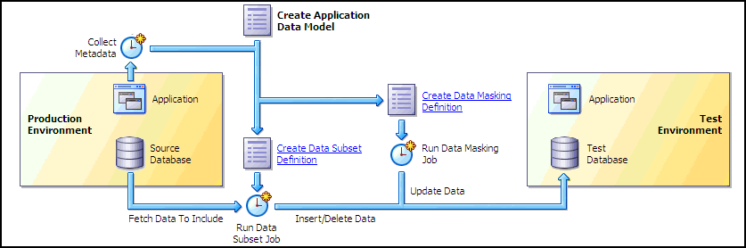

## 14 Application Data Models

Secure Test Data Management provides Enterprise Manager the capability to enable operations such as sensitive data discovery, data subsetting, and data masking. These capabilities enable scanning and tagging of sensitive data and modeling of data relationships incorporated within an Application Data Model (ADM). You must have the Oracle Data Masking and Subsetting Pack license to use test data management features.

The Application Data Model stores the list of applications, tables, and relationships between table columns that are either declared in the data dictionary, imported from application metadata, or user-specified. The Application Data Model maintains sensitive data types and their associated columns, and is used by Secure Test Data Management features, such as data subsetting and data masking, to securely produce test data. Creating an Application Data Model is a prerequisite for data subsetting and data masking operations.

Figure 14-1 shows the Application Data Model's relationship to other test data management components as well as the production and test environments.

Figure 14-1 Test Data Management Architecture

> This is a screenshot of the test data management architecture flowchart that appears when you select Enterprise ==> Quality Management ==> Data Discovery and Modeling. The left side of the graphic shows the components associated with the production environment, and the right side of the graphic shows the components associated with the test environment. The middle section of the graphic shows how the Application Data Model, Data Subsetting Definition, and Data Masking Definition relate to the two environments, and present a decision tree to assist you in deciding the order of tasks.
  

You can perform several tasks related to Application Data Modeling, including the following tasks discussed in this chapter:

- Creating an Application Data Model
- Managing Sensitive Column Types
- Associating a Database to an Application Data Model
- Importing and Exporting an Application Data Model
- Verifying or Upgrading a Source Database

Note:

The procedures in this chapter are applicable to Oracle Enterprise Manager 12.1 Cloud Control and higher only.

See Also:

- [Chapter 15, "Data Subsetting"](tdm_subsetting.md) for information about data subsetting
- [Chapter 16, "Masking Sensitive Data"](tdm_data_masking.md) for information about data masking

## 14.1 Creating an Application Data Model

The following procedure enables you to:

- Initiate creation of an Application Data Model (ADM)
- View and edit application tables
- View referential relationships
- Manually add a referential relationship
- Discover sensitive columns
- Set the type for sensitive columns

Before proceeding, ensure that you have the following privileges:

- `EM_ALL_OPERATOR` for Enterprise Manager Cloud Control users
- `SELECT_CATALOG_ROLE` for database users
- Select Any Dictionary privilege for database users

Note:

Before you can create an ADM, run the Deploy Test Data Management packages job on the source database. The job installs the PL/SQL metadata collection packages.

To create an Application Data Model:

1. From the Data Discovery and Modeling page, view the diagram that shows how you can create a database for a test environment.
	As the diagram shows, the first step is to create an ADM.
2. Create an ADM:
	1. Click Create.
		A pop-up window requesting general properties information appears.
		2. Provide the required Name and Source Database.
		The Source Database is the source from which the metadata is to be extracted.
		3. Select an Application Suite:
		If you select Custom Application Suite:
		- By default, metadata collection is enabled for the ADM creation process.
				- If you uncheck "Create One Application For Each Schema," you create a shell ADM and will need to edit the ADM later to add applications and tables. Also, no metadata collection job is submitted, unlike the default choice.
		If you select Oracle Application Suite:
		- Oracle E-Business — You submit a job to create the ADM.
				- Oracle Fusion Applications — You submit a job to create the ADM.
		Note the following points about metadata collections:
		- The metadata collection for the selected application suite populates the ADM with the applications and tables in the suite.
				- The ADM can collect metadata for one or more schemas. An ADM application is actually a schema. Each schema you select becomes an ADM application, and the ADM becomes populated with the tables in the schema.
		4. Click Continue.
		Assuming that you selected Custom Application Suite, a Schemas pop-up appears in which you select schemas to include from the Available list.
		5. Click Continue, provide the schedule parameters, then click Submit to submit the metadata collection job.
		The ADM you created appears in the Application Data Models page. The Most Recent Job Status table column indicates that the metadata collection job is running. The model is locked, and you cannot edit it during this period until the status indicates that the job is complete.
3. View and edit application tables:
	1. Select the model you created, then select Edit.
		The Applications and Tables subpage appears, displaying the applications found during metadata collection.
		To see the tables for an application, click the expand ( > ) icon.
		2. To edit an application, select the application, open the Actions menu, then select Add Table to Application.
		The Add Table to Application pop-up window appears.
		3. Click the Table search icon.
		The Search and Select pop-up appears, showing all of the tables from the selected schema that are not assigned to an application.
		4. Select an unassigned table, then click OK.
		The table name now appears in the Add Table to Application pop-up.
		5. After selecting a Table Type, click OK.
		The table now appears in the Applications and Tables view.
4. View referential relationships:
	1. Click the Referential Relationships tab.
		There are three types of referential relationships:
		- Dictionary-defined
			Upon opening this tab, this view shows the referential relationships that the metadata collection extracted, resulting from primary key and foreign key relationships. You can remove relationships from the ADM if desired.
				- Imported from template
			Oracle supplies application templates for Oracle Fusion Applications and Oracle E-Business Suite. To use them, you must have originally created the ADM from an Oracle-supplied template by using the Import action on the ADM home page.
				- User-defined
			See the step below about manually adding a referential relationship for more information.
		2. Open an application view by selecting it, then using the > icon to reveal parent and dependent key relationships.
5. Manually add a referential relationship:
	1. From the Referential Relationships tab, open the Actions menu, then select Add Referential Relationship.
		The Add Referential Relationship pop-up window appears.
		2. Select the requisite Parent Key and Dependent Key information.
		3. In the Columns Name list, select a dependent key column to associate with a parent key column.
		4. Click OK to add the referential relationship to the ADM.
		The new dependent column now appears in the referential relationships list.
6. Discover sensitive columns automatically or add them manually:
	To automatically discover sensitive columns:
	1. From the Sensitive Columns tab, open the Actions menu, then select Create Sensitive Column Discovery Job.
		The Parameters pop-up appears.
		2. Select one or more applications and one or more sensitive column types.
		Each type you select is processed for each application to search for columns that match the type.
		3. Click Continue.
		The schedule pop-up window appears.
		4. Provide the required information, schedule the job, then click Submit when you have finished.
		The Sensitive Columns subpage reappears.
		5. Click Save and Return to return to the Application Data Models home page.
		6. When the Most Recent Job Status column indicates that the job is Successful, select the ADM, then click Edit.
		7. Select the Sensitive Columns tab, then click Discovery Results to view the job results.
		8. To set the sensitive status of any column, select the row for the column you want to define, open the Set Status menu, then select either Sensitive or Not Sensitive.
		9. Click OK to save and return to the Sensitive Columns tab.
		The sensitive columns you defined in the previous step now appear in the list.
		10. Click Save and Return to return to the Application Data Models page.
	To manually add sensitive columns:
	1. From the Application Data Models page, select an ADM, then click Edit.
		2. Select the Sensitive Columns tab, then click Add.
		The Add Sensitive Column pop-up appears.
		3. Provide the required information and an optional Sensitive Column Type, then click OK.
		The sensitive column now appears in the table for the Sensitive Columns tab.
7. Change the type for sensitive columns:
	1. Click the Sensitive Columns tab.
		This view shows the sensitive columns that have already been identified.
		2. Select the sensitive column for which you want to change the type.
		3. Open the Actions menu, then select Set Sensitive Column Type.
		The Set Sensitive Column Type pop-up window appears.
		4. Select the new type and click OK.

## 14.2 Managing Sensitive Column Types

After you have successfully created an ADM, the next task is to create either a new sensitive column type or one based on an existing type.

To create a sensitive column type:

1. From the Actions menu of the Application Data Models page, select Sensitive Column Types.
	The Sensitive Column Types page appears.
2. Click Create.
	The Create Sensitive Column Type pop-up appears.
3. Specify a required name and regular expressions for the Column Name, Column Comment, and Column Data search patterns.
	- The Or Search Type means that any of the patterns can match for a candidate sensitive column.
		- The And Search Type means that all of the patterns must match for a candidate sensitive column.
	If you do not provide expressions for any of these parameters, the system does not search for the entity.
4. Click OK.
	The sensitive column appears in the table in the Sensitive Column Types page.

To create a sensitive column type based on an existing type:

1. From the Actions menu of the Application Data Models page, select Sensitive Column Types.
	The Sensitive Column Types page appears.
2. Select either a sensitive column type you have already defined, or select one from the out-of-box types that the product provides.
3. Click Create Like.
	The Create Sensitive Column Type pop-up appears.
4. Specify a required name and alter the existing expressions for the Column Name, Column Comment, and Column Data search patterns to suit your needs.
5. Click OK.
	The sensitive column appears in the table in the Sensitive Column Types page.

## 14.3 Associating a Database to an Application Data Model

After you have created an Application Data Model (ADM), you can select additional databases to be associated databases of an ADM, as explained in the following procedure.

To associate a database to an ADM:

1. From the Application Data Models page, select an ADM, select Actions, then Associated Databases.
	This dialog lists all of the databases associated with this ADM and the schemas assigned to each application per database. You can add more databases that give you a choice of data sources when subsetting and databases to mask during masking.
2. Click Add, then select a database from the pop-up.
	The selected database now appears in the Database section of the Associated Databases dialog.
3. To change a schema, select the associated database on the left, select the application on the right for which the schema is to be changed, then click Select Schema.
4. Select the missing schema from the list in the pop-up, then click Add.

## 14.4 Importing and Exporting an Application Data Model

You can share Application Data Models (ADM) with other Enterprise Manager environments that use a different repository.

To import an ADM XML file from your desktop:

1. From the Data Discovery and Modeling page, select Actions, then Import.
2. In the pop-up that appears, specify a name for the ADM, the source database you want to assign to the ADM, and location on your desktop from which you want to import the ADM.
3. Click OK.
	The ADM now appears on the Application Data Models page.

To export an ADM as an XML file to your desktop:

1. From the Data Discovery and Modeling page, select the ADM you want to export.
2. Select Actions, then Export.
3. In the pop-up that appears, specify a name and location on your desktop where you want to export the ADM.
4. Click OK.
	The system converts the ADM into an XML file that now appears at the specified location on your desktop.

## 14.5 Verifying or Upgrading a Source Database

After you have created an Application Data Model (ADM), the Source Database Status column can indicate Valid, Invalid, or Needs Upgrade.

- Invalid status — Verify the source database to update the referential relationships in the application data model with those found in the data dictionary, and to also determine if each item in the application data model has a corresponding object in the database.
- Needs Upgrade status — You have imported a pre-12g masking definition, so you now need to upgrade the ADM.

To verify a source database:

1. Select the ADM to be verified, indicated with an Invalid status.
2. From the Actions menu, select Verify.
3. Select the source database with the Invalid status, then click Create Verification Job.
4. Specify job parameters in the Create Verification Job pop-up, then click Submit.
5. After the job completes successfully, click the source database and note the object problems listed.
6. Fix the object problems, rerun the Verification Job, then check that the Source Database Status is now Valid.

To upgrade an ADM:

1. Select the ADM to be upgraded, indicated with a Needs Upgrade status.
2. From the Actions menu, select Upgrade.
3. Specify job parameters in the Create Upgrade Job pop-up, then click Submit.
4. After the job completes successfully, check that the Source Database Status column now indicates Valid. If the column indicates Invalid, see the previous procedure.