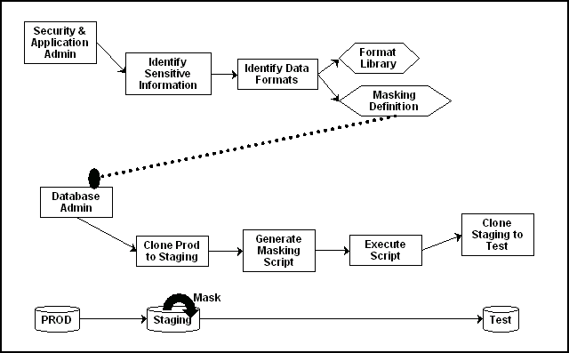

## 16 Masking Sensitive Data

This chapter provides conceptual information about the components that comprise Oracle Data Masking, and procedural information about performing the task sequence, such as creating masking formats and masking definitions. Topics discussed include:

The procedures in this chapter are applicable to Oracle Enterprise Manager 12.1 and higher Cloud Control only. You must have the Oracle Data Masking and Subsetting Pack license to use data masking features.

Note:

Performing masking on an 11.2.0.3 database that uses Database Plug-in 12.1.0.3 or higher requires that database patch # 16922826 be applied for masking to run successfully.

## 16.1 Overview of Oracle Data Masking

Enterprises run the risk of breaching sensitive information when copying production data into non-production environments for the purposes of application development, testing, or data analysis. Oracle Data Masking helps reduce this risk by irreversibly replacing the original sensitive data with fictitious data so that production data can be shared safely with non-production users. Accessible through Oracle Enterprise Manager, Oracle Data Masking provides end-to-end secure automation for provisioning test databases from production in compliance with regulations.

### 16.1.1 Data Masking Concepts

Data masking (also known as data scrambling and data anonymization) is the process of replacing sensitive information copied from production databases to test non-production databases with realistic, but scrubbed, data based on masking rules. Data masking is ideal for virtually any situation when confidential or regulated data needs to be shared with non-production users. These users may include internal users such as application developers, or external business partners such as offshore testing companies, suppliers and customers. These non-production users need to access some of the original data, but do not need to see every column of every table, especially when the information is protected by government regulations.

Data masking enables organizations to generate realistic and fully functional data with similar characteristics as the original data to replace sensitive or confidential information. This contrasts with encryption or Virtual Private Database, which simply hides data, and the original data can be retrieved with the appropriate access or key. With data masking, the original sensitive data cannot be retrieved or accessed.

Names, addresses, phone numbers, and credit card details are examples of data that require protection of the information content from inappropriate visibility. Live production database environments contain valuable and confidential data—access to this information is tightly controlled. However, each production system usually has replicated development copies, and the controls on such test environments are less stringent. This greatly increases the risks that the data might be used inappropriately. Data masking can modify sensitive database records so that they remain usable, but do not contain confidential or personally identifiable information. Yet, the masked test data resembles the original in appearance to ensure the integrity of the application.

### 16.1.2 Security and Regulatory Compliance

Masked data is a sensible precaution from a business security standpoint, because masked test information can help prevent accidental data escapes. In many cases, masked data is a legal obligation. The Enterprise Manager Data Masking Pack can help organizations fulfill legal obligations and comply with global regulatory requirements, such as Sarbanes-Oxley, the California Database Security Breach Notification Act (CA Senate Bill 1386), and the European Union Data Protection Directive.

The legal requirements vary from country to country, but most countries now have regulations of some form to protect the confidentiality and integrity of personal consumer information. For example, in the United States, The Right to Financial Privacy Act of 1978 creates statutory Fourth Amendment protection for financial records, and a host of individual state laws require this. Similarly, the U.S. Health Insurance Portability and Accountability Act (HIPAA) created protection of personal medical information.

### 16.1.3 Roles of Data Masking Users

The following types of users participate in the data masking process for a typical enterprise:

- Application database administrator or application developer
	This user is knowledgeable about the application and database objects. This user may add additional custom database objects or extensions to packaged applications, such as the Oracle E-Business suite.
- Information security administrator
	This user defines information security policies, enforces security best practices, and also recommends the data to be hidden and protected.

### 16.1.5 Agent Compatibility for Data Masking

Data Masking supports Oracle Database 9i and newer releases. If you have a version prior to 11.1, you can use it by implementing the following work-around.

Replace the following file...

```
AGENT_HOME/sysman/admin/scripts/db/reorg/reorganize.pl
```

... with this file:

```
OMS_HOME/sysman/admin/scripts/db/reorg/reorganize.pl
```

### 16.1.6 Supported Data Types

The list of supported data types varies by release.

- Grid Control 10g Release 5 (10.2.0.5), Database 11g Release 2 (11.2), and Cloud Control 12c Release 1 (10.2.0.1)
	- Numeric Types
		The following Numeric Types can use Array List, Delete, Fixed Number, Null Value, Post Processing Function, Preserve Original Data, Random Decimal Numbers, Random Numbers, Shuffle, SQL Expression, Substitute, Table Column, Truncate, Encrypt, and User Defined Function formats:
		- `NUMBER`
				- `FLOAT`
				- `RAW`
				- `BINARY_FLOAT`
				- `BINARY_DOUBLE`
		- String Types
		The following String Types can use Array List, Delete, Fixed Number, Fixed String, Null Value, Post Processing Function, Preserve Original Data, Random Decimal Numbers, Random Digits, Random Numbers, Random Strings, Shuffle, SQL Expression, Substitute, Substring, Table Column, Truncate, Encrypt, and User Defined Function formats:
		- `CHAR`
				- `NCHAR`
				- `VARCHAR2`
				- `NVARCHAR2`
		- Date Types
		The following Date Types can use Array List, Delete, Null Value, Post Processing Function, Preserve Original Data, Random Dates, Shuffle, SQL Expression, Substitute, Table Column, Truncate, Encrypt, and User Defined Function formats:
		- `DATE`
				- `TIMESTAMP`
- Grid Control 11g Release 1 (11.1) and Cloud Control 12c Release 1 (10.2.0.1)
	- Large Object (LOB) Data Types
		The following Data Types can use Fixed Number, Fixed String, and Null Value formats:
		- BLOB
				- CLOB
				- NCLOB

## 16.2 Format Libraries and Masking Definitions

To mask data, the Data Masking Pack provides two main features:

- Masking format library
	The format library contains a collection of ready-to-use masking formats. The library consists of format routines that you can use for masking. A masking format can either be one that you create, or one from the list of Oracle-supplied default masking formats.
	As a matter of best practice, organizations should create masking formats for all commonly regulated information so that the formats can be applied to the sensitive data regardless of which database the sensitive data resides in. This ensures that all sensitive data is consistently masked across the entire organization.
- Masking definitions
	A masking definition defines a data masking operation to be implemented on one or more tables in a database. Masking definitions associate table columns with formats to use for masking the data. They also maintain the relationship between columns that are not formally declared in the database using related columns.
	You can create a new masking definition or use an existing definition for a masking operation. To create a masking definition, you specify the column of the table for which the data should be masked and the format of masked data. If the columns being masked are involved in unique, primary key, or foreign key constraints, data masking generates the values so that the constraints are not violated. Masking ensures uniqueness per character using decimal arithmetic. For example, a 5-character string generates a maximum of only 99999 unique values. Similarly, a 1-character string generates a maximum of only 9 unique values.
	You would typically export masking definitions to files and import them on other systems. This is important when the test and production sites reside on different Oracle Management Systems or on entirely different sites.

See Also:

- "Creating a Data Masking Definition" in the Enterprise Manager online help as well as the help for each Data Masking page

## 16.3 Recommended Data Masking Workflow

Figure 16-1 shows that the production database is cloned to a staging region and then masked there. During the masking process, the staging and test areas are tightly controlled like a production site.

Figure 16-1 Data Masking Workflow



> The Data Masking workflow is shown. The diagram is a flowchart with two workflows. In the top workflow, Security & Application Admin points to Identify Sensitive Information, then Identify Data Formats, then branches to Format Library (branch ends) and Masking Definition. The Masking Definition branch points to Database Admin, then Clone Prod to Staging, then Generate Masking Script, then Execute Script, then Clone Staging to Test.
>
> In the bottom workflow, the PROD database points to the Staging database (Mask is shown being applied to the Staging database), then the Test database.
>
> End of description.
  

Data masking is an iterative and evolving process handled by the security administrator and implemented by the database administrator. When you first configure data masking, try out the masking definition on a test system, then add a greater number of columns to the masking definition and test it to make sure it functions correctly and does not break any application constraints. During this process, you should exercise care when removing all imbedded references to the real data while maintaining referential integrity.

After data masking is configured to your satisfaction, you can use the existing definition to repeatedly mask after cloning. The masking definition, however, would need to evolve as new schema changes require new data and columns to be masked.

After the masking process is complete, you can distribute the database for wide availability. If you need to ship the database to another third-party site, you are required to use the Data Pump Export utility, and then ship the dump file to the remote site. However, if you are retaining the masked data in-house, see "Data Masking Task Sequence".

## 16.4 Data Masking Task Sequence

The task sequence in this section demonstrates the data masking workflow and refers you to additional information about some of the tasks in the sequence. Before reviewing this sequence, note that there are two options for completing this process:

- Exporting/importing to another database
	You can clone the production database to a staging area, mask it, then export/ import it to another database before delivering it to in-house testers or external customers. This is the most secure approach.
- Making the staging area the new test region
	You can clone the production database to a mask staging area, then make the staging area the new test region. In this case, you should not grant testers `SYSDBA` access or access to the database files. Doing so would compromise security. The masked database contains the original data in unused blocks and in the free list. You can only purge this information by exporting/importing the data to another database.

The following basic steps guide you through the data masking process, with references to other sections for supporting information.

1. Review the application database and identify the sources of sensitive information.
2. Define mask formats for the sensitive data. The mask formats may be simple or complex depending on the information security needs of the organization.
	For more information, see "Creating New Masking Formats" and "Using Oracle-supplied Predefined Masking Formats".
3. Create a masking definition to associate table columns to these mask formats. Data masking determines the database foreign key relationships and adds foreign key columns to the mask.
	For more information, see "Masking with an Application Data Model and Workloads".
4. Save the masking definition and generate the masking script.
5. Verify if the masked data meets the information security requirements. Otherwise, refine the masking definition, restore the altered tables, and reapply the masking definition until the optimal set of masking definitions has been identified.
6. Clone the production database to a staging area, selecting the masking definition to be used after cloning. Note that you can clone using Enterprise Manager, which enables you to add masking to the Enterprise Manager clone workflow. However, if you clone outside of Enterprise Manager, you must initiate masking from Enterprise Manager after cloning is complete. The cloned database should be controlled with the same privileges as the production system, because it still contains sensitive production data.
	After cloning, be sure to change the passwords as well as update or disable any database links, streams, or references to external data sources. Back up the cloned database, or minimally the tables that contain masked data. This can help you restore the original data if the masking definition needs to be refined further.
	For more information, see "Cloning the Production Database".
7. After masking, test all of your applications, reports, and business processes to ensure they are functional. If everything is working, you can export the masking definition to keep it as a back-up.
8. After masking the staging site, make sure to drop any tables named `MGMT_DM_TT` before cloning to a test region. These temporary tables contain a mapping between the original sensitive column value and the mask values, and are therefore sensitive in nature.
	During masking, Enterprise Manager automatically drops these temporary tables for you with the default "Drop temporary tables created during masking" option. However, you can preserve these temporary tables by deselecting this option. In this case, you are responsible for deleting the temporary tables before cloning to the test region.
9. After masking is complete, ensure that all tables loaded for use by the substitute column format or table column format are going to be dropped. These tables contain the mask values that table column or substitute formats will use. It is recommended that you purge this information for security reasons.
	For more information, see "Deterministic Masking Using the Substitute Format".
10. Clone the database to a test region, or use it as the new test region. When cloning the database to an external or unsecured site, you should use Export or Import. Only supply the data in the database, rather than the database files themselves.
11. As part of cloning production for testing, provide the masking definition to the application database administrator to use in masking the database.

## 16.5 Defining Masking Formats

A masking definition requires one or more masking formats for any columns included in the masking definition. When adding columns to a masking definition, you can either create masking formats manually or import them from the format library. It is often more efficient to work with masking formats from the format library.

### 16.5.1 Creating New Masking Formats

This section describes how to create new masking formats using Enterprise Manager.

To create a masking format in the format library:

1. From the Enterprise menu, select Quality Management, then Data Masking Formats. Alternatively, if you are in the Database home page, select Data Masking Format Library from the Schema menu.
	The Format Library appears with predefined formats that Oracle Enterprise Manager provides.
2. Click Create.
	The Create Format page appears, where you can define a masking format.
	Tip:
	For information on page user controls, see the online help for the Format page.
3. Provide a required name for the new format, select a format entry type from the Add list, then click Go.
	A page appears that enables you to provide input for the format entry you have selected. For instance, if you select Array List, the subsequent page enables you to enter a list of values, such as New York, New Jersey, and New Hampshire.
4. Continue adding additional format entries as needed.
5. When done, provide an optional user-defined or post-processing function (see "Providing User-defined and Post-processing Functions"), then click OK to save the masking format.
	The Format Library page reappears with your newly created format displayed in the Format Library table. You can use this format later to mask a column of the same sensitive type.
	Tip:
	For information on page user controls, see the online help for the Format Library and Create Format pages.

#### 16.5.1.1 Providing User-defined and Post-processing Functions

If desired, you can provide user-defined and post-processing functions on the Create Format page. A user-defined choice is available in the Add list, and a post-processing function field is available at the bottom of the page.

- User-defined functions
	To provide a user-defined function, select User Defined Function from the Add list, then click Go to access the input fields.
	A user-defined function passes in the original value as input, and returns a mask value. The data type and uniqueness of the output values must be compatible with the original output values. Otherwise, a failure occurs when the job runs. Combinable, a user-defined function is a PL/SQL function that can be invoked in a `SELECT` statement. Its signature is returned as:
	```
	Function udf_func (rowid varchar2, column_name varchar2, original_value varchar2) returns varchar2;
	```
	- `rowid` is the min (rowid) of the rows that contain the value `original_value` 3rd argument.
		- `column_name` is the name of the column being masked.
		- `original_value` is the value being masked.
	That is, it accepts the original value as an input string, and returns the mask value.
	Both input and output values are varchar2. For instance, a user-defined function to mask a number could receive 100 as input, the string representation of the number 100, and return 99, the string representation of the number 99. Values are cast appropriately when inserting to the table. If the value is not castable, masking fails.
- Post-processing functions
	To provide a post-processing function, enter it in the Post Processing Function field.
	A post-processing function has the same signature as a user-defined function, but passes in the mask value the masking engine generates, and returns the mask value that should be used for masking, as shown in the following example:
	```
	Function post_proc_udf_func (rowid varchar2, column_name varchar2, mask_value varchar2) returns varchar2;
	```
	- `rowid` is the min (rowid) of the rows that contain the value `mask_value`.
		- `column_name` is the name of the column being masked.
		- `mask_value` is the value being masked.

#### 16.5.1.2 Using Masking Format Templates

After you have created at least one format, you can use the format definition as a template in the Create Format page, where you can implement most of the format using a different name and changing the entries as needed, rather than needing to create a new format from scratch.

To create a new format similar to an existing format, select a format on the Format Library page and click Create Like. The masking format you select can either be one you have previously defined yourself, or one from the list of out-of-box masking formats. You can use these generic masking format definitions for different applications.

For instructional details about the various Oracle-supplied predefined masking format definitions and how to modify them to suit your needs, see "Using Oracle-supplied Predefined Masking Formats".

### 16.5.2 Using Oracle-supplied Predefined Masking Formats

Enterprise Manager provides several out-of-box predefined formats. All predefined formats and built-in formats are random. The following sections discuss the various Oracle-supplied format definitions and how to modify them to suit your needs:

- Patterns of Format Definitions
- Category Definitions
- Installing the DM\_FMTLIB Package

Tip:

For information on installing the DM\_FMTLIB package so that you can use the predefined masking formats, see "Installing the DM\_FMTLIB Package".

#### 16.5.2.1 Patterns of Format Definitions

All of the format definitions adhere to these typical patterns:

- Generate a random number or random digits.
- Perform post-processing on the above-generated value to ensure that the final result is a valid, realistic value.

For example, a valid credit card number must pass Luhn's check. That is, the last digit of any credit card number is a checksum digit, which is always computed. Also, the first few digits indicate the card type (MasterCard, Amex, Visa, and so forth). Consequently, the format definition of a credit card would be as follows:

- Generate random and unique 10-digit numbers.
- Using a post-processing function, transform the values above to a proper credit card number by adding well known card type prefixes and computing the last digit.

This format is capable of generating 10 billion unique credit card numbers.

#### 16.5.2.2 Category Definitions

The following sections discuss different categories of these definitions:

- Credit Card Numbers
- United States Social Security Numbers
- ISBN Numbers
- UPC Numbers
- Canadian Social Insurance Numbers
- North American Phone Numbers

By default, these mask formats are also available in different format styles, such as a hyphen ( - ) format. If needed, you can modify the format style.

##### 16.5.2.2.1 Credit Card Numbers

Out of the box, the format library provides many different formats for credit cards. The credit card numbers generated by these formats pass the standard credit card validation tests by the applications, thereby making them appear like valid credit card numbers.

Some of the credit card formats you can use include:

- MasterCard numbers
- Visa card numbers
- American Express card numbers
- Discover Card numbers
- Any credit card number (credit card numbers belong to all types of cards)

You may want to use different styles for storing credit card numbers, such as:

- Pure numbers
- 'Space' for every four digits
- 'Hyphen' ( - ) for every four digits, and so forth

To implement the masked values in a certain format style, you can set the `DM_CC_FORMAT` variable of the `DM_FMTLIB` package. To install the package, see "Installing the DM\_FMTLIB Package".

##### 16.5.2.2.3 ISBN Numbers

Using the format library, you can generate either 10-digit or 13-digit ISBN numbers. These numbers adhere to standard ISBN number validation tests. All of these ISBN numbers are random in nature. Similar to other format definitions, you can affect the "style" of the ISBN format by setting values to `DM_ISBN_FORMAT`.

##### 16.5.2.2.4 UPC Numbers

Using the format library, you can generate valid UPC numbers. They adhere to standard tests for valid UPC numbers. You can affect the formatting style by setting the `DM_UPC_FORMAT` value of the `DM_FMTLIB` package.

##### 16.5.2.2.6 North American Phone Numbers

Out of the box, the format library provides various possible U.S. and Canadian phone numbers. These are valid, realistic looking numbers that can pass standard phone number validation tests employed by applications. You can generate the following types of numbers:

- Any North American phone numbers
- Any Canadian phone number
- Any U.S.A. phone number

#### 16.5.2.3 Installing the DM\_FMTLIB Package

The predefined masking formats use functions defined in the `DM_FMTLIB` package. This package is automatically installed in the `DBSNMP` schema of your Enterprise Manager repository database. To use the predefined masking formats on a target database (other than the repository database), you must manually install the `DM_FMTLIB` package on that database.

To install the DM\_FMTLIB package:

1. Locate the following scripts in your Enterprise Manager installation:
	```
	$PLUGIN_HOME/sql/db/latest/masking/dm_fmtlib_pkgdef.sql
	$PLUGIN_HOME/sql/db/latest/masking/dm_fmtlib_pkgbody.sql
	```
	Where PLUGIN\_HOME can be any of the locations returned by the following SQL SELECT statement, executed as SYSMAN:
	```
	select PLUGIN_HOME from gc_current_deployed_plugin where plugin_id='oracle.sysman.db' and destination_type='OMS';
	```
2. Copy these scripts to a directory in your target database installation and execute them using SQL\*Plus, connected as a user that can create packages in the DBSNMP schema.
	You can now use the predefined masking formats in your masking definitions.
3. Select and import any predefined masking format into a masking definition by clicking the Import Format button on the Define Column Mask page.

### 16.5.3 Providing a Masking Format to Define a Column

When you create a masking definition ("Masking with an Application Data Model and Workloads"), you will be either importing a format or selecting one from the available types in the Define Column Mask page. Format entry options are as follows:

- Array List
	The data type of each value in the list must be compatible with that of the masked column. Uniqueness must be guaranteed if needed. For example, for a unique key column that already has 10 distinct values, the array list should also contain at least 10 distinct values.
- Delete
	Deletes the specified rows as identified by the condition clauses. If a column includes a delete format for one of its conditions, a foreign key constraint or a dependent column cannot refer to the table.
- Encrypt
	Encrypts column data by specifying a regular expression. The column values in all the rows must match the regular expression. This format can be used to mask data consistently across databases. That is, for a given value it always generates the same masked value.
	For example, the regular expression \[(\]\[1-9\]\[0-9\]{2}\[)\]\[\_\]\[0-9\]{3}\[-\]\[0-9\]{4} generates U.S. phone numbers such as (123) 456-7890.
	This format supports a subset of the regular expression language. It supports encrypting strings of fixed widths. However, it does not support \* or + syntax of regular expressions.
	If a value does not match the format specified, the encrypted value may no longer produce one-to-one mappings. All non-confirming values are mapped to a single encrypted value, thereby producing a many-to-one mapping.
- Fixed Number
	The type of column applicable to this entry is a `NUMBER` column or a `STRING` column. For example, if you mask a column that has a social security number, one of the entries can be Fixed Number 900. This format is combinable.
- Fixed String
	The type of column applicable to this entry is a `STRING` column. For example, if you mask a column that has a License Plate Number, one of the entries can be Fixed String CA. This format is combinable.
- Null Value
	Masks the column using a value of `NULL`. The column must be nullable.
- Post-Processing Function
	This is a special function that you can apply to the mask value that the masking engine generates. This function takes the mask value as input and returns the actual mask value to be used for masking.
	The post-processing function is called after the mask value is generated. You can use it, for instance, to add commas or dollar signs to a value. For example, if a mask value is a number such as 12000, the post processing function can modify this to $12,000. Another use is for adding checksums or special encodings for the mask value that is produced.
	In the following statement:
	```
	Function post_proc_udf_func (rowid varchar2, column_name varchar2, mask_value varchar2) returns varchar2;
	```
	- `rowid` is the min (rowid) of the rows that contains the value `mask_value` 3rd argument.
		- `column_name` is the name of the column being masked.
		- `mask_value` is the value being masked.
- Preserve Original Data
	Retains the original values for rows that match the specified condition clause. This is used in cases where some rows that match a condition do not need to be masked.
- Random Dates
	The uniqueness of the Date column is not maintained after masking. This format is combinable.
- Random Digits
	This format generates unique values within the specified range. For example, for a random digit with a length of \[5,5\], an integer between \[0, 99999\] is randomly generated, left padded with '0's to satisfy the length and uniqueness requirement. This is a complementary type of random number, which will not be padded. When using random digits, the random digit pads to the appropriate length in a string. It does not pad when used for a number column. This format is combinable.
	Data masking ensures that the generated values are unique, but if you do not specify enough digits, you could run out of unique values in that range.
- Random Numbers
	If used as part of a mixed random string, these have limited usage for generating unique values. This format generates unique values within the specified range. For example, a starting value of 100 and ending value of 200 generates an integer number ranging from 100 to 200, both inclusive. Note that Oracle Enterprise Manager release 10.2.0.4.0 does not support float numbers. This format is combinable.
- Random Strings
	This format generates unique values within the specified range. For example, a starting length of 2 and ending length of 6 generates a random string of 2 - 6 characters in length. This format is combinable.
- Shuffle
	This format randomly shuffles the original column data. It maintains data distribution except when a column is conditionally masked and its values are not unique.
	For more information, see "Using the Shuffle Format".
- Substitute
	This format uses a hash-based substitution for the original value and always yields the same mask value for any given input value. Specify the substitution masking table and column. This format has the following properties:
	- The masked data is not reversible. That is, this format is not vulnerable to external security breaches because the original value is replaced, so it is not possible to retrieve the original value from the mask value.
		- Masking multiple times with a hash substitute across different databases yields the same mask value. This characteristic is valid across multiple databases or multiple runs assuming that the same substitution values are used in the two runs. That is, the actual rows and values in the substitution table do not change. For example, suppose the two values Joe and Tom were masked to Henry and Peter. When you repeat the same mask on another database using the same substitution table, if there were Bob and Tom, they might be replaced with Louise and Peter. Notice that even though the two runs have different data, Tom is always replaced with Peter.
		- This format does not generate uniqueness.
- Substring
	Substring is similar to the database `substr` function. The start position can be either a positive or a negative integer. For example, if the original string is `abcd`, a substring with a start position of 2 and length of 3 generates a masked string of bcd. A substring with start position of -2 and length of 3 generates a masked string of cd. This format is combinable.
- Table Column
	A table column enables you to select values from the chosen column as the replacement value or part thereof. The data type and uniqueness must be compatible. Otherwise, a failure occurs when the job runs. This format is combinable.
- Truncate
	Truncates all rows in a table. If one of the columns in a table is marked as truncated, the entire table is truncated, so no other mask formats can be specified for any of the other columns. If a table is being truncated, it cannot be referred to by a foreign key constraint or a dependent column.
- User Defined Function
	The data type and uniqueness of the output values must be compatible with the original output values. Otherwise, a failure occurs when the job runs.
	In the following statement:
	```
	Function udf_func (rowid varchar2, column_name varchar2, original_value varchar2) returns varchar2;
	```
	- `rowid` is the min (rowid) of the rows that contain the value `original_value` 3rd argument.
		- `column_name` is the name of the column being masked.
		- `original_value` is the value being masked.

### 16.5.4 Deterministic Masking Using the Substitute Format

You may occasionally need to consistently mask multiple, distinct databases. For instance, if you run HR, payroll, and benefits that have an employee ID concept on three separate databases, the concept may be consistent for all of these databases, in that an employee's ID can be selected to retrieve the employee's HR, payroll, or benefits information. Based on this premise, if you were to mask the employee's ID because it actually contains his/her social security number, you would have to mask this consistently across all three databases.

Deterministic masking provides a solution for this problem. You can use the Substitute format to mask employee ID column(s) in all three databases. The Substitute format uses a table of values from which to substitute the original value with a mask value. As long as this table of values does not change, the mask is deterministic or consistent across the three databases.

Tip:

For more information on the Substitute format, see the online help for the Define Column Mask page.

## 16.6 Masking with an Application Data Model and Workloads

Before creating a masking definition, note the following prerequisites and advisory information:

- Ensure that you have the following minimum privileges for data masking:
	- EM\_ALL\_OPERATOR for Enterprise Manager Cloud Control users
		- SELECT\_CATALOG\_ROLE for database users
		- Select Any Dictionary privilege for database users
		- Execute privileges for the DBMS\_CRYPTO package
- Ensure the format you select does not violate check constraints and does not break any applications that use the data.
- For triggers and PL/SQL packages, data masking recompiles the object.
- Exercise caution when masking partitioned tables, especially if you are masking the partition key. In this circumstance, the row may move to another partition.
- Data Masking does not support clustered tables, masking information in object tables, XML tables, and virtual columns. Relational tables are supported for masking.
- If objects are layered on top of a table such as views, materialized views, and PL/SQL packages, they are recompiled to be valid.

If you plan to mask a test system intended for evaluating performance, the following practices are recommended:

- Try to preserve the production statistics and SQL profiles after masking by adding a pre-masking script to export the SQL profiles and statistics to a temporary table, then restoring after masking completes.
- Run a SQL Performance Analyzer evaluation to understand the masking impact on performance. Any performance changes other than what appears in the evaluation report are usually related to application-specific changes on the masked database.

To create a masking definition:

1. From the Enterprise menu, select Quality Management, then Data Masking Definitions.
	The Data Masking Definitions page appears, where you can create and schedule new masking definitions and manage existing masking definitions.
	Tip:
	For information on page user controls, see the online help for the Data Masking Definitions page.
2. Click Create to go to the Create Masking Definition page.
	A masking definition includes information regarding table columns and the format for each column. You can choose which columns to mask, leaving the remaining columns intact.
	Tip:
	For information on page user controls, see the online help for the Create Masking Definition page.
3. Provide a required Name, Application Data Model, and Reference Database.
	When you click the search icon and select an Application Data Model (ADM) name from the list, the system automatically populates the Reference Database field.
	- Optional: Check Ensure Workload Masking Compatibility if you want to mask Capture files and SQL Tuning Sets.
		When you enable this check box, the masking definition is evaluated to determine if the SQL Expression format or conditional masking is being used. If either is in use when you click OK, the option becomes unchecked and an error message appears asking you to remove these items before selecting this option.
		Note:
		Before proceeding to the next step, one or more sensitive columns must already be defined in the Application Data Model. See ["Managing Sensitive Column Types"](tdm_data_disc_modeling.md) for more information.
4. Click Add to go to the Add Columns page, where you can choose which sensitive columns in the ADM you want to mask.
	Tip:
	For information on page user controls, see the online help for the Add Columns page.
5. Enter search criteria, then click Search.
	The sensitive columns you defined in the ADM appear in the table below.
6. Either select one or more columns for later formatting on the Create Masking Definition page, or formatting now if the data types of the columns you have selected are identical.
	Tip:
	For information on data types, see "Supported Data Types".
7. Optional: if you want to mask selected columns as a group, enable Mask selected columns as a group. The columns that you want to mask as a group must all be from the same table.
	Enable this check box if you want to mask more than one column together, rather than separately. When you select two or more columns and then later define the format on the Define Group Mask page, the columns appear together, and any choices you make for format type or masking table apply collectively to all of the columns.
	After you define the group and return to this page, the Column Group column in the table shows an identical number for each entry row in the table for all members of the group. For example, if you have defined your first group containing four columns, each of the four entries in this page will show a number 1 in the Column Group column. If you define another group, the entries in the page will show the number 2, and so forth. This helps you to distinguish which columns belong to which column groups.
8. Either click Add to add the column to the masking definition, return to the Create Masking Definition page and define the format of the column later, or click Define Format and Add to define the format for the column now.
	The Define Format and Add feature can save you significant time. When you select multiple columns to add that have the same data type, you do not need to define the format for each column as you would when you click Add. For instance, if you search for Social Security numbers (SSN) and the search yields 100 SSN columns, you could select them all, then click Define Format and Add to import the SSN format for all of them.
9. Do one of the following:
	- If you clicked Add in the previous step:
		You will eventually need to define the format of the column in the Create Masking Definition page before you can continue. When you are ready to do so, click the icon in the page Format column for the column you want to format. Depending on whether you decided to mask selected columns as a group on the Add Columns page, either the Define Column mask or Define Group mask appears. Read further in this step for instructions for both cases.
		- If you clicked Define Format and Add in the previous step and did not check Mask selected columns as a group:
		The Define Column Mask page appears, where you can define the format for the column before adding the column to the Create Masking Definition page, as explained below:
		- Provide a format entry for the required Default condition by either selecting a format entry from the list and clicking Add, or clicking Import Format, selecting a predefined format on the Import Format page, then clicking Import.
			The Import Format page displays the formats that are marked with the same sensitive type as the masked column.
			For information about Oracle-supplied predefined masking format definitions, see "Using Oracle-supplied Predefined Masking Formats".
			For descriptions of the choices available in the Format Entry list, see "Providing a Masking Format to Define a Column".
				- Add another condition by clicking Add Condition to add a new condition row, then provide one or more format entries as described in the previous step.
				- When you have finished formatting the column, click OK to return to the Create Masking Definition page.
		- If you clicked Define Format and Add in the previous step and checked Mask selected columns as a group:
		The Define Group Mask page appears, where you can add format entries for group columns that appear in the Create Masking Definition page, as explained below:
		- Select one of the available format types. For complete information on the format types, see the online help for the Defining the Group Masking Format topic.
			For descriptions of the choices available in the Format Entry list, see "Providing a Masking Format to Define a Column".
				- Optionally add a column to the group.
				- When you have finished formatting the group, click OK to return to the Create Masking Definition page.
			Your configuration appears in the Columns table. The sensitive columns you selected earlier now appear on this page. The selected columns are the primary key, and the foreign key columns are listed below. These columns are masked as well.
10. Expand Show Advanced Options and decide whether the selected default data masking options are satisfactory.
	For more information, see "Selecting Data Masking Advanced Options".
11. Click OK to save your definition and return to the Data Masking Definitions page.
	At this point, super administrators can see each other's masking definitions.
12. Select the definition and click Generate Script to view the script for the list of database commands used to mask the columns you selected earlier.
	This process checks whether sufficient disk space is available for the operation, and also determines the impact on other destination objects, such as users, after masking. After the process completes, the Script Generation Results page appears, enabling you to do the following:
	- Save the entire PL/SQL script to your desktop, if desired.
		- Clone and mask the database using the Clone Database wizard (this requires a Database Lifecycle Management Pack license).
		- Schedule the data masking job without cloning.
		- View errors and warnings, if any, in the impact report.
	Tip:
	For information on page user controls, see the online help for the Script Generation Results page.
	Note:
	If any tables included in the masking definition have columns of data type `LONG`, a warning message may appear. For more information, see "Using Data Masking with LONG Columns".
13. Do one of the following:
	- If you are working with a production database, click Clone and Mask to clone and mask the database you are currently working with to ensure that you do not mask your production database.
		The Clone and Mask feature requires a Database Lifecycle Management Pack license.
		For more information, see "Cloning the Production Database".
		- If you are already working with a test database and want to directly mask the data in this database, click Schedule Job.
		- Provide the requisite information and desired options. You can specify the database at execution time to any database. The system assumes that the database you select is a clone of the source database. By default, the source database from the ADM is selected.
				- Click Submit.
			The Data Masking Definitions page appears. The job has been submitted to Enterprise Manager and the masking process appears. The Status column on this page indicates the current stage of the process.
		Tip:
		For information on page user controls, see the online help for Scheduling a Data Masking Job.

### 16.6.1 Estimating Space Requirements for Masking Operations

Here are some guidelines for estimating space requirements for masking operations. These estimates are based on a projected largest table size of 500GB. In making masking space estimates, assume a "worst-case scenario."

- For in-place masking:
	- 2 \* 500GB for the mapping table (the mapping table stores both the original and the masked columns. Worse case is every column is to be masked).
		- 2 \* 500GB to accommodate both the original and the masked tables (both exist in the database at some point during the masking process).
		- 2 \* 500GB for temporary tablespace (needed for hash joins, sorts, and so forth).
	Total space required for the worst case: 3TB.
- For at-source masking:
	- 2 \* 500GB for the mapping table (as for in-place masking).
		- 2 \* 500GB for temporary tablespace (as for in-place masking).
		- Sufficient file system space to accommodate the dump file.
	Total space required for the worst case: 2TB plus the necessary file system space.

In either case, Oracle recommends that you set the temp and undo tablespaces to auto extend.

You can specify a tablespace for mapping tables during script generation. If you do not specify a tablespace, the tables are created in the tablespace of the executing user. There are some situations, for example when using the shuffle format, that do not require a mapping table. In these cases, updates to the original table happen in-line.

### 16.6.2 Adding Dependent Columns

Dependent columns are defined by adding them to the Application Data Model. The following prerequisites apply for the column to be defined as dependent:

- A valid dependent column should not already be included for masking.
- The column should not be a foreign key column or referenced by a foreign key column.
- The column data should conform to the data in the parent column.

If the column does not meet these criteria, an "Invalid Dependent Columns" message appears when you attempt to add the dependent column.

### 16.6.3 Masking Dependent Columns for Packaged Applications

The following procedure explains how to mask data across columns for packaged applications in which the relationships are not defined in the data dictionary.

To mask dependent columns for packaged applications:

1. Go to Data Discovery and Modeling and create a new Application Data Model (ADM) using metadata collection for your packaged application suite.
	When metadata collection is complete, edit the newly created ADM.
2. Manually add a referential relationship:
	1. From the Referential Relationships tab, open the Actions menu, then select Add Referential Relationship.
		The Add Referential Relationship pop-up window appears.
		2. Select the requisite Parent Key and Dependent Key information.
		3. In the Columns Name list, select a dependent key column to associate with a parent key column.
		4. Click OK to add the referential relationship to the ADM.
		The new dependent column now appears in the referential relationships list.
3. Perform sensitive column discovery.
	When sensitive column discovery is complete, review the columns found by the discovery job and mark them sensitive or not sensitive as needed.
	When marked as sensitive, any discovery sensitive column also marks its parent and the other child columns of the parent as sensitive. Consequently, it is advisable to first create the ADM with all relationships. ADM by default, or after running drivers, may not contain denormalized relationships. You need to manually add these.
	For more information about sensitive column discovery, see step [6](tdm_data_disc_modeling.md).
4. Go to Data Masking and create a new masking definition.
5. Select the newly created ADM and click Add, then Search to view this ADM's sensitive columns.
6. Select columns based on your search results, then import formats for the selected columns.
	Enterprise Manager displays formats that conform to the privacy attributes.
7. Select the format and generate the script.
8. Execute the masking script.
	Enterprise Manager executes the generated script on the target database and masks all of your specified columns.

### 16.6.4 Selecting Data Masking Advanced Options

The following options on the Masking Definitions page are all checked by default, so you need to uncheck the options that you do not want to enable:

- Data Masking Options
- Random Number Generation
- Pre- and Post-mask Scripts

#### 16.6.4.1 Data Masking Options

The data masking options include:

- Disable redo log generation during masking
	Masking disables redo logging and flashback logging to purge any original unmasked data from logs. However, in certain circumstances when you only want to test masking, roll back changes, and retry with more mask columns, it is easier to uncheck this box and use a flashback database to retrieve the old unmasked data after it has been masked. You can use Enterprise Manager to flashback a database.
	Note:
	Disabling this option compromises security. You must ensure this option is enabled in the final mask performed on the copy of the production database.
- Refresh statistics after masking
	If you have already enabled statistics collection and would like to use special options when collecting statistics, such as histograms or different sampling percentages, it is beneficial to turn off this option to disable default statistics collection and run your own statistics collection jobs.
- Drop temporary tables created during masking
	Masking creates temporary tables that map the original sensitive data values to mask values. In some cases, you may want to preserve this information to track how masking changed your data. Note that doing so compromises security. These tables must be dropped before the database is available for unprivileged users.
- Decrypt encrypted columns
	This option decrypts columns that were previously masked using Encrypt format. To decrypt a previously encrypted column, the seed value must be the same as the value used to encrypt.
	Decrypt only recovers the original value if the original format used for the encryption matches the original value. If the originally encrypted value did not conform to the specified regular expression, when decrypted, the encrypted value cannot reproduce the original value.
- Use parallel execution when possible
	Oracle Database can make parallel various SQL operations that can significantly improve their performance. Data Masking uses this feature when you select this option. You can enable Oracle Database to automatically determine the degree of parallelism, or you can specify a value. For more information about using parallel execution and the degree of parallelism, see [Oracle Database Data Warehousing Guide](https://docs.oracle.com/cd/E11882_01/server.112/e25554/toc.htm).

#### 16.6.4.2 Random Number Generation

The random number generation options include:

- Favor Speed
	The `DBMS_RANDOM` package is used for random number generation.
- Favor Security
	The `DBMS_CRYPTO` package is used for random number generation. Additionally, if you use the Substitute format, a seed value is required when you schedule the masking job or database clone job.

#### 16.6.4.3 Pre- and Post-mask Scripts

When masking a test system to evaluate performance, it is beneficial to preserve the object statistics after masking. You can accomplish this by adding a pre-masking script to export the statistics to a temporary table, then restoring them with a post-masking script after masking concludes.

Use the Pre Mask Script text box to specify any user-specified SQL script that must run before masking starts.

Use the Post Mask Script text box to specify any user-specified SQL script that must run after masking completes. Since masking modifies data, you can also perform tasks, such as rebalancing books or calling roll-up or aggregation modules, to ensure that related or aggregate information is consistent.

The following examples show pre- and post-masking scripts for preserving statistics.

Example 16-1 Pre-masking Script for Preserving Statistics

```
variable sts_task  VARCHAR2(64);

/*Step :1 Create the staging table for statistics*/

exec dbms_stats.create_stat_table(ownname=>'SCOTT',stattab=>'STATS');
 
/* Step 2: Export the table statistics into the staging table. Cascade results in
all index and column statistics associated with the specified table being exported
as well. */
 
exec
dbms_stats.export_table_stats(ownname=>'SCOTT',tabname=>'EMP',
partname=>NULL,stattab=>'STATS',statid=>NULL,cascade=>TRUE,statown=>'SCOTT');
exec
dbms_stats.export_table_stats(ownname=>'SCOTT',tabname=>'DEPT',
partname=>NULL,stattab=>'STATS',statid=>NULL,cascade=>TRUE,statown=>'SCOTT');

/* Step 3: Create analysis task */
3. exec :sts_task := DBMS_SQLPA.create_analysis_task(sqlset_name=>
'scott_test_sts',task_name=>'SPA_TASK', sqlset_owner=>'SCOTT');
 
/*Step 4: Execute the analysis task before masking */
exec DBMS_SQLPA.execute_analysis_task(task_name => 'SPA_TASK', 
execution_type=> 'explain plan', execution_name  => 'pre-mask_SPA_TASK');
```

Example 16-2 Post-masking Script for Preserving Statistics

```
*Step 1: Import the statistics from the staging table to the dictionary tables*/
 
exec
dbms_stats.import_table_stats(ownname=>'SCOTT',tabname=>'EMP',
partname=>NULL,stattab=>'STATS',statid=>NULL,cascade=>TRUE,statown=>'SCOTT');
exec
dbms_stats.import_table_stats(ownname=>'SCOTT',tabname=>'DEPT',
partname=>NULL,stattab=>'STATS',statid=>NULL,cascade=>TRUE,statown=>'SCOTT');
 
/* Step 2: Drop the staging table */
 
exec dbms_stats.drop_stat_table(ownname=>'SCOTT',stattab=>'STATS');

/*Step 3: Execute the analysis task before masking */
exec DBMS_SQLPA.execute_analysis_task(task_name=>'SPA_TASK', 
execution_type=>'explain plan', execution_name=>'post-mask_SPA_TASK');
 
/*Step 4: Execute the comparison task */
exec DBMS_SQLPA.execute_analysis_task(task_name =>'SPA_TASK', 
execution_type=>'compare', execution_name=>'compare-mask_SPA_TASK');
```

Tip:

See "Masking a Test System to Evaluate Performance" for a procedure that explains how to specify the location of these scripts when scheduling a data masking job.

### 16.6.5 Cloning the Production Database

When you clone and mask the database, a copy of the masking script is saved in the Enterprise Manager repository and then retrieved and executed after the clone process completes. Therefore, it is important to regenerate the script after any schema changes or modifications to the production database.

Note:

Ensure that you have a Database Lifecycle Management Pack license before proceeding. The Clone Database feature requires this license.

To clone and optionally mask the masking definition's target database:

1. From the Data Masking Definitions page, select the masking definition you want to clone, select Clone Database from the Actions list, then click Go.
	The Clone Database: Source Type page appears.
	The Clone Database wizard appears, where you can create a test system to run the mask. You can also access this wizard by clicking the Clone and Mask button from the Script Generation Results page.
2. Specify the type of source database backup to be used for the cloning operation, then click Continue.
3. Proceed through the wizard steps as you ordinarily would to clone a database. For assistance, refer to the online help for each step.
4. In the Database Configuration step of the wizard, add a masking definition, then select the Run SQL Performance Analyzer option as well as other options as desired or necessary.
5. Schedule and then run the clone job.

### 16.6.6 Importing a Data Masking Template

You can import and re-use a previously exported data masking definition template, including templates for Fusion Applications, saved as an XML file to the current Enterprise Manager repository.

Note the following advisory information:

- The XML file format must be compliant with the masking definition XML format.
- Verify that the name of the masking definition to be imported does not already exist in the repository.
- Verify that the target name identifies a valid Enterprise Manager target.

To import a data masking template:

1. From the Data Masking Definitions page, click Import.
	The Import Masking Definition page appears.
2. Specify the ADM associated with the template. The Reference Database is automatically provided.
3. Browse for the XML file, or specify the name of the XML file, then click Continue.

The Data Masking Definitions Page reappears and displays the imported definition in the table list for subsequent viewing and masking.

## 16.7 Masking a Test System to Evaluate Performance

After you have created a data masking definition, you may want to use it to analyze the performance impact from masking on a test system. The procedures in the following sections explain the process for this task for masking only, or cloning and masking.

### 16.7.1 Using Only Masking for Evaluation

To use only masking to evaluate performance:

1. From the Data Masking Definitions page, select the masking definition to be analyzed, then click Schedule Job.
	The Schedule Data Masking Job page appears.
2. At the top of the page, provide the requisite information.
	The script file location pertains to the masking script, which also contains the pre- and post-masking scripts you created in "Pre- and Post-mask Scripts".
3. In the Encryption Seed section, provide a text string that you want to use for encryption.
	This section only appears for masking definitions that use the Substitute or Encrypt formats. The seed is an encryption key used by the encryption/hash-based substitution APIs, and makes masking more deterministic instead of being random.
4. In the Workloads section:
	1. Select the Mask SQL Tuning Sets option, if desired.
		If you use a SQL Tuning Set that has sensitive data to evaluate performance, it is beneficial to mask it for security, consistency of data with the database, and to generate correct evaluation results.
		2. Select the Capture Files option, if desired, then select a capture directory.
		When you select this option, the contents of the directory is masked. The capture file masking is executed consistently with the database.
5. In the Detect SQL Plan Changes Due to Masking section, leave the Run SQL Performance Analyzer option unchecked.
	You do not need to enable this option because the pre- and post-masking scripts you created, referenced in step [^2], already execute the analyzer.
6. Provide credentials and scheduling information, then click Submit.
	The Data Masking Definitions page reappears, and a message appears stating that the Data Masking job has been submitted successfully.
	During masking of any database, the AWR bind variable data is purged to protect sensitive bind variables from leaking to a test system.
7. When the job completes successfully, click the link in the SQL Performance Analyzer Task column to view the executed analysis tasks and Trial Comparison Report, which shows any changes in plans, timing, and so forth.

### 16.7.2 Using Cloning and Masking for Evaluation

Using both cloning and masking to evaluate performance is very similar to the procedure described in the previous section, except that you specify the options from the Clone Database wizard, rather than from the Schedule Data Masking Job page.

To use both cloning and masking to evaluate performance:

1. Follow the steps described in "Cloning the Production Database".
2. At step [^1], the format of the Database Configuration step appears different from the Schedule Data Masking Job page discussed in "Using Only Masking for Evaluation", but select options as you would for the Schedule Data Masking Job page.
3. Continue with the wizard steps to complete and submit the cloning and masking job.

## 16.8 Upgrade Considerations

Consider the following points regarding upgrades:

- Importing a legacy (11.1 Grid Control) mask definition into 12.1 Cloud Control creates a shell ADM that becomes populated with the sensitive columns and their dependent column information from the legacy mask definition. The Application Data Model (ADM), and hence data masking, then remains in an unverified state, because it is missing the dictionary relationships.
	For dictionary-defined relationships, you need to click on the ADM and perform a validation to bring in the referential relationships, whereupon it becomes valid. You can then continue masking with this ADM.
	Tip:
	For information on dependent columns, see "Adding Dependent Columns".
- You can combine multiple upgraded ADMs by exporting an ADM and performing an Import Content into another ADM.
- An upgraded ADM uses the same semantics as for importing a legacy mask definition (discussed above), in that you would need to perform a validation.
- An 11.1 Grid Control E-Business Suite (EBS) masking definition based on an EBS masking template shipped from Oracle is treated as a custom application after the upgrade. You can always use the approach discussed in the second bulleted item above to move into a newly created EBS ADM with all of the metadata in place. However, this is not required.

## 16.9 Using the Shuffle Format

A shuffle format is available that does not preserve data distribution when the column values are not unique and also when it is conditionally masked. For example, consider the Original Table (Table 16-1) that shows two columns: EmpName and Salary. The Salary column has three distinct values: 10, 90, and 20.

Table 16-1 Original Table (Non-preservation)

| EmpName | Salary |
| --- | --- |
| A | 10 |
| B | 90 |
| C | 10 |
| D | 10 |
| E | 90 |
| F | 20 |

If you mask the Salary column with this format, each of the original values is replaced with one of the values from this set. Assume that the shuffle format replaces 10 with 20, 90 with 10, and 20 with 90 (Table 16-2).

Table 16-2 Mapping Table (Non-preservation)

| EmpName | Salary |
| --- | --- |
| 10 | 20 |
| 90 | 10 |
| 20 | 90 |

The result is a shuffled Salary column as shown in the Masked Table (Table 16-3), but the data distribution is changed. While the value 10 occurs three times in the Salary column of the Original Table, it occurs only twice in the Masked Table.

Table 16-3 Masked Table (Non-preservation)

| EmpName | Salary |
| --- | --- |
| A | 20 |
| B | 10 |
| C | 20 |
| D | 20 |
| E | 10 |
| F | 90 |

If the salary values had been unique, the format would have maintained data distribution.

## 16.10 Using Data Masking with LONG Columns

When data masking script generation completes, an impact report appears. If the masking definition has tables with columns of data type LONG, the following warning message is displayed in the impact report:

```
The table <table_name> has a LONG column. Data Masking uses "in-place" UPDATE to
mask tables with LONG columns. This will generate undo information and the
original data will be available in the undo tablespaces during the undo retention
period. You should purge undo information after masking the data. Any orphan rows
in this table will not be masked.
```

[^1]: In the Database Configuration step of the wizard, add a masking definition, then select the Run SQL Performance Analyzer option as well as other options as desired or necessary.

[^undefined]: Schedule and then run the clone job.

[^2]: At the top of the page, provide the requisite information.

The script file location pertains to the masking script, which also contains the pre- and post-masking scripts you created in "Pre- and Post-mask Scripts".

[^undefined]: In the Encryption Seed section, provide a text string that you want to use for encryption.

This section only appears for masking definitions that use the Substitute or Encrypt formats. The seed is an encryption key used by the encryption/hash-based substitution APIs, and makes masking more deterministic instead of being random.

[^undefined]: In the Workloads section:

1. Select the Mask SQL Tuning Sets option, if desired.
	If you use a SQL Tuning Set that has sensitive data to evaluate performance, it is beneficial to mask it for security, consistency of data with the database, and to generate correct evaluation results.
2. Select the Capture Files option, if desired, then select a capture directory.
	When you select this option, the contents of the directory is masked. The capture file masking is executed consistently with the database.

[^undefined]: In the Detect SQL Plan Changes Due to Masking section, leave the Run SQL Performance Analyzer option unchecked.

You do not need to enable this option because the pre- and post-masking scripts you created, referenced in step 2, already execute the analyzer.

[^undefined]: Provide credentials and scheduling information, then click Submit.

The Data Masking Definitions page reappears, and a message appears stating that the Data Masking job has been submitted successfully.

During masking of any database, the AWR bind variable data is purged to protect sensitive bind variables from leaking to a test system.

[^undefined]: When the job completes successfully, click the link in the SQL Performance Analyzer Task column to view the executed analysis tasks and Trial Comparison Report, which shows any changes in plans, timing, and so forth.