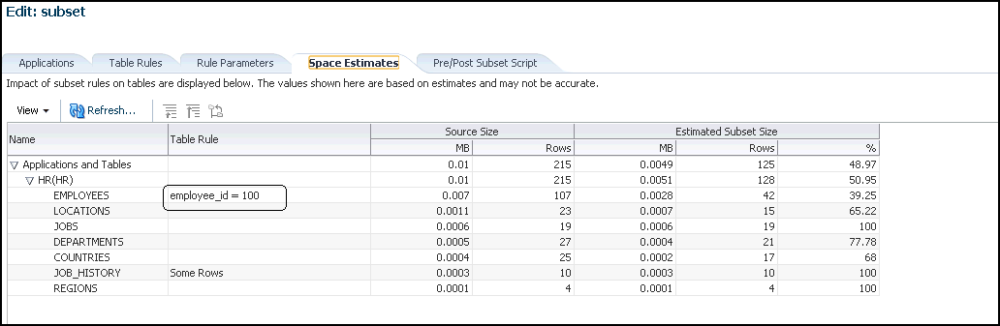

## 15 Data Subsetting

This chapter provides procedures for the following tasks:

You must have the Oracle Data Masking and Subsetting Pack license to use data subsetting features.

Note:

Data subsetting is only supported in Oracle Database versions 10.1 and higher.

Note:

The procedures in this chapter are applicable to Oracle Enterprise Manager 12.1 Cloud Control and higher only.

## 15.1 Creating a Data Subset Definition

The following procedure enables you to create a subset database, after which you can perform other tasks, such as editing the properties of the subset definition or exporting a subset definition.

Before proceeding, ensure that you have the following privileges:

- `EM_ALL_OPERATOR` for Enterprise Manager Cloud Control users
- `SELECT_CATALOG_ROLE` for database users
- Select Any Dictionary privilege for database users

To create a data subset definition:

1. From the Enterprise menu, select Quality Management, then Data Subset Definitions.
2. Open the Actions menu in the Data Subset Definitions page, then select Create, or just click the Create icon.
3. Define the data subset definition properties:
	1. Provide the requisite information in the General pop-up that appears, then click Continue.
		You can select any source database associated with the Application Data Model.
		2. Provide a job name, credentials, and specify a schedule in the Schedule Application Detail Collection pop-up that appears, then click Submit.
		If you want to use new credentials, choose the New Credentials option. Otherwise, choose the Preferred Credentials or Named Credentials option.
	The space estimate collection job runs, and then displays the Data Subset Definitions page. Your definition appears in the table, and the Most Recent Job Status column should indicate Scheduled, Running, or Succeeded, depending on the schedule option selected and time required to complete the job.
4. Select the definition within the table, open the Actions menu, then select Edit.
	The Database Login page appears.
5. Select either Named Credentials or New Credentials if you have not already set preferred credentials, then click Login.
6. In the Applications subpage of the Edit page, move entire application suites or specified applications that you want to use from the Available list to the Selected list.
	The names of application suites, applications, or application modules are maintained in the Application Data Model.
7. Click the Table Rules tab.
	You can add rules here to define the data to include in the subset.
8. Select Actions, then Create to display the Table Rule pop-up, or just click the Create icon.
	1. Select the application for which you want to provide a rule.
		Associate the rule with all tables, a specific table, or a category of tables.
		2. In the Rows to Include section, select the option that best suits your needs for a representative sample of production data. If you do not want to include all rows, you can include some rows by specifying a percentage portion of the rows. For finer granularity, you could specify a Where clause, such as where region\_id=6.
		For more information on specifying Where clauses, see step e.
		3. In the Include Related Rows section, do one of the following:
		- Select Ancestor and Descendant Tables
			This rule impacts the parent and child columns, and ensures that referential integrity is maintained, and that child columns are also selected as part of the subset.
				- Select Ancestor Tables Only
			This rule only impacts the parent columns, and ensures that referential integrity is maintained.
		If you disable the Include Related Rows check box, referential integrity may not be maintained. However, you can subsequently provide additional rules to restore referential integrity. You can disable this check box w8hether or not you specify a Where clause.
		4. If you want to specify a Where clause, go to the next step. Otherwise, skip to step [^1].
		5. Provide a rule parameter, if desired, for the clause.
		For instance, if you specify a particular value for an employee ID as employee\_id=:emp\_id, you could enter query values for the default of 100:
		- Select the Rows Where button and enter employee\_id=:emp\_id.
				- Click OK to save the rule and return to the Table Rules tab.
			If this is a new rule, a warning appears stating that "Rule parameters corresponding to the bind variables 'emp\_id' should be created before generating subset."
				- Select the table rule, click the Rule Parameters tab, then click Create.
			The Rule Parameter Properties pop-up appears.
				- Enter emp\_id for the Name and 100 for the Value.
			Note:
			The colon (: ) preceding emp\_id is only present in the Where clause, and not required when creating a new rule parameter.
				- Click OK to save the properties, which now appear in the Rule Parameters tab.
				- Skip to step [^2].
9. Click OK to save the rule and return to the Table Rules tab.
	The new rule is displayed in the list. The related tables are displayed in the table below. Related rows from the tables are included in the subset to provide referential integrity in the subset database.
10. In the Default Table Rows section of the Table Rules tab, choose whether you want to include or exclude the tables not affected by the defined rules in the subset.
	When you select the Include All Rows option, all of the rows for the table are selected as part of the subset.
	This is a global rule and applies to the entire subset. You can only select the Include All Rows option when all of the rules have a scope of None. A scope of None is established when you uncheck the Include Related Rows option in the Table Rule pop-up.
11. Click the Space Estimates tab.
	- Note the value in the Estimated Subset Size GB column. The space estimates depend on optimizer statistics, and the actual distribution of data can only be calculated if histogram statistics are present.
		- Whenever you add new rules, recheck the space estimates for updated values.
		- Data in the Space Estimates subpage is sorted with the largest applications appearing at the top.
	If you provide a Where clause and subsequent rule parameter properties, the Space Estimates subpage is updated with the value contained in the Rule Parameters tab.
	Figure 15-1 Space Estimates Tab
	

> This is a screenshot of the Space Estimates Tab. The graphic shows columns of Name, Table Rule, Source Size, and Estimated Subset Size. Example data appears in each column.
>
> Copyright © 2008, 2014, Oracle and/or its affiliates. All rights reserved.  
> [Legal Notices](https://docs.oracle.com/cd/E11882_01/dcommon/html/cpyr.htm)

12. Optional: click the Pre/Post Subset Scripts tab.
	- You can specify a pre-subset script to run on the subset database before you select subset data.
		- You can specify a post-subset script to run on the subset database after you assemble the subset data.
		- Either script type runs on the source database.
13. Click Return.
	The definition is complete and displayed in the Data Subset Definitions table.
14. Prepare and submit a job to generate a subset:
	1. Select the definition within the table, open the Actions menu, then select Generate Subset.
		The Generate Subset Methods and Parameters pop-up appears.
		2. Decide if you want to create a subset by writing subset data to export files, or by deleting data from a cloned database.
		Tip:
		If you have a very large database of 4 terabytes, for instance, and you want to export a small percentage of the rows, such as 10%, it is more advantageous to use the export method. Using the in-place delete method would require 3.6 terabytes of data, which would not perform as quickly as the export method.
		The in-place delete method is recommended when the amount of data being deleted is a small percentage of the overall data size.
		- Writing Subset Data to Export Files
			The Export File Directory list consists of directory objects for which you have access.
			The Maximum Number of Threads field specifies the maximum number of threads of active execution operating on behalf of the export job, thereby enabling you to consider trade-offs between resource consumption and elapsed time
				- Deleting Data from a Cloned Database
			This choice creates an in-place subset by removing/deleting unwanted data from a cloned copy of the production database, rather than a production database. Only data satisfying the rules are retained. Do not use this option on a production database.
		If you have defined any parameters from the Rule Parameters tab, they appear in the table at the bottom. You can change a parameter value by clicking on the associated field in the Value column.
		3. Click Continue to access the Parameters pop-up.
		The contents of the pop-up depends on whether you chose Writing Subset Data to Export Files or Deleting Data From a Cloned Database in the previous step.
		For Writing Subset Data to Export Files, provide the requisite information, then click Continue to schedule the job.
		- The Export File Directory list consists of directory objects for which you have access.
				- The Maximum Number of Threads field specifies the maximum number of threads of active execution operating on behalf of the export job, thereby enabling you to consider trade-offs between resource consumption and elapsed time.
				- Enable the Generate Import Script check box to generate a SQL script that imports the exported dump to the intended database. The import script resides in the same directory as the export dump. This operation occurs when the generate subset is complete.
			For more information, see "Importing Exported Dumps".
		For Deleting Data From a Target Database, provide the requisite information, then click Continue to schedule the job.
		- The Execution Scripts Directory list consists of directory objects for which you have access.
				- To proceed, you must enable the check box indicating that the selected target is not a production database.
		4. Click Continue to schedule the job from the Generate Subset Schedule pop-up, then click Submit.
		The Data Subset Definitions page reappears, and the Most Recent Job Status column shows that the subset job is running, and subsequently that it has succeeded.

After performing this procedure, you can now create a subset database with the generated export files at any time.

## 15.2 Importing Exported Dumps

As indicated in the procedure above, you can generate a SQL script that imports the exported dumps to the intended database.

For example, if you want to subset a database named DB2, you would create a subset model either on DB1 or DB2, then specify DB2 in the generate subset flow. After doing this, the dump files and subset\_import.sql script would be available in the specified directory on DB2. To create a subset, you would then log into DB2 and execute the subset\_import.sql script, which would internally use the dump files and create the subset database.

The following procedure explains how to import exported dumps based on the scenario described above.

To import exported dumps:

1. Log in to the target database.
2. From the Data Subset Definitions page, select an Application Data Model.
3. Select Generate Subset from the Actions menu.
	The Generate Subset: Subset Mode page appears.
4. Select the Writing Subset Data to Export Files option, provide the required Target Database name and Database Credentials, then click Continue.
	The Generate Subset: Parameters page appears.
5. Provide the required input at the top of the page, select the Generate Import Script option, then click Continue.
	The Generate Subset: Schedule page appears.
6. Provide the required scheduling information, then click Submit.
	The dump files and subset\_import.sql script are now available in the directory you specified.
7. Locate and run the script subset\_import.sql, which is present in your Export File Directory.
8. Respond to the prompts as shown in Example 15-1.

Example 15-1 Sample Schema Prompts and Responses

```
Choose the state of the schemas from below:
1 - None of the schemas exist.
2 - A part or all of the schemas exist.
3 - The schemas exist with complete metadata but no data.
Enter choice (1/2/3): 2
Enter directory object name: DATA_PUMP_DIR
old 7: user_choice number := &user_choice;
new 7: user_choice number := 2;
old 15: dump_dir varchar2(200) := '&dump_dir_object';
new 15: dump_dir varchar2(200) := 'DATA_PUMP_DIR';
```

## 15.3 Importing and Exporting Subset Templates

A subset template is an XML file that contains the details of the subset, consisting of the application, subset rules, rule parameters, and pre-scripts or post-scripts. When you create a subset definition and specify that you want to write subset data to export files, the export files become a template that you can subsequently import for reuse. You would import the template to perform subset operations on a different database.

Typically, the workflow is that you would first import a previously exported ADM template, which is another XML file, while creating an ADM. You would then import the related subset template while creating a data subset definition. You could alternatively select an existing ADM (skipping the import ADM flow) while importing the subset template.

To import a subset template:

1. From the Data Subset Definitions page, select Import from the Actions menu.
	The Import Data Subset Definition pop-up appears.
2. Provide the required Name, Application Data Model associated with the source database, the Source Database itself, and the local XML file.
3. Click Continue.
4. Provide the required Job Name, Credentials, and Schedule, then click Submit.

After the job runs successfully, the subset template appears in the list of subsets in the table on the Data Subset Definitions page.

To export a subset template:

1. From the Data Subset Definitions page, select the subset you want to export, then select Export from the Actions menu.
2. Click Save in the File Download pop-up, then provide a file name, if other than the default, and the directory where you want to store the subset.
3. Click Save.

## 15.4 Creating a Subset Version of a Target Database

After a subset is defined, analyzed, and validated, you can execute the subset operation to create a subset version of the source data.

The procedure assumes the following prerequisites:

- A subset definition already exists that contains the rules needed to subset the database.
- You have the requisite privileges to extract the data from the source and create the subset version in a target database. Depending on the subset technique, different levels of file or database privileges may be created. The required privileges include:
	- EM\_ALL\_OPERATOR for Enterprise Manager Cloud Control users
		- SELECT\_CATALOG\_ROLE for database users
		- Select Any Dictionary privilege for database users
		- DBA privileges on a database for target database users

To create a subset version of a target database:

1. Create a subset operation by selecting a subset definition and associating it with a source database.
	Enterprise Manager validates the subset definition against the source database and flags schema differences. Note that this association may be different from the original association that an application developer may have created.
2. Edit the definition to remap the defined schema to a test schema.
	You are prompted to connect to a database, whereupon the database is associated with the subset definition. This also enables you to remap the vendor-provided schema names to actual schema names in the database.
3. Select one of the various subset creation techniques:
	- Data Pump dump file followed by a Data Pump import
		- In-place delete, in which rows in the specified database not matching the rule conditions are deleted
		- In-transit subset creation or refresh
	Enterprise Manager generates the appropriate response file (that is, SQL script, Data Pump script, or OS script), checks the target system for appropriate privileges to be able proceed with the operation, and estimates the size of the target.
4. After reviewing the analysis, submit the subset process.
	Enterprise Manager executes the subset process and summarizes the results of the execution.

[^1]: Click OK to save the rule and return to the Table Rules tab.

The new rule is displayed in the list. The related tables are displayed in the table below. Related rows from the tables are included in the subset to provide referential integrity in the subset database.

[^2]: In the Default Table Rows section of the Table Rules tab, choose whether you want to include or exclude the tables not affected by the defined rules in the subset.

When you select the Include All Rows option, all of the rows for the table are selected as part of the subset.

This is a global rule and applies to the entire subset. You can only select the Include All Rows option when all of the rules have a scope of None. A scope of None is established when you uncheck the Include Related Rows option in the Table Rule pop-up.

[^undefined]: Click the Space Estimates tab.

- Note the value in the Estimated Subset Size GB column. The space estimates depend on optimizer statistics, and the actual distribution of data can only be calculated if histogram statistics are present.
- Whenever you add new rules, recheck the space estimates for updated values.
- Data in the Space Estimates subpage is sorted with the largest applications appearing at the top.

If you provide a Where clause and subsequent rule parameter properties, the Space Estimates subpage is updated with the value contained in the Rule Parameters tab.

Figure 15-1 Space Estimates Tab


> This is a screenshot of the Space Estimates Tab. The graphic shows columns of Name, Table Rule, Source Size, and Estimated Subset Size. Example data appears in each column.
>
> Copyright © 2008, 2014, Oracle and/or its affiliates. All rights reserved.  
> [Legal Notices](https://docs.oracle.com/cd/E11882_01/dcommon/html/cpyr.htm)


[^undefined]: Optional: click the Pre/Post Subset Scripts tab.

- You can specify a pre-subset script to run on the subset database before you select subset data.
- You can specify a post-subset script to run on the subset database after you assemble the subset data.
- Either script type runs on the source database.

[^undefined]: Click Return.

The definition is complete and displayed in the Data Subset Definitions table.

[^undefined]: Prepare and submit a job to generate a subset:

1. Select the definition within the table, open the Actions menu, then select Generate Subset.
	The Generate Subset Methods and Parameters pop-up appears.
2. Decide if you want to create a subset by writing subset data to export files, or by deleting data from a cloned database.
	Tip:
	If you have a very large database of 4 terabytes, for instance, and you want to export a small percentage of the rows, such as 10%, it is more advantageous to use the export method. Using the in-place delete method would require 3.6 terabytes of data, which would not perform as quickly as the export method.
	The in-place delete method is recommended when the amount of data being deleted is a small percentage of the overall data size.
	- Writing Subset Data to Export Files
		The Export File Directory list consists of directory objects for which you have access.
		The Maximum Number of Threads field specifies the maximum number of threads of active execution operating on behalf of the export job, thereby enabling you to consider trade-offs between resource consumption and elapsed time
		- Deleting Data from a Cloned Database
		This choice creates an in-place subset by removing/deleting unwanted data from a cloned copy of the production database, rather than a production database. Only data satisfying the rules are retained. Do not use this option on a production database.
	If you have defined any parameters from the Rule Parameters tab, they appear in the table at the bottom. You can change a parameter value by clicking on the associated field in the Value column.
3. Click Continue to access the Parameters pop-up.
	The contents of the pop-up depends on whether you chose Writing Subset Data to Export Files or Deleting Data From a Cloned Database in the previous step.
	For Writing Subset Data to Export Files, provide the requisite information, then click Continue to schedule the job.
	- The Export File Directory list consists of directory objects for which you have access.
		- The Maximum Number of Threads field specifies the maximum number of threads of active execution operating on behalf of the export job, thereby enabling you to consider trade-offs between resource consumption and elapsed time.
		- Enable the Generate Import Script check box to generate a SQL script that imports the exported dump to the intended database. The import script resides in the same directory as the export dump. This operation occurs when the generate subset is complete.
		For more information, see "Importing Exported Dumps".
	For Deleting Data From a Target Database, provide the requisite information, then click Continue to schedule the job.
	- The Execution Scripts Directory list consists of directory objects for which you have access.
		- To proceed, you must enable the check box indicating that the selected target is not a production database.
4. Click Continue to schedule the job from the Generate Subset Schedule pop-up, then click Submit.
	The Data Subset Definitions page reappears, and the Most Recent Job Status column shows that the subset job is running, and subsequently that it has succeeded.