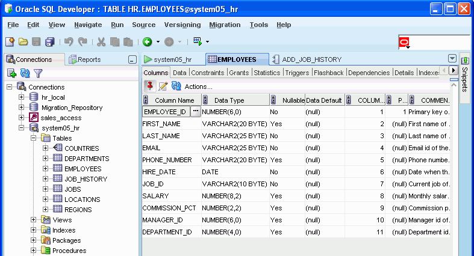
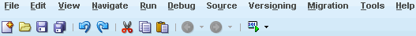
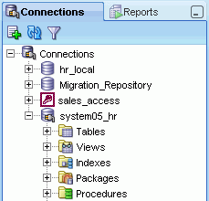
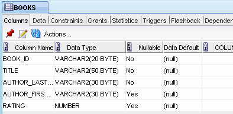

## 1 SQL Developer Concepts and Usage

Note:

This book is for an old release of SQL Developer. You are encouraged to use the latest available release. See `http://www.oracle.com/technetwork/developer-tools/sql-developer/` for information about downloads and documentation.

Oracle SQL Developer is a graphical version of SQL\*Plus that gives database developers a convenient way to perform basic tasks. You can browse, create, edit, and delete (drop) database objects; run SQL statements and scripts; edit and debug PL/SQL code; manipulate and export data; and view and create reports.

You can connect to any target Oracle database schema using standard Oracle database authentication. Once connected, you can perform operations on objects in the database.

You can connect to schemas for selected third-party (non-Oracle) databases, such as MySQL, Microsoft SQL Server, Sybase Adaptive Server, and Microsoft Access, and view metadata and data in these databases; and you can migrate third-party databases to Oracle.

This chapter contains the following major sections:

Installing and Getting Started with SQL Developer

SQL Developer User Interface

Database Objects

Database Connections

Entering and Modifying Data

Running and Debugging Functions and Procedures

Using the SQL Worksheet

Using Snippets to Insert Code Fragments

Using Find DB Object to Find Database Objects

Using Extended Search

Using Versioning

SQL Developer Reports

SQL Developer Preferences

Location of User-Related Information

Oracle TimesTen In-Memory Database Support

Using the Help

For More Information

## Installing and Getting Started with SQL Developer

To install and start SQL Developer, you simply download a ZIP file and unzip it into a desired parent directory or folder, and then type a command or double-click a file name. You should read the [Oracle Database SQL Developer Installation Guide](http://www.oracle.com/pls/topic/lookup?ctx=db112&id=RPTIG) before you perform the installation. After you have read the installation guide, the basic steps are:

1. Unzip the SQL Developer kit into a directory (folder) of your choice. This directory location will be referred to as `<sqldeveloper_install>`.
	Unzipping the SQL Developer kit causes a directory named `sqldeveloper` to be created under the `<sqldeveloper_install>` directory. It also causes many files and folders to be placed in and under that directory.
	If Oracle Database (Release 11 or later) is also installed, a version of SQL Developer is also included and is accessible through the menu system under Oracle. This version of SQL Developer is separate from any SQL Developer kit that you download and unzip on your own, so do not confuse the two, and do not unzip a kit over the SQL Developer files that are included with Oracle Database. Suggestion: Create a shortcut for the SQL Developer executable file that you install, and always use it to start SQL Developer.
2. To start SQL Developer, go to the `sqldeveloper` directory under the `<sqldeveloper_install>` directory, and do one of the following:
	On Linux and Mac OS X systems, run sh sqldeveloper.sh.
	On Windows systems, double-click `sqldeveloper.exe`.
	If you are asked to enter the full pathname for java.exe, click Browse and find java.exe. For example, on a Windows system the path might have a name similar to `C:\Program Files\Java\jdk1.6.0_06\bin\java.exe`.
3. If you want to become familiar with SQL Developer concepts before using the interface, read the rest of this chapter before proceeding to the next step.
4. Create at least one database connection (or import some previously exported connections), so that you can view and work with database objects, use the SQL Worksheet, and use other features.
	To create a new database connection, right-click the Connections node in the Connections navigator, select New Connection, and complete the required entries in the [Create/Edit/Select Database Connection](dialogs.md) dialog box.
5. If you want to get started quickly with SQL Developer, do the short tutorial in [Chapter 3, "Tutorial: Creating Objects for a Small Database"](tut_library.md), or work with your existing database objects.

## SQL Developer User Interface

The SQL Developer window generally uses the left side for navigation to find and select objects, and the right side to display information about selected objects.

Figure 1-1 shows the main window.

Figure 1-1 SQL Developer Main Window

Note:

This text explains the default interface. However, you can customize many aspects of the appearance and behavior of SQL Developer by setting preferences (see SQL Developer Preferences). If you ever need to restore the default interface, see Restoring the Original "Look and Feel".

Note:

For migration of third-party databases to Oracle, see also [SQL Developer User Interface for Migration](migration.md).

The menus at the top contain standard entries, plus entries for features specific to SQL Developer (see Menus for SQL Developer), as shown in the following figure.

  

You can use shortcut keys to access menus and menu items: for example Alt+F for the File menu and Alt+E for the Edit menu; or Alt+H, then Alt+S for Help, then Full Text Search. You can also display the File menu by pressing the F10 key.

Icons under the menus perform various actions, including the following:

- New creates a new a new database object (see [Create/Edit New Object (New Gallery)](dialogs.md)).
- Open opens a file (see [Open File](dialogs.md)).
- Save saves any changes to the currently selected object.
- Save All saves any changes to all open objects.
- Back moves to the pane that you most recently visited. (Or use the drop-down arrow to specify a tab view.)
- Forward moves to the pane after the current one in the list of visited panes. (Or use the drop-down arrow to specify a tab view.)
- Open SQL Worksheet opens the SQL Worksheet (see Using the SQL Worksheet). If you do not use the drop-down arrow to specify the database connection to use, you are asked to select a connection.

The left side of the SQL Developer window has tabs and panes for the Connections and Reports navigators, icons for performing actions, and a hierarchical tree display for the currently selected navigator, as shown in the following figure.

  

The Connections navigator lists database connections that have been created. To create a new database connection, import an XML file with connection definitions, or export or edit current connections, right-click the Connections node and select the appropriate menu item. (For more information, see Database Connections.)

The Files navigator (marked by a folder icon; not shown in the preceding figure) displays your local file system using a standard hierarchy of folders and files. You can double-click or drag and drop files to open them, and you can edit and save the files. For example, if you open a.sql file, it is displayed in a SQL Worksheet window. The Files navigator is especially useful if you are using versioning with SQL Developer (see Using Versioning).

The Reports navigator lists informative reports provided by SQL Developer, such as a list of tables without primary keys for each database connection, as well as any user-defined reports. (For more information, see SQL Developer Reports.)

Icons under the Connections tab (above the metadata tree) perform the following actions on the currently selected object:

- Refresh queries the database for the current details about the selected object (for example, a connection or just a table).
- Apply Filter restricts the display of objects using a filter that you specify. For example, you can right-click the Tables node and specify a filter of EM% to see only tables that start with EM and to have the Tables node label be changed to Tables (EM%). To remove the effects of applying a filter, right-click the node and select Clear Filter.

The metadata tree in the Connections pane displays all the objects (categorized by object type) accessible to the defined connections. To select an object, expand the appropriate tree node or nodes, then click the object.

The right side of the SQL Developer window has tabs and panes for objects that you select or open, as shown in the following figure, which displays information about a table named BOOKS. (If you hold the mouse pointer over the tab label -- BOOKS in this figure -- a tooltip displays the object's owner and the database connection.)

  

For objects other than subprograms, icons provide the following options:

- Freeze View (the pin) keeps that object's tab and information in the window when you click another object in the Connections navigator; a separate tab and display are created for that other object. If you click the pin again, the object's display is available for reuse.
- Edit displays a dialog box for editing the object.
- Refresh updates the display by querying the database for the latest information.
- Actions displays a menu with actions appropriate for the object. The actions are the same as when you right-click an object of that type in the Connections navigator, except the Actions menu does not include Edit.

To switch among objects, click the desired tabs; to close a tab, click the X in the tab. If you make changes to an object and click the X, you are asked if you want to save the changes.

For tables and views, this information is grouped under tabs, which are labeled near the top. For example, for tables the tabs are Columns, Data (for seeing and modifying the data itself), Indexes, Constraints, and so on; and you can click a column heading under a tab to sort the grid rows by the values in that column. For most objects, the tabs include SQL, which displays the SQL statement for creating the object.

You can export data from a detail pane or from the results of a SQL Worksheet operation or a report by using the context menu and selecting Export.

The Messages - Log area is used for feedback information as appropriate (for example, results of an action, or error or warning messages). If this area is not already visible, you can display is by clicking View and then Log.

The Compiler - Log area is used for any messages displayed as a result of a Compile or Compile for Debug operation.

### Menus for SQL Developer

This topic explains menu items that are specific to SQL Developer.

Edit menu

Extended Paste: Displays the [Paste](dialogs.md) dialog box, in which you select a clipboard item (from potentially many) to be pasted into the current location.

Duplicate Selection: When you have selected text while editing a function or procedure, creates a copy of the selected text at the current location.

Wrap Selection: When you have selected text while editing a function or procedure, wraps the selected text.

View menu

Contains options that affect what is displayed in the SQL Developer interface.

Connections: Displays the Connections navigator.

Files: Displays the Files navigator, which is marked by a folder icon. You can use the Files navigator to browse, open, edit, and save files that are accessible from the local system.

Reports: Displays the Reports navigator (see SQL Developer Reports).

Captured Models: Displays the Captured Models navigator (see [SQL Developer User Interface for Migration](migration.md)).

Converted Models: Displays the Converted Models navigator (see [SQL Developer User Interface for Migration](migration.md)).

Find DB Object: Displays the Find Database Object pane (see Using Find DB Object to Find Database Objects).

Versioning Navigator: Displays the Versioning navigator (see Using Versioning).

Log: Displays the Messages - Log pane, which can contain errors, warnings, and informational messages.

Debugger: Displays panes related to debugging (see Running and Debugging Functions and Procedures).

Run Manager: Displays the Run Manager pane, which contains entries for any active debugging sessions.

SQL History: Displays information about SQL statements that you have executed. You can select statements and append them to or overwrite statements on the worksheet (see SQL History).

Snippets: Displays snippets (see Using Snippets to Insert Code Fragments).

Status Bar: Controls the display of the status bar at the bottom of the SQL Developer window.

Toolbars: Controls the display of the main toolbar (under the SQL Developer menus) and the Connections navigator toolbar.

Refresh: Updates the current display for any open connections using the current objects in the affected database or databases.

Navigate menu

Contains options for navigating to panes and in the execution of subprograms.

Back: Moves to the pane that you most recently visited.

Forward: Moves to the pane after the current one in the list of visited panes.

Toggle Bookmark: If you are editing a function or procedure, creates or removes a bookmark (see Using Bookmarks When Editing Functions and Procedures).

Remove Bookmarks from File: Removes bookmarks from the currently active editing window for a function or procedure (see Using Bookmarks When Editing Functions and Procedures).

Remove All Bookmarks: Removes bookmarks from open editing windows for functions and procedures (see Using Bookmarks When Editing Functions and Procedures).

Go to Bookmark: Displays a dialog box so that you can go to a specified bookmark (see Using Bookmarks When Editing Functions and Procedures).

Go to Next Bookmark: Goes to the next bookmark in the currently active editing window for a function or procedure (see Using Bookmarks When Editing Functions and Procedures).

Go to Previous Bookmark: Goes to the previous bookmark in the currently active editing window for a function or procedure (see Using Bookmarks When Editing Functions and Procedures).

Go to Line: Goes to the specified line number and highlights the line in the editing window for the selected function or procedure. (To display line numbers, enable Show Line Numbers under the Code Editor: Line Gutter preferences.)

Go to Last Edit: Goes to the last line that was edited in the editing window for a function or procedure.

Go to Recent Files: Displays the [Recent Files](dialogs.md) dialog box, in which you can specify a function or procedure to go to.

Run menu

Contains options relevant when a function or procedure is selected or when it is open for debugging.

Run \[name\]: Starts execution of the specified function or procedure.

Debug \[name\]: Starts execution of the specified function or procedure in debug mode.

The remaining items on the Debug menu match commands on the debugging toolbar, which is described in Running and Debugging Functions and Procedures.

Source menu

Contains options for use when editing functions and procedures.

Completion Insight: Causes a pop-up window to be displayed when you are typing PL/SQL code, listing items from which you can select for autocompletion. See the Code Editor options under SQL Developer Preferences.

Toggle Line Comments: Inserts and removes comment indicators at the start of selected code lines.

Indent Block: Moves the selected statements to the right.

Unindent Block: Moves the selected statements to the left.

Versioning menu

Contains options related to support for the CVS and Subversion version management and source control system; see Using Versioning for more information.

The commands on the Versioning menu depend on whether the Version System is specified as CVS, Subversion, or none.

Migration menu

Contains options related to migrating third-party databases to Oracle; see [Migration Menu](migration.md) for more information.

Tools menu

Invokes SQL Developer tools.

Database Copy: Enables you to copy objects from one database schema to another (see the [Database Copy (Schema Objects)](dialogs.md) interface).

Database Export: Enables you to export some or all objects of one or more object types for a database connection to a file containing SQL statements to create these objects and optionally to export table data (see the [Export (Database Objects and Data)](dialogs.md) interface).

Database Diff: Enables you to compare two schemas to find differences between objects of the same type and name (for example, tables named CUSTOMERS) in two different schemas, and optionally to update the objects in the destination schema to reflect differences in the source schema (see the [Database Schema Differences](dialogs.md) interface).

Monitor Sessions: Displays the status of one or more sessions, using information from the V$RSRC\_SESSION\_INFO view, which shows how the session has been affected by the Oracle Database Resource Manager. For more information about session monitoring, see [Oracle Database Administrator's Guide](https://docs.oracle.com/cd/E11882_01/server.112/e25494/dbrm.htm#ADMIN11906).

Monitor SQL: Displays information about any query currently executing and queries that are done executing for a selected connection. To see detailed information about a query, right-click its row and select Show SQL Details. The information is especially useful for real-time monitoring of long-running SQL statements. Cursor statistics (such as CPU times and IO times) and execution plan statistics (such as number of output rows, memory, and temporary space used) are updated close to real-time during statement execution. (Internally, this feature calls the DBMS\_SQLTUNE.REPORT\_SQL\_MONITOR subprogram.)

SQL Worksheet: Displays a worksheet in which you can enter and execute SQL and PL/SQL statements using a specified connection (see Using the SQL Worksheet).

External Tools: Displays the [External Tools](dialogs.md) dialog box, with information about user-defined external tools that are integrated with the SQL Developer interface. From this dialog box can add external tools (see [Create/Edit External Tool](dialogs.md)). The Tools menu also contains items for any user-defined external tools.

Preferences: Enables you to customize the behavior of SQL Developer (see SQL Developer Preferences).

Help menu

Displays help about SQL Developer and enables you to check for SQL Developer updates.

Search: Displays the Help Center window.

Table of Contents: Displays the Help Center window.

Tip of the Day: Displays a suggestion for efficient use of SQL Developer.

Check for Updates: Checks for any updates to the selected optional SQL Developer extensions, as well as any mandatory SQL Developer extensions. The available updates may include the JTDS JDBC Driver for Microsoft SQL Server and the MySQL JDBE Driver, which enable you to create connections to third-party databases. (If the system you are using is behind a firewall, see the SQL Developer user preferences for Web Browser and Proxy.)

About: Displays version-related information about SQL Developer and its components.

### Restoring the Original "Look and Feel"

If you have made changes to the SQL Developer user interface ("look and feel"), such as accidentally repositioning navigators and panes, you can restore the interface to the way it was after SQL Developer was installed by following these steps:

1. If you are running SQL Developer, exit.
2. Create a backup copy of the folder or directory where your SQL Developer user information is stored, in case you want to restore any old user-defined reports, snippets, code templates, or SQL history. The default location is:
	- Windows: C:\\Documents and Settings\\\<user-name>\\Application Data\\SQL Developer
		- Linux or Mac OS X: ~/.sqldeveloper
	If you have specified a nondefault location for your SQL Developer user information (see Location of User-Related Information), create the backup copy of that folder or directory instead.
	(If you do not want to use any old information or settings, you can skip creating a backup copy.)
3. Delete the original (not the backup) folder or directory where your user information is stored (explained in step 2).
4. Start SQL Developer.
	This creates a folder or directory where your user information is stored (explained in step 2), which has the same content as when SQL Developer was installed.

## Database Objects

You can create, edit, and delete (drop) most types of objects in an Oracle database by using the context menu (right-click, or Shift+F10) in the Connections navigator or by clicking the Actions button in the detail pane display. For some objects, you can do other operations, as appropriate for the object type.

Note:

The actions available from context menus and Actions buttons depend on the Oracle Database release number for the specified database connection. If an action mentioned in the text is not available with a connection, it may be that the feature was not available in that release of Oracle Database.

You can search for specific objects associated with an Oracle database connection by clicking View, then Find DB Object. For more information, see Using Find DB Object to Find Database Objects.

If you have connected to any third-party (non-Oracle) databases, such as MySQL, Microsoft SQL Server, Sybase Adaptive Server, or Microsoft Access, you can view their objects using the Connections navigator. (For information about connecting to third-party databases, see the SQL Developer user preferences for Database: Third Party JDBC Drivers.)

### Applications (Application Express 3.0.1 and Later)

Effective with Oracle Application Express 3.0.1, if you use SQL Developer to connect to a schema that owns any Application Express applications, the Connections navigator has an Application Express node. You can click an application name to display tabs (Application, Pages, LOVs, Lists, Templates, Breadcrumbs, and so on) with information about the application.

You can perform the following operations on an Application Express application by right-clicking the application name in the Connections navigator and selecting an item from the menu:

- Import Application: Imports an application from a specified file and installs the application.
- Deploy Application: Deploys an application into a specified target schema.
- Drop: Deletes the application.
- Modify Application: Enables you to change the alias, name (Rename), status, global notification, and proxy server for the application.
- Export DDL: Saves the DDL statements to create the application (or the selected component) to a file, a.zip file, a worksheet, or the system clipboard.

The following operations are available only by right-clicking the Application Express node in the Connections navigator and selecting an item from the menu:

- Start EPG: Starts the embedded PL/SQL gateway for Application Express. Displays a dialog box for executing the following statements: BEGIN DBMS\_EPG.map\_dad('APEX', '/apex/\*'); end;
- Stop EPG: Stops the embedded PL/SQL gateway for Application Express. Displays a dialog box for executing the following statements: BEGIN DBMS\_EPG.unmap\_dad('APEX'); end;

### Cache Groups (Oracle TimesTen In-Memory Database)

A cache group describes a collection of in-memory database tables that map to all or a subset of the tables in an Oracle database. A cache group can consist of all or a subset of the rows and columns in these tables. Multiple cache groups can be used to cache different sets of related tables in the Oracle database.

### Database Links (Public and Private)

A database link is a database object in one database that enables you to access objects on another database. The other database need not be an Oracle Database system; however, to access non-Oracle systems you must use Oracle Heterogeneous Services. After you have created a database link, you can use it to refer to tables and views in the other database. The Connections navigator has a Database Links node for all database links (public and private) owned by the user associated with the specified connection, and a Public Database Links node for all public database links on the database associated with the connection. For help with specific options in creating a database link, see [Create/Edit Database Link](dialogs.md).

You can perform the following operations on a database link by right-clicking the database link name in the Connections navigator and selecting an item from the menu:

- Test Database Link: Validates the database link.
- Drop: Deletes the database link.

### Directories

A directory object specifies an alias for a directory (called a folder on Windows systems) on the server file system where external binary file LOBs (BFILEs) and external table data are located. To create a directory (that is, a directory object), you can use SQL Developer or the SQL statement CREATE DIRECTORY.

You can use directory names when referring to BFILEs in your PL/SQL code and OCI calls, rather than hard coding the operating system path name, for management flexibility. All directories are created in a single namespace and are not owned by an individual schema. You can secure access to the BFILEs stored within the directory structure by granting object privileges on the directories to specific users.

### Functions

A function is a type of PL/SQL subprogram, which is a programming object that can be stored and executed in the database server, and called from other programming objects or applications. (Functions return a value; procedures do not return a value.) For help with specific options in creating a PL/SQL subprogram, see [Create PL/SQL Subprogram (Function or Procedure)](dialogs.md).

You can perform the following operations on a function by right-clicking the function name in the Connections navigator and selecting an item from the menu:

- Open: Displays the function text so that you can view and edit it.
- Compile: Performs a PL/SQL compilation of the function.
- Compile for Debug: Performs a PL/SQL compilation of the procedure, with PL/SQL library units compiled for debugging.
- Run: Displays the [Run/Debug/Profile PL/SQL](dialogs.md) dialog box, and then executes the function in normal (not debug) mode.
- Debug: Displays the [Run/Debug/Profile PL/SQL](dialogs.md) dialog box, and then executes the function in debug mode.
- Profile (for an Oracle Database Release 11.1 or later connection): Displays the [Run/Debug/Profile PL/SQL](dialogs.md) dialog box, and then executes the function and collects execution statistics.
- Rename: Renames the function.
- Drop: Deletes the function.

### Indexes

An index is a database object that contains an entry for each value that appears in the indexed column(s) of the table or cluster and provides direct, fast access to rows. Indexes are automatically created on primary key columns; however, you must create indexes on other columns to gain the benefits of indexing. For help with specific options in creating an index, see [Create/Edit Index](dialogs.md).

You can perform the following operations on an index by right-clicking the index name in the Connections navigator and selecting an item from the menu:

- Drop: Deletes the index.
- Rebuild Index: Re-creates the index or one of its partitions or subpartitions. If the index is unusable, a successful rebuild operation makes the index usable. For a function-based index, rebuilding also enables the index; however, if the function on which the index is based does not exist, the rebuild operation fails.
- Rename Index: Changes the name of the index.
- Make Unusable: Prevents the index from being used by Oracle in executing queries. An unusable index must be rebuilt, or dropped and re-created, before it can be used again.
- Coalesce: Merges the contents of index blocks, where possible, to free blocks for reuse.
- Compute Statistics: For a function-based index, collects statistics on both the index and its base table using the DBMS\_STATS package. Such statistics will enable Oracle Database to correctly decide when to use the index.
- Export DDL: Saves the DDL statement to create the index to a file, a SQL Worksheet, or the system clipboard.

### Java Sources

Java sources can be created and managed in the database. You can create a Java source object by right-clicking the Java node in the Connections navigator, selecting Load Java, and specifying the Java source name and source code. (A CREATE OR REPLACE AND RESOLVE JAVA SOURCE statement is executed using the information you specify.) For information about Java concepts and stored procedures, see [Oracle Database Java Developer's Guide](https://docs.oracle.com/cd/E11882_01/java.112/e10588/toc.htm).

### Materialized Views

A materialized view is a database object that contains the results of a query. The FROM clause of the query can name tables, views, and other materialized views. Collectively these objects are called master tables (a replication term) or detail tables (a data warehousing term). This reference uses "master tables" for consistency. The databases containing the master tables are called the master databases. For help with specific options in creating a materialized view, see [Create/Edit View](dialogs.md), especially the [View Information or Materialized View Properties pane](dialogs.md).

### Materialized View Logs

A materialized view log is a table associated with the master table of a materialized view. When DML changes are made to master table data, Oracle Database stores rows describing those changes in the materialized view log and then uses the materialized view log to refresh materialized views based on the master table. This process is called incremental or fast refresh. Without a materialized view log, Oracle Database must reexecute the materialized view query to refresh the materialized view. This process is called a complete refresh. Usually, a fast refresh takes less time than a complete refresh.

### Packages

A package is an object that contains subprograms, which are programming objects that can be stored and executed in the database server, and called from other programming objects or applications. A package can contain functions or procedures, or both. For help with specific options in creating a package, see [Create PL/SQL Package](dialogs.md).

You can perform the following operations on a package by right-clicking the package name in the Connections navigator and selecting an item from the menu:

- Edit: Displays a read-only tabbed view of information about the package.
- Open: Opens the package in a window, where you can modify the content and other information.
- Run: Lets you select a member in the package and run it.
- Compile: Performs a PL/SQL compilation of the members in the package.
- Compile for Debug: Performs a PL/SQL compilation of the members in the package, with PL/SQL library units compiled for debugging
- Order Members By: Orders the members of the package by location in the source, by name, or by type and by name within each type.
- Drop Package: Deletes the package.
- Create Body: Displays a pane in which you can enter text for the package body.
- Grant: Lets you grant privileges on the package
- Revoke: Lets you revoke privileges on the package.
- Save Package Spec and Body: Saves the package specification and body to a file that you specify.
- Export DDL: Saves the DDL statement to create the package to a file, a SQL Worksheet, or the system clipboard.

### Procedures

A procedure is a type of PL/SQL subprogram, which is a programming object that can be stored and executed in the database server, and called from other programming objects or applications. (Procedures do not return a value; functions return a value.) For help with specific options in creating a PL/SQL subprogram, see [Create PL/SQL Subprogram (Function or Procedure)](dialogs.md).

You can perform the following operations on a procedure by right-clicking the procedure name in the Connections navigator and selecting an item from the menu:

- Open: Displays the procedure text so that you can view and edit it.
- Run: Displays the [Run/Debug/Profile PL/SQL](dialogs.md) dialog box, and then executes the procedure in normal (not debug) mode.
- Compile: Performs a PL/SQL compilation of the procedure.
- Compile for Debug: Performs a PL/SQL compilation of the procedure, with PL/SQL library units compiled for debugging.
- Debug: Displays the [Run/Debug/Profile PL/SQL](dialogs.md) dialog box, and then executes the procedure in debug mode.
- Profile (for an Oracle Database Release 11.1 or later connection): Displays the [Run/Debug/Profile PL/SQL](dialogs.md) dialog box, and then executes the procedure and collects execution statistics.
- Grant: Lets you grant privileges on the procedure
- Revoke: Lets you revoke privileges on the procedure.
- Drop: Deletes the procedure.
- Compile Dependants: Performs a PL/SQL compilation of the procedure and any relevant dependent subprograms (see the Dependencies tab).
- Export DDL: Saves the DDL statement to create the procedure to a file, a SQL Worksheet, or the system clipboard.

### Queues

A queue is an object in which messages are enqueued and dequeued. Queues are managed by Oracle Streams Advanced Queueing (AQ). For information about using queues, see Oracle Streams Advanced Queuing User's Guide.

### Queue Tables

A queue table is a table that holds messages to be used with Oracle Streams Advanced Queueing (AQ). For information about using queue tables, see Oracle Streams Advanced Queuing User's Guide, especially the information about managing queue tables in the chapter describing the Oracle Streams AQ administrative interface.

### Recycle Bin

The Recycle bin (applicable only to Oracle Database Release 10g and later) holds objects that have been dropped (deleted). The objects are not actually deleted until a commit operation is performed. Before the objects are actually deleted, you can "undelete" them by selecting them in the Recycle bin and selecting Undrop from the context menu.

You can perform the following operations on an object in the Recycle bin by right-clicking the object name in the Recycle bin in the Connections navigator and selecting an item from the menu:

- Purge: Removes the object from the Recycle bin and deletes it.
- Flashback to Before Drop: Moves the object from the Recycle bin back to its appropriate place in the Connections navigator display.

### Replication Schemes (Oracle TimesTen In-Memory Database)

A replication scheme is a configuration, using SQL statements and a transaction-based log, whereby committed changes are copied from their source to one or more subscriber databases. The goal is to enable high efficiency and low overhead during the replication.

### Sequences

Sequences are used to generate unique integers. You can use sequences to automatically generate primary key values. For help with specific options in creating and editing a sequence, see [Create/Edit Sequence](dialogs.md).

### Synonyms (Public and Private)

Synonyms provide alternative names for tables, views, sequences, procedures, stored functions, packages, materialized views, Java class database objects, user-defined object types, or other synonyms. The Connections navigator has a Synonyms node for all synonyms (public and private) owned by the user associated with the specified connection, and a Public Synonyms node for all public synonyms on the database associated with the connection. For help with specific options in creating and editing a synonym, see [Create/Edit Synonym](dialogs.md).

### Tables

Tables are used to hold data. Each table typically has multiple columns that describe attributes of the database entity associated with the table, and each column has an associated data type. You can choose from many table creation options and table organizations (such as partitioned tables, index-organized tables, and external tables), to meet a variety of enterprise needs. To create a table, you can do one of the following:

- Create the table quickly by adding columns and specifying frequently used features. To do this, do not check the Advanced box in the Create Table dialog box. For help with options for creating a table using this quick approach, see [Create Table (quick creation)](dialogs.md).
- Create the table by adding columns and selecting from a larger set of features. To do this, check the Advanced box in the Create Table dialog box. For help with options for creating a table with advanced features, see [Create/Edit Table (with advanced options)](dialogs.md).
- Create the table automatically from a Microsoft Excel worksheet. To do this, right-click Tables under a connection in the Connections navigator, and select Import Data. When asked for the file, select a file of type.xls or.csv.

You can perform the following operations on a table by right-clicking the table name in the Connections navigator and selecting an item from the menu:

- Edit: Displays the [Create/Edit Table (with advanced options)](dialogs.md) dialog box.
- Table: Table actions include Rename, Copy (create a copy using a different name), Drop (delete the table), Truncate (delete existing data without affecting the table definition), Lock (set the table lock mode: row share, exclusive, and so on), Comment (descriptive comment explaining the use or purpose of the table), Parallel (change the default degree of parallelism for queries and DML on the table), No Parallel (specify serial execution), and Count Rows (return the number of rows).
- Column: Column actions include Comment (descriptive comment about a column), Add, Drop, and Normalize.
- Constraint: Includes options for adding, dropping, enabling, and disabling constraints.
- Index: Options include Create (create an index on specified columns), Create Text (create an Oracle Text index on a column), Create Text (create a function-based index on a column), and Drop.
- Constraint: Options include Enable or Disable Single, Drop (delete a constraint), Add Check (add a check constraint), Add Foreign Key, and Add Unique.
- Privileges: If you are connected as a database user with sufficient privileges, you can Grant or Revoke privileges on the table to other users.
- Statistics: Options include Gather Statistics (compute exact table and column statistics and store them in the data dictionary) and Validate Structure (verifies the integrity of each data block and row, and for an index-organized table also generates the optimal prefix compression count for the primary key index on the table). Statistics are used by the Oracle Database optimizer to choose the execution plan for SQL statements that access analyzed objects.
- Storage: Options include Shrink Table (shrink space in a table, for segments in tablespaces with automatic segment management) and Move Table (to another tablespace). The Shrink Table options include Compact (only defragments the segment space and compacts the table rows for subsequent release, but does not readjust the high water mark and does not release the space immediately) and Cascade (performs the same operations on all dependent objects of the table, including secondary indexes on index-organized tables).
- Trigger: Options include Create, Create PK from Sequence (create a before-insert trigger to populate the primary key using values from a specified sequence), Enable or Disable All, Enable or Disable Single, and Drop (delete the trigger).
- Import Data: Enables you to import data from a Microsoft Excel worksheet (.xls or.csv file).
- Export Data: Enables you to export some or all of the table data to a file or to the system clipboard, in any of the following formats: XML (XML tags and data), CSV (comma-separated values including a header row for column identifiers), SQL Insert (INSERT statements), or SQL Loader (SQL\*Loader control file). After you select a format, the [Export Table Data](dialogs.md) dialog box is displayed.

You can perform the following operations on a column in a table by right-clicking the column name in the Connections navigator and selecting an item from the menu:

- Rename: Renames the column.
- Drop: Deletes the column (including all data in that column) from the table.