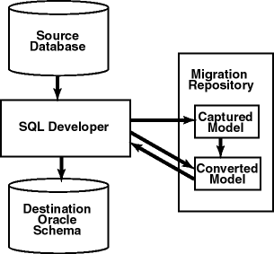
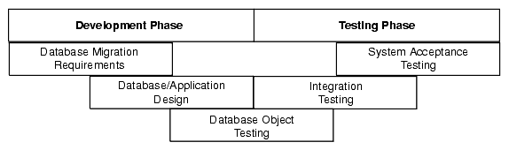
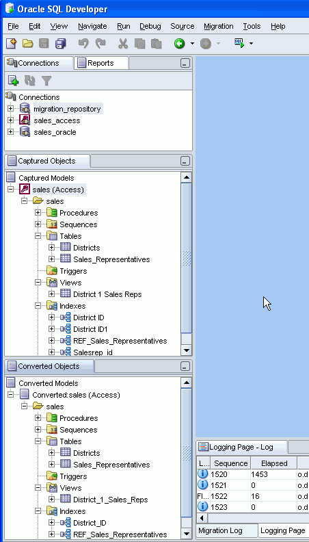
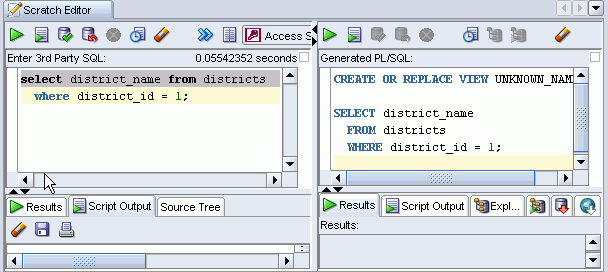

## 2 Migrating Third-Party Databases

Note:

The migration capabilities in SQL Developer represent an evolution of the Oracle Migration Workbench product.

Migration is the process of copying the schema objects and data from a source third-party (non-Oracle) database, such as MySQL, Microsoft SQL Server, Sybase Adaptive Server, or Microsoft Access, to an Oracle database. You can perform the migration in an efficient, largely automated way.

Thus, you have two options for working with third-party databases in SQL Developer:

- Creating database connections so that you can view schema objects and data in these databases
- Migrating these databases to Oracle, to take advantage of the full range of Oracle Database features and capabilities

This chapter contains the following major sections:

Migration Quick Start

Overview of Migration

Preparing a Migration Plan

Before You Start Migrating: General Information

Before You Start Migrating: Source-Specific Information

Capturing the Source Database

Creating and Customizing the Converted Model

Generating the DDL for the Oracle Schema Objects

Migrating the Data

Making Queries Case Insensitive

Testing the Oracle Database

Deploying the Oracle Database

Using Migration Reports

SQL Developer User Interface for Migration

## Migration Quick Start

To migrate a third-party database to Oracle, the basic actions are: prepare for the migration, create or select associate a migration repository, capture the source database, convert the captured database, generate and run DDL for the new Oracle schema objects, and optionally move data from the source database to the new database.

There are two mechanisms for migrating third-party databases to Oracle: standard migration and quick migration.

### Standard Migration

Standard migration involves capturing, converting, generating the database, and performing the data move in several distinct steps. This is the recommended approach when performing a migration. Any issues during these phases can be manually resolved and all objects can be inspected or modified to suit your needs.

Standard Migration: Prepare for Migration

1. Prepare for the migration by reading the appropriate related topics in Chapter 2, "Migrating Third-Party Databases".
2. Create a migration repository in a new or existing Oracle connection. You may find it simple and convenient to create separate a Oracle database user and connection for migration work. Then, select the connection and create the repository. For example:
	1. Create an Oracle user named MIGRATIONS with default tablespace USER and temporary tablespace TEMP; and grant it at least RESOURCE, CREATE SESSION, and CREATE VIEW privileges. (For multischema migrations, you must grant the RESOURCE role with the ADMIN option; and you must also grant this user the CREATE ROLE, CREATE USER, and ALTER ANY TRIGGER privileges, all with the ADMIN option.)
		2. Create a database connection named Migration\_Repository that connects to the MIGRATIONS user.
		3. Right-click the Migration\_Repository connection, and select Migration Repository, then Associate Migration Repository to create the repository.
3. Create and open a database connection for the third-party database. (For migrations other than from Microsoft Access, you should set the third party JDBC driver preference before creating the connection.)
	For example, create a database connection named Sales\_Access to the Microsoft Access database named sales.mdb, and connect to it.

Standard Migration: Capture Source Schema Objects

There are two ways to capture source schema objects: online and offline. Online capture which is suitable in most cases, so it is described here.

To perform online capture, right-click the connection name in the Connections navigator and select Capture database-type (for example, Capture MySQL, Capture Microsoft Access, Capture Microsoft SQL Server, or Capture Sybase Adaptive Server).

Selecting Capture Microsoft Access automatically invokes the Microsoft Access exporter tool to create XML files for migrating the schema and the table data. However, if you want to run the exporter tool manually (for example, to control certain options), click Migration, then Microsoft Access Exporter, then the item for your version of Microsoft Access. Follow the steps for the exporter tool, which has its own online help.

After the capture, the Captured Models navigator displays an expandable node for the captured objects (for example, sales (Access) for the captured sales.mdb objects, as shown in the figure in SQL Developer User Interface for Migration).

Standard Migration: Convert Captured Objects

To convert the captured objects to Oracle-format objects, right-click the appropriate node in the Captured Objects navigator and select Convert to Oracle Model, and accept the defaults for data mappings (or specify selected mappings if you need to).

After the conversion, the Converted Models navigator displays an expandable node for the converted objects (for example, Converted sales (Access)).

Standard Migration: Generate Oracle Database Objects

1. Generate a SQL\*Plus script that creates the DDL statements to create the Oracle database objects that correspond to the source database objects: right-click the appropriate node in the Captured Models navigator and select Generate. A SQL Worksheet window opens containing the SQL\*Plus statements.
2. In the SQL Worksheet window that was just opened, select (in the drop-down list on the right) an Oracle database connection in which to run the script (next step).
3. Examine the generated SQL\*Plus statements, and optionally make any changes. For example, if the database user to own the generated objects already exists (as it will if you are following these quick-step instructions), delete or modify the CREATE USER and related statements.
4. Click the Run Script button in the SQL Worksheet window to run the script.
5. In the Connections navigator, create a connection to the user that was just created.

In the Connections navigator, you should now see the new database objects corresponding to the objects in the third-party database that you migrated.

Standard Migration: Move Data to Oracle Database

If you want, you can migrate (move) any existing data from the source database to the Oracle database. You have two options for data migration: online or offline.

- Online data move: Click Migration, then Migrate Data. In the dialog box, specify the Source Connection, the Target Connection, and the Converted Model. This method uses JDBC and therefore is constrained by the third-party implementations. This method is suitable for moving small data sets.
- Offline data move: Click Migration, then Script Generation, then Generate Data Move Scripts; specify the converted model and a directory into which to generate the files that you will use for unloading the data from the source database and for importing into Oracle using SQL\*Loader. This method is designed for moving large volumes of data.

### Quick Migration

Quick migration is a simplified approach that uses a wizard. It provides a quick solution when migrating a simple database; however, for more control of the migration process, you should use Standard Migration.

Quick Migration: Prepare for Migration

1. Prepare for the migration by reading the appropriate related topics in Chapter 2, "Migrating Third-Party Databases".
2. Create a migration repository in a new or existing Oracle connection. You may find it simple and convenient to create separate a Oracle database user and connection for migration work. Then, select the connection and create the repository. For example:
	1. Create an Oracle user named MIGRATIONS with default tablespace USER and temporary tablespace TEMP; and grant it at least RESOURCE, CREATE SESSION, and CREATE VIEW privileges. (For multischema migrations, you must grant the RESOURCE role with the ADMIN option; and you must also grant this user the CREATE ROLE, CREATE USER, and ALTER ANY TRIGGER privileges, all with the ADMIN option.)
		2. Create a database connection named Migration\_Repository that connects to the MIGRATIONS user.
		3. Right-click the Migration\_Repository connection, and select Migration Repository, then Associate Migration Repository to create the repository.
3. Create an Oracle user whose schema is to be used as the destination for the objects to be migrated, or use an existing Oracle user and schema. Grant sufficient privileges to this user.
	For example, if you plan to migrate a Microsoft Access database named sales.mdb, you might create an Oracle user named SALES, in whose schema the Oracle database objects will be generated.
4. Create and open an Oracle connection for the schema that you created or selected in the preceding step.
	For example, create an Oracle connection named Sales\_Oracle to the schema associated with user SALES, and connect to it.
5. Create and open a database connection for the third-party database. (For migrations other than from Microsoft Access, you should set the third party JDBC driver preference before creating the connection.)
	For example, create a database connection named Sales\_Access to the Microsoft Access database named sales.mdb, and connect to it.

Quick Migration: Migrate Using the Wizard

1. Click Migration, then Quick Migrate.
2. For Source Connection, select the connection for the third-party database to be migrated. For example: Sales\_Access
3. For Target Connection, select the connection for the Oracle Database schema to which the third-party database is to be migrated. For example: Sales\_Oracle
4. For Repository, use the selected existing repository; or if no repository exists, allow SQL Developer to create a migration repository in the schema of the target connection.
5. Click Verify to start the pre-migration check.
6. After the pre-migration check completes satisfactorily, specify the Migration Type: Migrate Tables, Migrate Tables and Data, or Migrate Everything (all objects).
7. Click Finish in the Summary pane to perform the migration.
	The specific operations performed depend on the migration type and the type of third-party database being migrated. For example, for a Microsoft Access database, the Exporter for Microsoft Access tool is automatically invoked. Do not interrupt any of the migration operations.

If any issues arise during the migration, the quick migration will stop. To proceed with migration, follow the Standard Migration approach, which will help identify the issues and allow you to modify the appropriate objects.

## Overview of Migration

An Oracle database provides you with better scalability, reliability, increased performance, and better security than third-party databases. For this reason, organizations migrate from their current database, such as Microsoft SQL Server, Sybase Adaptive Server, or Microsoft Access, to an Oracle database. Although database migration can be complicated, SQL Developer enables you to simplify the process of migrating a third-party database to an Oracle database.

SQL Developer captures information from the source database and displays it in the captured model, which is a representation of the structure of the source database. This representation is stored in a migration repository, which is a collection of schema objects that SQL Developer uses to store migration information.

The information in the repository is used to generate the converted model, which is a representation of the structure of the destination database as it will be implemented in the Oracle database. You can then use the information in the captured model and the converted model to compare database objects, identify conflicts with Oracle reserved words, and manage the migration progress. When you are ready to migrate, you generate the Oracle schema objects, and then migrate the data.

SQL Developer contains logic to extract data from the data dictionary of the source database, create the captured model, and convert the captured model to the converted model.

Using SQL Developer to migrate a third-party database to an Oracle database provides the following benefits:

- Reduces the effort and risks involved in a migration project
- Enables you to migrate an entire third-party database, including triggers and stored procedures
- Enables you to see and compare the captured model and converted model and to customize each if you wish, so that you can control how much automation there is in the migration process
- Provides feedback about the migration through reports

### How Migration Works

The components of SQL Developer work together to migrate a third-party database to an Oracle database. Figure 2-1, "SQL Developer Migration Architecture" shows how SQL Developer reads the information from the source database and creates the Oracle database schema objects. SQL Developer uses the information stored in the migration repository to migrate to the Oracle schema. You can make changes to the captured model or the converted model, or both, before migrating. The information in the converted model is used to complete the migration, that is, to generate the database objects in the destination Oracle schema.

Figure 2-1 SQL Developer Migration Architecture



### Migration Implemented as SQL Developer Extensions

Migration support is implemented in SQL Developer as a set of extensions. If you want, you can disable migration support or support for migrating individual third-party databases.

To view the installed extensions, and to enable or disable individual extensions, click Tools, then Preferences, then Extensions. Note that SQL Developer ships which all extensions and third-party database "plugins" available at the time of release, so to begin migrations other than for Microsoft Access, only the third-party drivers need be installed.

## Preparing a Migration Plan

This topic describes the process of how to create a migration project plan. It identifies the sections to include in the migration plan, describes how to determine what to include for each section, and explains how to avoid the risks involved in a migration project. This information includes:

### Task 1: Determining the Requirements of the Migration Project

In this task, you identify which databases you want to migrate and applications that access that database. You also evaluate the business requirements and define testing criteria.

To determine the requirements of the migration project:

1. Define the scope of the project.
	There are several choices you must make about the third-party database and applications that access that database in order to define the scope of the migration project. To obtain a list of migration issues and dependencies, you should consider the following
	- What third-party databases are you migrating?
		- What is the version of the third-party database?
				- What is the character set of the third-party database?
		- What source applications are affected by migrating the third-party database to an Oracle database?
		- What is the third-party application language?
				- What version of the application language are you using?
		In the scope of the project, you should have identified the applications you must migrate. Ensure that you have included all the necessary applications that are affected by migrating the database
		- What types of connectivity issues are involved in migrating to an Oracle database?
		- Do you use connectivity software to connect the applications to the third-party database? Do you need to modify the connectivity software to connect the applications to the Oracle database?
				- What version of the connectivity software do you use? Can you use this same version to connect to the Oracle database?
		- Are you planning to rewrite the applications or modify the applications to work with an Oracle database?
2. Use Table 2-1 to determine whether you have a complex or simple source database environment. Identify the requirements based on the specific scenario.
	If the migration project is a simple scenario, you may not have to complete all of the tasks listed in this guide. You make decisions based on your specific environment. For example, if you have a complex scenario, you may require extra testing based on the complexity of the application accessing the database.
	Table 2-1 Complex and Simple Scenarios
	| Complex Scenario | Simple Scenario |
	| --- | --- |
	| More than one of the following:  - Large database (greater than 25 GB) - Data warehouse - Large applications (greater than 100 forms, reports, and batch jobs) - Database is used by multiple lines of business - Distributed deployment - Large user base (greater than 100) - High availability requirement (such as a 24 X 7 X 365 environment) | Contains the following:  - Small database (less than 25 GB) - Simple online transaction processing (OLTP) - Small application (less than 100 forms, reports, and batch jobs) - Database is used by one   	department - Centralized deployment - Small user base (less than 100) - Average availability (business hours) |
3. Determine whether the destination database requires additional hardware and rewriting of backup schedules.
4. Define testing and acceptance criteria.
	Define tests to measure the accuracy of the migration. You then use the acceptance criteria to determine whether the migration was successful. The tests that you develop from the requirements should also measure stability, evaluate performance, and test the applications. You must decide how much testing is necessary before you can deploy the Oracle database and applications into a production environment.
5. Create a requirements document with a list of requirements for the migration project.
	The requirements document should have clearly defined tasks and number each specific requirement, breaking these into sub-requirements where necessary.

### Task 2: Estimating Workload

In this task, you use SQL Developer to make calculated decisions on the amount of work that can be automated and how much is manual.

To estimate the workload:

1. Capture the captured model, create the converted model, and migrate to the destination database.
	You can analyze the source database through the captured model and a preview of the destination database through the converted model. After you have captured the source database, analyze the captured data contained in the captured model and the converted model. Ensure the content and structure of the migration repository is correct and determine how much time the entire process takes.
2. Use the Migration Log pane to evaluate the capture and migration process, categorize the total number of database objects, and identify the number of objects that can be converted and migrated automatically.
	The migration log provides information about the actions that have occurred and record any warnings and errors. They identify the changes that have been made to the converted model so that you can evaluate if you should make changes to the applications that access the destination database.
3. Evaluate and categorize the issues that occurred. The migration log can help by providing information about:
	- Tables that did not load when you captured the source database
		- Stored procedures, views, and triggers that did not parse when you created the converted model
		- Syntax that requires manual intervention
		- Database objects that were not created successfully when you migrated the destination database
		- Data that did not migrate successfully when you migrated the destination database
4. For each error or warning in the migration log, evaluate the following:
	- Number of times an issue occurred
		- Time required to fix the issues, in person-hours
		- Number of resources required to fix the issue
		After you have solved a complex problem, it should be easier and quicker to resolve the next time you have the same problem.

### Task 3: Analyzing Operational Requirements

In this task, you analyze the operational requirements, as follows:

1. Evaluate the operational considerations in migrating the source database to a destination database. Consider the following questions:
	Note:
	If the scope of the migration project is a complex scenario as defined in Table 2-1, Oracle recommends that you answer all of these questions. If you have a simple scenario, determine the answers to the most appropriate questions.
	- What backup and recovery changes do you require?
		- What downtime is required during the migration?
		- Have you met the performance requirements?
		- Are you changing the operational time window?
		- What effect does the downtime have on the business?
		- What training requirements or additional staff considerations are required?
		- Is it necessary to have the third-party and the Oracle database running simultaneously?
2. For each task, determine the resources and time required to complete.
3. Create an initial project plan.
	Use the information that you have gathered during the requirements and planning stage to develop an initial project plan.

### Task 4: Analyzing the Application

In this task, you identify the users of the applications that run on the source database, what hardware it requires, what the application does, and how it interfaces with the source database. You also analyze the method the application uses to connect to the database and identify necessary modifications.

Note:

If the migration project is a complex scenario as defined in Table 2-1, Oracle recommends that you answer all of these questions. If you have a simple scenario, determine the answers to the most appropriate questions.

To analyze the application:

1. Determine whether changes to the application are required to make them run effectively on the destination database.
2. If changes are required to the application, determine whether it is more efficient to rewrite or modify the applications.
	If you are rewriting the application to use the Oracle database, consider the following:
	1. Create the necessary project documentation to rewrite the application. For example, you need a design specification and requirements documentation.
		2. Rewrite the application according to the specification.
		3. Test the application works against the Oracle database.
	If you are modifying the application to use the Oracle database, consider the following:
	1. Identify the number of connections to the database that are in the application and modify these connections to use the Oracle database.
		You may need to change the connection information to use an ODBC or JDBC connection.
		2. Identify the embedded SQL statements that you need to change in the application before you can test it against the Oracle database.
		3. Test the application using the Oracle database.
3. Allocate time and resource to address each issue associated with rewriting or modifying the application.
4. Update the general requirements document for the project that you created in Task 1.

### Task 5: Planning the Migration Project

In this task, you evaluate the unknown variables that the migration project may contain, such as the difference in the technologies of the source database and the destination database. During the planning stage, you:

- Estimate the budget constraints of the project
- Gather information to produce a migration plan
- Estimate how much time the migration project should take
- Calculate how many resources are required to complete and test the migration

To plan a migration project:

1. Define a list of tasks required to successfully complete the migration project requirements of Task 1.
2. Categorize the list of tasks required to complete the migration project.
	You should group these tasks according to your business. This allows you to schedule and assign resources more accurately.
3. Update and finalize the migration project plan based on the information that you have obtained from Task 3 and Task 4.
4. Make sure the migration project plan meets the requirements of the migration project.
	The migration plan should include a project description, resources allocated, training requirements, migration deliverable, general requirements, environment analysis, risk analysis, application evaluation, and project schedule.

## Before You Start Migrating: General Information

You may need to perform certain tasks before you start migrating a third-party database to an Oracle database. See the following for more information:

- Creating a Database User for the Migration Repository
- Requirements for Creating the Destination Oracle Objects

See also any information specific to the source database that you will be migrating, as explained in Before You Start Migrating: Source-Specific Information.

Note:

Oracle recommends that you make a complete backup of the source database before starting the migration. For more information about backing up the source database, see the documentation for that type of database.

If possible, begin the migration using a development or test environment, not a production database.

### Creating a Database User for the Migration Repository

SQL Developer requires a migration repository to migrate a third-party database to an Oracle database. To use an Oracle database for the migration repository, you must have access to that database using a database user account. Oracle recommends that you use a specific user account for migrations, For example, you may want to create a user named MIGRATIONS, create a database connection to that user, and use that connection for the migration repository; and if you wish, you can later delete the MIGRATIONS user to remove all traces of the migration from the database.

When you create a user for migrations, specify the tablespace information as in the following example, instead of using the defaults for tablespaces:

```
CREATE USER migrations IDENTIFIED BY password
  DEFAULT TABLESAPACE users TEMPORARY TABLESPACE temp,
```

Do not use a standard account (for example, SYSTEM) for migration.

When SQL Developer creates a migration repository, it creates many schema objects that are intended only for its own use. For example, it creates tables, views, indexes, packages, and triggers, many with names starting with `MD_` and `MIGR`. You should not directly modify these objects or any data stored in them.

### Requirements for Creating the Destination Oracle Objects

The user associated with the Oracle database connection used to perform the migration (that is, to run the script containing the generated DDL statements) must have the following roles and privileges:

Note:

You must grant these privileges directly to a user account. Granting the privileges to a role, which is subsequently granted to a user account, does not suffice. You cannot migrate a database as the user `SYS`.

Roles

```
CONNECT WITH ADMIN OPTION
RESOURCE WITH ADMIN OPTION
```

Privileges

```
ALTER ANY ROLE
ALTER ANY SEQUENCE
ALTER ANY TABLE
ALTER TABLESPACE
ALTER ANY TRIGGER
COMMENT ANY TABLE
CREATE ANY SEQUENCE
CREATE ANY TABLE
CREATE ANY TRIGGER
CREATE VIEW WITH ADMIN OPTION
CREATE PUBLIC SYNONYM WITH ADMIN OPTION
CREATE ROLE
CREATE USER
DROP ANY SEQUENCE
DROP ANY TABLE
DROP ANY TRIGGER
DROP USER
DROP ANY ROLE
GRANT ANY ROLE
INSERT ANY TABLE
SELECT ANY TABLE
UPDATE ANY TABLE
```

For example, you can create a user called `migrations` with the minimum required privileges required to migrate a database by using the following commands:

```
CREATE USER migrations IDENTIFIED BY password
  DEFAULT TABLESAPACE users TEMPORARY TABLESPACE temp;
 
GRANT CONNECT, RESOURCE, CREATE VIEW, CREATE PUBLIC SYNONYM TO 
  migrations WITH ADMIN OPTION;
 
GRANT  ALTER ANY ROLE, ALTER ANY SEQUENCE, ALTER ANY TABLE, ALTER TABLESPACE,
ALTER ANY TRIGGER, COMMENT ANY TABLE, CREATE ANY SEQUENCE, CREATE ANY TABLE,
CREATE ANY TRIGGER, CREATE ROLE, CREATE TABLESPACE, CREATE USER, DROP ANY
SEQUENCE, DROP ANY TABLE, DROP ANY TRIGGER, DROP TABLESPACE, DROP USER, DROP ANY
ROLE, GRANT ANY ROLE, INSERT ANY TABLE, SELECT ANY TABLE, UPDATE ANY TABLE TO 
migrations;
```

After you have created the converted model is created and done first DDL generation done for the new database, it will be clear from the scripts which privileges will be required for your situation.

## Before You Start Migrating: Source-Specific Information

Depending on the third-party database that you are migrating to an Oracle database, you may have to configure connection information and install drivers. For more information about specific third-party database requirements, see the following:

- Before Migrating From Microsoft SQL Server or Sybase Adaptive Server
- Before Migrating From Microsoft Access
- Before Migrating From MySQL

### Before Migrating From Microsoft SQL Server or Sybase Adaptive Server

To configure a Microsoft SQL Server or Sybase Adaptive Server database for migration:

1. Ensure that the source database is accessible by the Microsoft SQL Server or Sybase Adaptive Server user that is used by SQL Developer for the source connection. This user must be able to see any objects to be captured in the Microsoft SQL Server or Sybase Adaptive Server database; objects that the user cannot see are not captured. For example, if the user can execute a stored procedure but does not have sufficient privileges to see the source code, the stored procedure cannot be captured.
2. Ensure that you can connect to the Microsoft SQL Server or Sybase Adaptive Server database from the system where you have installed SQL Developer.
3. Ensure that you have downloaded the JTDS JDBC driver from `http://jtds.sourceforge.net/`.
4. In SQL Developer, if you have not already installed the JTDS driver using Check for Updates (on the Help menu), do the following:
	1. Click Tools, then Preferences, then Database, then Third Party JDBC Drivers.
		2. Click Add Entry.
		3. Select the jar file for the JTDS driver you downloaded from `http://jtds.sourceforge.net/`.
		4. Click OK.
5. In SQL Developer, click Tools, then Preferences, then [Migration: Identifier Options](intro.md), and ensure that the setting is correct for the Is Quoted Identifier On option (that is, the setting reflects the database to be migrated).
	If this option is enabled, quotation marks (double-quotes) can be used to refer to identifiers; if this option is not enabled, quotation marks identify string literals. As an example of the difference in behavior, consider the following T-SQL code:
	```
	select col1, "col 2" "column_alias"
	from tablex "table_alias"
	```
	If the Is Quoted Identifier On option is enabled (checked), the following PL/SQL code is generated:
	```
	SELECT col1, col_2 "column_alias"
	  FROM tablex "table_alias";
	```
	If the Is Quoted Identifier On option is disabled (not checked), the following PL/SQL code is generated:
	```
	SELECT col1, 'col 2' "column_alias"
	  FROM tablex "table_alias";
	```

### Before Migrating From Microsoft Access

To configure a Microsoft Access database for migration:

1. Make backup copies of the database file or files.
2. Ensure that the necessary software (Microsoft Access, perhaps other components) is installed on the same system as SQL Developer.
3. Ensure that the Admin user has at least Read Design and Read Data permissions on the MSysObjects, MSysQueries, and MSysRelationships system tables, as explained in the information about the [Access tab](dialogs.md) in the [Create/Edit/Select Database Connection](dialogs.md) dialog box.
4. If security is enabled, you should turn it off by copying the contents of the secured database into a new database, as follows:
	SQL Developer does not support the migration of Microsoft Access databases that have security enabled. By default, SQL Developer uses the name of the Microsoft Access MDB file as the user name for the destination Oracle user. If you create an Oracle user in this way, the password is ORACLE.
	1. From the File menu in Microsoft Access, select New Database.
		2. Select the Blank Database icon, then click OK.
		3. In the File New Database option, type a name for the database, then click Create.
		4. From the File menu within the new database, select Get External Data, then select Import.
		5. Select the secured Microsoft Access database that you want to import, then click Import.
		6. From the Import Objects dialog, click Options.
		7. Select the Relationships and Definition and Data options.
		8. From the Tables tab, choose Select All.
		9. Click OK.
		All Microsoft Access objects are copied over to the new Microsoft Access database, except for the security settings.
5. If the application contains linked tables to other Microsoft Access databases, refresh these links by opening the application in Microsoft Access and performing the following:
	From the Tools menu in Microsoft Access 97, select Add Ins, then select Linked Table Manager.
	From the Tools menu in Microsoft Access 2000, select Database Utilities, then select Linked Table Manager.
6. Ensure that the Microsoft Access database is not a replica database, but a master database.
	When you use the Exporter for Microsoft Access to export, an error message is displayed if the database is a replica. SQL Developer does not support the migration of a replica database.
7. From the Tools menu within Microsoft Access, select Database, then select Compact Database to compact the Microsoft Access database files.
8. Ensure that the Microsoft Access MDB file is accessible from the system where you have installed SQL Developer.
9. Use the Oracle Universal Installer to verify that you have the Oracle ODBC driver installed. If you need to install the driver, it is available on the Oracle Database Server or Database Client CD. You can also download the Oracle ODBC driver from the Oracle Technology Network (OTN) Web site:
	```
	http://www.oracle.com/technology/software/tech/windows/odbc/
	```
	Install the Oracle ODBC driver into an Oracle home directory that contains the Oracle Net Services. You can obtain the Oracle Net Services from the Oracle Client or Oracle Database CD. You install Oracle Net Services to obtain the Net Configuration Assistant and Net Manager. These allow you to create a net configuration in the `tnsnames.ora` file.
	Note:
	For more information about installing the networking products needed to connect to an Oracle database, see the installation guide for your Oracle Database release.

#### Creating Microsoft Access XML Files

To prepare for capturing a Microsoft Access database, the Exporter for Microsoft Access tool must be run, either automatically or manually, as explained in Capturing the Source Database. This tool is packaged as a Microsoft Access MDE file and it allows you to export the Microsoft Access MDB file to an XML file.

Note:

Do not modify any of the files created by the Exporter tool.

Each Microsoft Access database that you selected is exported to an XML file. The exporter tool currently does not support creating XML files from secured or replica databases.

### Before Migrating From MySQL

To configure a MySQL database for migration, install MySQLConnector/J release 3.1.12 or 5.0.4 on the system where you have installed SQL Developer and set the appropriate SQL Developer preference. Follow these steps:

1. Ensure that you can connect to the MySQL database from the system where you have installed SQL Developer.
2. Ensure that you have downloaded the MySQLConnector/J API from the MySQL Web site at `http://www.mysql.com/`.
3. In SQL Developer, if you have not already installed the MySQL JDBC driver using Check for Updates (on the Help menu), do the following:
	1. Click Tools, then Preferences, then Database, then Third Party JDBC Drivers.
		2. Click Add Entry.
		3. Select the jar file for the MySQL driver you downloaded from `http://www.mysql.com/`.
		4. Click OK.
4. Ensure that the source database is accessible by the MySQL user that is used by SQL Developer for the source connection. This user must be able to see any objects to be captured in the MySQL database; objects that the user cannot see are not captured. For example, if the user can execute a stored procedure but does not have sufficient privileges to see the source code, the stored procedure cannot be captured.

## Capturing the Source Database

Before migrating a third-party database, you must extract information from the database. This information is a representation of the structure of the source database, and it is called the captured model. The process of extracting the information from the database is called capturing the source database.

The capture can be done online or offline:

- Online capture is done in a convenient guided sequence within the SQL Developer interface, as explained in Online Capture. You can use online capture with all supported third-party databases.
- Offline capture involves creating a script that you run later, as explained in Offline Capture. You can use offline capture with MySQL, Microsoft SQL Server databases, and Sybase Adaptive Server.

After capturing the source database, you can view the source database information in the captured model in SQL Developer. If necessary, you can modify the captured model and change data type mappings.

Note:

Oracle recommends that you do not change the default data type mappings unless you are an experienced Oracle database administrator.

### Online Capture

To perform an online capture of the source database, you can have the capture performed automatically as part of the Quick Migrate option, or you can have it performed as a separate operation by right-clicking the connection name in the Connections navigator and selecting Capture product-name (for example, Capture MySQL, Capture Microsoft Access, Capture Microsoft SQL Server, or Capture Sybase Adaptive Server).

For a Microsoft Access database, selecting Capture product-name automatically invokes the Microsoft Access exporter tool to create XML files for migrating the schema and the table data. However, if you want to run the exporter tool manually (for example, to control certain options), click Migration, then Microsoft Access Exporter, then the item for your version of Microsoft Access. Follow the steps for the exporter tool, which has its own online help.

### Offline Capture

To perform an offline capture of a MySQL, Microsoft SQL Server, or Sybase Adaptive Server database, you create a set of offline capture scripts, run these scripts outside SQL Developer to create the script output (a dump of the third party metadata tables), and load the script output (the.ocp file containing the converted model) using SQL Developer.

- To create the script file (a Windows.bat file or a Linux or UNIX.sh file) and related files, click Migration, then MySQL, SQL Server, and Sybase Offline Capture, then Create Database Capture Scripts.
	When this operation completes, you are notified that several files (.bat,.sql,.ocp) have been created, one of which is the controlling script. You must run the controlling script (outside SQL Developer) to populate the object capture properties (.ocp) file with information about the converted model.
- To load the converted model from the object capture properties (.ocp) file generated by the offline capture controlling script, click Migration, then MySQL, SQL Server, and Sybase Offline Capture, then Load Database Capture Script Output.

## Creating and Customizing the Converted Model

After you capture a third-party database, the next step is to convert it, creating the converted model. The converted model is a representation of the structure of the destination database. SQL Developer creates the converted model using the information from the captured model.

By default, all procedures, functions, triggers, and views are copied to the converted model during translation and translated to Oracle PL/SQL. However, if translation fails for any of the objects, those objects appear in the converted model but their original SQL code remains unchanged. Objects that remain in their original SQL code will not be used when the generation scripts are created. Therefore, to have any such objects migrated, you must either fix the problem in the original SQL code before generating the script or edit the generated script to replace the original SQL code with valid PL/SQL code.

To convert a captured model to a converted model, right-click the appropriate node in the Captured Models navigator and select Convert to Oracle, and specify or accept the defaults for data mappings.

The following topic describes how to modify the converted model, if this becomes necessary:

- Correcting Errors in the Converted Model

### Correcting Errors in the Converted Model

If error messages with the prefix `Parse Exception` are listed in the migration log, manual intervention is required to resolve the issues. To complete the converted model:

1. Note the converted model schema object that failed.
2. Select that schema object in the converted model.
3. Copy the schema objects DDL and paste it into the translation scratch editor (displayed by clicking Migration, then Translation Scratch Editor).
4. Inspect the properties on the schema object in the translation scratch editor for possible causes of the error.
5. Modify a property of the schema object in the translation scratch editor.
	For example, you might comment out one line of a stored procedure.
6. Translate using the appropriate translator.
7. If the error appears again, repeat steps [^1] to 6.
8. If the error cannot be resolved in this way, it is best to modify the object manually in the converted model.

## Generating the DDL for the Oracle Schema Objects

To generate the DDL statements to create the Oracle schema objects, you must already have captured the captured model and created the converted model. After you generate the DDL, you run the DDL statements to cause the objects to be created in the Oracle database. At this point, the database schema is migrated to Oracle.

After you generate and run the DDL statements to migrate the schema objects, you can migrate the data from the original source database, as explained in Migrating the Data.

## Migrating the Data

After you have generated and run DDL statements to create the Oracle schema objects for the migrated database, you can migrate (move) any existing data from the source database to the Oracle database. You have two options for data migration: online or offline.

- Online data move: Click Migration, then Migrate Data. In the dialog box, specify the Source Connection, the Target Connection, and the Converted Model. This method uses JDBC and therefore is constrained by the third-party implementations. Online data moves are suitable for small data sets.
- Offline data move: Click Migration, then Generate Offline Data Move Scripts; specify the converted model and a directory into which to generate the files that you will use for unloading the data from the source database and for importing into Oracle using SQL\*Loader. The offline data move approach is designed for moving large volumes of data.

### Transferring the Data Offline

To transfer the data offline, you generate and use scripts to copy data from the source database to the destination database. During this process you must:

- Use SQL Developer to generate the data unload scripts for the source database and corresponding data load scripts for the destination database.
- Run the data unload scripts to create data files from the source database using the appropriate procedure for your source database:
	- Creating Data Files From Microsoft SQL Server or Sybase Adaptive Server
		- Creating Data Files From Microsoft Access
		- Creating Data Files From MySQL
- Run the data load scripts using SQL\*Loader to populate the destination database with the data from these data files as described in Populating the Destination Database Using the Data Files.

#### Creating Data Files From Microsoft SQL Server or Sybase Adaptive Server

To create data files from a Microsoft SQL Server or Sybase Adaptive Server database:

1. Copy the contents of the directory where SQL Developer generated the data unload scripts onto the computer where the source database is installed.
2. Edit the BCP extract script to include the name of the source database server.
	- On Windows, edit the `unload_script.bat` script to alter the bcp lines to include the appropriate variables.
	The following shows a line from a sample `unload_script.bat` script:
	```
	bcp "AdventureWorks.dbo.AWBuildVersion" out "[AdventureWorks].[dbo].[AWBuildVersion].dat" -q -c -t "<EOFD>" -r "<EORD>" -U<Username> -P<Password> -S<ServerName>
	```
3. Run the BCP extract script.
	- On Windows, enter:
		```
		prompt> unload_script.bat
		```
	This script creates the data files in the current directory.
4. Copy the data files and scripts, if necessary, to the target Oracle database system, or to a system that has access to the target Oracle database and has SQL\*Loader (Oracle Client) installed.

#### Creating Data Files From Microsoft Access

To create data files from a Microsoft Access database, use the Exporter for Microsoft Access tool.

Note:

For information about how to create data files from a Microsoft Access database, see online help for the exporter tool.

#### Creating Data Files From MySQL

To create data files from a MySQL database:

1. Copy the contents of the directory where SQL Developer generated the data unload scripts, if necessary, onto the system where the source database is installed or a system that has access to the source database and has the mysqldump tool installed.
2. Edit the `unload_script` script to include the correct host, user name, password, and destination directory for the data files.
	- On Windows, edit the `unload_script.bat` script.
		- On Linux or UNIX, edit the `unload_script.sh` script.
	The following shows a line from a sample `unload_script.bat` script:
	```
	mysqldump -h localhost -u <USERNAME> -p<PASSWORD>  -T <DESTINATION_PATH> 
	--fields-terminated-by="<EOFD>" --fields-escaped-by="" 
	--lines-terminated-by="<EORD>" "CarrierDb" "CarrierPlanTb"
	```
	Edit this line to include the correct values for USERNAME, PASSWORD, and DESTINATION PATH. Do not include the angle brackets in the edited version of this file.
	In this command line, `localhost` indicates a loopback connection, which is required by the -T option. (See the mysqldump documentation for more information.)
3. Run the script.
	- On Windows, enter:
		```
		prompt> unload_script.bat
		```
		- On Linux or UNIX, enter:
		```
		prompt> chmod 755 unload_script.sh
		prompt> sh ./unload_script.sh
		```
	This script creates the data files in the current directory.
4. Copy the data files and scripts, if necessary, to the target Oracle database system, or to a system that has access to the target Oracle database and has SQL\*Loader (Oracle Client) installed.

#### Populating the Destination Database Using the Data Files

To populate the destination database using the data files, you run the data load scripts using SQL\*Loader:

1. Navigate to the directory where you created the data unload scripts.
2. Edit the `oracle_ctl.bat` (Windows systems) or `oractl_ctl.sh` (Linux or UNIX systems) file, to provide the appropriate user name and password strings.
3. Run the SQL Load script.
	- On Windows, enter:
		```
		prompt> oracle_ctl.bat
		```
		- On Linux or UNIX, enter:
		```
		prompt> ./oracle_ctl.sh
		```

For Microsoft SQL Server and Sybase migrations, if you are inserting into BLOB fields with SQL\*Loader, you will receive the following error:

```
SQL*Loader-309: No SQL string allowed as part of LARGEOBJECT field specification
```

To handle situations indicated by this error, you can use either one of the following options:

- Enable the Generate Stored Procedure for Migrate Blobs Offline SQL Developer preference (see [Migration: Generation Options](intro.md)).
- Use the following Workaround.

Workaround

The workaround is to load the data (which is in hex format) into an additional CLOB field and then convert the CLOB to a BLOB through a PL/SQL procedure.

The only way to export binary data properly through the Microsoft SQL Server or Sybase Adaptive Server BCP is to export it in a hexadecimal (hex) format; however, to get the hex values into Oracle, save them in a CLOB (holds text) column, and then convert the hex values to binary values and insert them into the BLOB column. The problem here is that the HEXTORAW function in Oracle only converts a maximum of 2000 hex pairs. Consequently, write your own procedure that will convert (piece by piece) your hex data to binary. (In the following steps and examples, modify the START.SQL and FINISH.SQL to reflect your environment.

The following shows the code for two scripts, `start.sql` and `finish.sql`, that implement this workaround. Read the comments in the code, and modify any SQL statements as needed to reflect your environment and your needs.

Note:

After you run `start.sql` and before you run `finish.sql`, run BCP; and before you run BCP, change the relevant line in the `.ctl` file from:
```
<blob_column> CHAR(2000000) "HEXTORAW (:<blob_column>)"
```

to:

```
<blob_column>_CLOB CHAR(2000000)
```

```
-- START.SQL
-- Modify this for your environment.
 
-- This should be executed in the user schema in Oracle that contains the table.
-- DESCRIPTION:
-- ALTERS THE OFFENDING TABLE SO THAT THE DATA MOVE CAN BE EXECUTED
-- DISABLES TRIGGERS, INDEXES AND SEQUENCES ON THE OFFENDING TABLE
 
-- 1) Add an extra column to hold the hex string;
alter table <tablename> add (<blob_column>_CLOB CLOB);
 
-- 2) Allow the BLOB column to accept NULLS
alter table <tablename> MODIFY <blob_column> NULL;
 
-- 3) Disable triggers and sequences on <tablename>
alter trigger <triggername> disable;
 
alter table <tablename> drop primary key cascade;
 
drop index <indexname>;
 
-- 4) Allow the table to use the tablespace
alter table <tablename> move lob (<blob_column>) store as (tablespace lob_tablespace);
 
alter table <tablename> move lob (<blob_column>_clob) store as (tablespace lob_tablespace);
 
COMMIT;
 
-- END OF FILE
 
 
-- FINISH.SQL
-- Modify this for your enironment.
 
-- This should be executed in the table schema in Oracle.
-- DESCRIPTION:
-- MOVES THE DATA FROM CLOB TO BLOB
-- MODIFIES THE TABLE BACK TO ITS ORIGINAL SPEC (without a clob)
-- THEN ENABLES THE SEQUENCES, TRIGGERS AND INDEXES AGAIN
 
-- Currently we have the hex values saved as 
-- text in the <blob_column>_CLOB column
-- And we have NULL in all rows for the <blob_column> column.
-- We have to get BLOB locators for each row in the BLOB column
 
-- put empty blobs in the blob column
UPDATE <tablename> SET <blob_column>=EMPTY_BLOB();
 
COMMIT;
 
-- create the following procedure in your table schema
CREATE OR REPLACE PROCEDURE CLOBTOBLOB
AS
inputLength NUMBER; -- size of input CLOB
offSet NUMBER := 1;
pieceMaxSize NUMBER := 2000; -- the max size of each peice
piece VARCHAR2(2000); -- these pieces will make up the entire CLOB
currentPlace NUMBER := 1; -- this is where were up to in the CLOB
blobLoc BLOB; -- blob locator in the table
clobLoc CLOB; -- clob locator pointsthis is the value from the dat file
 
-- THIS HAS TO BE CHANGED FOR SPECIFIC CUSTOMER TABLE 
-- AND COLUMN NAMES
CURSOR cur IS SELECT <blob_column>_clob clob_column , <blob_column> blob_column FROM /*table*/<tablename> FOR UPDATE;
 
cur_rec cur%ROWTYPE;
 
BEGIN
 
OPEN cur;
FETCH cur INTO cur_rec;
 
WHILE cur%FOUND
LOOP
--RETRIVE THE clobLoc and blobLoc
clobLoc := cur_rec.clob_column;
blobLoc := cur_rec.blob_column;
 
currentPlace := 1; -- reset evertime
-- find the lenght of the clob
inputLength := DBMS_LOB.getLength(clobLoc);
 
-- loop through each peice
LOOP
-- get the next piece and add it to the clob
piece := DBMS_LOB.subStr(clobLoc,pieceMaxSize,currentPlace);
 
-- append this piece to the BLOB
DBMS_LOB.WRITEAPPEND(blobLoc, LENGTH(piece)/2, HEXTORAW(piece));
 
currentPlace := currentPlace + pieceMaxSize ;
 
EXIT WHEN inputLength < currentplace;
END LOOP;
 
FETCH cur INTO cur_rec;
END LOOP;
 
END CLOBtoBLOB;
/
 
-- now run the procedure
-- It will update the blob column with the correct binary representation
-- of the clob column
EXEC CLOBtoBLOB;
 
-- drop the extra clob cloumn
alter table <tablename> drop column <blob_column>_clob;
 
-- 2) apply the constraint we removed during the data load
alter table <tablename> MODIFY FILEBINARY NOT NULL;
 
-- Now re enable the triggers, indexes and primary keys
alter trigger <triggername> enable;
 
ALTER TABLE <tablename> ADD ( CONSTRAINT <pkname> PRIMARY KEY ( <column>) ) ;
 
CREATE INDEX <index_name> ON <tablename>( <column> );
 
COMMIT;
 
-- END OF FILE
```

## Making Queries Case Insensitive

With several third-party databases, it is common for queries to be case insensitive. For example, in such cases the following queries return the same results:

```
SELECT * FROM orders WHERE sales_rep = 'Oracle';
SELECT * FROM orders WHERE sales_rep = 'oracle';
SELECT * FROM orders WHERE sales_rep = 'OrAcLe';
```

If you want queries to be case insensitive for a user in the Oracle database, you can create an AFTER LOGON ON DATABASE trigger, in which you set, for that database user, the NLS\_SORT session parameter to an Oracle sort name with `_CI` (for "case insensitive") appended.

The following example causes queries for user SMITH to use the German sort order and to be case insensitive:

```
CREATE OR REPLACE TRIGGER set_sort_order AFTER LOGON ON DATABASE
 DECLARE
  username VARCHAR2(30);
 BEGIN
  username:=SYS_CONTEXT('USERENV','SESSION_USER');
  IF username LIKE 'SMITH' then
   execute immediate 'alter session set NLS_COMP=LINGUISTIC';
   execute immediate  'alter session set NLS_SORT=GERMAN_CI';
  END IF;
 END;
```

## Testing the Oracle Database

During the testing phase, you test the application and Oracle database to make sure that the:

- Migrated data is complete and accurate
- Applications function in the same way as the source database
- Oracle database producing the same results as the source database
- Applications and Oracle database meet the operational and performance requirements

You may already have a collection of unit tests and system tests from the original application that you can use to test the Oracle database. You should run these tests in the same way that you ran tests against the source database. However, regardless of added features, you should ensure that the application connects to the Oracle database and that the SQL statements it issues produces the correct results.

Note:

The tests that you run against the application vary depending on the scope of the application. Oracle recommends that you thoroughly test each SQL statement that is changed in the application. You should also test the system to make sure that the application functions the same way as in the third-party database.

See also the following:

- Testing Methodology
- Testing the Oracle Database

### Testing Methodology

Many constraints shape the style and amount of testing that you perform on a database. Testing can contain one or all of the following:

- Simple data validation
- Full life cycle of testing addressing individual unit tests
- System and acceptance testing

You should follow a strategy for testing that suits your organization and circumstances. Your strategy should define the process by which you test the migrated application and Oracle database. A typical test method is the V-model, which is a staged approach where each feature of the database creation is mirrored with a testing phase.

Figure 2-2, "V-model with a Database Migration" shows an example of the V-model with a database migration scenario:

Figure 2-2 V-model with a Database Migration



> This is a text description of [Figure 2-2, "V-model with a Database Migration"](migration.md). It illustrates the process of using V-model with a database migration scenario, as explained in text before the illustration. The two boxes at the top level are Development Phase and Testing Phase. The two boxes at the next level down are Database Migration Requirements and System Acceptance Testing. The two boxes at the next level down are Database/Application Design and Integration Testing. The box at the bottom level is Database Object Testing.
  

There are several types of tests that you use during the migration process. During the testing stage, you go through several cycles of testing to enhance the quality of the database. The test cases you use should make sure that any issues encountered in a previous version of the Oracle database are not introduced again.

For example, if you have to make changes to the migrated schema based on test results, you may need to create a new version of the Oracle database schema. In practice, you use SQL Developer to create a base-line Oracle schema at the start of testing, and then edit this schema as you progress with testing.

Note:

Oracle recommends that you track issues that you find during a testing cycle in an issue tracking system. Track these issues against the version of the database or application that you are testing.

### Testing the Oracle Database

Use the test cases to verify that the Oracle database provides the same business logic results as the source database.

Note:

Oracle recommends that you define completion criteria so that you can determine the success of the migration.

This procedure explains one way of testing the migrated database. Other methods are available and may be more appropriate to your business requirements.

To test the Oracle database:

1. Create a controlled version of the migrated database.
	Oracle recommends that you keep the database migration scripts in a source control system.
2. Design a set of test cases that you can use to test the Oracle database from unit to system level. The test cases should:
	1. Ensure the following:
		- All the users in the source database have migrated successfully
				- Privileges and grants for users are correct
				- Tables have the correct structure, defaults are functioning correctly, and errors did not occur during mapping or generation
		2. Validate that the data migrated successfully by doing the following:
		- Comparing the number of rows in the Oracle database with those in the source database
				- Calculating the sum of numerical columns in the Oracle database and compare with those in the source database
		3. Ensure that the following applies to constraints:
		- You cannot enter duplicate primary keys
				- Foreign keys prevent you from entering inconsistent data
				- Check constraints prevent you from entering invalid data
		4. Check that indexes and sequences are created successfully.
		5. Ensure that views migrated successfully by doing the following:
		- Comparing the number of rows in the Oracle database with those in the source database
				- Calculating the sum of numerical columns in the Oracle database and compare with those in the source database
		6. Ensure that triggers, procedures, and functions are migrated successfully. Check that the correct values are returned for triggers and functions.
3. Run the test cases against the migrated database.
4. Create a report that evaluates the test case results.
	These reports allow you to evaluate the data to qualify the errors, file problem reports, and provide a customer with a controlled version of the database.
5. If the tests pass, go to step [^3].
	If all tests in the test cases pass or contain acceptable errors, the test passes. If acceptable errors occur, document them in an error report that you can use for audit purposes.
6. If the test cases fail:
	1. Identify the cause of the error.
		2. Identify the test cases needed to check the errors.
		3. Log an issue on the controlled version of the migrated database code in the problem report.
		4. Add the test case and a description of the problem to the incident tracking system of your organization, which could be a spreadsheet or bug reporting system. Aside from the test case, the incident log should include the following:
		- Provide a clear, concise description of the incident encountered
				- Provide a complete description of the environment, such as platform and source control version
				- Attach the output of the test, if useful
				- Indicate the frequency and predictability of the incident
				- Provide a sequence of events leading to the incident
				- Describe the effect on the current test, diagnostic steps taken, and results noted
				- Describe the persistent after effect, if any
		5. Attempt to fix the errors.
		6. Return to step [^2].
7. Identify acceptance tests that you can use to make sure the Oracle database is an acceptable quality level.

#### Guidelines for Creating Tests

You may already have a collection of unit tests and system tests from the original application that you can use to test the Oracle database. However, if you do not have any unit or system tests, you need to create them. When creating test cases, use the following guidelines:

- Plan, specify, and execute the test cases, recording the results of the tests.
	The amount of testing you perform is proportional to the time and resources that are available for the migration project. Typically, the testing phase in a migration project can take anywhere from 40% to 60% of the effort for the entire project.
- Identify the components that you are testing, the approach to the test design and the test completion criteria.
- Define each test case so that it is reproducible.
	A test that is not reproducible is not acceptable for issue tracking or for an audit process.
- Divide the source database into functions and procedures and create a test case for each function or procedure. In the test case, state what you are going to test, define the testing criteria, and describe the expected results.
- Record the expected result of each test case.
- Verify that the actual results meet the expected results for each test.
- Define test cases that produce negative results as well as those that you expect a positive result.

#### Example of a Unit Test Case

The following displays a sample unit test plan for Windows:

Name Jane Harrison

Module Table Test Emp

Date test completed 23 May 2007

Coverage log file location mwb\\database\\TableTestEmp

Description This unit test tests that the emp table was migrated successfully.

Reviewed by John Smith

| Task ID | Task Description | Expected Result | Verified (Yes/No) |
| --- | --- | --- | --- |
| 1 | Run the following on the source database for each table: ``` select count(*) from emp ```  Run the following on the destination database for each table:  ``` select count(*) from emp ``` | On the source database, the count(\*) produces a number. In this case, the number is the number of rows in each table.  On the destination database, the count(\*) number corresponds to the number of rows in the new Oracle table. | Yes  The number of rows in each table is the same in the source and destination databases. |
| 2 | Run the following on the source database for each table: ``` select sum(salary) from emp ```  Run the following on the destination database for each table:  ``` select sum(salary) from emp ``` | On the source database, sum(salary) produces a check sum for the sum of the data in each table.  On the destination database, sum(salary) corresponds to the sum of the salary in the emp table. | Yes  The sum for each table is the same in the source and destination databases. |

## Deploying the Oracle Database

Deploying the migrated and tested Oracle database within a business environment can be difficult. Therefore, you may need to consider different rollout strategies depending on your environment. Several rollout strategies are identified for you, but you may use another approach if that is recommended by your organization.

During the deployment phase, you move the destination database from a development to a production environment. A group separate from the migration and testing team, may perform the deployment phase, such as the in-house IT department.

Deployment involves the following:

- Choosing a Rollout Strategy
- Deploying the Destination Database

### Choosing a Rollout Strategy

The strategy that you use for migrating a third-party database to an Oracle database must take into consideration the users and the type of business that may be affected during the transition period. For example, you may use the Big Bang approach because you do not have enough systems to run the source database and Oracle database simultaneously. Otherwise, you may want to use the Phased approach to make sure that the system is operating in the user environment correctly before it is released to the general user population. You can use one of the following approaches.

#### Phased Approach

Using the Phased approach, you migrate groups of users at different times. You may decide to migrate a department or a subset of the complete user-base. The users that you select should represent a cross-section of the complete user-base. This approach allows you to profile users as you introduce them to the Oracle database. You can reconfigure the system so that only selected users are affected by the migration and unscheduled outages only affect a small percentage of the user population. This approach may affect the work of the users you migrated. However, because the number of users is limited, support services are not overloaded with issues.

The Phased approach allows you to debug scalability issues as the number of migrated users increases. However, using this approach may mean that you must migrate data to and from legacy systems during the migration process. The application architecture must support a phased approach.

#### Big Bang Approach

Using the Big Bang approach, you migrate all of the users at the same time. This approach may cause schedule outages during the time you are removing the old system, migrating the data, deploying the Oracle system, and testing that the system is operating correctly. This approach relies on you testing the database on the same scale as the original database. It has the advantage of minimal data conversion and synchronization with the original database because that database is switched off. The disadvantage is that this approach can be labor intensive and disruptive to business activities due to the switch over period needed to install the Oracle database and perform the other migration project tasks.

#### Parallel Approach

Using the Parallel approach, you maintain both the source database and destination Oracle database simultaneously. To ensure that the application behaves the same way in the production environment for the source database and destination database, you enter data in both databases and analyze the data results. The advantage of this approach is if problems occur in the destination database, users can continue using the source database. The disadvantage of the Parallel approach is that running and maintaining both the source and the destination database may require more resources and hardware than other approaches.

### Deploying the Destination Database

There are several ways to deploy the destination database. The following task is an example that you should use as a guideline for deploying the destination database.

Note:

If you have a complex scenario as defined in Table 2-1, Oracle recommends that you complete all of the deployment tasks. However, if you have a simple scenario, you should choose the deployment tasks appropriate to your organization.

1. Configure the hardware, if necessary.
	In a large scale or complex environment, you must design the disk layout to correspond with the database design. If you use redundant disks, align them in stripes that you can increase as the destination database evolves. You must install and configure the necessary disks, check the memory, and configure the system.
2. Make sure the operating system meets the parameters of the Oracle configuration.
	Before installing any Oracle software, make sure that you have modified all system parameters. For more information about modifying system parameters, see the relevant installation guide for your platform, such as Solaris Operating System.
3. Install the Oracle software.
	Aside from the Oracle software that allows you to create an Oracle database, you may need to install ancillary software to support the application, such as Extract Transformation and Load (ETL) Software for data warehousing.
4. Create the destination database from the source database and migrate the data to the Oracle database.
	There are several ways of putting the destination database into production after testing it, such as:
	- Place the successfully tested database into production. The test system is now the production system.
		- Use Oracle Export to extract the destination database from the successfully tested database and use Oracle Import to create that database within the production environment.
		- Use the tested migration scripts to create the Oracle database and populate it with data using SQL\*Loader.
5. Perform the final checks on the destination database and applications.
6. Place the destination database into production using one of the rollout strategies.
7. Perform a final audit by doing the following:
	- Audit the integrity of the data
		- Audit the validity of the processes, such as back-up and recovery
		- Obtain sign-off for the project, if necessary

## Using Migration Reports

Several SQL Developer reports provide information about objects that have been captured, converted, and generated during operations designed to migrate third-party databases to Oracle. Each report uses information from a selected migration project. These reports are listed in the Reports navigator: click Migration Reports.

Automatic Name Changes: Lists name changes that were automatically made when the converted model was generated. Some names are automatically changed during conversion, so that they are Oracle compliant and no collisions exist.

Migration Details: Lists all the objects and their status through each phase of the migration (capture, convert, generate).

Migration Summary: Gives a summary of the migration. Includes the total number of procedures, triggers, and views that where captured, converted. and generated successfully.

## SQL Developer User Interface for Migration

If you are performing database migration, you need to use some migration-specific features in addition to those described in [SQL Developer User Interface](intro.md). The user interface includes some additional navigator tabs and panes (Captured Models and Converted Models) and a Migration menu, and many smaller changes throughout the interface. Figure 2-3, "Main Window for a Database Migration" shows the SQL Developer main window with objects reflecting the migration of a Microsoft Access application named sales.mdb.

Figure 2-3 Main Window for a Database Migration



In this figure:

- The Connections navigator shows three database connections: `migration_repository` for a connection (to a user named MIGRATION) used for the migration repository, `sales_access` connected to a Microsoft Access database named sales.mdb, and `sales_oracle` connected to an Oracle user named SALES whose schema owns the migrated schema objects.
- The Captured Models navigator shows one captured model, which was created using an XML file created by the exporter tool for Access applications. (If the source database is a type other than Microsoft Access, the procedure for creating the captured model is different: you can generate it directly from the source database connection.)
- The Converted Models navigator shows one converted model, which is an Oracle representation of the source database. The converted model is created from the captured model, and the converted model is used to generate the schema objects that you can see using an Oracle database connection (sales\_oracle in this figure).

### Migration Menu

The Migration menu contains options related to migrating third-party databases to Oracle.

Quick Migrate: Displays a dialog box for performing a quick migration using many default values.

Repository Management: Enables you to create, delete, or truncate (remove all data from) a migration repository; select the current migration repository; and disconnect from the current migration repository (which deactivates the current repository but does not disconnect from the database).

Microsoft Access Exporter: Contains submenu items from which you specify the version of the exporter tool to use to create an XML file to be used for creating the captured model. You can also use the exporter tool to export table data. Specify the exporter tool version for the version of Access that is on your PC and that was used to create the.mdb file.

Migrate Data: Displays a dialog box for performing an online migration of table data from the source database to the Oracle schema.

Script Generation: Generate Oracle DDL displays DDL (data definition language) statements in a SQL Worksheet window, where you can then run the script to create the Oracle schema and schema objects; Generate Data Move Scripts displays a dialog box for specifying the location in which to create files for performing an offline migration of table data from the source database to the Oracle schema.

Capture Microsoft Access Exporter XML: Creates a captured model of a Microsoft Access database from the XML file created by the exporter tool.

MySQL, SQL Server, and Sybase Offline Capture: Create Database Capture Scripts specifies options for creating an offline capture properties (.ocp) file, which you can later load and run; Load Database Capture Script Output enables you to select a script to be loaded and run.

Script Generation: Generate Oracle DDL specifies the converted model for which to generate Oracle DDL and produces a SQL\*Plus script file that you use for offline generation (that is, you can run the script to create the appropriate objects in the Oracle database); Generate Data Move Scripts specifies the converted model and the destination directory if you are performing offline data migration.

Translation Scratch Editor: Displays the translation scratch editor, which is explained in Using the Translation Scratch Editor.

### Migration Preferences

The SQL Developer user preferences window (displayed by clicking Tools, then Preferences) contains a Migration pane with several related subpanes, and a Translation pane with a Translation Preferences subpane.

For information about these preferences, click Help in the pane, or see [Migration](intro.md).

### Migration Log Panes

Migration Log: Contains errors, warnings, and informational messages relating to migration operations.

Logging Page: Contains an entry for each migrated-related operation.

Data Editor Log: Contains entries when data is being manipulated by SQL Developer. For example, the output of a Microsoft Excel import operation will be reported here as a series of INSERT statements.

### Using the Translation Scratch Editor

You can use the translation scratch editor to enter third-party database SQL statements and have them translated to Oracle PL/SQL statements. You can specify translation from Microsoft SQL Server T-SQL to PL/SQL, from Sybase T-SQL to PL/SQL, or from Microsoft Access SQL to PL/SQL.

You can display the scratch editor by clicking Migration, then Translation Scratch Editor. The scratch editor consists of two SQL Worksheet windows side by side, as shown in the following figure:

  

To translate a statement to its Oracle equivalent, select the type of translation, enter the third-party SQL statement or statements, then click the Translate (>>) icon to display the generated PL/SQL statement or statements.

SQL keywords are automatically highlighted.

Note:

For a Microsoft SQL Server or Sybase Adaptive Server connection, the worksheet does not support running T-SQL statements. It only supports SELECT, CREATE, INSERT, UPDATE, DELETE, and DROP statements.

The first time you save the contents of either worksheet window in the translation scratch editor, you are prompted for the file location and name. If you perform any subsequent Save operations (regardless of whether you have erased or changed the content of the window), the contents are saved to the same file. To save the contents to a different file, click File, then Save As.

For detailed information about the worksheet windows, see [Using the SQL Worksheet](intro.md).

[^1]: Select that schema object in the converted model.

[^undefined]: Copy the schema objects DDL and paste it into the translation scratch editor (displayed by clicking Migration, then Translation Scratch Editor).

[^undefined]: Inspect the properties on the schema object in the translation scratch editor for possible causes of the error.

[^undefined]: Modify a property of the schema object in the translation scratch editor.

For example, you might comment out one line of a stored procedure.

[^2]: Create a controlled version of the migrated database.

Oracle recommends that you keep the database migration scripts in a source control system.

[^undefined]: Design a set of test cases that you can use to test the Oracle database from unit to system level. The test cases should:

1. Ensure the following:
	- All the users in the source database have migrated successfully
		- Privileges and grants for users are correct
		- Tables have the correct structure, defaults are functioning correctly, and errors did not occur during mapping or generation
2. Validate that the data migrated successfully by doing the following:
	- Comparing the number of rows in the Oracle database with those in the source database
		- Calculating the sum of numerical columns in the Oracle database and compare with those in the source database
3. Ensure that the following applies to constraints:
	- You cannot enter duplicate primary keys
		- Foreign keys prevent you from entering inconsistent data
		- Check constraints prevent you from entering invalid data
4. Check that indexes and sequences are created successfully.
5. Ensure that views migrated successfully by doing the following:
	- Comparing the number of rows in the Oracle database with those in the source database
		- Calculating the sum of numerical columns in the Oracle database and compare with those in the source database
6. Ensure that triggers, procedures, and functions are migrated successfully. Check that the correct values are returned for triggers and functions.

[^3]: Identify acceptance tests that you can use to make sure the Oracle database is an acceptable quality level.