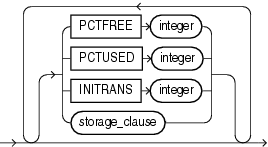
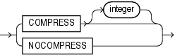
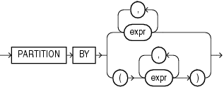

Syntax diagrams are drawings that illustrate valid SQL syntax. To read a diagram, trace it from left to right, in the direction shown by the arrows.

Commands and other keywords appear in UPPERCASE inside rectangles. Type them exactly as shown in the rectangles. Parameters appear in lowercase inside ovals. Variables are used for the parameters. Punctuation, operators, delimiters, and terminators appear inside circles.

If the syntax diagram has more than one path, then you can choose any path. For example, in the following syntax you can specify either `NOPARALLEL` or `PARALLEL`:

parallel\_clause::=


> ```
> { NOPARALLEL | PARALLEL [ integer ] }
> ```
  
  

If you have the choice of more than one keyword, operator, or parameter, then your options appear in a vertical list. For example, in the following syntax diagram, you can specify one or more of the four parameters in the stack:

physical\_attributes\_clause::=



> ```
> [ { PCTFREE integer
>   | PCTUSED integer
>   | INITRANS integer
>   | storage_clause
>   }...
> ]
> ```
  
  

The following table shows parameters that appear in the syntax diagrams and provides examples of the values you might substitute for them in your statements:

Table A-1 Syntax Parameters

| Parameter | Description | Examples |
| --- | --- | --- |
| `table` | The substitution value must be the name of an object of the type specified by the parameter. For a list of all types of objects, see the section, ["Schema Objects"](sql_elements007.md). | `employees` |
| `c` | The substitution value must be a single character from your database character set. | `T`  `s` |
| `'text'` | The substitution value must be a text string in single quotation marks. See the syntax description of ' `text` ' in ["Text Literals"](sql_elements003.md). | `'Employee records'` |
| `char` | The substitution value must be an expression of data type `CHAR` or `VARCHAR2` or a character literal in single quotation marks. | `last_name`  `'Smith'` |
| `condition` | The substitution value must be a condition that evaluates to `TRUE` or `FALSE`. See the syntax description of `condition` in [Chapter 7, "Conditions"](conditions.md). | `last_name >'A'` |
| `date`  `d` | The substitution value must be a date constant or an expression of `DATE` data type. | `TO_DATE(`  `'01-Jan-2002',`  `'DD-MON-YYYY')` |
| `expr` | The substitution value can be an expression of any data type as defined in the syntax description of expr in ["About SQL Expressions"](expressions001.md). | `salary + 1000` |
| `integer` | The substitution value must be an integer as defined by the syntax description of integer in ["Integer Literals"](sql_elements003.md). | `72` |
| `number`  `m`  `n` | The substitution value must be an expression of `NUMBER` data type or a number constant as defined in the syntax description of number in ["Numeric Literals"](sql_elements003.md). | `AVG(salary)`  `15 * 7` |
| `raw` | The substitution value must be an expression of data type `RAW`. | `HEXTORAW('7D')` |
| `subquery` | The substitution value must be a `SELECT` statement that will be used in another SQL statement. See [SELECT](statements_10002.md). | `SELECT last_name`  `FROM employees` |
| `db_name` | The substitution value must be the name of a nondefault database in an embedded SQL program. | `sales_db` |
| `db_string` | The substitution value must be the database identification string for an Oracle Net database connection. For details, see the user's guide for your specific Oracle Net protocol. | — |

## Required Keywords and Parameters

Required keywords and parameters can appear singly or in a vertical list of alternatives. Single required keywords and parameters appear on the main path, which is the horizontal line you are currently traveling. In the following example, `library_name` is a required parameter:

drop\_library::=

  
[Description of the illustration ''drop\_library.gif''](https://docs.oracle.com/cd/E11882_01/server.112/e41084/img_text/drop_library.htm)  
  

If there is a library named `HQ_LIB`, then, according to the diagram, the following statement is valid:

```
DROP LIBRARY hq_lib;
```

If multiple keywords or parameters appear in a vertical list that intersects the main path, then one of them is required. You must choose one of the keywords or parameters, but not necessarily the one that appears on the main path. In the following example, you must choose one of the two settings:

key\_compression::=



> ```
> { COMPRESS [ integer ]
> | NOCOMPRESS
> }
> ```
  

## Optional Keywords and Parameters

If keywords and parameters appear in a vertical list above the main path, then they are optional. In the following example, instead of traveling down a vertical line, you can continue along the main path:

deallocate\_unused\_clause::=


> ```
> DEALLOCATE UNUSED [ KEEP size_clause ]
> ```
  
  

size\_clause::=


> ```
> integer [ K | M | G | T | P | E ]
> ```
  
  

According to the diagrams, all of the following statements are valid:

```
DEALLOCATE UNUSED;
DEALLOCATE UNUSED KEEP 1000;
DEALLOCATE UNUSED KEEP 10G;
DEALLOCATE UNUSED 8T;
```

## Syntax Loops

Loops let you repeat the syntax within them as many times as you like. In the following example, after choosing one value expression, you can go back repeatedly to choose another, separated by commas.

query\_partition\_clause::=



> ```
> PARTITION BY
>   { expr[, expr ]...
>   | ( expr[, expr ]... )
>   }
> ```
  

## Multipart Diagrams

Read a multipart diagram as if all the main paths were joined end to end. The following example is a three-part diagram:

alter\_java::=


> ```
> ALTER JAVA
>   { SOURCE | CLASS } [ schema. ]object_name 
>   [ RESOLVER 
>       ( ( match_string [, ] { schema_name | - } )... )
>   ]
>   { { COMPILE | RESOLVE }
>   | invoker_rights_clause
>   } ;
> ```
  
  

According to the diagram, the following statement is valid:

```
ALTER JAVA SOURCE jsource_1 COMPILE;
```

## Database Objects

The names of Oracle identifiers, such as tables and columns, must not exceed 30 characters in length. The first character must be a letter, but the rest can be any combination of letters, numerals, dollar signs ($), pound signs (#), and underscores (\_).

However, if an Oracle identifier is enclosed by double quotation marks ("), then it can contain any combination of legal characters, including spaces but excluding quotation marks. Oracle identifiers are not case sensitive except within double quotation marks.

See Also:

["Database Object Naming Rules"](sql_elements008.md) for more information