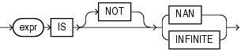

The floating-point conditions let you determine whether an expression is infinite or is the undefined result of an operation (is not a number or `NaN`).

floating\_point\_condition::=



> ```
> expr IS [ NOT ] { NAN | INFINITE }
> ```
  
  

In both forms of floating-point condition, `expr` must resolve to a numeric data type or to any data type that can be implicitly converted to a numeric data type. Table 7-3 describes the floating-point conditions.

Table 7-3 Floating-Point Conditions

| Type of Condition | Operation | Example |
| --- | --- | --- |
| ``` IS [NOT] NAN ``` | Returns `TRUE` if `expr` is the special value `NaN` when `NOT` is not specified. Returns `TRUE` if `expr` is not the special value `NaN` when `NOT` is specified. | ``` SELECT COUNT(*) FROM employees   WHERE commission_pct IS NOT NAN; ``` |
| ``` IS [NOT] INFINITE ``` | Returns `TRUE` if `expr` is the special value + `INF` or - `INF` when `NOT` is not specified. Returns `TRUE` if `expr` is neither + `INF` nor - `INF` when `NOT` is specified. | ``` SELECT last_name FROM employees   WHERE salary IS NOT INFINITE; ``` |

See Also:

- ["Floating-Point Numbers"](sql_elements001.md) for more information on the Oracle implementation of floating-point numbers
- ["Implicit Data Conversion"](sql_elements002.md) for more information on how Oracle converts floating-point data types