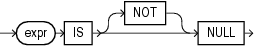

A `NULL` condition tests for nulls. This is the only condition that you should use to test for nulls.

null\_condition::=



> ```
> expr IS [ NOT ] NULL
> ```
  
  

Table 7-9 lists the null conditions.

Table 7-9 Null Condition

| Type of Condition | Operation | Example |
| --- | --- | --- |
| ``` IS [NOT] NULL ``` | Tests for nulls.  See Also: ["Nulls"](sql_elements005.md) | ``` SELECT last_name   FROM employees   WHERE commission_pct   IS NULL   ORDER BY last_name; ``` |