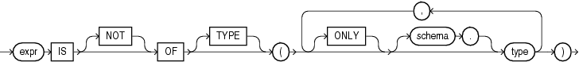

Use the `IS` `OF` `type` condition to test object instances based on their specific type information.

is\_of\_type\_condition::=



> ```
> expr IS [ NOT ] OF [ TYPE ]
>    ([ ONLY ] [ schema. ] type
>       [, [ ONLY ] [ schema. ] type ]...
>    )
> ```
  
  

You must have `EXECUTE` privilege on all types referenced by `type`, and all `type` s must belong to the same type family.

This condition evaluates to null if `expr` is null. If `expr` is not null, then the condition evaluates to true (or false if you specify the `NOT` keyword) under either of these circumstances:

- The most specific type of `expr` is the subtype of one of the types specified in the `type` list and you have not specified `ONLY` for the type, or
- The most specific type of `expr` is explicitly specified in the `type` list.

The `expr` frequently takes the form of the `VALUE` function with a correlation variable.

The following example uses the sample table `oe.persons`, which is built on a type hierarchy in ["Substitutable Table and Column Examples"](statements_7002.md). The example uses the `IS` `OF` `type` condition to restrict the query to specific subtypes:

```
SELECT * FROM persons p 
   WHERE VALUE(p) IS OF TYPE (employee_t);

NAME                     SSN
----------------------------
Joe                    32456
Tim                     5678

SELECT * FROM persons p 
   WHERE VALUE(p) IS OF (ONLY part_time_emp_t);

NAME                     SSN
----------------------------
Tim                     5678
```