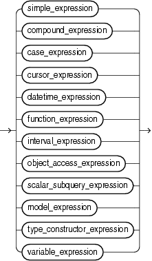

An expression is a combination of one or more values, operators, and SQL functions that evaluates to a value. An expression generally assumes the data type of its components.

Note:

The combined values of the `NLS_COMP` and `NLS_SORT` settings determine the rules by which characters are sorted and compared. If `NLS_COMP` is set to `LINGUISTIC` for your database, then all entities in this chapter will be interpreted according to the rules specified by the `NLS_SORT` parameter. If `NLS_COMP` is not set to `LINGUISTIC`, then the functions are interpreted without regard to the `NLS_SORT` setting. `NLS_SORT` can be explicitly set. If it is not set explicitly, it is derived from `NLS_LANGUAGE`. Refer to [Oracle Database Globalization Support Guide](https://docs.oracle.com/cd/E11882_01/server.112/e10729/ch5lingsort.htm#NLSPG005) for more information on these settings.

This simple expression evaluates to 4 and has data type `NUMBER` (the same data type as its components):

```
2*2
```

The following expression is an example of a more complex expression that uses both functions and operators. The expression adds seven days to the current date, removes the time component from the sum, and converts the result to `CHAR` data type:

```
TO_CHAR(TRUNC(SYSDATE+7))
```

You can use expressions in:

- The select list of the `SELECT` statement
- A condition of the `WHERE` clause and `HAVING` clause
- The `CONNECT` `BY`, `START` `WITH`, and `ORDER` `BY` clauses
- The `VALUES` clause of the `INSERT` statement
- The `SET` clause of the `UPDATE` statement

For example, you could use an expression in place of the quoted string `'Smith'` in this `UPDATE` statement `SET` clause:

```
SET last_name = 'Smith';
```

This `SET` clause has the expression `INITCAP` (`last_name`) instead of the quoted string ' `Smith` ':

```
SET last_name = INITCAP(last_name);
```

Expressions have several forms, as shown in the following syntax:

expr::=



> ```
> { simple_expression
> | compound_expression
> | case_expression
> | cursor_expression
> | datetime_expression
> | function_expression
> | interval_expression
> | object_access_expression
> | scalar_subquery_expression
> | model_expression
> | type_constructor_expression
> | variable_expression
> }
> ```
  
  

Oracle Database does not accept all forms of expressions in all parts of all SQL statements. Refer to the individual SQL statements in [Chapter 10](statements_1.md) through [Chapter 19](statements_10.md) for information on restrictions on the expressions in that statement.

You must use appropriate expression notation whenever `expr` appears in conditions, SQL functions, or SQL statements in other parts of this reference. The sections that follow describe and provide examples of the various forms of expressions.