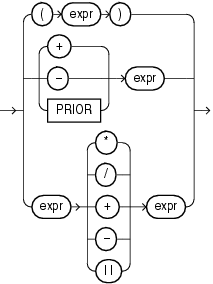

A compound expression specifies a combination of other expressions.

compound\_expression::=



> ```
> { (expr)
> | { + | - | PRIOR } expr
> | expr { * | / | + | - | || } expr
> }
>
> Note: The double vertical bars are part of the syntax
>       (indicating concatenation) rather than BNF notation.
> ```
  
  

You can use any built-in function as an expression (["Function Expressions"](expressions008.md)). However, in a compound expression, some combinations of functions are inappropriate and are rejected. For example, the `LENGTH` function is inappropriate within an aggregate function.

The `PRIOR` operator is used in `CONNECT` `BY` clauses of hierarchical queries.

See Also:

["Operator Precedence"](operators001.md) and ["Hierarchical Queries"](queries003.md)

Some valid compound expressions are:

```
('CLARK' || 'SMITH') 
LENGTH('MOOSE') * 57 
SQRT(144) + 72 
my_fun(TO_CHAR(sysdate,'DD-MMM-YY'))
```