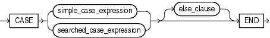
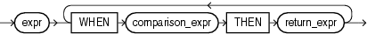
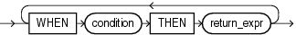

`CASE` expressions let you use `IF`... `THEN`... `ELSE` logic in SQL statements without having to invoke procedures. The syntax is:



> ```
> CASE { simple_case_expression
>      | searched_case_expression
>      }
>      [ else_clause ]
>      END
> ```
  
  

simple\_case\_expression::=



> ```
> expr
>   { WHEN comparison_expr THEN return_expr }...
> ```
  
  

searched\_case\_expression::=



> ```
> { WHEN condition THEN return_expr }...
> ```
  
  

else\_clause::=

  
[Description of the illustration ''else\_clause.gif''](https://docs.oracle.com/cd/E11882_01/server.112/e41084/img_text/else_clause.htm)  
  

In a simple `CASE` expression, Oracle Database searches for the first `WHEN`... `THEN` pair for which `expr` is equal to `comparison_expr` and returns `return_expr`. If none of the `WHEN`... `THEN` pairs meet this condition, and an `ELSE` clause exists, then Oracle returns `else_expr`. Otherwise, Oracle returns null.

In a searched `CASE` expression, Oracle searches from left to right until it finds an occurrence of `condition` that is true, and then returns `return_expr`. If no `condition` is found to be true, and an `ELSE` clause exists, then Oracle returns `else_expr`. Otherwise, Oracle returns null.

Oracle Database uses short-circuit evaluation. For a simple `CASE` expression, the database evaluates each `comparison_expr` value only before comparing it to `expr`, rather than evaluating all `comparison_expr` values before comparing any of them with `expr`. Consequently, Oracle never evaluates a `comparison_expr` if a previous `comparison_expr` is equal to `expr`. For a searched `CASE` expression, the database evaluates each `condition` to determine whether it is true, and never evaluates a `condition` if the previous `condition` was true.

For a simple `CASE` expression, the `expr` and all `comparison_expr` values must either have the same data type (`CHAR`, `VARCHAR2`, `NCHAR`, or `NVARCHAR2`, `NUMBER`, `BINARY_FLOAT`, or `BINARY_DOUBLE`) or must all have a numeric data type. If all expressions have a numeric data type, then Oracle determines the argument with the highest numeric precedence, implicitly converts the remaining arguments to that data type, and returns that data type.

For both simple and searched `CASE` expressions, all of the `return_expr` s must either have the same data type (`CHAR`, `VARCHAR2`, `NCHAR`, or `NVARCHAR2`, `NUMBER`, `BINARY_FLOAT`, or `BINARY_DOUBLE`) or must all have a numeric data type. If all return expressions have a numeric data type, then Oracle determines the argument with the highest numeric precedence, implicitly converts the remaining arguments to that data type, and returns that data type.

The maximum number of arguments in a `CASE` expression is 65535. All expressions count toward this limit, including the initial expression of a simple `CASE` expression and the optional `ELSE` expression. Each `WHEN`... `THEN` pair counts as two arguments. To avoid exceeding this limit, you can nest `CASE` expressions so that the `return_expr` itself is a `CASE` expression.

See Also:

- [Table 3-10, "Implicit Type Conversion Matrix"](sql_elements002.md) for more information on implicit conversion
- ["Numeric Precedence"](sql_elements001.md) for information on numeric precedence
- [COALESCE](functions030.md) and [NULLIF](functions116.md) for alternative forms of `CASE` logic
- [Oracle Database Data Warehousing Guide](https://docs.oracle.com/cd/E11882_01/server.112/e25554/analysis.htm#DWHSG02012) for examples using various forms of the `CASE` expression

Simple CASE Example For each customer in the sample `oe.customers` table, the following statement lists the credit limit as "Low" if it equals $100, "High" if it equals $5000, and "Medium" if it equals anything else.

```
SELECT cust_last_name,
   CASE credit_limit WHEN 100 THEN 'Low'
   WHEN 5000 THEN 'High'
   ELSE 'Medium' END AS credit
   FROM customers
   ORDER BY cust_last_name, credit;

CUST_LAST_NAME       CREDIT
-------------------- ------
Adjani               Medium
Adjani               Medium
Alexander            Medium
Alexander            Medium
Altman               High
Altman               Medium
. . .
```

Searched CASE Example The following statement finds the average salary of the employees in the sample table `oe.employees`, using $2000 as the lowest salary possible:

```
SELECT AVG(CASE WHEN e.salary > 2000 THEN e.salary
   ELSE 2000 END) "Average Salary" FROM employees e;

Average Salary
--------------
    6461.68224
```