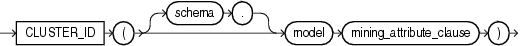

Syntax



> ```
> CLUSTER_ID ( [ schema . ] model mining_attribute_clause )
> ```
  
  

mining\_attribute\_clause::=


> ```
> USING
> { * 
> | { [ schema . ] table . * 
>   | expr [ AS alias ]
>   }
>     [, { [ schema . ] table . * 
>        | expr [ AS alias ]
>        }
>     ]...
> }
> ```
  
  

Purpose

This function is for use with clustering models created by the `DBMS_DATA_MINING` package or with Oracle Data Miner. It returns the cluster identifier of the predicted cluster with the highest probability for the set of predictors specified in the `mining_attribute_clause`. The value returned is an Oracle `NUMBER`.

The `mining_attribute_clause` behaves as described for the `PREDICTION` function. Refer to [mining\_attribute\_clause](functions132.md).

See Also:

- [Oracle Data Mining Concepts](https://docs.oracle.com/cd/E11882_01/datamine.112/e16808/toc.htm) for detailed information about Oracle Data Mining
- [Oracle Data Mining Application Developer's Guide](https://docs.oracle.com/cd/E11882_01/datamine.112/e12218/models_deploying.htm#DMPRG004) for detailed information about scoring with the Data Mining SQL functions

Examples

The following example lists the clusters into which customers of a given dataset have been grouped.

This example, and the prerequisite data mining operations, including the creation of the `km_sh_clus_sample` model and the `mining_data_apply_v` view, can be found in the demo file `$ORACLE_HOME/rdbms/demo/dmkmdemo.sql`. General information on data mining demo files is available in [Oracle Data Mining Administrator's Guide](https://docs.oracle.com/cd/E11882_01/datamine.112/e16807/sampleprogs.htm#DMADM009). The example is presented here to illustrate the syntactic use of the function.

```
SELECT CLUSTER_ID(km_sh_clus_sample USING *) AS clus, COUNT(*) AS cnt 
  FROM mining_data_apply_v
  GROUP BY CLUSTER_ID(km_sh_clus_sample USING *)
  ORDER BY cnt DESC;

      CLUS        CNT
---------- ----------
         2        580
        10        216
         6        186
         8        115
        19        110
        12        101
        18         81
        16         39
        17         38
        14         34
 
10 rows selected.
```