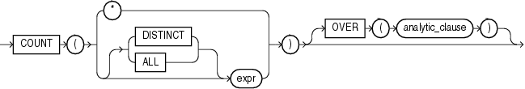

Syntax



> ```
> COUNT({ * | [ DISTINCT | ALL ] expr }) [ OVER (analytic_clause) ]
> ```
  
  

See Also:

["Analytic Functions"](functions004.md) for information on syntax, semantics, and restrictions

Purpose

`COUNT` returns the number of rows returned by the query. You can use it as an aggregate or analytic function.

If you specify `DISTINCT`, then you can specify only the `query_partition_clause` of the `analytic_clause`. The `order_by_clause` and `windowing_clause` are not allowed.

If you specify `expr`, then `COUNT` returns the number of rows where `expr` is not null. You can count either all rows, or only distinct values of `expr`.

If you specify the asterisk (\*), then this function returns all rows, including duplicates and nulls. `COUNT` never returns null.

See Also:

["About SQL Expressions"](expressions001.md) for information on valid forms of `expr` and ["Aggregate Functions"](functions003.md)

Aggregate Examples

The following examples use `COUNT` as an aggregate function:

```
SELECT COUNT(*) "Total"
  FROM employees;

     Total
----------
       107

SELECT COUNT(*) "Allstars"
  FROM employees
  WHERE commission_pct > 0;

 Allstars
---------
       35

SELECT COUNT(commission_pct) "Count"
  FROM employees;

     Count
----------
        35

SELECT COUNT(DISTINCT manager_id) "Managers"
  FROM employees;

  Managers
----------
        18
```

Analytic Example

The following example calculates, for each employee in the `employees` table, the moving count of employees earning salaries in the range 50 less than through 150 greater than the employee's salary.

```
SELECT last_name, salary,
       COUNT(*) OVER (ORDER BY salary RANGE BETWEEN 50 PRECEDING AND
                      150 FOLLOWING) AS mov_count
  FROM employees
  ORDER BY salary, last_name;

LAST_NAME                     SALARY  MOV_COUNT
------------------------- ---------- ----------
Olson                           2100          3
Markle                          2200          2
Philtanker                      2200          2
Gee                             2400          8
Landry                          2400          8
Colmenares                      2500         10
Marlow                          2500         10
Patel                           2500         10
. . .
```