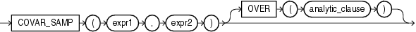

Syntax



> ```
> COVAR_SAMP(expr1, expr2) [ OVER (analytic_clause) ]
> ```
  
  

See Also:

["Analytic Functions"](functions004.md) for information on syntax, semantics, and restrictions

Purpose

`COVAR_SAMP` returns the sample covariance of a set of number pairs. You can use it as an aggregate or analytic function.

This function takes as arguments any numeric data type or any nonnumeric data type that can be implicitly converted to a numeric data type. Oracle determines the argument with the highest numeric precedence, implicitly converts the remaining arguments to that data type, and returns that data type.

See Also:

[Table 3-10, "Implicit Type Conversion Matrix"](sql_elements002.md) for more information on implicit conversion and ["Numeric Precedence"](sql_elements001.md) for information on numeric precedence

Oracle Database applies the function to the set of (`expr1`, `expr2`) pairs after eliminating all pairs for which either `expr1` or `expr2` is null. Then Oracle makes the following computation:

```
(SUM(expr1 * expr2) - SUM(expr1) * SUM(expr2) / n) / (n-1)
```

where `n` is the number of (`expr1`, `expr2`) pairs where neither `expr1` nor `expr2` is null.

The function returns a value of type `NUMBER`. If the function is applied to an empty set, then it returns null.

See Also:

["About SQL Expressions"](expressions001.md) for information on valid forms of `expr` and ["Aggregate Functions"](functions003.md)

Aggregate Example

Refer to the aggregate example for [COVAR\_POP](functions040.md).

Analytic Example

Refer to the analytic example for [COVAR\_POP](functions040.md).