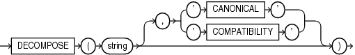

Syntax



> ```
> DECOMPOSE( string [, { 'CANONICAL' | 'COMPATIBILITY' } ] )
> ```
  
  

Purpose

`DECOMPOSE` is valid only for Unicode characters. `DECOMPOSE` takes as its argument a string in any data type and returns a Unicode string after decomposition in the same character set as the input. For example, an o-umlaut code point will be returned as the "o" code point followed by an umlaut code point.

- `string` can be any of the data types `CHAR`, `VARCHAR2`, `NCHAR`, `NVARCHAR2`, `CLOB`, or `NCLOB`.
- `CANONICAL` causes canonical decomposition, which allows recomposition (for example, with the `COMPOSE` function) to the original string. This is the default and returns the string in NFD normal form.
- `COMPATIBILITY` causes decomposition in compatibility mode. In this mode, recomposition is not possible. This mode is useful, for example, when decomposing half-width and full-width katakana characters, where recomposition might not be desirable without external formatting or style information. It returns the string in NFKD normal form.

`CLOB` and `NCLOB` values are supported through implicit conversion. If `char` is a character LOB value, then it is converted to a `VARCHAR` value before the `COMPOSE` operation. The operation will fail if the size of the LOB value exceeds the supported length of the `VARCHAR` in the particular development environment.

See Also:

- [Oracle Database Globalization Support Guide](https://docs.oracle.com/cd/E11882_01/server.112/e10729/applocaledata.htm#NLSPG014) for information on Unicode character sets and character semantics
- [COMPOSE](functions032.md)

Examples

The following example decomposes the string " `Châteaux` " into its component code points:

```
SELECT DECOMPOSE ('Châteaux')
  FROM DUAL; 

DECOMPOSE
---------
Cha^teaux
```

Note:

The results of this example can vary depending on the character set of your operating system.