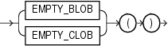

Syntax

empty\_LOB::=



> ```
> { EMPTY_BLOB | EMPTY_CLOB }( )
> ```
  
  

Purpose

`EMPTY_BLOB` and `EMPTY_CLOB` return an empty LOB locator that can be used to initialize a LOB variable or, in an `INSERT` or `UPDATE` statement, to initialize a LOB column or attribute to `EMPTY`. `EMPTY` means that the LOB is initialized, but not populated with data.

Note:

An empty LOB is not the same as a null LOB, and an empty `CLOB` is not the same as a LOB containing a string of 0 length. For more information, see [Oracle Database SecureFiles and Large Objects Developer's Guide](https://docs.oracle.com/cd/E11882_01/appdev.112/e18294/adlob_working.htm#ADLOB002).

Restriction on LOB Locators You cannot use the locator returned from this function as a parameter to the `DBMS_LOB` package or the OCI.

Examples

The following example initializes the `ad_photo` column of the sample `pm.print_media` table to `EMPTY`:

```
UPDATE print_media
  SET ad_photo = EMPTY_BLOB();
```