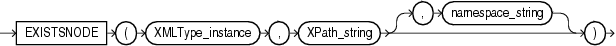

Note:

The `EXISTSNODE` function is deprecated. It is still supported for backward compatibility. However, Oracle recommends that you use the `XMLEXISTS` function instead. See [XMLEXISTS](functions243.md) for more information.

Syntax



> ```
> EXISTSNODE(XMLType_instance, XPath_string [, namespace_string ])
> ```
  
  

Purpose

`EXISTSNODE` determines whether traversal of an XML document using a specified path results in any nodes. It takes as arguments the `XMLType` instance containing an XML document and a `VARCHAR2` XPath string designating a path. The optional `namespace_string` must resolve to a `VARCHAR2` value that specifies a default mapping or namespace mapping for prefixes, which Oracle Database uses when evaluating the XPath expression(s).

The `namespace_string` argument defaults to the namespace of the root element. If you refer to any subelement in `Xpath_string`, then you must specify `namespace_string`, and you must specify the "who" prefix in both of these arguments.

See Also:

["Using XML in SQL Statements"](ap_examples002.md) for examples that specify `namespace_string` and use the "who" prefix.

The return value is `NUMBER`:

- 0 if no nodes remain after applying the XPath traversal on the document
- 1 if any nodes remain

Examples

The following example tests for the existence of the `/Warehouse/Dock` node in the XML path of the `warehouse_spec` column of the sample table `oe.warehouses`:

```
SELECT warehouse_id, warehouse_name
  FROM warehouses
  WHERE EXISTSNODE(warehouse_spec, '/Warehouse/Docks') = 1
  ORDER BY warehouse_id;

WAREHOUSE_ID WAREHOUSE_NAME
------------ -----------------------------------
           1 Southlake, Texas
           2 San Francisco
           4 Seattle, Washington
```