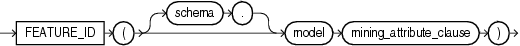

Syntax



> ```
> FEATURE_ID( [ schema . ] model mining_attribute_clause )
> ```
  
  

mining\_attribute\_clause:=


> ```
> USING
> { * 
> | { [ schema . ] table . * 
>   | expr [ AS alias ]
>   }
>     [, { [ schema . ] table . * 
>        | expr [ AS alias ]
>        }
>     ]...
> }
> ```
  
  

Purpose

This function is for use with feature extraction models created by the `DBMS_DATA_MINING` package or with Oracle Data Miner. It returns an Oracle `NUMBER` that is the identifier of the feature with the highest value in the row.

The `mining_attribute_clause` behaves as described for the `PREDICTION` function. Refer to [mining\_attribute\_clause](functions132.md).

See Also:

- [Oracle Data Mining Concepts](https://docs.oracle.com/cd/E11882_01/datamine.112/e16808/toc.htm) for detailed information about Oracle Data Mining
- [Oracle Data Mining Application Developer's Guide](https://docs.oracle.com/cd/E11882_01/datamine.112/e12218/models_deploying.htm#DMPRG004) for detailed information about scoring with the Data Mining SQL functions

Examples

The following example lists the features and corresponding count of customers in a dataset.

This example and the prerequisite data mining operations, including creation of the `nmf_sh_sample` model and `nmf_sh_sample_apply_prepared` view, can be found in the demo file `$ORACLE_HOME/rdbms/demo/dmnmdemo.sql`. General information on data mining demo files is available in [Oracle Data Mining Administrator's Guide](https://docs.oracle.com/cd/E11882_01/datamine.112/e16807/sampleprogs.htm#DMADM009). The example is presented here to illustrate the syntactic use of the function.

```
SELECT FEATURE_ID(nmf_sh_sample USING *) AS feat, COUNT(*) AS cnt
  FROM nmf_sh_sample_apply_prepared
  GROUP BY FEATURE_ID(nmf_sh_sample USING *)
  ORDER BY cnt DESC, feat DESC;

      FEAT        CNT
---------- ----------
         7       1443
         2         49
         3          6
         6          1
         1          1
```