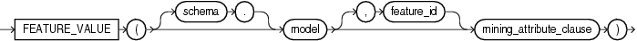

Syntax



> ```
> FEATURE_VALUE( [ schema . ] model [, feature_id ] mining_attribute_clause )
> ```
  
  

mining\_attribute\_clause:=


> ```
> USING
> { * 
> | { [ schema . ] table . * 
>   | expr [ AS alias ]
>   }
>     [, { [ schema . ] table . * 
>        | expr [ AS alias ]
>        }
>     ]...
> }
> ```
  
  

Purpose

This function is for use with feature extraction models created by the `DBMS_DATA_MINING` package or with Oracle Data Miner. It returns the value of a given feature. If you omit the `feature_id` argument, then the function returns the highest feature value. You can use this form in conjunction with the `FEATURE_ID` function to obtain the largest feature/value combination.

The `mining_attribute_clause` behaves as described for the `PREDICTION` function. Refer to [mining\_attribute\_clause](functions132.md).

See Also:

- [Oracle Data Mining Concepts](https://docs.oracle.com/cd/E11882_01/datamine.112/e16808/toc.htm) for detailed information about Oracle Data Mining
- [Oracle Data Mining Application Developer's Guide](https://docs.oracle.com/cd/E11882_01/datamine.112/e12218/models_deploying.htm#DMPRG004) for detailed information about scoring with the Data Mining SQL functions

Examples

The following example lists the customers that correspond to feature 3, ordered by match quality.

This example and the prerequisite data mining operations, including the creation of the model and view, can be found in the demo file `$ORACLE_HOME/rdbms/demo/dmnmdemo.sql`. General information on data mining demo files is available in [Oracle Data Mining Administrator's Guide](https://docs.oracle.com/cd/E11882_01/datamine.112/e16807/sampleprogs.htm#DMADM009). The example is presented here to illustrate the syntactic use of the function.

```
SELECT *
  FROM (SELECT cust_id, FEATURE_VALUE(nmf_sh_sample, 3 USING *) match_quality
          FROM nmf_sh_sample_apply_prepared
          ORDER BY match_quality DESC)
  WHERE ROWNUM < 11;

   CUST_ID MATCH_QUALITY
---------- -------------
    100210    19.4101627
    100962    15.2482251
    101151    14.5685197
    101499    14.4186292
    100363    14.4037396
    100372    14.3335148
    100982    14.1716545
    101039    14.1079914
    100759    14.0913761
    100953    14.0799737
 
10 rows selected.
```