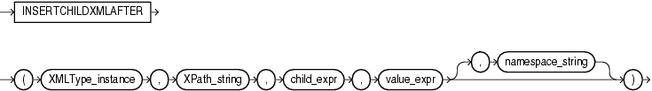

Syntax



> ```
> INSERTCHILDXMLAFTER
>   ( XMLType_instance, XPath_string, child_expr, value_expr [, namespace_string ] )
> ```
  
  

Purpose

`INSERTXMLCHILDAFTER` inserts one or more collection elements as children of target parent elements. The insertion for each target occurs immediately after a specified existing collection element. The existing XML document that is the target of the insertion can be schema-based or non-schema-based.

- `XMLType_instance` identifies the XML data that is the target of the insertion.
- `XPath_string` locates the parent elements within target-data; child-data is inserted under each parent element.
- `child_expr` is a relative XPath 1.0 expression that locates the existing child that will precede the inserted child-data. It must name a child element of the element indicated by parent-xpath, and it can include a predicate.
- `value_expr` is the `XMLType` child element data to insert. Each top-level element node in this argument must have the same data type as the element indicated by child\_expr.
- The optional `namespace_string` specifies the namespace for the parent elements, existing child element, and child element XML data to be inserted.

See Also:

[Oracle XML DB Developer's Guide](https://docs.oracle.com/cd/E11882_01/appdev.112/e23094/xdb04cre.htm#ADXDB0440) for more information about this function

Examples

The following example is similar to that for `INSERTCHILDXML`, but it adds a third `/Owner` node after the `/Owner` node added in the other example. The output of the query has been formatted for readability.

```
UPDATE warehouses
  SET warehouse_spec = INSERTCHILDXMLAFTER(warehouse_spec, '/Warehouse/Building',
    'Owner[2]', XMLType('<Owner>ThirdOwner</Owner>'))
  WHERE warehouse_id = 3;

SELECT warehouse_name,
       EXTRACT(warehouse_spec, '/Warehouse/Building/Owner') "Owners"
  FROM warehouses
  WHERE warehouse_id = 3;

WAREHOUSE_NAME                      Owners
----------------------------------- ------------------------------
New Jersey                          <Owner>GrandCo</Owner>
                                    <Owner>LesserCo</Owner>
                                    <Owner>ThirdOwner</Owner>
```