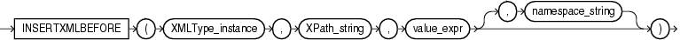

Syntax



> ```
> INSERTXMLBEFORE
>   ( XMLType_instance, XPath_string, value_expr [, namespace_string ] )
> ```
  
  

Purpose

`INSERTXMLBEFORE` inserts a user-supplied value into the target XML before the node indicated by the XPath expression. This function is similar to INSERTXMLAFTER, but it inserts before, not after, the target node. Compare this function with [INSERTCHILDXML](functions075.md).

- `XMLType_instance` is an instance of `XMLType`.
- `XPath_string` is an Xpath expression indicating one or more nodes into which one or more child nodes are to be inserted. You can specify an absolute `XPath_string` with an initial slash or a relative `XPath_string` by omitting the initial slash. If you omit the initial slash, then the context of the relative path defaults to the root node.
- `value_expr` is a fragment of `XMLType` that defines one or more nodes being inserted and their position within the parent node. It must resolve to a string.
- The optional `namespace_string` provides namespace information for the `XPath_string`. This parameter must be of type `VARCHAR2`.

See Also:

[Oracle XML DB Developer's Guide](https://docs.oracle.com/cd/E11882_01/appdev.112/e23094/xdb04cre.htm#ADXDB0440) for more information about this function

Examples

The following example is similar to that for [INSERTCHILDXML](functions075.md), but it adds a third `/Owner` node before the `/Owner` node added in the other example. The output of the query has been formatted for readability.

```
UPDATE warehouses
  SET warehouse_spec = INSERTXMLBEFORE(warehouse_spec,
    '/Warehouse/Building/Owner[2]', XMLType('<Owner>ThirdOwner</Owner>'))
  WHERE warehouse_id = 3;

SELECT warehouse_name,
       EXTRACT(warehouse_spec, '/Warehouse/Building/Owner') "Owners"
  FROM warehouses
  WHERE warehouse_id = 3;

WAREHOUSE_NAME                      Owners
----------------------------------- ------------------------------
New Jersey                          <Owner>GrandCo</Owner>
                                    <Owner>ThirdOwner</Owner>
                                    <Owner>LesserCo</Owner>
```