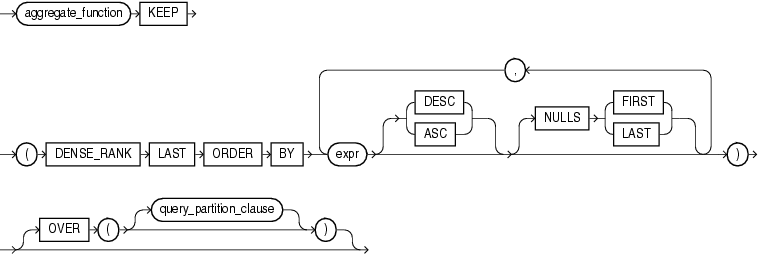

Syntax

last::=



> ```
> aggregate_function KEEP
>   (DENSE_RANK LAST ORDER BY
>     expr [ DESC | ASC ]
>          [ NULLS { FIRST | LAST } ]
>     [, expr [ DESC | ASC ]
>             [ NULLS { FIRST | LAST } ]
>     ]...
>   )
>   [ OVER ( [query_partition_clause] ) ]
> ```
  
  

See Also:

["Analytic Functions"](functions004.md) for information on syntax, semantics, and restrictions of the `query_partitioning_clause`

Purpose

`FIRST` and `LAST` are very similar functions. Both are aggregate and analytic functions that operate on a set of values from a set of rows that rank as the `FIRST` or `LAST` with respect to a given sorting specification. If only one row ranks as `FIRST` or `LAST`, then the aggregate operates on the set with only one element.

Refer to [FIRST](functions065.md) for complete information on this function and for examples of its use.