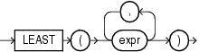

Syntax



> ```
> LEAST(expr [, expr ]...)
> ```
  
  

Purpose

`LEAST` returns the least of a list of one or more expressions. Oracle Database uses the first `expr` to determine the return type. If the first `expr` is numeric, then Oracle determines the argument with the highest numeric precedence, implicitly converts the remaining arguments to that data type before the comparison, and returns that data type. If the first `expr` is not numeric, then each `expr` after the first is implicitly converted to the data type of the first `expr` before the comparison.

Oracle Database compares each `expr` using nonpadded comparison semantics. The comparison is binary by default and is linguistic if the `NLS_COMP` parameter is set to `LINGUISTIC` and the `NLS_SORT` parameter has a setting other than `BINARY`. Character comparison is based on the numerical codes of the characters in the database character set and is performed on whole strings treated as one sequence of bytes, rather than character by character. If the value returned by this function is character data, then its data type is `VARCHAR2` if the first `expr` is a character data type and `NVARCHAR2` if the first `expr` is a national character data type.

See Also:

- ["Data Type Comparison Rules"](sql_elements002.md) for more information on character comparison
- [Table 3-10, "Implicit Type Conversion Matrix"](sql_elements002.md) for more information on implicit conversion and ["Floating-Point Numbers"](sql_elements001.md) for information on binary-float comparison semantics
- ["GREATEST"](functions069.md), which returns the greatest of a list of one or more expressions

Examples

The following statement selects the string with the least value:

```
SELECT LEAST('HARRY','HARRIOT','HAROLD') "Least"
  FROM DUAL;
 
Least 
------
HAROLD
```

In the following statement, the first argument is numeric. Oracle Database determines that the argument with the highest numeric precedence is the third argument, converts the remaining arguments to the data type of the third argument, and returns the least value as that data type:

```
SELECT LEAST (1, '2.1', '.000832') "Least"
  FROM DUAL;
 
Least
-------
.000832
```