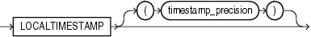

Syntax



> ```
> LOCALTIMESTAMP [ (timestamp_precision) ]
> ```
  
  

Purpose

`LOCALTIMESTAMP` returns the current date and time in the session time zone in a value of data type `TIMESTAMP`. The difference between this function and `CURRENT_TIMESTAMP` is that `LOCALTIMESTAMP` returns a `TIMESTAMP` value while `CURRENT_TIMESTAMP` returns a `TIMESTAMP` `WITH` `TIME` `ZONE` value.

The optional argument `timestamp_precision` specifies the fractional second precision of the time value returned.

See Also:

[CURRENT\_TIMESTAMP](functions045.md), ["TIMESTAMP Data Type"](sql_elements001.md), and ["TIMESTAMP WITH TIME ZONE Data Type"](sql_elements001.md)

Examples

This example illustrates the difference between `LOCALTIMESTAMP` and `CURRENT_TIMESTAMP`:

```
ALTER SESSION SET TIME_ZONE = '-5:00';
SELECT CURRENT_TIMESTAMP, LOCALTIMESTAMP FROM DUAL;

CURRENT_TIMESTAMP                    LOCALTIMESTAMP
-------------------------------------------------------------------
04-APR-00 01.27.18.999220 PM -05:00  04-APR-00 01.27.19 PM

ALTER SESSION SET TIME_ZONE = '-8:00';
SELECT CURRENT_TIMESTAMP, LOCALTIMESTAMP FROM DUAL;

CURRENT_TIMESTAMP                    LOCALTIMESTAMP
-----------------------------------  ------------------------------
04-APR-00 10.27.45.132474 AM -08:00  04-APR-00 10.27.451 AM
```

When you use the `LOCALTIMESTAMP` with a format mask, take care that the format mask matches the value returned by the function. For example, consider the following table:

```
CREATE TABLE local_test (col1 TIMESTAMP WITH LOCAL TIME ZONE);
```

The following statement fails because the mask does not include the `TIME` `ZONE` portion of the return type of the function:

```
INSERT INTO local_test
  VALUES (TO_TIMESTAMP(LOCALTIMESTAMP, 'DD-MON-RR HH.MI.SSXFF'));
```

The following statement uses the correct format mask to match the return type of `LOCALTIMESTAMP`:

```
INSERT INTO local_test
  VALUES (TO_TIMESTAMP(LOCALTIMESTAMP, 'DD-MON-RR HH.MI.SSXFF PM'));
```