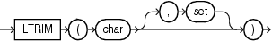

Syntax



> ```
> LTRIM(char [, set ])
> ```
  
  

Purpose

`LTRIM` removes from the left end of `char` all of the characters contained in `set`. If you do not specify `set`, then it defaults to a single blank. If `char` is a character literal, then you must enclose it in single quotation marks. Oracle Database begins scanning `char` from its first character and removes all characters that appear in `set` until reaching a character not in `set` and then returns the result.

Both `char` and `set` can be any of the data types `CHAR`, `VARCHAR2`, `NCHAR`, `NVARCHAR2`, `CLOB`, or `NCLOB`. The string returned is of `VARCHAR2` data type if `char` is a character data type, `NVARCHAR2` if `char` is a national character data type, and a LOB if `char` is a LOB data type.

See Also:

[RTRIM](functions160.md)

Examples

The following example trims all the left-most occurrences of less than sign (`<`), greater than sign (`>`), and equal sign (`=`) from a string:

```
SELECT LTRIM('<=====>BROWNING<=====>', '<>=') "LTRIM Example"
  FROM DUAL;

LTRIM Example
---------------
BROWNING<=====>
```