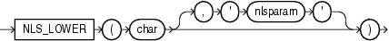

Syntax



> ```
> NLS_LOWER(char [, 'nlsparam' ])
> ```
  
  

Purpose

`NLS_LOWER` returns `char`, with all letters lowercase.

Both `char` and `'nlsparam'` can be any of the data types `CHAR`, `VARCHAR2`, `NCHAR`, `NVARCHAR2`, `CLOB`, or `NCLOB`. The string returned is of `VARCHAR2` data type if `char` is a character data type and a LOB if `char` is a LOB data type. The return string is in the same character set as `char`.

The `'nlsparam'` can have the same form and serve the same purpose as in the `NLS_INITCAP` function.

Examples

The following statement returns the lowercase form of the character string ' `NOKTASINDA` ' using the XTurkish linguistic sort sequence. The Turkish uppercase I becoming a small, dotless i.

```
SELECT NLS_LOWER('NOKTASINDA', 'NLS_SORT = XTurkish') "Lowercase"
  FROM DUAL;
```