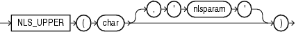

Syntax



> ```
> NLS_UPPER(char [, 'nlsparam' ])
> ```
  
  

Purpose

`NLS_UPPER` returns `char`, with all letters uppercase.

Both `char` and `'nlsparam'` can be any of the data types `CHAR`, `VARCHAR2`, `NCHAR`, `NVARCHAR2`, `CLOB`, or `NCLOB`. The string returned is of `VARCHAR2` data type if `char` is a character data type and a LOB if `char` is a LOB data type. The return string is in the same character set as `char`.

The `'nlsparam'` can have the same form and serve the same purpose as in the `NLS_INITCAP` function.

Examples

The following example returns a string with all the letters converted to uppercase:

```
SELECT NLS_UPPER('große') "Uppercase"
  FROM DUAL;

Upper
-----
GROßE

SELECT NLS_UPPER('große', 'NLS_SORT = XGerman') "Uppercase" 
  FROM DUAL;

Upperc
------
GROSSE
```

See Also:

[NLS\_INITCAP](functions110.md)