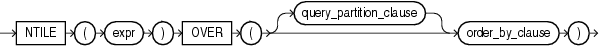

Syntax



> ```
> NTILE(expr) OVER ([ query_partition_clause ] order_by_clause)
> ```
  
  

See Also:

["Analytic Functions"](functions004.md) for information on syntax, semantics, and restrictions, including valid forms of `expr`

Purpose

`NTILE` is an analytic function. It divides an ordered data set into a number of buckets indicated by `expr` and assigns the appropriate bucket number to each row. The buckets are numbered 1 through `expr`. The `expr` value must resolve to a positive constant for each partition. Oracle Database expects an integer, and if `expr` is a noninteger constant, then Oracle truncates the value to an integer. The return value is `NUMBER`.

The number of rows in the buckets can differ by at most 1. The remainder values (the remainder of number of rows divided by buckets) are distributed one for each bucket, starting with bucket 1.

If `expr` is greater than the number of rows, then a number of buckets equal to the number of rows will be filled, and the remaining buckets will be empty.

You cannot nest analytic functions by using `NTILE` or any other analytic function for `expr`. However, you can use other built-in function expressions for `expr`.

See Also:

["About SQL Expressions"](expressions001.md) for information on valid forms of `expr` and [Table 3-10, "Implicit Type Conversion Matrix"](sql_elements002.md) for more information on implicit conversion

Examples

The following example divides into 4 buckets the values in the `salary` column of the `oe.employees` table from Department 100. The `salary` column has 6 values in this department, so the two extra values (the remainder of 6 / 4) are allocated to buckets 1 and 2, which therefore have one more value than buckets 3 or 4.

```
SELECT last_name, salary, NTILE(4) OVER (ORDER BY salary DESC) AS quartile
  FROM employees
  WHERE department_id = 100
  ORDER BY last_name, salary, quartile;

LAST_NAME                     SALARY   QUARTILE
------------------------- ---------- ----------
Chen                            8200          2
Faviet                          9000          1
Greenberg                      12008          1
Popp                            6900          4
Sciarra                         7700          3
Urman                           7800          2
```