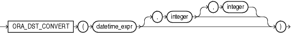

Syntax



> ```
> ORA_DST_CONVERT(datetime_expr [, integer [, integer ]])
> ```
  
  

Purpose

`ORA_DST_CONVERT` is useful when you are changing the time zone data file for your database. The function lets you specify error handling for a specified datetime expression.

- For `datetime_expr`, specify a datetime expression that resolves to a `TIMESTAMP` `WITH` `TIME` `ZONE` value or a `VARRAY` object that contains `TIMESTAMP` `WITH` `TIME` `ZONE` values.
- The optional second argument specifies handling of "duplicate time" errors. Specify `0` (false) to suppress the error by returning the source datetime value. This is the default. Specify `1` (true) to allow the database to return the duplicate time error.
- The optional third argument specifies handling of "nonexisting time" errors. Specify `0` (false) to suppress the error by returning the source datetime value. This is the default. Specify `1` (true) to allow the database to return the nonexisting time error.

If no error occurs, this function returns a value of the same data type as `datetime_expr` (a `TIMESTAMP` `WITH` `TIME` `ZONE` value or a `VARRAY` object that contains `TIMESTAMP` `WITH` `TIME` `ZONE` values). The returned datetime value when interpreted with the new time zone file corresponds to `datetime_expr` interpreted with the old time zone file.

This function can be issued only when changing the time zone data file of the database and upgrading the timestamp with the time zone data, and only between the execution of the `DBMS_DST`.`BEGIN_UPGRADE` and the `DBMS_DST`.`END_UPGRADE` procedures.

See Also:

[Oracle Database Globalization Support Guide](https://docs.oracle.com/cd/E11882_01/server.112/e10729/ch4datetime.htm#NLSPG259) for more information on time zone datafiles and on how Oracle Database handles daylight saving time, and [Oracle Database PL/SQL Packages and Types Reference](https://docs.oracle.com/cd/E11882_01/appdev.112/e40758/d_dst.htm#ARPLS234) for information on the `DBMS_DST` package