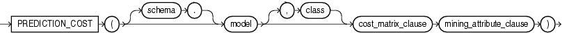
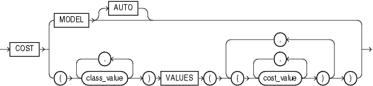

Syntax



> ```
> PREDICTION_COST ( [ schema . ] model [ , class ] cost_matrix_clause
>  mining_attribute_clause )
> ```
  
  

cost\_matrix\_clause::=



> ```
> COST
>   { MODEL [AUTO]
>   | ( class_value [, class_value]... )
>         VALUES ( ( cost_value [, cost_value]...) 
>                  [ , (cost_value [, cost_value]... ) ]...
>                )
>   }
> ```
  
  

mining\_attribute\_clause::=


> ```
> USING
> { * 
> | { [ schema . ] table . * 
>   | expr [ AS alias ]
>   }
>     [, { [ schema . ] table . * 
>        | expr [ AS alias ]
>        }
>     ]...
> }
> ```
  
  

Purpose

This function is for use with classification models created by the `DBMS_DATA_MINING` package or with Oracle Data Miner. It returns a measure of cost for a given prediction as an Oracle `NUMBER`.

If you specify the optional `class` parameter, then the function returns the cost for the specified class. If you omit the `class` parameter, then the function returns the cost associated with the best prediction. You can use this form in conjunction with the `PREDICTION` function to obtain the best pair of prediction value and cost.

The `COST` clause is relevant for all classification models.

- Specify `COST` `MODEL` to indicate that the scoring should be performed by taking into account the scoring cost matrix associated with the model. If no such scoring cost matrix exists, then the database returns an error.
- Specify `COST` `MODEL` `AUTO` if the existence of a cost matrix is unknown. In this case:
	- If the stored cost matrix exists, then the function returns the cost using the stored cost matrix.
		- If no stored cost matrix exists, then the function applies the unit cost matrix (0's on the diagonal and 1's everywhere else). This is equivalent to one minus probability for the given class.
- Use the `VALUES` clause (the bottom branch of the `cost_matrix_clause`) to specify an inline cost matrix. You can use an inline cost matrix regardless of whether the model has an associated scoring cost matrix. Refer to [Oracle Data Mining Application Developer's Guide](https://docs.oracle.com/cd/E11882_01/datamine.112/e12218/models_deploying.htm#DMPRG243) for an example of an inline cost matrix

The `mining_attribute_clause` behaves as described for the `PREDICTION` function. Refer to [mining\_attribute\_clause](functions132.md).

See Also:

- Oracle Data Mining Concepts for detailed information about [Oracle Data Mining](https://docs.oracle.com/cd/E11882_01/datamine.112/e16808/toc.htm) in general and about [costs](https://docs.oracle.com/cd/E11882_01/datamine.112/e16808/classify.htm#DMCON032) in particular
- [Oracle Data Mining Application Developer's Guide](https://docs.oracle.com/cd/E11882_01/datamine.112/e12218/models_deploying.htm#DMPRG004) for detailed information about scoring with the Data Mining SQL functions

Example

The following example finds the ten customers living in Italy who are least expensive to convince to use an affinity card.

This example and the prerequisite data mining operations can be found in the demo file `$ORACLE_HOME/rdbms/demo/dmdtdemo.sql`. General information on data mining demo files is available in [Oracle Data Mining Administrator's Guide](https://docs.oracle.com/cd/E11882_01/datamine.112/e16807/sampleprogs.htm#DMADM009). The example is presented here to illustrate the syntactic use of the function.

```
WITH
cust_italy AS (
SELECT cust_id
  FROM mining_data_apply_v
 WHERE country_name = 'Italy'
ORDER BY PREDICTION_COST(DT_SH_Clas_sample, 1 COST MODEL USING *) ASC, 1
)
SELECT cust_id
  FROM cust_italy
 WHERE rownum < 11;

   CUST_ID
----------
    100081
    100179
    100185
    100324
    100344
    100554
    100662
    100733
    101250
    101306
 
10 rows selected.
```